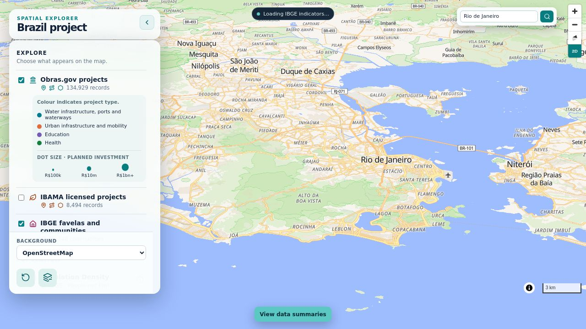

# Brazil Research Project

A research project exploring changes in population, housing, income, and access to basic services in Brazil, alongside infrastructure, environmental licensing, and land value. It combines national datasets with local exploration in Belo Horizonte and surrounding municipalities.

The project harmonises census tracts across 2010 and 2022 so that demographic and socioeconomic indicators can be compared over time. It also brings together IBAMA licensing records, Obrasgov infrastructure projects, and exploratory property-value data, producing maps, charts, and research reports.

[Website: interactive project data map](https://sandy-ivory-k65c.here.now/)

[Research methods and documentation](docs/index.md) · [Setup and workflow instructions](docs/technical/workflow.md)
