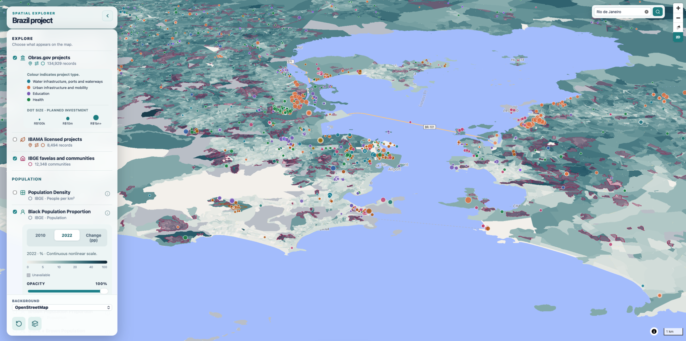

# Brazil Research Project

A research project exploring changes in population, housing, income, and access to basic services in Brazil, alongside infrastructure, environmental licensing, and land value. It combines national datasets with local exploration in Belo Horizonte and surrounding municipalities.

The project harmonises census tracts across 2010 and 2022 so that demographic and socioeconomic indicators can be compared over time. It also brings together IBAMA licensing records, Obrasgov infrastructure projects, and exploratory property-value data, producing maps, charts, and research reports.

**Find your work:** `research/` reports and presentations · `outputs/` maps, figures and tables · `data/` datasets and originals · `code/` processing and tests · `docs/` methods and progress · `website/` map source.

[Research methods and documentation](docs/index.md) · [Setup and workflow instructions](docs/workflow.md)

[Website: interactive project data map](https://sandy-ivory-k65c.here.now/)

## Where to find things

Start with the [research reports](research/README.md#read-the-reports) to read the analyses, tables and figures. Use [methods](docs/methods.md), [progress](docs/progress.md) and [remaining tasks](docs/tasks.md) to understand the decisions, current state and open questions.

| Folder | What it contains | Where to start |
| --- | --- | --- |
| **`research/`** | Readable Markdown reports in `reports/`; conference abstracts, posters and presentations in `cs2nordic/`. | [Report list](research/README.md#read-the-reports) |
| **`docs/`** | Methods, processing explanations, quality checks, decisions and project progress. | [Documentation index](docs/index.md) |
| **`outputs/`** | Generated figures, interactive maps, exported tables and municipality-specific report copies. | [Output guide](outputs/README.md) |
| **`data/`** | Source datasets, reference material, processing intermediates and preserved originals in `archive/`. | [Data guide](data/README.md) |
| **`code/`** | Reusable Python processing, pipeline tools, supporting R scripts and tests. | [Code guide](code/README.md) |
| **`website/`** | Source files for the interactive project map. | [Website guide](website/README.md) |

For example, read [Obrasgov preprocessing and location exclusions](research/reports/obrasgov_preprocessing.md) or [census harmonisation](research/reports/ibge_census_tract_harmonisation.md). The `.md` reports display directly on GitHub. Full datasets and generated outputs are kept locally; their folder guides explain where to find them.
