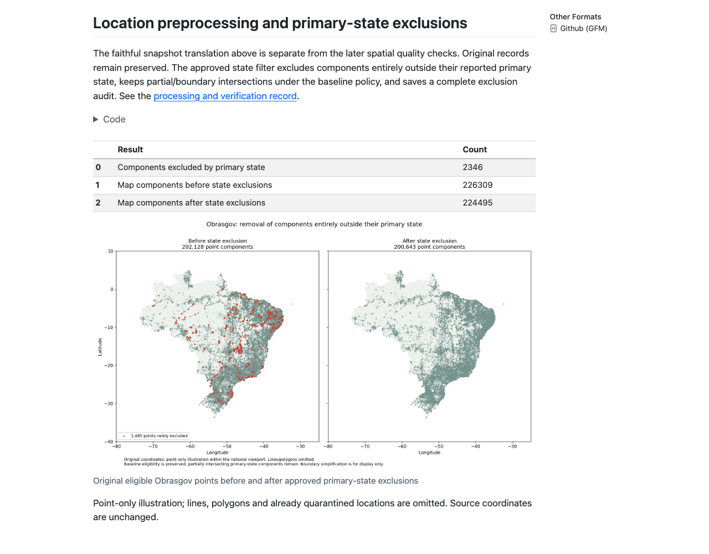

# Quarto Reports — Visual Editing and Readable Previews

Status: implemented; rendered outputs and static browser review verified
Last updated: 2026-10-06
Version: 0.1
Scope: Genuine executable Quarto sources, local HTML and GitHub Markdown views

## Edit History

| Date | Version | Edited by | Reason |
| --- | --- | --- | --- |
| 2026-10-06 | 0.1 | Codex | Restored visual editing, repaired report discovery and generated readable previews. |

The migration removed `editor: visual` from the original Quarto headers. The later folder move also introduced `research/research/notebooks/*.qmd` in the project render pattern. Both are corrected. The screenshot uses an older root `notebooks/` file/configuration path; the current sources live under `research/notebooks/` and use root `project.toml`.

The Quarto VS Code extension was absent; `quarto.quarto` 1.138.0 is now installed. The project recommends it in `.vscode/extensions.json`. Local workspace settings associate QMD files with `quarto.visualEditor`, select the local Quarto runtime and Python interpreter, and use an internal rendered preview. Those machine-specific settings remain outside Git. Open the current file using **Open With → Quarto Visual Editor**, or use **Quarto: Preview** for executed outputs. Visual editing formats the document; rendering executes its code to show tables/figures. See [Quarto visual editing](https://quarto.org/docs/tools/vscode/visual-editor.html).

GitHub reads Quarto source as source code; the supported readable output is [GitHub Markdown (GFM)](https://quarto.org/docs/output-formats/gfm.html). Each source now has a generated `.md` companion. [The research index](../research/README.md#read-the-reports) links to both views.

## Reproduce the previews

```bash
.venv/bin/python code/scripts/render_reports.py
# Refresh one report:
.venv/bin/python code/scripts/render_reports.py --only obrasgov_preprocessing
```

The script renders actual sources to HTML and GFM using the project Python environment and Quarto 1.9.38. HTML reports are under `outputs/reports/research/notebooks/`; Markdown previews are beside their sources, with small deduplicated PNG assets in `research/notebooks/assets/`. The original code/narratives are preserved; the Obrasgov report also shows the saved state-exclusion summary and before/after figure. Rendering reads local artifacts without acquisition or coordinate changes.

GitHub strips interactive JavaScript: map widgets are retained in local HTML reports and represented by an explanatory message in Markdown. Previews contain bounded table excerpts and reviewed figures, not complete datasets. CSS-only dataframe wrappers are removed; table values remain unchanged. Image bytes/checksums and source/output identities are recorded in `docs/evidence/report-previews.json`.

## Verification and script audit

- All 64 tests pass, including a render-pattern coverage test that catches the duplicated folder regression, restoration of visual/HTML/GFM headers, exact image-copy/table-value preservation and safe failure on missing images or interactive output.
- The exporter validates local PNG paths and size limits, rejects scripts/iframes and oversized output, and replaces Markdown only after successful validation. Failed exports preserve the previous preview; output fingerprints identify stale previews after later source edits.
- All nine sources rendered to HTML and GFM. Browser checks found no broken images; the four distinct PNGs were visually reviewed and copied byte-for-byte. The Obrasgov exclusion table shows 2,346 excluded and 224,495 eligible components. Interactive external maps were not retested.
- The audit caught multiline HTML image tags bypassing export and sequential format rendering deleting HTML figures. Both are fixed and covered by regression tests; the repaired renderer also passed a real chart-report refresh. GFM images are exported before HTML rendering replaces the temporary figure folder.
- Completion fingerprints are in [the evidence manifest](evidence/report-previews.json). Interrupted runs can be resumed by rerunning the command; concurrent refreshes are unsupported. A failed later render may leave earlier companions updated, but the completed manifest remains unchanged and exposes stale hashes.
- No research method is changed. A missing saved input appears as an explicit notice. Older file tabs should be reopened at their current paths rather than edited into a duplicate obsolete notebook tree.

## Reviewed output



Local HTML generated with the render command above; browser screenshot of the location section, with external requests blocked. It demonstrates readable saved counts and the figure, not independent geographic validation. Exact screenshot bytes, checksum and capture provenance are in the evidence manifest.
