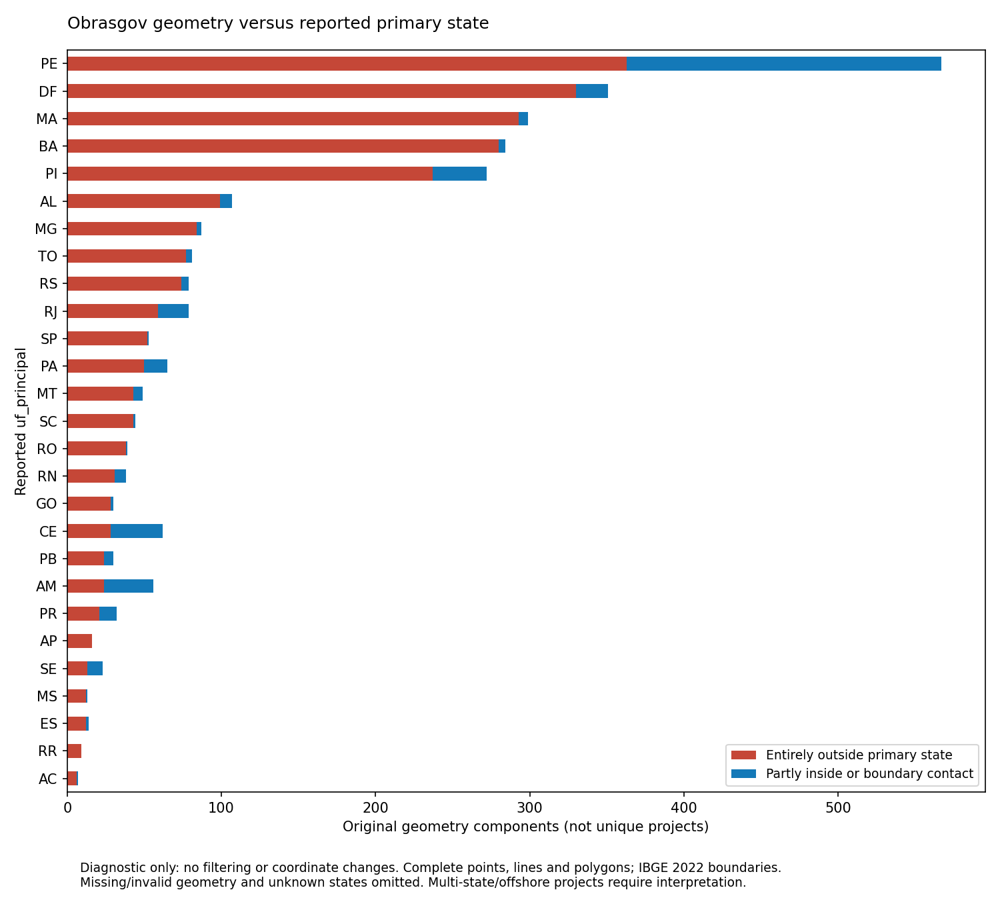

# Obrasgov Primary-State Check

Status: diagnostic complete; no filtering applied
Last updated: 2026-10-06
Version: 0.1
Scope: Complete original geometry containment against reported uf_principal

## Edit History

| Date | Version | Edited by | Reason |
| ---- | ------- | --------- | ------ |
| 2026-10-06 | 0.1 | Codex | Checked reported primary-state coverage without altering locations or eligibility. |

## Process and code output

Read all 230,356 original components from the checksum-verified location audit, including polygons and previously quarantined components. Dissolved the original-resolution IBGE 2022 municipalities by `SIGLA_UF`, preserving mapped islands. Tested each complete geometry against its reported `uf_principal`, rather than its centroid or sampled line path. No acquisition, coordinate changes, eligibility updates, filtering or public-map changes.

```bash
.venv/bin/python scripts/check_obras_primary_state.py --config config/project.toml
.venv/bin/python -m pytest tests/test_primary_state_check.py -q
```

| Result | Components | Distinct affected project IDs |
| --- | ---: | ---: |
| Fully inside primary state | 226,006 | 128,048 |
| Partly inside or boundary contact | 440 | 79 |
| Entirely outside primary state | 2,346 | 697 |
| Geometry cannot be assessed | 1,561 | 1,508 |
| Missing/unrecognized primary state | 3 | 3 |

A component is fully inside when the state **covers** its entire geometry, including boundary points. Otherwise, any intersection is recorded separately as partly inside or boundary contact. There is no buffer or inferred coordinate correction. Missing, empty, invalid, nonfinite and out-of-range geometries cannot be assessed. Categories partition components; source rows and project IDs can occur in multiple categories and must not be added together.

Of the 2,346 entirely outside components, **1,678 intersect another Brazilian state; 668 intersect no mapped state territory**. The latter includes offshore/border/foreign locations and is not an ocean-only count. Entirely outside components comprise 2,010 points, 329 lines and seven polygons. Partial/contact components comprise 375 lines and 65 polygons. Multi-state projects may legitimately extend beyond their primary state, and IBGE administrative boundaries do not define offshore project jurisdiction. These results flag inconsistencies for review, not proven errors.



**Figure output:** `outputs/figures/obrasgov-location-qa/primary-state-check.png`, generated by the command above. Counts refer to geometry components, not distinct projects; multiple locations and repeated source IDs remain intact. Unknown states and unassessable geometries are omitted. The exact documentation copy and input/output checksums are recorded in [evidence](obrasgov-primary-state-evidence.json).

[Complete component CSV](../../outputs/tables/obrasgov-primary-state/components.csv) · [State counts](../../outputs/tables/obrasgov-primary-state/by-state.csv) · [Geometry counts](../../outputs/tables/obrasgov-primary-state/by-geometry.csv)

## Final script audit

- Verified input provenance against the completed producer report, matching declared CRS, unique state keys and valid dissolved reference geometry. Input hashes are checked again after computation. The script reads originals and writes only separate diagnostic outputs.
- Exact `covers`/`intersects` predicates assess whole lines and polygons without sampling, simplification or centroid substitution. Boundary hits retain every candidate state; duplicate source project IDs remain separate.
- Two focused tests pass, covering points, crossing lines/polygons, shared boundaries, missing state, invalid/missing/out-of-range geometries, source preservation, CRS mismatch and duplicate reference keys. Two national executions produced identical diagnostic CSV hashes.
- Removed any prior completion summary before publishing outputs; the completed summary is atomically replaced last and records CSV/figure hashes. Concurrent runs are unsupported; after interruption rerun and require the completed summary plus matching output hashes.
- Remaining limits: exact source/reference boundary differences; historical projects checked against 2022 boundaries; primary state semantics for multi-state projects; and offshore jurisdiction. No methodological decision to exclude state mismatches has been made.
