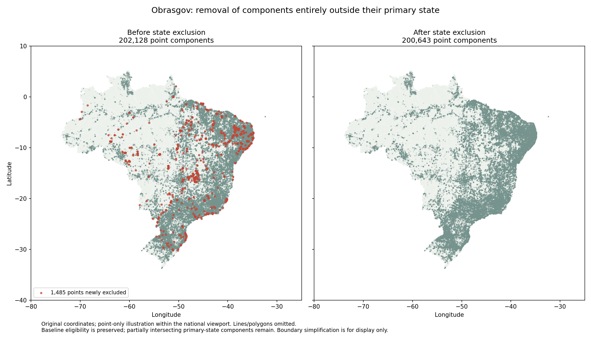

# Obrasgov Primary-State Exclusion — Process and Audit

Status: implemented, nationally executed and verified with documented limitations
Last updated: 2026-10-06
Version: 0.1
Scope: Researcher-approved exclusion of entirely outside primary-state geometry components

## Edit History

| Date | Version | Edited by | Reason |
| ---- | ------- | --------- | ------ |
| 2026-10-06 | 0.1 | Codex | Implemented explained, auditable state exclusions and before/after outputs. |

## Process and code output

The researcher approved removing the **2,346 components entirely outside their reported primary state**, including 1,678 intersecting another state and 668 intersecting no mapped state territory. This display decision is recorded separately in the [location policy](../methods/obrasgov-location-policy.md); it does not establish that all excluded source coordinates are wrong.

`scripts/filter_obras_primary_state.py` verifies the saved complete-geometry state check and original input checksums, joins by stable component IDs, records the exclusion reason and saves separate outputs. Explanatory `WHY`, `CONTRACT` and `INVARIANT` comments cover repeated project IDs, marine exclusions, preservation of previous quarantine decisions, publication recovery and exact geometry verification. The original source, initial diagnostic, baseline QA and research totals remain intact. No clipping or coordinate corrections.

```bash
.venv/bin/python scripts/check_obras_primary_state.py --config config/project.toml
.venv/bin/python scripts/filter_obras_primary_state.py --config config/project.toml
.venv/bin/python -m pytest tests/test_primary_state_filter.py tests/test_primary_state_check.py -q
```

| Recorded output | Components |
| --- | ---: |
| All original components | 230,356 |
| Entirely outside primary state — excluded | 2,346 |
| Remaining after state rule alone | 228,010 |
| Eligible map components before state rule | 226,309 |
| Newly excluded from eligible map | 1,814 |
| Already absent under baseline QA/polygon rule | 532 |
| Eligible map components after both rules | 224,495 |

The exclusion covers 784 source rows / 697 distinct project IDs and comprises 2,010 points, 329 lines and seven polygons. Other eligible locations from those projects remain; project IDs and component investment values are not consolidated or summed. Partly intersecting/boundary-contact components are not removed by the new state rule. Missing-state/unassessable components still follow their baseline eligibility decisions.



**Figure output:** `outputs/figures/obrasgov-location-qa/primary-state-filter.png`, generated by the filter script. Only original eligible point coordinates within the national viewport are illustrated; lines, polygons and already quarantined locations are omitted. Red indicates points newly excluded by the state rule. Boundary simplification affects this illustration only. The exact documentation copy is preserved with checksum in [verification evidence](obrasgov-primary-state-filter-evidence.json).

[Filtered map GeoPackage and exclusion layer](../../outputs/maps/obrasgov-primary-state-filter/locations.gpkg) · [Exclusion CSV](../../outputs/maps/obrasgov-primary-state-filter/exclusions.csv)

Saved GeoParquet files under `data/intermediate/obrasgov-primary-state-filter/` contain the complete component audit, all components remaining after the state rule, all excluded components and final eligible map components. The GeoPackage layers are `map_components` and `excluded_primary_state`; original attributes and component geometries accompany the decision fields. Require a completed `report.json` with matching output hashes before consuming these artifacts. The public map has not yet been rebuilt or published from this derivative.

## Final script audit

- **Correctness/provenance:** completed producer manifests, diagnostic CSV hashes, source/reference hashes and checker code identity are required. Stable component IDs prevent repeated project IDs from multiplying or dropping locations. Inputs are fingerprinted again after execution.
- **Verified outputs:** all 2,346 exclusions accounted for; retained/excluded components form a complete disjoint partition. All original component attributes and WKB are unchanged. Final map components include only baseline-eligible points/lines with no entirely-outside components. Both GeoPackage layers preserve exact component IDs, CRS and WKB.
- **Tests/repeatability:** seven focused state-check/filter tests and all 58 project tests pass. Tests cover partial/shared-boundary behavior, missing state, preservation of other project locations and quarantine, incomplete/duplicate/unknown classifications, and tampered/incomplete producer rejection. Two national executions yield four identical GeoParquet hashes. The figure was visually inspected and copied exactly into documentation.
- **Recovery:** individual Parquet/GeoPackage files and the final completion report are published by replacement; the old report is removed before writes. CSV/figure publication is not transactional. After interruption rerun and require a completed report with matching artifact hashes. Concurrent runs are unsupported.
- **Remaining scientific limits:** multi-state project semantics, administrative/offshore boundary differences and historical projects assessed against 2022 geography. The approved state filter applies even when a marine description is present. No geocoding correction or scientific certification is implied.
