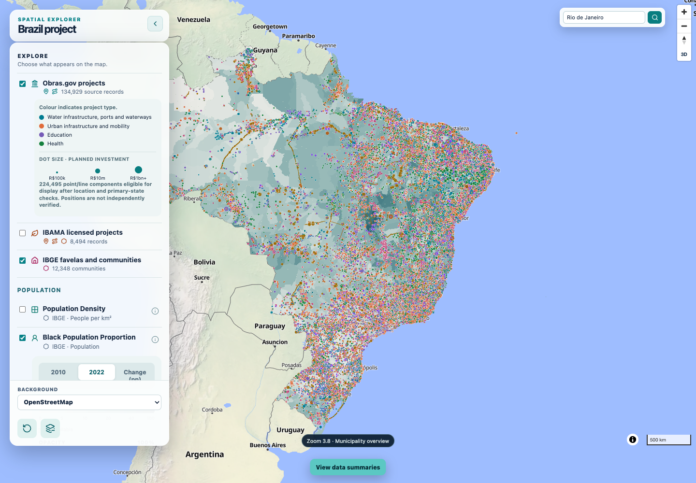

# Obrasgov Website Location Update

Status: published; local and live verification passed
Last updated: 2026-10-07
Version: 0.1
Scope: Existing here.now map adopts the approved Obrasgov location derivative

The website export reads the completed national pipeline's `obrasgov-primary-state-filter/map_components.parquet`. It checks producer provenance, the saved exclusion policy, source/output hashes, component IDs and eligibility. Source records and coordinates remain preserved in research data. The census tile contract and every indicator checksum already match current processing outputs, so those archives are reused.

## Processing and outputs

```bash
.venv/bin/python code/scripts/build_obras_web_map.py --config project.toml
```

The export contains 224,495 point/line components: 200,643 points and 23,852 lines from 131,554 source rows. The approved state rule removes 1,814 additional eligible components; 2,346 components are entirely outside their primary state in the full audit. All Obrasgov polygons remain excluded. There are 392 retained components requiring administrative or coordinate review; eligibility does not establish verified geocoding.

The prepared GeoPackage exchange is checked against original component identifiers, attributes, CRS and geometry WKB before tile generation. The ten project fields match the previous public tile schema; additional raw fields are kept out of the site. Only the tile archive, compact location manifest and updated website source-record display counts are public. Full QA tables, raw source files and the work GeoPackage stay outside the publication directory.

The new archive has a source-hash-derived filename. Browser modules have a new cache revision and load that filename through `data/obras-location.json`. Existing type frequencies, timeline and source-record totals remain independent of geographic exclusions. Popups distinguish retained review flags; overlapping components have separate identities. Tile projection, clipping and quantisation affect display geometry only. Full-resolution tile identity verification finds 224,457 unique components, no unexpected IDs and all 200,643 points. The 38 missing components are lines only 0.025–0.906 metres long in Web Mercator; they collapse within the zoom-13 tile grid (about 1.19 metres per coordinate unit at the equator). All remain in research outputs and the prepared eligibility count; this is display quantisation, not a new analytical exclusion. [GDAL documents the tile extent and size rules](https://gdal.org/en/stable/drivers/vector/mvt.html#dataset-creation-options).

## Script audit and verification

- Reject national/municipality scope mismatches, stale producer outputs, repeated component IDs, polygons and excluded/ineligible rows before exporting.
- Check original public attributes and exact geometry through the GeoPackage boundary; check input fingerprints again after tile generation.
- Verified the `projects_st` MVT layer at zooms 0–13, all point IDs and the documented sub-metre line limitation. Local overview/mid/detail rendering, summaries, search, popups, review wording, basemap transitions and mobile controls pass with zero page errors or failed HTTP responses. All 92 tests pass. Live anonymous Chromium checks also pass with zero page errors or failed HTTP responses; the live location manifest matches the local export exactly. All 122 published hashes match the reviewed directory. A separate plain urllib asset probe returned 403; browser access succeeds.
- Verified 115 unchanged published file hashes, including census, IBAMA, community and timeline assets. The census contract and all indicator hashes match current processing.
- Preserve the previous Obrasgov archive under `data/archive/`; remove it from the active publication directory after the replacement passes checks.

No acquisition, coordinate corrections or methodological changes are introduced. Publishing this display derivative does not certify source geocoding or independent scientific validation. Build, archive identities and live checks are recorded in [machine-readable evidence](evidence/website-location-update.json).

## Reviewed code output



Generated by the local Chromium capture after the export command above, with the map fully loaded. The view shows screened points/lines over the unchanged census overview; visible markers are not a population or investment total. Small legitimate islands and retained review cases can still appear offshore. Screenshot bytes are preserved under `outputs/figures/website-location-update/national.png` and the documentation asset; SHA-256: `87d2e57e7e78b2d787fafb667cca8d32158940cfe80fadf7e51c0aec1d388742`.

## Publication

The existing [here.now map](https://sandy-ivory-k65c.here.now/) is updated permanently in the saved account. Published version: `01M4ANCFJRBKP011HTFEBDX2A7`. The deployment uploaded seven changed/new files and reused 115 unchanged files. The previous Obrasgov archive is preserved under `data/archive/website-obras-before-screening-20261007.pmtiles`.
