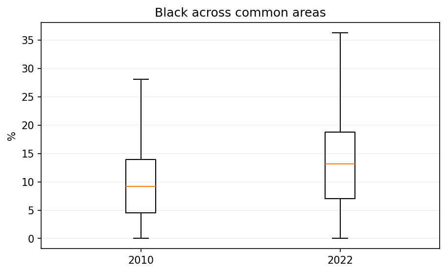
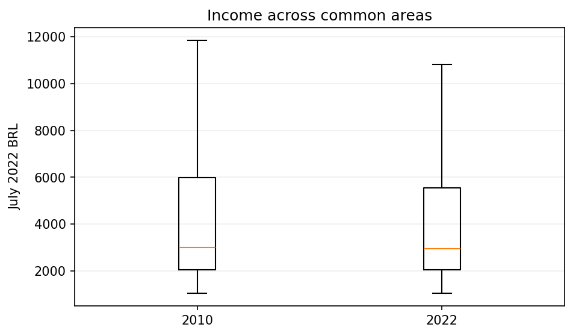
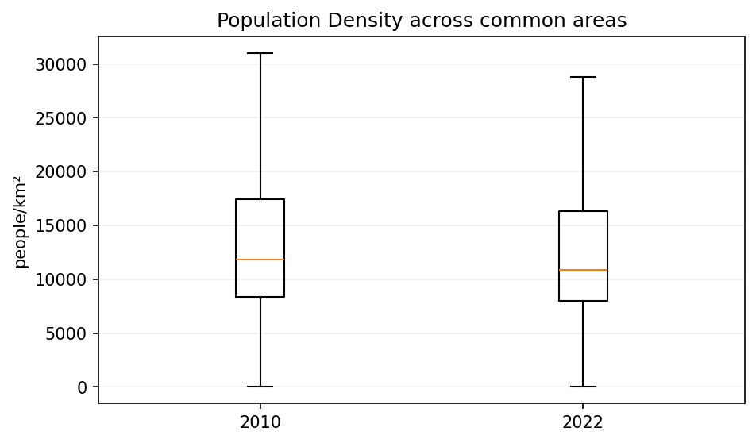

# Census indicators: 2010–2022 comparison

Compare demographic, household-service, housing, income and density indicators on connected common areas. Each spatial output contains one merged 2022 feature per common_id.

[Variable and dataset codebook](../../../docs/codebook.md) · [Methods](../../../docs/methods.md) · [All reports](../../../research/README.md#read-the-reports)

Refresh processing and this report with `brazil-project report ibge_census_temporal_comparison --config project.toml`. Add `--from-saved` to refresh existing verified artifacts only. Code is collapsed; tables and figures below are saved execution results.

## How to read this analysis

Counts are aggregated before ratios are calculated. Annual tables are outer joined: an absent year stays unavailable, never zero. Most count sums skip missing entries; specified combined components are coalesced to zero. Housing denominators and population-density totals stay missing if every contributing value is missing. Proportion calculations require positive denominators. Incomplete counts can bias ratios even when an estimate is available.

Annual ratio columns are fractions (0.10 = 10%). Percentage-point change is 100 × (2022 ratio − 2010 ratio); a change from 10% to 15% is +5 pp. It is not a 5% relative increase. Income and density use their own units and change rules. See the [variable codebook](../../../docs/codebook.md) for every numerator, denominator, source code and exception.

## Inputs, coverage and processing status

Coverage is counted from final saved change columns. The original income missingness counter was recorded before those columns existed and is retained only in collapsed legacy metadata; it does not describe final income coverage. Technical fingerprints remain in run evidence.

<details>
<summary>Read saved processing summary</summary>

<!-- brazil:cell ibge_census_temporal_comparison_1 -->
```python
import matplotlib
matplotlib.use("Agg")  # Headless figures in the fresh report process.
import json
import pandas as pd
from brazil_project.reporting import show_chunk, table, markdown
processing_record = report_json("indicators")
coverage_rows = []
for name, metadata in processing_record.items():
    if not isinstance(metadata, dict) or "common_areas" not in metadata:
        continue
    change_column = ("income_change_brl" if name == "income" else
                     "population_density_change" if name == "population_density" else
                     name + "_ratio_change_pp")
    changes = pd.read_parquet(ctx.require(ctx.artifact("indicators", name + ".parquet")), columns=[change_column])
    if len(changes) != metadata["common_areas"]:
        raise RuntimeError("Coverage differs from processing record: " + name)
    coverage_rows.append({"Indicator": name.replace("_", " ").title(),
                          "Common areas": len(changes),
                          "Unavailable change": int(changes[change_column].isna().sum())})
table(pd.DataFrame(coverage_rows), "Availability is calculated from the final saved change columns, including income and density.")
markdown("<details>\n<summary>Original processing metadata (legacy income missingness counter is not final coverage)</summary>\n\n```json\n" + json.dumps(processing_record, indent=2) + "\n```\n\n</details>")
ctx._report_presented = {("indicators", "report")}
```

</details>

<!-- brazil:output ibge_census_temporal_comparison_1 begin -->
Availability is calculated from the final saved change columns, including income and density.

<table border="1" class="dataframe">
  <thead>
    <tr style="text-align: right;">
      <th>Indicator</th>
      <th>Common areas</th>
      <th>Unavailable change</th>
    </tr>
  </thead>
  <tbody>
    <tr>
      <td>Black</td>
      <td>3790</td>
      <td>19</td>
    </tr>
    <tr>
      <td>Brown</td>
      <td>3790</td>
      <td>19</td>
    </tr>
    <tr>
      <td>Black Brown</td>
      <td>3790</td>
      <td>19</td>
    </tr>
    <tr>
      <td>Literacy</td>
      <td>3780</td>
      <td>48</td>
    </tr>
    <tr>
      <td>Rudimentary Sanitation</td>
      <td>3780</td>
      <td>26</td>
    </tr>
    <tr>
      <td>Water Network</td>
      <td>3780</td>
      <td>26</td>
    </tr>
    <tr>
      <td>Waste Collection</td>
      <td>3780</td>
      <td>26</td>
    </tr>
    <tr>
      <td>Sewer Septic</td>
      <td>3780</td>
      <td>26</td>
    </tr>
    <tr>
      <td>Houses</td>
      <td>3790</td>
      <td>36</td>
    </tr>
    <tr>
      <td>Village Condo</td>
      <td>3790</td>
      <td>36</td>
    </tr>
    <tr>
      <td>Apartments</td>
      <td>3790</td>
      <td>36</td>
    </tr>
    <tr>
      <td>Income</td>
      <td>3790</td>
      <td>58</td>
    </tr>
    <tr>
      <td>Population Density</td>
      <td>3790</td>
      <td>16</td>
    </tr>
  </tbody>
</table>

<details>
<summary>Original processing metadata (legacy income missingness counter is not final coverage)</summary>

```json
{
  "harmonisation_version": "fd7b309fbb21fda5f5188df22ec3c1813c89d517ee2b7683b3a0923e7c833385",
  "spatial_unit": "common_id",
  "black": {
    "common_areas": 3790,
    "missing_change": 19
  },
  "brown": {
    "common_areas": 3790,
    "missing_change": 19
  },
  "black_brown": {
    "common_areas": 3790,
    "missing_change": 19
  },
  "literacy": {
    "common_areas": 3780,
    "missing_change": 48
  },
  "rudimentary_sanitation": {
    "common_areas": 3780,
    "missing_change": 26
  },
  "water_network": {
    "common_areas": 3780,
    "missing_change": 26
  },
  "waste_collection": {
    "common_areas": 3780,
    "missing_change": 26
  },
  "sewer_septic": {
    "common_areas": 3780,
    "missing_change": 26
  },
  "houses": {
    "common_areas": 3790,
    "missing_change": 36
  },
  "village_condo": {
    "common_areas": 3790,
    "missing_change": 36
  },
  "apartments": {
    "common_areas": 3790,
    "missing_change": 36
  },
  "income": {
    "common_areas": 3790,
    "missing_change": 0
  },
  "population_density": {
    "common_areas": 3790
  },
  "generated_at": "2026-10-07T08:23:56.821584+00:00"
}
```

</details>
<!-- brazil:output ibge_census_temporal_comparison_1 end -->

<details>
<summary>Trace original step: Data Import</summary>

<!-- brazil:cell ibge_census_temporal_comparison_2 -->
```python
#| label: ibge_census_temporal_comparison_2
show_chunk(ctx, 'Scripts_Data/IBGE/IBGE Census - Temporal Comparison.qmd', 2)
```

</details>

<!-- brazil:output ibge_census_temporal_comparison_2 begin -->
<!-- Saved result already presented; original cell retained for traceability. -->
<!-- brazil:output ibge_census_temporal_comparison_2 end -->

<details>
<summary>Trace original step: Check Join Keys</summary>

<!-- brazil:cell ibge_census_temporal_comparison_3 -->
```python
#| label: ibge_census_temporal_comparison_3
show_chunk(ctx, 'Scripts_Data/IBGE/IBGE Census - Temporal Comparison.qmd', 3)
```

</details>

<!-- brazil:output ibge_census_temporal_comparison_3 begin -->
<!-- Saved result already presented; original cell retained for traceability. -->
<!-- brazil:output ibge_census_temporal_comparison_3 end -->

## Black population share

Black count / total population, aggregated within each common area.

<details>
<summary>Read black population share</summary>

<!-- brazil:cell ibge_census_temporal_comparison_4 -->
```python
#| label: ibge_census_temporal_comparison_4
show_chunk(ctx, 'Scripts_Data/IBGE/IBGE Census - Temporal Comparison.qmd', 4)
```

</details>

<!-- brazil:output ibge_census_temporal_comparison_4 begin -->
Unweighted distribution across common areas. These are not national population-weighted estimates.

<table border="1" class="dataframe">
  <thead>
    <tr style="text-align: right;">
      <th>Year</th>
      <th>Unit</th>
      <th>Available areas</th>
      <th>Unavailable areas</th>
      <th>Median across areas</th>
      <th>25th percentile</th>
      <th>75th percentile</th>
    </tr>
  </thead>
  <tbody>
    <tr>
      <td>2010</td>
      <td>%</td>
      <td>3774</td>
      <td>16</td>
      <td>9.2283</td>
      <td>4.4944</td>
      <td>13.9730</td>
    </tr>
    <tr>
      <td>2022</td>
      <td>%</td>
      <td>3777</td>
      <td>13</td>
      <td>13.1631</td>
      <td>7.0053</td>
      <td>18.7500</td>
    </tr>
  </tbody>
</table>

First five saved common areas (a data preview, not a representative sample). Annual ratios in this preview are fractions; change is percentage points for proportion indicators.

<table border="1" class="dataframe">
  <thead>
    <tr style="text-align: right;">
      <th>common_id</th>
      <th>black_ratio_2010</th>
      <th>black_ratio_2022</th>
      <th>black_ratio_change_pp</th>
    </tr>
  </thead>
  <tbody>
    <tr>
      <td>95334</td>
      <td>0.0117</td>
      <td>0.0300</td>
      <td>1.8237</td>
    </tr>
    <tr>
      <td>95335</td>
      <td>0.0153</td>
      <td>0.0153</td>
      <td>-0.0074</td>
    </tr>
    <tr>
      <td>95336</td>
      <td>0.0185</td>
      <td>0.0262</td>
      <td>0.7670</td>
    </tr>
    <tr>
      <td>95337</td>
      <td>0.0147</td>
      <td>0.0221</td>
      <td>0.7354</td>
    </tr>
    <tr>
      <td>95338</td>
      <td>0.0292</td>
      <td>0.0000</td>
      <td>-2.9181</td>
    </tr>
  </tbody>
</table>



Median and middle 50% of available common-area estimates; whiskers follow 1.5×IQR. Outliers are hidden in the figure and retained in the data. Annual availability can differ; this is descriptive, not a paired causal comparison.
<!-- brazil:output ibge_census_temporal_comparison_4 end -->

## Literacy among people aged 15+

Literate population aged 15+ / population aged 15+. The 2022 Pessoas table supplies its own denominator independently of the Basico join.

<details>
<summary>Read literacy among people aged 15+</summary>

<!-- brazil:cell ibge_census_temporal_comparison_5 -->
```python
#| label: ibge_census_temporal_comparison_5
show_chunk(ctx, 'Scripts_Data/IBGE/IBGE Census - Temporal Comparison.qmd', 5)
```

</details>

<!-- brazil:output ibge_census_temporal_comparison_5 begin -->
Unweighted distribution across common areas. These are not national population-weighted estimates.

<table border="1" class="dataframe">
  <thead>
    <tr style="text-align: right;">
      <th>Year</th>
      <th>Unit</th>
      <th>Available areas</th>
      <th>Unavailable areas</th>
      <th>Median across areas</th>
      <th>25th percentile</th>
      <th>75th percentile</th>
    </tr>
  </thead>
  <tbody>
    <tr>
      <td>2010</td>
      <td>%</td>
      <td>3740</td>
      <td>40</td>
      <td>98.0487</td>
      <td>95.7962</td>
      <td>99.3026</td>
    </tr>
    <tr>
      <td>2022</td>
      <td>%</td>
      <td>3761</td>
      <td>19</td>
      <td>98.4520</td>
      <td>96.6346</td>
      <td>99.4550</td>
    </tr>
  </tbody>
</table>

First five saved common areas (a data preview, not a representative sample). Annual ratios in this preview are fractions; change is percentage points for proportion indicators.

<table border="1" class="dataframe">
  <thead>
    <tr style="text-align: right;">
      <th>common_id</th>
      <th>literacy_ratio_2010</th>
      <th>literacy_ratio_2022</th>
      <th>literacy_ratio_change_pp</th>
    </tr>
  </thead>
  <tbody>
    <tr>
      <td>95334</td>
      <td>1.0000</td>
      <td>0.9977</td>
      <td>-0.2331</td>
    </tr>
    <tr>
      <td>95335</td>
      <td>0.9979</td>
      <td>1.0000</td>
      <td>0.2053</td>
    </tr>
    <tr>
      <td>95336</td>
      <td>0.9948</td>
      <td>0.9934</td>
      <td>-0.1371</td>
    </tr>
    <tr>
      <td>95337</td>
      <td>0.9835</td>
      <td>0.9942</td>
      <td>1.0697</td>
    </tr>
    <tr>
      <td>95338</td>
      <td>0.9951</td>
      <td>0.9906</td>
      <td>-0.4562</td>
    </tr>
  </tbody>
</table>
<!-- brazil:output ibge_census_temporal_comparison_5 end -->

## Rudimentary sanitation

Selected rudimentary pit, ditch and water-body disposal counts / the original household denominator. This excludes the additional no-bathroom categories used in conference charts.

<details>
<summary>Read rudimentary sanitation</summary>

<!-- brazil:cell ibge_census_temporal_comparison_6 -->
```python
#| label: ibge_census_temporal_comparison_6
show_chunk(ctx, 'Scripts_Data/IBGE/IBGE Census - Temporal Comparison.qmd', 6)
```

</details>

<!-- brazil:output ibge_census_temporal_comparison_6 begin -->
Unweighted distribution across common areas. These are not national population-weighted estimates.

<table border="1" class="dataframe">
  <thead>
    <tr style="text-align: right;">
      <th>Year</th>
      <th>Unit</th>
      <th>Available areas</th>
      <th>Unavailable areas</th>
      <th>Median across areas</th>
      <th>25th percentile</th>
      <th>75th percentile</th>
    </tr>
  </thead>
  <tbody>
    <tr>
      <td>2010</td>
      <td>%</td>
      <td>3768</td>
      <td>12</td>
      <td>0.0000</td>
      <td>0.0000</td>
      <td>0.5694</td>
    </tr>
    <tr>
      <td>2022</td>
      <td>%</td>
      <td>3761</td>
      <td>19</td>
      <td>0.0000</td>
      <td>0.0000</td>
      <td>0.0000</td>
    </tr>
  </tbody>
</table>

First five saved common areas (a data preview, not a representative sample). Annual ratios in this preview are fractions; change is percentage points for proportion indicators.

<table border="1" class="dataframe">
  <thead>
    <tr style="text-align: right;">
      <th>common_id</th>
      <th>rudimentary_sanitation_ratio_2010</th>
      <th>rudimentary_sanitation_ratio_2022</th>
      <th>rudimentary_sanitation_ratio_change_pp</th>
    </tr>
  </thead>
  <tbody>
    <tr>
      <td>95334</td>
      <td>0.0000</td>
      <td>0.0000</td>
      <td>0.0000</td>
    </tr>
    <tr>
      <td>95335</td>
      <td>0.0000</td>
      <td>0.0000</td>
      <td>0.0000</td>
    </tr>
    <tr>
      <td>95336</td>
      <td>0.0000</td>
      <td>0.0000</td>
      <td>0.0000</td>
    </tr>
    <tr>
      <td>95337</td>
      <td>0.0000</td>
      <td>0.0000</td>
      <td>0.0000</td>
    </tr>
    <tr>
      <td>95338</td>
      <td>0.0000</td>
      <td>0.0000</td>
      <td>0.0000</td>
    </tr>
  </tbody>
</table>
<!-- brazil:output ibge_census_temporal_comparison_6 end -->

## Water-network access

Water-network household counts / the original household denominator.

<details>
<summary>Read water-network access</summary>

<!-- brazil:cell ibge_census_temporal_comparison_7 -->
```python
#| label: ibge_census_temporal_comparison_7
show_chunk(ctx, 'Scripts_Data/IBGE/IBGE Census - Temporal Comparison.qmd', 7)
```

</details>

<!-- brazil:output ibge_census_temporal_comparison_7 begin -->
Unweighted distribution across common areas. These are not national population-weighted estimates.

<table border="1" class="dataframe">
  <thead>
    <tr style="text-align: right;">
      <th>Year</th>
      <th>Unit</th>
      <th>Available areas</th>
      <th>Unavailable areas</th>
      <th>Median across areas</th>
      <th>25th percentile</th>
      <th>75th percentile</th>
    </tr>
  </thead>
  <tbody>
    <tr>
      <td>2010</td>
      <td>%</td>
      <td>3768</td>
      <td>12</td>
      <td>100.0000</td>
      <td>100.0000</td>
      <td>100.0000</td>
    </tr>
    <tr>
      <td>2022</td>
      <td>%</td>
      <td>3761</td>
      <td>19</td>
      <td>100.0000</td>
      <td>100.0000</td>
      <td>100.0000</td>
    </tr>
  </tbody>
</table>

First five saved common areas (a data preview, not a representative sample). Annual ratios in this preview are fractions; change is percentage points for proportion indicators.

<table border="1" class="dataframe">
  <thead>
    <tr style="text-align: right;">
      <th>common_id</th>
      <th>water_network_ratio_2010</th>
      <th>water_network_ratio_2022</th>
      <th>water_network_ratio_change_pp</th>
    </tr>
  </thead>
  <tbody>
    <tr>
      <td>95334</td>
      <td>1.0000</td>
      <td>1.0000</td>
      <td>0.0000</td>
    </tr>
    <tr>
      <td>95335</td>
      <td>1.0000</td>
      <td>0.9815</td>
      <td>-1.8462</td>
    </tr>
    <tr>
      <td>95336</td>
      <td>1.0000</td>
      <td>0.9336</td>
      <td>-6.6362</td>
    </tr>
    <tr>
      <td>95337</td>
      <td>0.9966</td>
      <td>1.0000</td>
      <td>0.3390</td>
    </tr>
    <tr>
      <td>95338</td>
      <td>1.0000</td>
      <td>0.9966</td>
      <td>-0.3378</td>
    </tr>
  </tbody>
</table>
<!-- brazil:output ibge_census_temporal_comparison_7 end -->

## Waste collection

Selected collection categories / the original household denominator. The combined 2022 components retain the original missing-component rule.

<details>
<summary>Read waste collection</summary>

<!-- brazil:cell ibge_census_temporal_comparison_8 -->
```python
#| label: ibge_census_temporal_comparison_8
show_chunk(ctx, 'Scripts_Data/IBGE/IBGE Census - Temporal Comparison.qmd', 8)
```

</details>

<!-- brazil:output ibge_census_temporal_comparison_8 begin -->
Unweighted distribution across common areas. These are not national population-weighted estimates.

<table border="1" class="dataframe">
  <thead>
    <tr style="text-align: right;">
      <th>Year</th>
      <th>Unit</th>
      <th>Available areas</th>
      <th>Unavailable areas</th>
      <th>Median across areas</th>
      <th>25th percentile</th>
      <th>75th percentile</th>
    </tr>
  </thead>
  <tbody>
    <tr>
      <td>2010</td>
      <td>%</td>
      <td>3768</td>
      <td>12</td>
      <td>100.0000</td>
      <td>100.0000</td>
      <td>100.0000</td>
    </tr>
    <tr>
      <td>2022</td>
      <td>%</td>
      <td>3761</td>
      <td>19</td>
      <td>100.0000</td>
      <td>99.7340</td>
      <td>100.0000</td>
    </tr>
  </tbody>
</table>

First five saved common areas (a data preview, not a representative sample). Annual ratios in this preview are fractions; change is percentage points for proportion indicators.

<table border="1" class="dataframe">
  <thead>
    <tr style="text-align: right;">
      <th>common_id</th>
      <th>waste_collection_ratio_2010</th>
      <th>waste_collection_ratio_2022</th>
      <th>waste_collection_ratio_change_pp</th>
    </tr>
  </thead>
  <tbody>
    <tr>
      <td>95334</td>
      <td>1.0000</td>
      <td>1.0000</td>
      <td>0.0000</td>
    </tr>
    <tr>
      <td>95335</td>
      <td>0.9947</td>
      <td>0.9969</td>
      <td>0.2214</td>
    </tr>
    <tr>
      <td>95336</td>
      <td>1.0000</td>
      <td>0.9977</td>
      <td>-0.2288</td>
    </tr>
    <tr>
      <td>95337</td>
      <td>1.0000</td>
      <td>0.9968</td>
      <td>-0.3155</td>
    </tr>
    <tr>
      <td>95338</td>
      <td>1.0000</td>
      <td>1.0000</td>
      <td>0.0000</td>
    </tr>
  </tbody>
</table>
<!-- brazil:output ibge_census_temporal_comparison_8 end -->

## Sewer or septic disposal

Selected sewer/septic disposal categories / the original household denominator. Categories follow the year-specific codes in the codebook.

<details>
<summary>Read sewer or septic disposal</summary>

<!-- brazil:cell ibge_census_temporal_comparison_9 -->
```python
#| label: ibge_census_temporal_comparison_9
show_chunk(ctx, 'Scripts_Data/IBGE/IBGE Census - Temporal Comparison.qmd', 9)
```

</details>

<!-- brazil:output ibge_census_temporal_comparison_9 begin -->
Unweighted distribution across common areas. These are not national population-weighted estimates.

<table border="1" class="dataframe">
  <thead>
    <tr style="text-align: right;">
      <th>Year</th>
      <th>Unit</th>
      <th>Available areas</th>
      <th>Unavailable areas</th>
      <th>Median across areas</th>
      <th>25th percentile</th>
      <th>75th percentile</th>
    </tr>
  </thead>
  <tbody>
    <tr>
      <td>2010</td>
      <td>%</td>
      <td>3768</td>
      <td>12</td>
      <td>100.0000</td>
      <td>98.7587</td>
      <td>100.0000</td>
    </tr>
    <tr>
      <td>2022</td>
      <td>%</td>
      <td>3761</td>
      <td>19</td>
      <td>100.0000</td>
      <td>99.4334</td>
      <td>100.0000</td>
    </tr>
  </tbody>
</table>

First five saved common areas (a data preview, not a representative sample). Annual ratios in this preview are fractions; change is percentage points for proportion indicators.

<table border="1" class="dataframe">
  <thead>
    <tr style="text-align: right;">
      <th>common_id</th>
      <th>sewer_septic_ratio_2010</th>
      <th>sewer_septic_ratio_2022</th>
      <th>sewer_septic_ratio_change_pp</th>
    </tr>
  </thead>
  <tbody>
    <tr>
      <td>95334</td>
      <td>1.0000</td>
      <td>1.0000</td>
      <td>0.0000</td>
    </tr>
    <tr>
      <td>95335</td>
      <td>1.0000</td>
      <td>1.0000</td>
      <td>0.0000</td>
    </tr>
    <tr>
      <td>95336</td>
      <td>1.0000</td>
      <td>1.0000</td>
      <td>0.0000</td>
    </tr>
    <tr>
      <td>95337</td>
      <td>1.0000</td>
      <td>0.9968</td>
      <td>-0.3155</td>
    </tr>
    <tr>
      <td>95338</td>
      <td>1.0000</td>
      <td>1.0000</td>
      <td>0.0000</td>
    </tr>
  </tbody>
</table>
<!-- brazil:output ibge_census_temporal_comparison_9 end -->

## Brown population share

Brown count / total population. This retains the census category as supplied.

<details>
<summary>Read brown population share</summary>

<!-- brazil:cell ibge_census_temporal_comparison_10 -->
```python
#| label: ibge_census_temporal_comparison_10
show_chunk(ctx, 'Scripts_Data/IBGE/IBGE Census - Temporal Comparison.qmd', 10)
```

</details>

<!-- brazil:output ibge_census_temporal_comparison_10 begin -->
Unweighted distribution across common areas. These are not national population-weighted estimates.

<table border="1" class="dataframe">
  <thead>
    <tr style="text-align: right;">
      <th>Year</th>
      <th>Unit</th>
      <th>Available areas</th>
      <th>Unavailable areas</th>
      <th>Median across areas</th>
      <th>25th percentile</th>
      <th>75th percentile</th>
    </tr>
  </thead>
  <tbody>
    <tr>
      <td>2010</td>
      <td>%</td>
      <td>3774</td>
      <td>16</td>
      <td>44.9272</td>
      <td>29.7896</td>
      <td>53.3888</td>
    </tr>
    <tr>
      <td>2022</td>
      <td>%</td>
      <td>3777</td>
      <td>13</td>
      <td>45.5724</td>
      <td>32.8784</td>
      <td>52.5661</td>
    </tr>
  </tbody>
</table>

First five saved common areas (a data preview, not a representative sample). Annual ratios in this preview are fractions; change is percentage points for proportion indicators.

<table border="1" class="dataframe">
  <thead>
    <tr style="text-align: right;">
      <th>common_id</th>
      <th>brown_ratio_2010</th>
      <th>brown_ratio_2022</th>
      <th>brown_ratio_change_pp</th>
    </tr>
  </thead>
  <tbody>
    <tr>
      <td>95334</td>
      <td>0.1057</td>
      <td>0.1178</td>
      <td>1.2098</td>
    </tr>
    <tr>
      <td>95335</td>
      <td>0.0886</td>
      <td>0.1174</td>
      <td>2.8785</td>
    </tr>
    <tr>
      <td>95336</td>
      <td>0.1406</td>
      <td>0.1517</td>
      <td>1.1036</td>
    </tr>
    <tr>
      <td>95337</td>
      <td>0.0847</td>
      <td>0.1364</td>
      <td>5.1701</td>
    </tr>
    <tr>
      <td>95338</td>
      <td>0.0909</td>
      <td>0.1020</td>
      <td>1.1074</td>
    </tr>
  </tbody>
</table>
<!-- brazil:output ibge_census_temporal_comparison_10 end -->

## Combined Black/Brown population share

Sum of Black and Brown counts / total population; missing component counts are coalesced to zero.

<details>
<summary>Read combined black/brown population share</summary>

<!-- brazil:cell ibge_census_temporal_comparison_11 -->
```python
#| label: ibge_census_temporal_comparison_11
show_chunk(ctx, 'Scripts_Data/IBGE/IBGE Census - Temporal Comparison.qmd', 11)
```

</details>

<!-- brazil:output ibge_census_temporal_comparison_11 begin -->
Unweighted distribution across common areas. These are not national population-weighted estimates.

<table border="1" class="dataframe">
  <thead>
    <tr style="text-align: right;">
      <th>Year</th>
      <th>Unit</th>
      <th>Available areas</th>
      <th>Unavailable areas</th>
      <th>Median across areas</th>
      <th>25th percentile</th>
      <th>75th percentile</th>
    </tr>
  </thead>
  <tbody>
    <tr>
      <td>2010</td>
      <td>%</td>
      <td>3774</td>
      <td>16</td>
      <td>56.1859</td>
      <td>35.4520</td>
      <td>67.8611</td>
    </tr>
    <tr>
      <td>2022</td>
      <td>%</td>
      <td>3777</td>
      <td>13</td>
      <td>61.0446</td>
      <td>40.7095</td>
      <td>72.0779</td>
    </tr>
  </tbody>
</table>

First five saved common areas (a data preview, not a representative sample). Annual ratios in this preview are fractions; change is percentage points for proportion indicators.

<table border="1" class="dataframe">
  <thead>
    <tr style="text-align: right;">
      <th>common_id</th>
      <th>black_brown_ratio_2010</th>
      <th>black_brown_ratio_2022</th>
      <th>black_brown_ratio_change_pp</th>
    </tr>
  </thead>
  <tbody>
    <tr>
      <td>95334</td>
      <td>0.1174</td>
      <td>0.1478</td>
      <td>3.0335</td>
    </tr>
    <tr>
      <td>95335</td>
      <td>0.1039</td>
      <td>0.1326</td>
      <td>2.8711</td>
    </tr>
    <tr>
      <td>95336</td>
      <td>0.1592</td>
      <td>0.1779</td>
      <td>1.8706</td>
    </tr>
    <tr>
      <td>95337</td>
      <td>0.0994</td>
      <td>0.1584</td>
      <td>5.9055</td>
    </tr>
    <tr>
      <td>95338</td>
      <td>0.1201</td>
      <td>0.1020</td>
      <td>-1.8107</td>
    </tr>
  </tbody>
</table>
<!-- brazil:output ibge_census_temporal_comparison_11 end -->

## Income in July 2022 reais

2010 tract mean = total income / positive recipients. Group means are weighted by household heads using only valid mean/weight pairs; incomplete coverage is reported but does not automatically block a mean. This corrects the former report’s stronger prose restriction to describe the existing implementation. The pipeline’s configured inflation factor converts 2010 nominal income to July 2022 reais. Absolute change is BRL; relative change requires positive 2010 income.

<details>
<summary>Read income in july 2022 reais</summary>

<!-- brazil:cell ibge_census_temporal_comparison_12 -->
```python
#| label: ibge_census_temporal_comparison_12
show_chunk(ctx, 'Scripts_Data/IBGE/IBGE Census - Temporal Comparison.qmd', 12)
```

</details>

<!-- brazil:output ibge_census_temporal_comparison_12 begin -->
Unweighted distribution across common areas. These are not national population-weighted estimates.

<table border="1" class="dataframe">
  <thead>
    <tr style="text-align: right;">
      <th>Year</th>
      <th>Unit</th>
      <th>Available areas</th>
      <th>Unavailable areas</th>
      <th>Median across areas</th>
      <th>25th percentile</th>
      <th>75th percentile</th>
    </tr>
  </thead>
  <tbody>
    <tr>
      <td>2010</td>
      <td>July 2022 BRL</td>
      <td>3737</td>
      <td>53</td>
      <td>3,015.2246</td>
      <td>2,068.3300</td>
      <td>5,974.6203</td>
    </tr>
    <tr>
      <td>2022</td>
      <td>July 2022 BRL</td>
      <td>3761</td>
      <td>29</td>
      <td>2,958.6500</td>
      <td>2,060.8943</td>
      <td>5,557.1700</td>
    </tr>
  </tbody>
</table>

First five saved common areas (a data preview, not a representative sample). Annual ratios in this preview are fractions; change is percentage points for proportion indicators.

<table border="1" class="dataframe">
  <thead>
    <tr style="text-align: right;">
      <th>common_id</th>
      <th>income_2010</th>
      <th>income_2022</th>
      <th>income_change_brl</th>
    </tr>
  </thead>
  <tbody>
    <tr>
      <td>95334</td>
      <td>14,847.6431</td>
      <td>11,810.1200</td>
      <td>-3,037.5231</td>
    </tr>
    <tr>
      <td>95335</td>
      <td>27,584.5676</td>
      <td>20,668.2455</td>
      <td>-6,916.3221</td>
    </tr>
    <tr>
      <td>95336</td>
      <td>12,210.2396</td>
      <td>13,041.4425</td>
      <td>831.2029</td>
    </tr>
    <tr>
      <td>95337</td>
      <td>15,528.4529</td>
      <td>13,917.5125</td>
      <td>-1,610.9404</td>
    </tr>
    <tr>
      <td>95338</td>
      <td>19,354.5374</td>
      <td>17,603.1338</td>
      <td>-1,751.4036</td>
    </tr>
  </tbody>
</table>



Median and middle 50% of available common-area estimates; whiskers follow 1.5×IQR. Outliers are hidden in the figure and retained in the data. Annual availability can differ; this is descriptive, not a paired causal comparison.
<!-- brazil:output ibge_census_temporal_comparison_12 end -->

## House dwelling share

House counts / the original household denominator. All-missing group denominators remain unavailable.

<details>
<summary>Read house dwelling share</summary>

<!-- brazil:cell ibge_census_temporal_comparison_13 -->
```python
#| label: ibge_census_temporal_comparison_13
show_chunk(ctx, 'Scripts_Data/IBGE/IBGE Census - Temporal Comparison.qmd', 13)
```

</details>

<!-- brazil:output ibge_census_temporal_comparison_13 begin -->
Unweighted distribution across common areas. These are not national population-weighted estimates.

<table border="1" class="dataframe">
  <thead>
    <tr style="text-align: right;">
      <th>Year</th>
      <th>Unit</th>
      <th>Available areas</th>
      <th>Unavailable areas</th>
      <th>Median across areas</th>
      <th>25th percentile</th>
      <th>75th percentile</th>
    </tr>
  </thead>
  <tbody>
    <tr>
      <td>2010</td>
      <td>%</td>
      <td>3768</td>
      <td>22</td>
      <td>82.5611</td>
      <td>26.4737</td>
      <td>98.1323</td>
    </tr>
    <tr>
      <td>2022</td>
      <td>%</td>
      <td>3761</td>
      <td>29</td>
      <td>77.2727</td>
      <td>24.4737</td>
      <td>96.2500</td>
    </tr>
  </tbody>
</table>

First five saved common areas (a data preview, not a representative sample). Annual ratios in this preview are fractions; change is percentage points for proportion indicators.

<table border="1" class="dataframe">
  <thead>
    <tr style="text-align: right;">
      <th>common_id</th>
      <th>houses_ratio_2010</th>
      <th>houses_ratio_2022</th>
      <th>houses_ratio_change_pp</th>
    </tr>
  </thead>
  <tbody>
    <tr>
      <td>95334</td>
      <td>0.0472</td>
      <td>0.0360</td>
      <td>-1.1134</td>
    </tr>
    <tr>
      <td>95335</td>
      <td>0.0106</td>
      <td>0.0000</td>
      <td>-1.0582</td>
    </tr>
    <tr>
      <td>95336</td>
      <td>0.3319</td>
      <td>0.1693</td>
      <td>-16.2522</td>
    </tr>
    <tr>
      <td>95337</td>
      <td>0.0712</td>
      <td>0.0662</td>
      <td>-0.4940</td>
    </tr>
    <tr>
      <td>95338</td>
      <td>0.0764</td>
      <td>0.0608</td>
      <td>-1.5601</td>
    </tr>
  </tbody>
</table>
<!-- brazil:output ibge_census_temporal_comparison_13 end -->

## Village/condominium house share

Village or condominium house counts / the original household denominator. This is a dwelling type, not a neighbourhood classification.

<details>
<summary>Read village/condominium house share</summary>

<!-- brazil:cell ibge_census_temporal_comparison_14 -->
```python
#| label: ibge_census_temporal_comparison_14
show_chunk(ctx, 'Scripts_Data/IBGE/IBGE Census - Temporal Comparison.qmd', 14)
```

</details>

<!-- brazil:output ibge_census_temporal_comparison_14 begin -->
Unweighted distribution across common areas. These are not national population-weighted estimates.

<table border="1" class="dataframe">
  <thead>
    <tr style="text-align: right;">
      <th>Year</th>
      <th>Unit</th>
      <th>Available areas</th>
      <th>Unavailable areas</th>
      <th>Median across areas</th>
      <th>25th percentile</th>
      <th>75th percentile</th>
    </tr>
  </thead>
  <tbody>
    <tr>
      <td>2010</td>
      <td>%</td>
      <td>3768</td>
      <td>22</td>
      <td>0.0000</td>
      <td>0.0000</td>
      <td>0.5054</td>
    </tr>
    <tr>
      <td>2022</td>
      <td>%</td>
      <td>3761</td>
      <td>29</td>
      <td>0.0000</td>
      <td>0.0000</td>
      <td>0.0000</td>
    </tr>
  </tbody>
</table>

First five saved common areas (a data preview, not a representative sample). Annual ratios in this preview are fractions; change is percentage points for proportion indicators.

<table border="1" class="dataframe">
  <thead>
    <tr style="text-align: right;">
      <th>common_id</th>
      <th>village_condo_ratio_2010</th>
      <th>village_condo_ratio_2022</th>
      <th>village_condo_ratio_change_pp</th>
    </tr>
  </thead>
  <tbody>
    <tr>
      <td>95334</td>
      <td>0.0000</td>
      <td>0.0000</td>
      <td>0.0000</td>
    </tr>
    <tr>
      <td>95335</td>
      <td>0.0000</td>
      <td>0.0000</td>
      <td>0.0000</td>
    </tr>
    <tr>
      <td>95336</td>
      <td>0.0000</td>
      <td>0.0000</td>
      <td>0.0000</td>
    </tr>
    <tr>
      <td>95337</td>
      <td>0.0000</td>
      <td>0.0000</td>
      <td>0.0000</td>
    </tr>
    <tr>
      <td>95338</td>
      <td>0.0000</td>
      <td>0.0000</td>
      <td>0.0000</td>
    </tr>
  </tbody>
</table>
<!-- brazil:output ibge_census_temporal_comparison_14 end -->

## Apartment share

Apartment counts / the original household denominator. All-missing group denominators remain unavailable.

<details>
<summary>Read apartment share</summary>

<!-- brazil:cell ibge_census_temporal_comparison_15 -->
```python
#| label: ibge_census_temporal_comparison_15
show_chunk(ctx, 'Scripts_Data/IBGE/IBGE Census - Temporal Comparison.qmd', 15)
```

</details>

<!-- brazil:output ibge_census_temporal_comparison_15 begin -->
Unweighted distribution across common areas. These are not national population-weighted estimates.

<table border="1" class="dataframe">
  <thead>
    <tr style="text-align: right;">
      <th>Year</th>
      <th>Unit</th>
      <th>Available areas</th>
      <th>Unavailable areas</th>
      <th>Median across areas</th>
      <th>25th percentile</th>
      <th>75th percentile</th>
    </tr>
  </thead>
  <tbody>
    <tr>
      <td>2010</td>
      <td>%</td>
      <td>3768</td>
      <td>22</td>
      <td>7.3082</td>
      <td>0.4162</td>
      <td>60.7201</td>
    </tr>
    <tr>
      <td>2022</td>
      <td>%</td>
      <td>3761</td>
      <td>29</td>
      <td>12.8788</td>
      <td>0.0000</td>
      <td>71.2042</td>
    </tr>
  </tbody>
</table>

First five saved common areas (a data preview, not a representative sample). Annual ratios in this preview are fractions; change is percentage points for proportion indicators.

<table border="1" class="dataframe">
  <thead>
    <tr style="text-align: right;">
      <th>common_id</th>
      <th>apartments_ratio_2010</th>
      <th>apartments_ratio_2022</th>
      <th>apartments_ratio_change_pp</th>
    </tr>
  </thead>
  <tbody>
    <tr>
      <td>95334</td>
      <td>0.9528</td>
      <td>0.9640</td>
      <td>1.1134</td>
    </tr>
    <tr>
      <td>95335</td>
      <td>0.9894</td>
      <td>0.9969</td>
      <td>0.7505</td>
    </tr>
    <tr>
      <td>95336</td>
      <td>0.6681</td>
      <td>0.8284</td>
      <td>16.0234</td>
    </tr>
    <tr>
      <td>95337</td>
      <td>0.9288</td>
      <td>0.9338</td>
      <td>0.4940</td>
    </tr>
    <tr>
      <td>95338</td>
      <td>0.9236</td>
      <td>0.9392</td>
      <td>1.5601</td>
    </tr>
  </tbody>
</table>
<!-- brazil:output ibge_census_temporal_comparison_15 end -->

## Population density

Population / saved common-area km². Area is computed from merged geometry in equal-area EPSG:6933. Absolute change is people/km²; percentage change requires positive 2010 density. The archived stored absolute-change column differs from current source code; see the verification record.

<details>
<summary>Read population density</summary>

<!-- brazil:cell ibge_census_temporal_comparison_16 -->
```python
#| label: ibge_census_temporal_comparison_16
show_chunk(ctx, 'Scripts_Data/IBGE/IBGE Census - Temporal Comparison.qmd', 16)
```

</details>

<!-- brazil:output ibge_census_temporal_comparison_16 begin -->
Unweighted distribution across common areas. These are not national population-weighted estimates.

<table border="1" class="dataframe">
  <thead>
    <tr style="text-align: right;">
      <th>Year</th>
      <th>Unit</th>
      <th>Available areas</th>
      <th>Unavailable areas</th>
      <th>Median across areas</th>
      <th>25th percentile</th>
      <th>75th percentile</th>
    </tr>
  </thead>
  <tbody>
    <tr>
      <td>2010</td>
      <td>people/km²</td>
      <td>3774</td>
      <td>16</td>
      <td>11,795.2924</td>
      <td>8,363.1303</td>
      <td>17,416.9102</td>
    </tr>
    <tr>
      <td>2022</td>
      <td>people/km²</td>
      <td>3790</td>
      <td>0</td>
      <td>10,874.3997</td>
      <td>7,995.2364</td>
      <td>16,301.3032</td>
    </tr>
  </tbody>
</table>

First five saved common areas (a data preview, not a representative sample). Annual ratios in this preview are fractions; change is percentage points for proportion indicators.

<table border="1" class="dataframe">
  <thead>
    <tr style="text-align: right;">
      <th>common_id</th>
      <th>population_density_2010</th>
      <th>population_density_2022</th>
      <th>population_density_change</th>
    </tr>
  </thead>
  <tbody>
    <tr>
      <td>95334</td>
      <td>12,746.0926</td>
      <td>11,648.5817</td>
      <td>-1,097.5109</td>
    </tr>
    <tr>
      <td>95335</td>
      <td>29,721.8299</td>
      <td>43,139.6918</td>
      <td>13,417.8619</td>
    </tr>
    <tr>
      <td>95336</td>
      <td>5,902.6009</td>
      <td>9,743.3969</td>
      <td>3,840.7960</td>
    </tr>
    <tr>
      <td>95337</td>
      <td>11,940.1039</td>
      <td>11,280.8344</td>
      <td>-659.2695</td>
    </tr>
    <tr>
      <td>95338</td>
      <td>10,332.0227</td>
      <td>8,186.7655</td>
      <td>-2,145.2572</td>
    </tr>
  </tbody>
</table>



Median and middle 50% of available common-area estimates; whiskers follow 1.5×IQR. Outliers are hidden in the figure and retained in the data. Annual availability can differ; this is descriptive, not a paired causal comparison.
<!-- brazil:output ibge_census_temporal_comparison_16 end -->

<details>
<summary>Trace original step: Save</summary>

<!-- brazil:cell ibge_census_temporal_comparison_17 -->
```python
#| label: ibge_census_temporal_comparison_17
show_chunk(ctx, 'Scripts_Data/IBGE/IBGE Census - Temporal Comparison.qmd', 17)
```

</details>

<!-- brazil:output ibge_census_temporal_comparison_17 begin -->
<!-- Saved result already presented; original cell retained for traceability. -->
<!-- brazil:output ibge_census_temporal_comparison_17 end -->

## Interpretation and limits

Outputs retain the original aggregation, missingness and exclusion rules. Available results do not establish national scientific validation. Read [verification and remaining limitations](../../../docs/checks.md) before drawing research conclusions. Original codebooks and earlier report contents remain preserved in the project archive.
