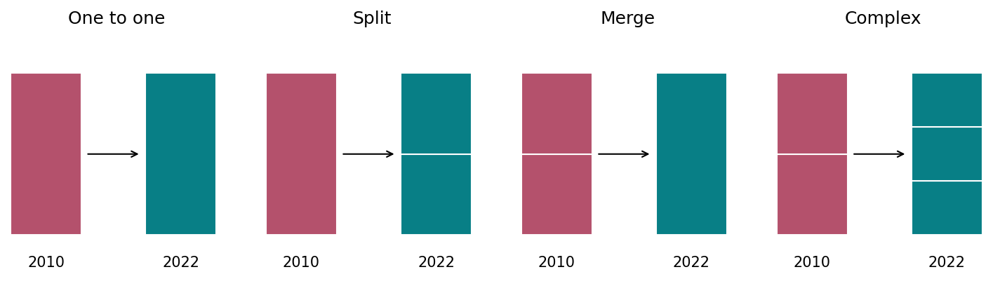
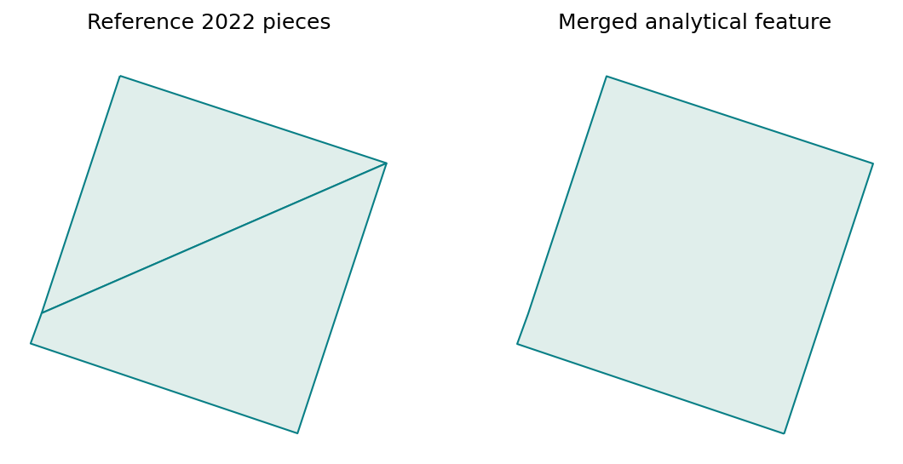

# Census tract harmonisation

Link 2010 and 2022 tracts into common comparison areas, preserving the research processing flow and original source geometry. The lookup assigns tracts to common_id; the analytical geometry merges complete 2022 pieces within each group.

[Variable and dataset codebook](../../../docs/codebook.md) · [Methods](../../../docs/methods.md) · [All reports](../../../research/README.md#read-the-reports)

Refresh processing and this report with `brazil-project report ibge_census_tract_harmonisation --config project.toml`. Add `--from-saved` to refresh existing verified artifacts only. Code is collapsed; tables and figures below are saved execution results.

## How to read this analysis

Each tract selects its largest strictly positive polygon-area overlap in the other year. The two directional sets of links form a graph; connected components become comparison groups. Boundary-only contact is not an overlap match. Groups can be one-to-one, split, merge or many-to-many. A municipality selects complete groups, including contributing tracts beyond its boundary.

The routine national mode validates the original correspondence; it is not a fresh national recomputation. A versioned bundle keeps geometry and lookups together. Original tract pieces, including repeated tract IDs, remain reference data; identifiers are deduplicated for count aggregation.

**Research assumption:** footprint differences are assumed not to materially change the inhabited population compared. This has not been independently verified. Merging boundaries does not establish identical footprints in both years; diagnostics remain available without automatically rejecting groups. See the [approved policy](../../../docs/harmonisation-policy.md).

## Inputs, coverage and processing status

This summary reads the current saved processing artifacts. Technical fingerprints are available in the collapsed provenance record.

<details>
<summary>Read saved processing summary</summary>

<!-- brazil:cell ibge_census_tract_harmonisation_1 -->
```python
import matplotlib
matplotlib.use("Agg")  # Headless figures in the fresh report process.
#| label: ibge_census_tract_harmonisation_1
from pathlib import Path
from brazil_project.io import Context
from brazil_project.reporting import show_chunk
show_chunk(ctx, 'Scripts_Data/IBGE/IBGE - Census tract harmonisation.qmd', 1)
```

</details>

<!-- brazil:output ibge_census_tract_harmonisation_1 begin -->
<table border="1" class="dataframe">
  <thead>
    <tr style="text-align: right;">
      <th>Measure</th>
      <th>Count</th>
    </tr>
  </thead>
  <tbody>
    <tr>
      <td>Comparison groups</td>
      <td>3790</td>
    </tr>
    <tr>
      <td>Merged 2022 features</td>
      <td>3790</td>
    </tr>
    <tr>
      <td>Reference 2022 pieces</td>
      <td>5167</td>
    </tr>
    <tr>
      <td>Repeated reference IDs</td>
      <td>1</td>
    </tr>
  </tbody>
</table>

Coverage: known totals exclude unavailable values; missing values are not zero.

<table border="1" class="dataframe">
  <thead>
    <tr style="text-align: right;">
      <th>Year</th>
      <th>Measure</th>
      <th>Matched tract IDs</th>
      <th>Unmatched tract IDs</th>
      <th>Known unmatched total</th>
      <th>Unmatched missing values</th>
      <th>Matched missing values</th>
    </tr>
  </thead>
  <tbody>
    <tr>
      <td>2010</td>
      <td>population</td>
      <td>3943</td>
      <td>0</td>
      <td>0.0000</td>
      <td>0</td>
      <td>41</td>
    </tr>
    <tr>
      <td>2010</td>
      <td>households</td>
      <td>3943</td>
      <td>0</td>
      <td>0.0000</td>
      <td>0</td>
      <td>41</td>
    </tr>
    <tr>
      <td>2022</td>
      <td>population</td>
      <td>5181</td>
      <td>0</td>
      <td>0.0000</td>
      <td>0</td>
      <td>0</td>
    </tr>
    <tr>
      <td>2022</td>
      <td>households</td>
      <td>5181</td>
      <td>0</td>
      <td>0.0000</td>
      <td>0</td>
      <td>53</td>
    </tr>
  </tbody>
</table>

Execution mode: `validated_original_correspondence`. Boundary differences are assumed not to materially change the inhabited population; not independently verified.

<details>
<summary>Technical provenance and complete processing record</summary>

```json
{
  "version": "fd7b309fbb21fda5f5188df22ec3c1813c89d517ee2b7683b3a0923e7c833385",
  "source_version": "84700cdc61d0b76baf8512431fc55a7f3e9a8044b682a6fc51987b53ea1a49bd",
  "policy": "positive-area-common-geometry-v1",
  "mode": "validated_original_correspondence",
  "scope": "3106200",
  "source_contract": {
    "policy": "positive-area-common-geometry-v1",
    "mode": "validated_original_correspondence",
    "inputs": {
      "tracts": "15ce7a4882dd3f8798223e3c1697fa3f32164793acac884da026c75b56549a3c",
      "baseline_lookup": "42d1354a5ed84047f4df28781aecd1970c0dd7e09c630c960c1a1139cb098c9b",
      "baseline_geometry": "ae961e48f488a18ae94cb3ece85162bab4f039daa9b87b3c029ac9e579edae57",
      "baseline_group_sizes": "17175bc7b75c44465cceecd87184fcbc413daedb5aaabb01cbd8efdc4bf721a1"
    },
    "crs": 5880,
    "precision_grid": 1e-06
  },
  "population_coverage": {
    "2010": {
      "matched_tract_ids": 3943,
      "unmatched_tract_ids": 0,
      "measures": {
        "population": {
          "status": "partial",
          "matched_known_total": 2378308.0,
          "unmatched_known_total": 0.0,
          "matched_missing_values": 41,
          "unmatched_missing_values": 0,
          "unmatched_share_of_known_total": 0.0
        },
        "households": {
          "status": "partial",
          "matched_known_total": 762962.0,
          "unmatched_known_total": 0.0,
          "matched_missing_values": 41,
          "unmatched_missing_values": 0,
          "unmatched_share_of_known_total": 0.0
        }
      }
    },
    "2022": {
      "matched_tract_ids": 5181,
      "unmatched_tract_ids": 0,
      "measures": {
        "population": {
          "status": "complete",
          "matched_known_total": 2319829.0,
          "unmatched_known_total": 0.0,
          "matched_missing_values": 0,
          "unmatched_missing_values": 0,
          "unmatched_share_of_known_total": 0.0
        },
        "households": {
          "status": "partial",
          "matched_known_total": 891051.0,
          "unmatched_known_total": 0.0,
          "matched_missing_values": 53,
          "unmatched_missing_values": 0,
          "unmatched_share_of_known_total": 0.0
        }
      }
    }
  },
  "assumption": "Boundary differences are assumed not to materially change the inhabited population; not independently verified.",
  "generation": "84fb2f1fd54a4079b21a35c569d663e2",
  "tracts_2022": 5167,
  "groups": 3790,
  "duplicate_base_ids": 1,
  "common_geometry_features": 3790,
  "rejected_edges": 0,
  "unmatched": {
    "2010": 0,
    "2022": 0
  },
  "footprint_difference_above_10pct": 502,
  "generated_at": "2026-10-07T08:23:54.082342+00:00"
}
```

</details>
<!-- brazil:output ibge_census_tract_harmonisation_1 end -->

<details>
<summary>Trace original step: Data Import</summary>

<!-- brazil:cell ibge_census_tract_harmonisation_2 -->
```python
#| label: ibge_census_tract_harmonisation_2
show_chunk(ctx, 'Scripts_Data/IBGE/IBGE - Census tract harmonisation.qmd', 2)
```

</details>

<!-- brazil:output ibge_census_tract_harmonisation_2 begin -->
<!-- Saved result already presented; original cell retained for traceability. -->
<!-- brazil:output ibge_census_tract_harmonisation_2 end -->

## How comparison groups work

The illustration explains relationship types. A common_id identifies a connected group; dissolving its 2022 pieces removes internal display boundaries.

<details>
<summary>Draw common-area relationship schematic</summary>

<!-- brazil:cell reference_diagram -->
```python
from brazil_project.reporting import harmonisation_diagram
harmonisation_diagram(ctx)
```

</details>

<!-- brazil:output reference_diagram begin -->


Schematic only: no measured tract boundaries. Connected links form one common_id; complete 2022 pieces are merged for analysis. Largest positive overlap is selected in both directions. Yearly footprints may differ under the accepted research assumption.
<!-- brazil:output reference_diagram end -->

## Merged analytical geography

One row per common_id; inner tract boundaries are merged. Original pieces remain reference data. The preview identifies saved areas and their measured km². Dissolving preserves holes and gaps between source pieces; small holes can appear as short interior strokes in the illustration. These are not separately retained tract boundaries.

<details>
<summary>Read merged common-area geometry</summary>

<!-- brazil:cell ibge_census_tract_harmonisation_3 -->
```python
#| label: ibge_census_tract_harmonisation_3
show_chunk(ctx, 'Scripts_Data/IBGE/IBGE - Census tract harmonisation.qmd', 3)
```

</details>

<!-- brazil:output ibge_census_tract_harmonisation_3 begin -->
3,790 saved rows; showing up to ten. See the codebook for column definitions.

<table border="1" class="dataframe">
  <thead>
    <tr style="text-align: right;">
      <th>common_id</th>
      <th>n_2010</th>
      <th>n_2022</th>
      <th>relationship</th>
      <th>area_km2</th>
      <th>footprint_difference_fraction</th>
      <th>area_2010_km2</th>
      <th>area_2022_projected_km2</th>
    </tr>
  </thead>
  <tbody>
    <tr>
      <td>95334</td>
      <td>1</td>
      <td>1</td>
      <td>1:1</td>
      <td>0.0401</td>
      <td>0.0035</td>
      <td>0.0405</td>
      <td>0.0406</td>
    </tr>
    <tr>
      <td>95335</td>
      <td>1</td>
      <td>2</td>
      <td>2010_to_2022_split</td>
      <td>0.0197</td>
      <td>0.0117</td>
      <td>0.0202</td>
      <td>0.0200</td>
    </tr>
    <tr>
      <td>95336</td>
      <td>1</td>
      <td>2</td>
      <td>2010_to_2022_split</td>
      <td>0.1096</td>
      <td>0.0000</td>
      <td>0.1111</td>
      <td>0.1111</td>
    </tr>
    <tr>
      <td>95337</td>
      <td>1</td>
      <td>2</td>
      <td>2010_to_2022_split</td>
      <td>0.0683</td>
      <td>0.0346</td>
      <td>0.0697</td>
      <td>0.0692</td>
    </tr>
    <tr>
      <td>95338</td>
      <td>1</td>
      <td>2</td>
      <td>2010_to_2022_split</td>
      <td>0.0862</td>
      <td>0.0155</td>
      <td>0.0878</td>
      <td>0.0874</td>
    </tr>
    <tr>
      <td>95339</td>
      <td>1</td>
      <td>2</td>
      <td>2010_to_2022_split</td>
      <td>0.0500</td>
      <td>0.0199</td>
      <td>0.0497</td>
      <td>0.0507</td>
    </tr>
    <tr>
      <td>95340</td>
      <td>1</td>
      <td>1</td>
      <td>1:1</td>
      <td>0.0293</td>
      <td>0.0002</td>
      <td>0.0297</td>
      <td>0.0297</td>
    </tr>
    <tr>
      <td>95341</td>
      <td>1</td>
      <td>1</td>
      <td>1:1</td>
      <td>0.1178</td>
      <td>0.0071</td>
      <td>0.1194</td>
      <td>0.1195</td>
    </tr>
    <tr>
      <td>95342</td>
      <td>1</td>
      <td>2</td>
      <td>2010_to_2022_split</td>
      <td>0.0613</td>
      <td>0.0041</td>
      <td>0.0622</td>
      <td>0.0622</td>
    </tr>
    <tr>
      <td>95343</td>
      <td>1</td>
      <td>1</td>
      <td>1:1</td>
      <td>0.0323</td>
      <td>0.0000</td>
      <td>0.0327</td>
      <td>0.0327</td>
    </tr>
  </tbody>
</table>

One row per common_id. area_km2 is the saved equal-area denominator; geometry belongs to the same versioned lookup bundle.



Actual common_id 95335: complete reference pieces at left, one merged analytical feature at right. Original pieces remain saved. This shows removal of internal boundaries, not equality of 2010 and 2022 footprints.
<!-- brazil:output ibge_census_tract_harmonisation_3 end -->

## Interpretation and limits

Outputs retain the original aggregation, missingness and exclusion rules. Available results do not establish national scientific validation. Read [verification and remaining limitations](../../../docs/checks.md) before drawing research conclusions. Original codebooks and earlier report contents remain preserved in the project archive.
