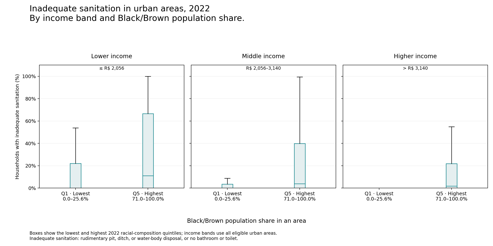

# Brazil Poroject - Charts

Research report · [Python report script](../../code/reports/brazil_poroject_charts.py) · Saved local results; full datasets stay outside Git.

|     | year | racial_quintile | households | inadequate_sanitation | percentage |
|-----|------|-----------------|------------|-----------------------|------------|
| 0   | 2010 | 1               | 7481178.0  | 249492.0              | 3.334929   |
| 1   | 2010 | 2               | 7749718.0  | 594814.0              | 7.675299   |
| 2   | 2010 | 3               | 7701575.0  | 1180648.0             | 15.329955  |
| 3   | 2010 | 4               | 7772029.0  | 2270568.0             | 29.214610  |
| 4   | 2010 | 5               | 7962930.0  | 3414868.0             | 42.884566  |
| 5   | 2022 | 1               | 8031367.0  | 263168.0              | 3.276752   |
| 6   | 2022 | 2               | 8556830.0  | 385678.0              | 4.507253   |
| 7   | 2022 | 3               | 8442688.0  | 668547.0              | 7.918651   |
| 8   | 2022 | 4               | 8453915.0  | 1458583.0             | 17.253344  |
| 9   | 2022 | 5               | 8479892.0  | 2422264.0             | 28.564798  |

    {'artifact_rows': 10, 'path': 'data/intermediate/charts/year_summary.parquet'}

