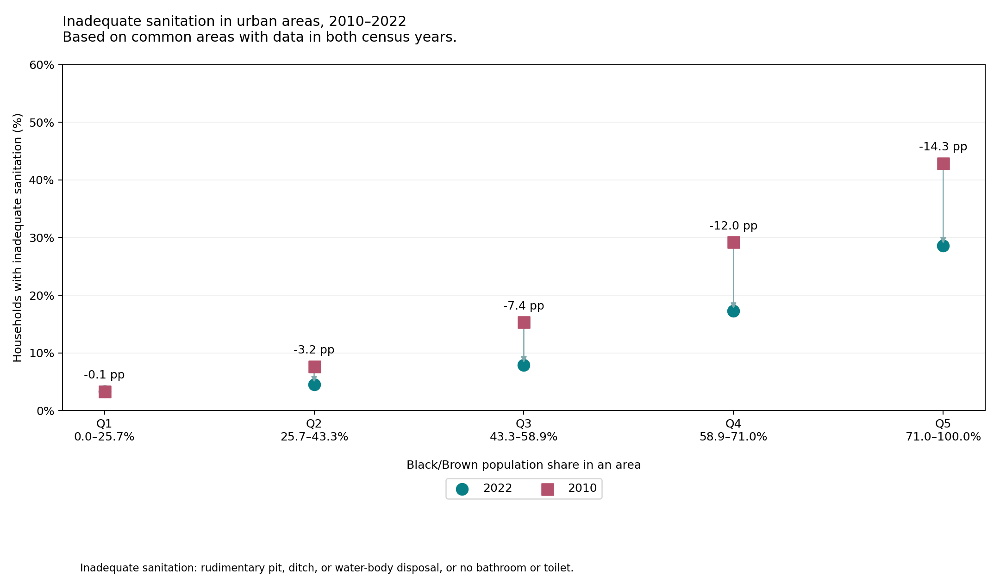

# Brazil Poroject - Charts

Executable research report. Refresh with `brazil-project report brazil_poroject_charts`. Code is collapsed below each explanation.


<details>
<summary>Python code</summary>

<!-- brazil:cell brazil_poroject_charts_1 -->
```python
#| label: brazil_poroject_charts_1
from pathlib import Path
from brazil_project.io import Context
from brazil_project.reporting import show_chunk
show_chunk(ctx, 'CS2Nordic/Brazil Poroject - Charts.qmd', 1)
```

</details>

<!-- brazil:output brazil_poroject_charts_1 begin -->

<table border="1" class="dataframe">
  <thead>
    <tr style="text-align: right;">
      <th></th>
      <th>year</th>
      <th>racial_quintile</th>
      <th>households</th>
      <th>inadequate_sanitation</th>
      <th>percentage</th>
    </tr>
  </thead>
  <tbody>
    <tr>
      <th>0</th>
      <td>2010</td>
      <td>1</td>
      <td>7481178.0</td>
      <td>249492.0</td>
      <td>3.334929</td>
    </tr>
    <tr>
      <th>1</th>
      <td>2010</td>
      <td>2</td>
      <td>7749718.0</td>
      <td>594814.0</td>
      <td>7.675299</td>
    </tr>
    <tr>
      <th>2</th>
      <td>2010</td>
      <td>3</td>
      <td>7701575.0</td>
      <td>1180648.0</td>
      <td>15.329955</td>
    </tr>
    <tr>
      <th>3</th>
      <td>2010</td>
      <td>4</td>
      <td>7772029.0</td>
      <td>2270568.0</td>
      <td>29.214610</td>
    </tr>
    <tr>
      <th>4</th>
      <td>2010</td>
      <td>5</td>
      <td>7962930.0</td>
      <td>3414868.0</td>
      <td>42.884566</td>
    </tr>
    <tr>
      <th>5</th>
      <td>2022</td>
      <td>1</td>
      <td>8031367.0</td>
      <td>263168.0</td>
      <td>3.276752</td>
    </tr>
    <tr>
      <th>6</th>
      <td>2022</td>
      <td>2</td>
      <td>8556830.0</td>
      <td>385678.0</td>
      <td>4.507253</td>
    </tr>
    <tr>
      <th>7</th>
      <td>2022</td>
      <td>3</td>
      <td>8442688.0</td>
      <td>668547.0</td>
      <td>7.918651</td>
    </tr>
    <tr>
      <th>8</th>
      <td>2022</td>
      <td>4</td>
      <td>8453915.0</td>
      <td>1458583.0</td>
      <td>17.253344</td>
    </tr>
    <tr>
      <th>9</th>
      <td>2022</td>
      <td>5</td>
      <td>8479892.0</td>
      <td>2422264.0</td>
      <td>28.564798</td>
    </tr>
  </tbody>
</table>


```text
{'artifact_rows': 10, 'path': 'data/intermediate/charts/year_summary.parquet'}
```




<!-- brazil:output brazil_poroject_charts_1 end -->
