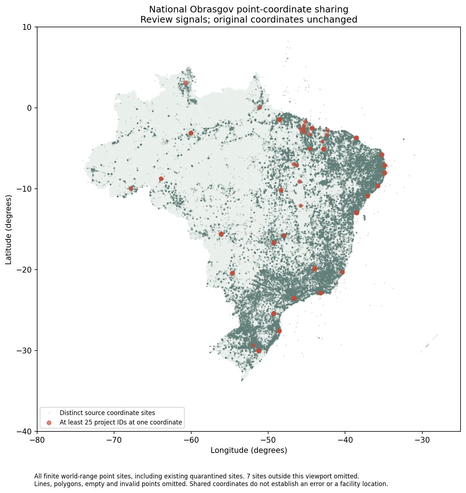
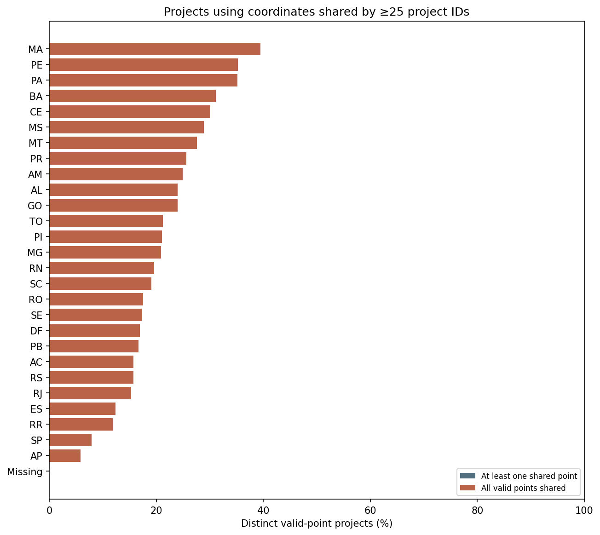
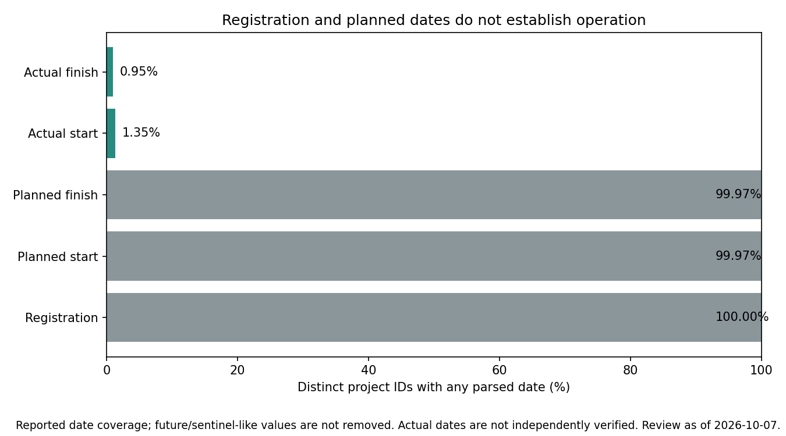
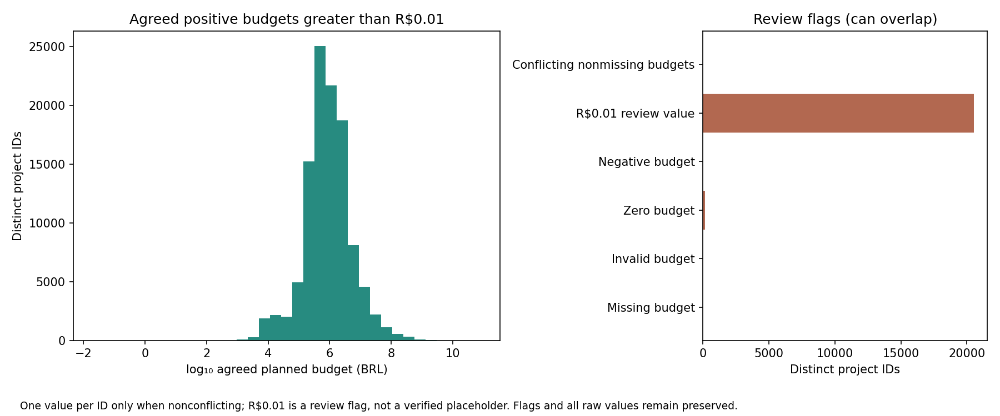
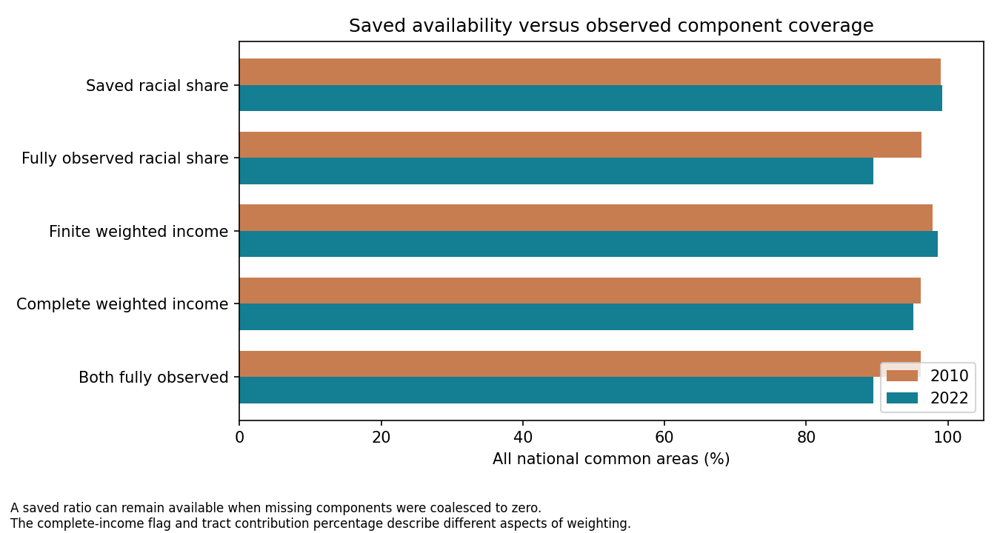
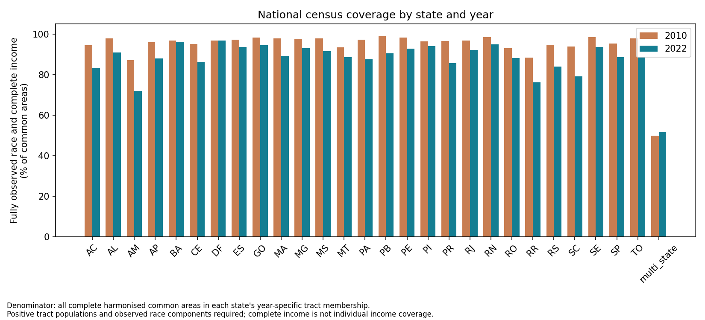

# Government projects and census data: national quality review

## Executive summary

<!-- brazil:cell gov_data_quality_summary
import pandas as pd
from brazil_project.reporting import table, markdown
summary = report_json("gov-data-quality")
attr, loc, census = summary["attributes"], summary["locations"], summary["census"]
coverage = ctx.table("gov-data-quality", "census_annual_coverage")
paired = ctx.table("gov-data-quality", "census_paired_coverage")
budgets = ctx.table("gov-data-quality", "budget_summary")
population = ctx.table("gov-data-quality", "census_race_population_coverage")
def audit_row(frame, **conditions):
    selected = frame
    for column, value in conditions.items():
        selected = selected.loc[selected[column].eq(value)]
    if len(selected) != 1:
        raise RuntimeError("Expected one audit summary row for " + str(conditions))
    return selected.iloc[0]
def annual(year, measure):
    return audit_row(coverage, year=year, measure=measure)
def both(measure):
    return audit_row(paired, measure=measure, availability="both_years")
def percent(value, denominator):
    return f"{100 * value / denominator:.2f}%" if denominator else "percentage unavailable"
figures = summary["figures"]
def show_figure(name, caption):
    if name not in figures:
        raise RuntimeError("Missing required summary figure: " + name)
    report_image(figures[name])
    markdown(caption)
joint = annual(2022, "joint_fully_observed")
saved, observed = annual(2022, "race_ratio_available"), annual(2022, "race_ratio_fully_observed")
threshold = loc["shared_coordinate_threshold"]
shared_text = percent(loc["shared_point_projects"], loc["valid_point_projects"])
review_date = pd.Timestamp(summary["as_of_date"]).strftime("%d %B %Y").lstrip("0")
markdown(f"This national review examines **{summary['distinct_projects']:,} government projects** recorded in Obrasgov and "
         + f"**{census['n_common_areas']:,} census areas** made comparable between 2010 and 2022. "
         + "The purpose is to assess the evidence for a future study of distances to government projects and differences between areas by income and racial composition.")
markdown(f"**Reported locations and project types need the most immediate attention.** "
         + f"{shared_text} of projects passing a basic coordinate-range check have a point recorded for at least {threshold} different projects. "
         + "Some project descriptions also appear inconsistent with their categories. These are reasons to investigate, not proof of incorrect records.")
markdown(f"**Construction dates, budget amounts and incomplete census information require separate treatment.** "
         + f"Actual start and finish dates are available for only {attr['projects_with_effective_start_pct']:.2f}% and {attr['projects_with_effective_finish_pct']:.2f}% of projects. "
         + f"Complete usable income and racial-composition inputs cover {joint['share_pct']:.2f}% of comparison areas in 2022. "
         + "The data can support carefully qualified exploration of registered projects, but this review does not establish access to working services, historical investment effects or racial inequality.")
markdown(f"Review date: {review_date}. This assessment introduces no additional exclusions or corrections. "
         + "It covers Obrasgov project records and IBGE census information; IBAMA environmental licensing is a separate dataset.")
markdown("## Main findings")
rows = [
    {"Dataset": "Obrasgov", "Topic": "Project counts", "Finding": f"{summary['source_rows']:,} entries describe {summary['distinct_projects']:,} different projects; {summary['source_rows'] - summary['distinct_projects']:,} entries repeat a project.",
     "Why it matters": "Multiple classifications can create repeated entries. Count projects once when measuring their number or total budget."},
    {"Dataset": "Obrasgov", "Topic": "Reported locations", "Finding": f"{loc['shared_point_projects']:,} of {loc['valid_point_projects']:,} projects passing a basic coordinate-range check ({shared_text}) have a location recorded for at least {threshold} different projects.",
     "Why it matters": "A shared location can be legitimate or a generic address. Confirm what the point represents before interpreting nearby infrastructure."},
    {"Dataset": "Obrasgov", "Topic": "Project types", "Finding": f"{attr['projects_with_category_review']:,} projects combine education-related wording or organisations with a water/ports classification.",
     "Why it matters": "Verify categories before comparing sectors; these signals do not establish the correct replacement label."},
    {"Dataset": "Obrasgov", "Topic": "Construction dates", "Finding": f"Actual starts are recorded for {attr['projects_with_effective_start']:,} projects ({attr['projects_with_effective_start_pct']:.2f}%); actual finishes for {attr['projects_with_effective_finish']:,} ({attr['projects_with_effective_finish_pct']:.2f}%).",
     "Why it matters": "Registration and planned dates cannot establish when construction occurred or a service opened."},
    {"Dataset": "Obrasgov", "Topic": "Budget amounts", "Finding": f"{attr['projects_with_budget_001']:,} projects ({attr['projects_with_budget_001_pct']:.2f}%) report R$0.01.",
     "Why it matters": "Check unusually small amounts before weighting projects by investment. Planned budgets are not confirmed spending."},
    {"Dataset": "IBGE", "Topic": "Census information", "Finding": f"{int(joint['n_common_areas']):,} of {census['n_common_areas']:,} areas ({joint['share_pct']:.2f}%) have complete usable inputs for income and racial composition in 2022.",
     "Why it matters": "Missing information varies across places and years. Removing incomplete areas could change who is represented."},
]
table(pd.DataFrame(rows))
markdown("## Obrasgov: government project records")
markdown("### Project counts: entries are not separate investments")
markdown(f"The {summary['source_rows']:,} entries include {summary['source_rows'] - summary['distinct_projects']:,} additional rows for projects already present. "
         + f"{attr['projects_with_any_attribute_conflict']:,} projects have differing classifications across their entries. "
         + "This can reflect several labels attached to one project, rather than several independent investments. The review preserves those labels instead of choosing one arbitrarily.")
markdown("A project can also have several recorded points or routes. Counting every row or every location as a new project would overstate the number of projects. "
         + "The project identifier is therefore essential to interpretation, even where repeated entries are legitimate. "
         + "A registered project does not, by itself, confirm that a facility exists, is operating or serves nearby residents.")
markdown("### Reported locations: passing map checks is not verification")
markdown(f"Under the existing mapping rules, **{loc['eligible_point_projects']:,} of {summary['distinct_projects']:,} projects** have at least one retained point. "
         + "Those checks identify obvious geographic problems, including locations outside their reported state. A point can still be misplaced within the correct state, or represent an administrative address rather than the construction site.")
markdown("The location-sharing check deliberately includes points already withheld from the map, provided their coordinates fall within possible latitude and longitude ranges. "
         + "Its percentages describe the broader recorded-location problem, not the final map alone. "
         + "Withholding one location does not necessarily remove every location from that project; the original project records remain preserved.")
markdown(f"**{loc['shared_point_projects']:,} projects have a point recorded for at least {threshold} different projects.** "
         + f"The largest recorded cluster contains {loc['max_projects_at_one_coordinate']:,} different project identifiers. "
         + "Shared facilities, generic addresses and inaccurate locations are all possible explanations. The audit cannot determine which explanation applies without checking the records and supporting evidence.")
show_figure("location-overview.png", f"Red dots mark coordinates recorded for at least {threshold} different projects. Background points include locations already withheld from the project map. "
            + "The figure shows recorded sites, not verified infrastructure; lines, polygons and missing or invalid points are omitted.")
markdown("These clusters matter differently for different distance measures. Several project identifiers at exactly the same point do not, by themselves, change the distance to the nearest point. "
         + "They can increase a score that adds up nearby projects or investment. If the shared point is actually a generic office address, even the nearest distance can be misleading. "
         + "The appropriate interpretation depends on whether the intended measure concerns projects, distinct sites or investment.")
show_figure("shared-coordinates-by-state.png", f"Percentages refer to projects with coordinates passing the basic range check in each reported state. "
            + f"A project is flagged when at least {threshold} different projects share one of its coordinates. These are review flags, not confirmed error rates or differences in infrastructure access.")
markdown("The proportion of shared locations differs by state, so a single national percentage does not describe every setting. "
         + "This variation is relevant when comparing places: differences in the way project locations are recorded could influence a distance comparison alongside real differences in infrastructure.")
markdown("### Project types: some labels need checking against the descriptions")
markdown(f"**{attr['projects_with_category_review']:,} projects ({attr['projects_with_category_review_pct']:.2f}% of all projects)** combine education-related wording or organisations with a water/ports category. "
         + "The check uses textual clues; it does not establish that all flagged classifications are wrong. Descriptions may refer to organisations or broader programmes rather than the physical purpose of a specific site.")
markdown("This matters if the later analysis separates schools, transport, water or other sectors. A sector-specific distance would be difficult to interpret if project labels do not reliably identify that sector. "
         + "The flagged records need review before relabelling or excluding them. This assessment keeps the existing categories unchanged.")
markdown("### Construction dates: a completed label is not a reliable delivery date")
markdown(f"Actual construction starts are recorded for **{attr['projects_with_effective_start']:,} projects**, and actual finishes for **{attr['projects_with_effective_finish']:,}**. "
         + "Registration and planned dates are much more widely recorded, but they describe entry into the system and intended schedules, not confirmed delivery.")
markdown(f"Of **{attr['projects_with_completed_status']:,} projects marked completed, {attr['projects_completed_without_effective_finish']:,} lack an actual finish date**. "
         + "A completed label alone therefore cannot reliably place the project before or after a census. Even a recorded finish date does not independently establish when a service opened or became available to residents.")
show_figure("date-coverage.png", "Bars count distinct projects with each type of date. Registration, plans and reported actual events remain separate; a populated field is not an independently verified construction or opening date.")
markdown("Missing dates do not prevent a descriptive calculation of distance to recorded locations. They do limit claims about when infrastructure arrived, whether it preceded demographic change, "
         + "or whether changes between 2010 and 2022 followed project delivery. Those questions need stronger evidence on timing than the current records provide.")
markdown("### Budget amounts: small values and repeated entries affect totals")
zero = audit_row(budgets, Measure="Zero budget")
row_sum = audit_row(budgets, Measure="Sum across source rows: repeats included")
project_sum = audit_row(budgets, Measure="Sum of one agreed budget per ID: conflicting/invalid IDs omitted")
markdown(f"**{attr['projects_with_budget_001']:,} projects report R$0.01**, and **{int(zero['Distinct project IDs']):,} report zero**. "
         + "These values deserve checking before they are used to represent investment. They may have an administrative explanation, but the review does not verify that they are placeholders or determine their correct replacements.")
markdown(f"Adding budgets across all entries gives approximately **R${row_sum['Value (BRL)'] / 1e12:.3f} trillion**. "
         + f"Counting one agreed recorded budget per project gives approximately **R${project_sum['Value (BRL)'] / 1e12:.3f} trillion**. "
         + "The difference comes from repeated project entries; it is not additional investment discovered by this assessment.")
show_figure("budget-distribution.png", "The left panel shows one agreed planned budget above R$0.01 per project on a logarithmic scale, making very different amounts visible. The right panel counts zero, R$0.01 and other review signals. These amounts are planned, not verified spending.")
markdown("Large projects would carry much more weight in an investment-based proximity score than small ones. Repeated budgets, unusually small amounts or broad project locations could therefore change that score even when a simple nearest-point distance stays the same. "
         + "The amounts are nominal planned budgets from the available snapshot, not realised spending or investment values adjusted to a common price year.")
markdown("## IBGE: census information")
markdown("The census checks focus on average area income and the share of residents recorded as Black or Brown.")
markdown("### Census completeness: an available value can still contain gaps")
markdown(f"In 2022, racial-composition values are available for **{saved['share_pct']:.2f}% of comparison areas**, but only **{observed['share_pct']:.2f}%** have all the required contributing population counts. "
         + "The existing calculation can treat a missing racial count as zero. It can therefore produce a value even where the underlying information is incomplete; that value should not automatically be treated as a fully observed description of the area.")
income_saved, income_full = annual(2022, "income_available"), annual(2022, "income_complete_available")
markdown(f"The same distinction matters for income: a value is available for **{income_saved['share_pct']:.2f}% of areas**, while complete usable contributing inputs cover **{income_full['share_pct']:.2f}%**. "
         + "An average may be calculated from the usable parts of an area even when other parts lack the required information. Availability and completeness answer different questions.")
show_figure("income-coverage.png", f"Percentages are calculated across all {census['n_common_areas']:,} comparison areas in each year. The chart separates available values from complete required inputs; it measures information coverage, not proximity or racial inequality.")
markdown("### Comparing years: 2022 coverage is more limited")
coverage_rows = []
for label, measure in [("Racial composition", "race_ratio_fully_observed"), ("Income", "income_complete_available"), ("Income and racial composition together", "joint_fully_observed")]:
    coverage_rows.append({"Dataset": "IBGE", "Complete usable information": label,
                          "2010": f"{annual(2010, measure)['share_pct']:.2f}%",
                          "2022": f"{annual(2022, measure)['share_pct']:.2f}%",
                          "Both years": f"{both(measure)['share_pct']:.2f}%"})
table(pd.DataFrame(coverage_rows), f"Share of all {census['n_common_areas']:,} comparison areas with the required usable information. These percentages count areas, not residents.")
paired_full, paired_saved = both("joint_fully_observed"), both("joint_available")
markdown(f"For a comparison using both income and racial composition across both censuses, **{int(paired_full['n_common_areas']):,} areas ({paired_full['share_pct']:.2f}%)** have complete required information in both years. "
         + f"By contrast, **{int(paired_saved['n_common_areas']):,} areas ({paired_saved['share_pct']:.2f}%)** have available values in both years. "
         + "A study that used every available value would therefore include more areas, but also more incomplete contributing information.")
markdown("These coverage groups are diagnostics, not automatic decisions about the final study sample. Keeping incomplete areas and restricting to complete ones would answer questions about different sets of places. "
         + "Any later comparison should make that difference visible rather than interpreting a change in coverage as a demographic change.")
markdown("### Geographic gaps: national coverage hides local differences")
show_figure("census-coverage-by-state.png", "Each bar gives the share of comparison areas with complete required information within that state's annual geography. Areas spanning states are recorded separately. The chart describes data completeness, not living conditions or investment.")
markdown("Coverage varies across states. An analysis restricted to complete information could consequently represent some parts of Brazil better than others. "
         + "This is a reason to examine which areas remain, not evidence that the resulting estimates are necessarily biased or that the missing areas have a particular income or racial composition.")
missing_population = audit_row(population, year=2022, check="missing_race_component")
markdown(f"In 2022, original census tracts with missing required racial counts contain **{int(missing_population['known_population_flagged']):,} recorded residents**, "
         + f"or **{missing_population['share_of_known_population_pct']:.2f}% of the known source population**. "
         + "This population share is smaller than the share of comparison areas with gaps because areas differ in population and can combine several tracts. "
         + "It does not mean every resident in those tracts lacks a racial response; it identifies the population living in tracts whose required totals are incomplete.")
markdown("### Income and race: these measures describe places, not individuals")
markdown("The area income figure combines smaller-area averages, giving more weight to areas with more household heads. Racial composition describes residents. "
         + "These measures do not reveal the income of individual Black or Brown residents, and an area with a particular average income can contain people with very different resources.")
markdown("A later study could compare areas of similar average income but different racial composition. That would describe differences between places at comparable recorded income; "
         + "it would not isolate the experience of individual people or establish discrimination. This quality review has not calculated distances, fitted a regression or found an income-adjusted racial difference.")
markdown("Census boundaries also changed between 2010 and 2022. The comparison areas group connected tract sets across the two years, but their footprints are not guaranteed identical. "
         + "The research assumes that these boundary differences do not materially change the inhabited population being compared; this assessment does not independently test that assumption. "
         + "Expressing 2010 income in 2022 prices helps compare amounts, but does not remove differences in the census income definitions.")
markdown("## Bringing Obrasgov and IBGE together")
markdown("The strongest next step is a transparent exploratory comparison of distances to registered project locations, with the location and category uncertainties visible. "
         + "Unweighted distance, a score combining nearby projects and a score weighted by planned investment have different meanings; the quality issues above affect them differently. "
         + "Census completeness and geographic coverage should be shown alongside the resulting comparisons.")
markdown("The current evidence does not establish which communities are closer to infrastructure, whether projects were delivered before a census, or whether income explains racial differences. "
         + "Those remain research questions. The assessment preserves the project records and existing mapping rules so these choices can be examined explicitly rather than embedded in silent corrections.")
-->

<!-- brazil:output gov_data_quality_summary begin -->
This national review examines **129,961 government projects** recorded in Obrasgov and **287,178 census areas** made comparable between 2010 and 2022. The purpose is to assess the evidence for a future study of distances to government projects and differences between areas by income and racial composition.

**Reported locations and project types need the most immediate attention.** 22.00% of projects passing a basic coordinate-range check have a point recorded for at least 25 different projects. Some project descriptions also appear inconsistent with their categories. These are reasons to investigate, not proof of incorrect records.

**Construction dates, budget amounts and incomplete census information require separate treatment.** Actual start and finish dates are available for only 1.35% and 0.95% of projects. Complete usable income and racial-composition inputs cover 89.46% of comparison areas in 2022. The data can support carefully qualified exploration of registered projects, but this review does not establish access to working services, historical investment effects or racial inequality.

Review date: 7 October 2026. This assessment introduces no additional exclusions or corrections. It covers Obrasgov project records and IBGE census information; IBAMA environmental licensing is a separate dataset.

## Main findings

<table border="1" class="dataframe">
  <thead>
    <tr style="text-align: right;">
      <th>Dataset</th>
      <th>Topic</th>
      <th>Finding</th>
      <th>Why it matters</th>
    </tr>
  </thead>
  <tbody>
    <tr>
      <td>Obrasgov</td>
      <td>Project counts</td>
      <td>134,929 entries describe 129,961 different projects; 4,968 entries repeat a project.</td>
      <td>Multiple classifications can create repeated entries. Count projects once when measuring their number or total budget.</td>
    </tr>
    <tr>
      <td>Obrasgov</td>
      <td>Reported locations</td>
      <td>27,953 of 127,081 projects passing a basic coordinate-range check (22.00%) have a location recorded for at least 25 different projects.</td>
      <td>A shared location can be legitimate or a generic address. Confirm what the point represents before interpreting nearby infrastructure.</td>
    </tr>
    <tr>
      <td>Obrasgov</td>
      <td>Project types</td>
      <td>25,216 projects combine education-related wording or organisations with a water/ports classification.</td>
      <td>Verify categories before comparing sectors; these signals do not establish the correct replacement label.</td>
    </tr>
    <tr>
      <td>Obrasgov</td>
      <td>Construction dates</td>
      <td>Actual starts are recorded for 1,750 projects (1.35%); actual finishes for 1,241 (0.95%).</td>
      <td>Registration and planned dates cannot establish when construction occurred or a service opened.</td>
    </tr>
    <tr>
      <td>Obrasgov</td>
      <td>Budget amounts</td>
      <td>20,532 projects (15.80%) report R$0.01.</td>
      <td>Check unusually small amounts before weighting projects by investment. Planned budgets are not confirmed spending.</td>
    </tr>
    <tr>
      <td>IBGE</td>
      <td>Census information</td>
      <td>256,907 of 287,178 areas (89.46%) have complete usable inputs for income and racial composition in 2022.</td>
      <td>Missing information varies across places and years. Removing incomplete areas could change who is represented.</td>
    </tr>
  </tbody>
</table>

## Obrasgov: government project records

### Project counts: entries are not separate investments

The 134,929 entries include 4,968 additional rows for projects already present. 2,684 projects have differing classifications across their entries. This can reflect several labels attached to one project, rather than several independent investments. The review preserves those labels instead of choosing one arbitrarily.

A project can also have several recorded points or routes. Counting every row or every location as a new project would overstate the number of projects. The project identifier is therefore essential to interpretation, even where repeated entries are legitimate. A registered project does not, by itself, confirm that a facility exists, is operating or serves nearby residents.

### Reported locations: passing map checks is not verification

Under the existing mapping rules, **126,719 of 129,961 projects** have at least one retained point. Those checks identify obvious geographic problems, including locations outside their reported state. A point can still be misplaced within the correct state, or represent an administrative address rather than the construction site.

The location-sharing check deliberately includes points already withheld from the map, provided their coordinates fall within possible latitude and longitude ranges. Its percentages describe the broader recorded-location problem, not the final map alone. Withholding one location does not necessarily remove every location from that project; the original project records remain preserved.

**27,953 projects have a point recorded for at least 25 different projects.** The largest recorded cluster contains 2,645 different project identifiers. Shared facilities, generic addresses and inaccurate locations are all possible explanations. The audit cannot determine which explanation applies without checking the records and supporting evidence.

Red dots mark coordinates recorded for at least 25 different projects. Background points include locations already withheld from the project map. The figure shows recorded sites, not verified infrastructure; lines, polygons and missing or invalid points are omitted.

These clusters matter differently for different distance measures. Several project identifiers at exactly the same point do not, by themselves, change the distance to the nearest point. They can increase a score that adds up nearby projects or investment. If the shared point is actually a generic office address, even the nearest distance can be misleading. The appropriate interpretation depends on whether the intended measure concerns projects, distinct sites or investment.

Percentages refer to projects with coordinates passing the basic range check in each reported state. A project is flagged when at least 25 different projects share one of its coordinates. These are review flags, not confirmed error rates or differences in infrastructure access.

The proportion of shared locations differs by state, so a single national percentage does not describe every setting. This variation is relevant when comparing places: differences in the way project locations are recorded could influence a distance comparison alongside real differences in infrastructure.

### Project types: some labels need checking against the descriptions

**25,216 projects (19.40% of all projects)** combine education-related wording or organisations with a water/ports category. The check uses textual clues; it does not establish that all flagged classifications are wrong. Descriptions may refer to organisations or broader programmes rather than the physical purpose of a specific site.

This matters if the later analysis separates schools, transport, water or other sectors. A sector-specific distance would be difficult to interpret if project labels do not reliably identify that sector. The flagged records need review before relabelling or excluding them. This assessment keeps the existing categories unchanged.

### Construction dates: a completed label is not a reliable delivery date

Actual construction starts are recorded for **1,750 projects**, and actual finishes for **1,241**. Registration and planned dates are much more widely recorded, but they describe entry into the system and intended schedules, not confirmed delivery.

Of **42,850 projects marked completed, 41,626 lack an actual finish date**. A completed label alone therefore cannot reliably place the project before or after a census. Even a recorded finish date does not independently establish when a service opened or became available to residents.

Bars count distinct projects with each type of date. Registration, plans and reported actual events remain separate; a populated field is not an independently verified construction or opening date.

Missing dates do not prevent a descriptive calculation of distance to recorded locations. They do limit claims about when infrastructure arrived, whether it preceded demographic change, or whether changes between 2010 and 2022 followed project delivery. Those questions need stronger evidence on timing than the current records provide.

### Budget amounts: small values and repeated entries affect totals

**20,532 projects report R$0.01**, and **151 report zero**. These values deserve checking before they are used to represent investment. They may have an administrative explanation, but the review does not verify that they are placeholders or determine their correct replacements.

Adding budgets across all entries gives approximately **R$1.115 trillion**. Counting one agreed recorded budget per project gives approximately **R$1.017 trillion**. The difference comes from repeated project entries; it is not additional investment discovered by this assessment.

The left panel shows one agreed planned budget above R$0.01 per project on a logarithmic scale, making very different amounts visible. The right panel counts zero, R$0.01 and other review signals. These amounts are planned, not verified spending.

Large projects would carry much more weight in an investment-based proximity score than small ones. Repeated budgets, unusually small amounts or broad project locations could therefore change that score even when a simple nearest-point distance stays the same. The amounts are nominal planned budgets from the available snapshot, not realised spending or investment values adjusted to a common price year.

## IBGE: census information

The census checks focus on average area income and the share of residents recorded as Black or Brown.

### Census completeness: an available value can still contain gaps

In 2022, racial-composition values are available for **99.24% of comparison areas**, but only **89.49%** have all the required contributing population counts. The existing calculation can treat a missing racial count as zero. It can therefore produce a value even where the underlying information is incomplete; that value should not automatically be treated as a fully observed description of the area.

The same distinction matters for income: a value is available for **98.61% of areas**, while complete usable contributing inputs cover **95.16%**. An average may be calculated from the usable parts of an area even when other parts lack the required information. Availability and completeness answer different questions.

Percentages are calculated across all 287,178 comparison areas in each year. The chart separates available values from complete required inputs; it measures information coverage, not proximity or racial inequality.

### Comparing years: 2022 coverage is more limited

Share of all 287,178 comparison areas with the required usable information. These percentages count areas, not residents.

<table border="1" class="dataframe">
  <thead>
    <tr style="text-align: right;">
      <th>Dataset</th>
      <th>Complete usable information</th>
      <th>2010</th>
      <th>2022</th>
      <th>Both years</th>
    </tr>
  </thead>
  <tbody>
    <tr>
      <td>IBGE</td>
      <td>Racial composition</td>
      <td>96.30%</td>
      <td>89.49%</td>
      <td>87.67%</td>
    </tr>
    <tr>
      <td>IBGE</td>
      <td>Income</td>
      <td>96.18%</td>
      <td>95.16%</td>
      <td>92.90%</td>
    </tr>
    <tr>
      <td>IBGE</td>
      <td>Income and racial composition together</td>
      <td>96.18%</td>
      <td>89.46%</td>
      <td>87.64%</td>
    </tr>
  </tbody>
</table>

For a comparison using both income and racial composition across both censuses, **251,675 areas (87.64%)** have complete required information in both years. By contrast, **279,962 areas (97.49%)** have available values in both years. A study that used every available value would therefore include more areas, but also more incomplete contributing information.

These coverage groups are diagnostics, not automatic decisions about the final study sample. Keeping incomplete areas and restricting to complete ones would answer questions about different sets of places. Any later comparison should make that difference visible rather than interpreting a change in coverage as a demographic change.

### Geographic gaps: national coverage hides local differences

Each bar gives the share of comparison areas with complete required information within that state's annual geography. Areas spanning states are recorded separately. The chart describes data completeness, not living conditions or investment.

Coverage varies across states. An analysis restricted to complete information could consequently represent some parts of Brazil better than others. This is a reason to examine which areas remain, not evidence that the resulting estimates are necessarily biased or that the missing areas have a particular income or racial composition.

In 2022, original census tracts with missing required racial counts contain **3,821,787 recorded residents**, or **1.88% of the known source population**. This population share is smaller than the share of comparison areas with gaps because areas differ in population and can combine several tracts. It does not mean every resident in those tracts lacks a racial response; it identifies the population living in tracts whose required totals are incomplete.

### Income and race: these measures describe places, not individuals

The area income figure combines smaller-area averages, giving more weight to areas with more household heads. Racial composition describes residents. These measures do not reveal the income of individual Black or Brown residents, and an area with a particular average income can contain people with very different resources.

A later study could compare areas of similar average income but different racial composition. That would describe differences between places at comparable recorded income; it would not isolate the experience of individual people or establish discrimination. This quality review has not calculated distances, fitted a regression or found an income-adjusted racial difference.

Census boundaries also changed between 2010 and 2022. The comparison areas group connected tract sets across the two years, but their footprints are not guaranteed identical. The research assumes that these boundary differences do not materially change the inhabited population being compared; this assessment does not independently test that assumption. Expressing 2010 income in 2022 prices helps compare amounts, but does not remove differences in the census income definitions.

## Bringing Obrasgov and IBGE together

The strongest next step is a transparent exploratory comparison of distances to registered project locations, with the location and category uncertainties visible. Unweighted distance, a score combining nearby projects and a score weighted by planned investment have different meanings; the quality issues above affect them differently. Census completeness and geographic coverage should be shown alongside the resulting comparisons.

The current evidence does not establish which communities are closer to infrastructure, whether projects were delivered before a census, or whether income explains racial differences. Those remain research questions. The assessment preserves the project records and existing mapping rules so these choices can be examined explicitly rather than embedded in silent corrections.
<!-- brazil:output gov_data_quality_summary end -->

[Supporting evidence, definitions and methods](gov_data_quality_annex.md)
