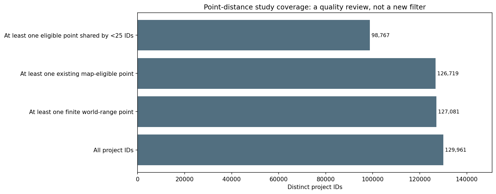
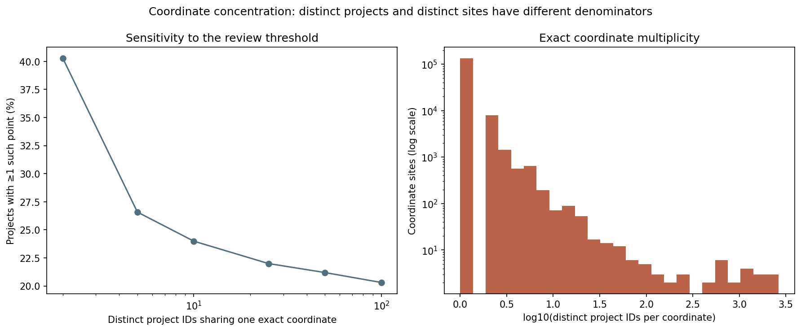
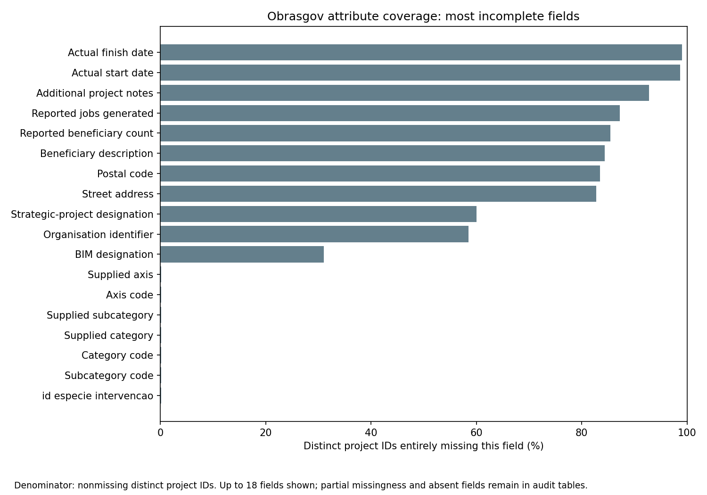
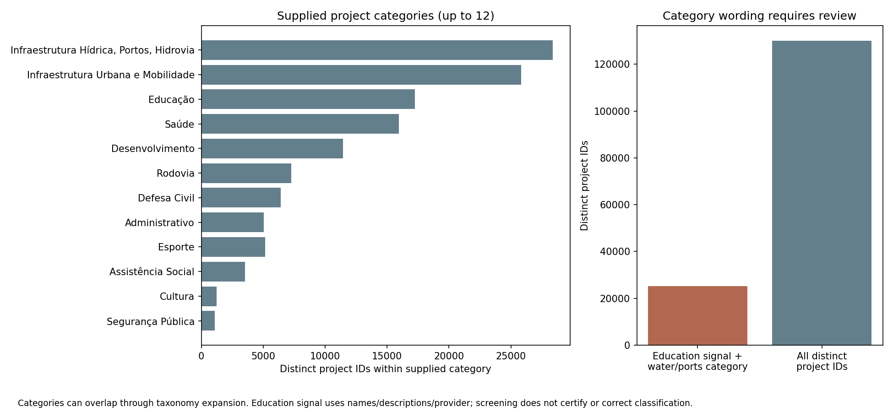
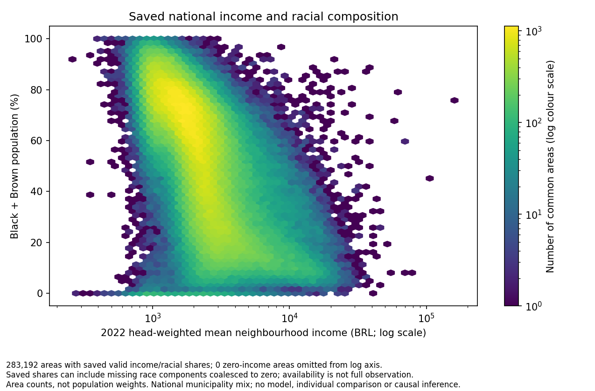

# Annex: national government-data quality assessment

[Read the concise report](gov_data_quality.md). This annex preserves the detailed methods, diagnostics, executable cells and all eleven figures. Both documents update through the same pipeline command.

Assess whether the frozen Obrasgov records and census variables can support a later study of infrastructure proximity, neighbourhood income and racial composition. This report checks source identity, recorded locations, classifications, dates, budgets and census coverage **before distances or regression are implemented**.

[Variable and dataset codebook](../../docs/codebook.md) · [Methods](../../docs/methods.md) · [All reports](../README.md#read-the-reports)

Run `brazil-project run gov-data-quality --config project.toml` to audit local artifacts and update this report. Use `brazil-project report gov_data_quality --from-saved --config project.toml` to refresh verified saved results only. The assessment is national and rejects municipality scope. It does not acquire data, correct coordinates, apply new exclusions or publish the website.

## Processing code and pipeline

The [CLI dispatcher](../../code/brazil_project/cli.py) runs [gov_quality.py → run()](../../code/brazil_project/infrastructure/gov_quality.py#L289). This stage consumes explicit frozen inputs and checks their provenance; it does not automatically rerun harmonisation, indicators or the national Obrasgov flow. The [report engine](../../code/brazil_project/report_engine.py) refreshes only the generated sections below after producer/input checks.

| Responsibility | Active source | Inputs | Saved outputs |
| --- | --- | --- | --- |
| National source, geometry and recorded-location audit | [gov_quality.py → run()](../../code/brazil_project/infrastructure/gov_quality.py#L289) | Frozen Obrasgov source, existing location-QA/state artifacts and reference manifests | `data/intermediate/gov-data-quality/*.parquet` and `report.json` |
| Project identity, classifications, missing fields, dates and budgets | [gov_quality_attributes.py → audit_attributes()](../../code/brazil_project/infrastructure/gov_quality_attributes.py#L80) | Original project rows, preserving repeated taxonomy records | Identity, inconsistency, missingness, timing and budget diagnostics |
| Attribute figures | [gov_quality_attributes.py → write_attribute_figures()](../../code/brazil_project/infrastructure/gov_quality_attributes.py#L301) | Current saved diagnostic tables | `outputs/figures/gov-data-quality/` |
| Census source structure, variable coverage and area-level compatibility | [gov_quality_census.py → audit_census()](../../code/brazil_project/infrastructure/gov_quality_census.py#L330) and [write_census_figures()](../../code/brazil_project/infrastructure/gov_quality_census.py#L412) | Configured raw census tables, complete versioned harmonisation bundle and saved annual indicators | `census_*.parquet` diagnostic tables and current census figures |
| Report presentation | [reporting.py → table() and markdown()](../../code/brazil_project/reporting.py#L13) | Current saved audit tables and exact generated PNG bytes | This Markdown and its figure assets |

See the [pipeline/source guide](../../docs/pipeline-source.md) for processing commands and artifacts. Output status “completed” means the audit software finished; it does not mean the records passed scientific validation.

## How to read this analysis

Source rows, distinct project IDs and geometry components are different units. Repeated rows can reflect taxonomy expansion; several locations can belong to one project. Compare like units and do not interpret extra rows or points as additional investment decisions.

The assessment screens recorded locations, not their verified correctness. An on-land, in-state point can still mark an administrative office or the wrong municipality. A concentration of different project IDs at one coordinate requires review; neither co-location nor a project-name mismatch alone establishes the true construction site. Recorded geometries and category labels remain unchanged.

Income is an area aggregate weighted by household heads; racial composition uses resident population shares. Their missingness and spatial support must be examined before conditional comparisons. Aggregate data do not give the joint distribution of individual race and income. The census year, project snapshot, registration dates and any future network vintage must be distinguished.

## Scope, completeness and source provenance

Read the population counts and frozen-input contract first. The original data and previous approved derivatives remain intact. Large diagnostic datasets are saved locally; the report shows a clearly labelled first-20-row preview where a table is longer.

Processing source: [gov_quality.py → run()](../../code/brazil_project/infrastructure/gov_quality.py#L289). Report display: [reporting.py → table() and markdown()](../../code/brazil_project/reporting.py#L13). This cell reads saved results and defines presentation helpers only.

<details>
<summary>Read scope and completeness</summary>

<!-- brazil:cell gov_data_quality_lineage -->
```python
import json
import pandas as pd
from brazil_project.reporting import table, markdown
summary = report_json("gov-data-quality")
available_tables = set(summary["tables"])
figures = summary["figures"]
required_figures = {"location-overview.png", "point-project-coverage.png", "shared-coordinates-by-state.png",
                    "shared-coordinate-distribution.png", "attribute-missingness.png", "category-consistency.png",
                    "date-coverage.png", "budget-distribution.png", "census-coverage-by-state.png",
                    "income-coverage.png", "income-race-observed.png"}
if required_figures - set(figures):
    raise RuntimeError("Missing required national quality figures: " + ", ".join(sorted(required_figures - set(figures))))
shown_tables = set()
shown_figures = set()
detail_tables = {"missingness", "duplicate_projects", "field_conflicts", "coordinate_sites",
                 "location_examples", "point_project_coverage", "location_by_state", "geometry_summary",
                 "shared_coordinate_by_state", "category_frequency", "dates_anomalies_by_state", "budget_by_state"}

def show_tables(names, caption):
    for name in names:
        if name not in available_tables:
            continue
        frame = ctx.table("gov-data-quality", name)
        shown_tables.add(name)
        folded = name in detail_tables or name.startswith("census_")
        if folded:
            markdown("<details>\n<summary>" + name.replace("_", " ").capitalize() + " — diagnostic table</summary>\n")
        table(frame.head(20), caption + " Saved table: `" + name + ".parquet`."
              + (" Showing the first 20 of " + str(len(frame)) + " rows; complete diagnostics remain in the saved artifact."
                 if len(frame) > 20 else ""))
        if folded:
            markdown("\n</details>")

def show_figure(name, caption):
    report_image(figures[name])
    shown_figures.add(name)
    markdown(caption)

counts = []
for key, label in (("status", "Audit execution status"), ("source_rows", "Original source rows"),
                   ("distinct_projects", "Distinct source project IDs"),
                   ("geometry_components", "Source geometry components")):
    value = summary[key]
    if isinstance(value, (dict, list)):
        value = json.dumps(value, ensure_ascii=False)
    counts.append({"Measure": label, "Value": value})
table(pd.DataFrame(counts), "National frozen-source assessment. Audit completion is not data certification.")
attr, loc = summary["attributes"], summary["locations"]
markdown("**Main quality concerns**\n\n"
         + f"- **Coordinates:** {loc['shared_point_projects']:,} distinct projects have at least one coordinate shared by {loc['shared_coordinate_threshold']} or more project IDs. This is a review signal, not proof of a wrong location.\n"
         + f"- **Timing:** actual starts are present for {attr['projects_with_effective_start_pct']:.2f}% of project IDs and actual finishes for {attr['projects_with_effective_finish_pct']:.2f}%. Registration dates do not date construction or service opening.\n"
         + f"- **Investment:** {attr['projects_with_budget_001']:,} project IDs ({attr['projects_with_budget_001_pct']:.2f}%) report R$0.01; verify their meaning before using investment weights.\n"
         + "- **Census:** saved racial shares can exist despite missing underlying components. The coverage comparison below distinguishes computable results from fully observed inputs.\n")
show_tables(("identity_summary", "missingness"), "Identity and field availability; use each table's stated unit and denominator.")
markdown("<details>\n<summary>Complete frozen-input, output and audit provenance</summary>\n\n```json\n"
         + json.dumps(summary, indent=2, ensure_ascii=False) + "\n```\n\n</details>")
```

</details>

<!-- brazil:output gov_data_quality_lineage begin -->
National frozen-source assessment. Audit completion is not data certification.

<table border="1" class="dataframe">
  <thead>
    <tr style="text-align: right;">
      <th>Measure</th>
      <th>Value</th>
    </tr>
  </thead>
  <tbody>
    <tr>
      <td>Audit execution status</td>
      <td>completed</td>
    </tr>
    <tr>
      <td>Original source rows</td>
      <td>134929</td>
    </tr>
    <tr>
      <td>Distinct source project IDs</td>
      <td>129961</td>
    </tr>
    <tr>
      <td>Source geometry components</td>
      <td>230356</td>
    </tr>
  </tbody>
</table>

**Main quality concerns**

- **Coordinates:** 27,953 distinct projects have at least one coordinate shared by 25 or more project IDs. This is a review signal, not proof of a wrong location.
- **Timing:** actual starts are present for 1.35% of project IDs and actual finishes for 0.95%. Registration dates do not date construction or service opening.
- **Investment:** 20,532 project IDs (15.80%) report R$0.01; verify their meaning before using investment weights.
- **Census:** saved racial shares can exist despite missing underlying components. The coverage comparison below distinguishes computable results from fully observed inputs.


Identity and field availability; use each table's stated unit and denominator. Saved table: `identity_summary.parquet`.

<table border="1" class="dataframe">
  <thead>
    <tr style="text-align: right;">
      <th>Measure</th>
      <th>Count</th>
    </tr>
  </thead>
  <tbody>
    <tr>
      <td>Preserved source rows</td>
      <td>134929</td>
    </tr>
    <tr>
      <td>Distinct nonmissing project IDs</td>
      <td>129961</td>
    </tr>
    <tr>
      <td>Rows without a project ID</td>
      <td>0</td>
    </tr>
    <tr>
      <td>Repeated-ID rows beyond one per ID</td>
      <td>4968</td>
    </tr>
    <tr>
      <td>Project IDs occurring in multiple rows</td>
      <td>2684</td>
    </tr>
    <tr>
      <td>Repeated identical attribute rows (geometry excluded)</td>
      <td>0</td>
    </tr>
  </tbody>
</table>

<details>
<summary>Missingness — diagnostic table</summary>


Identity and field availability; use each table's stated unit and denominator. Saved table: `missingness.parquet`. Showing the first 20 of 36 rows; complete diagnostics remain in the saved artifact.

<table border="1" class="dataframe">
  <thead>
    <tr style="text-align: right;">
      <th>Field</th>
      <th>Meaning</th>
      <th>Source rows missing</th>
      <th>Source rows missing (%)</th>
      <th>Project IDs with any missing row</th>
      <th>Project IDs entirely missing</th>
      <th>Project IDs entirely missing (%)</th>
    </tr>
  </thead>
  <tbody>
    <tr>
      <td>id_projeto_investimento</td>
      <td>Project identifier</td>
      <td>0</td>
      <td>0.0000</td>
      <td>0</td>
      <td>0</td>
      <td>0.0000</td>
    </tr>
    <tr>
      <td>projeto_estruturante</td>
      <td>Strategic-project designation</td>
      <td>80716</td>
      <td>59.8211</td>
      <td>77993</td>
      <td>77993</td>
      <td>60.0126</td>
    </tr>
    <tr>
      <td>desc_nome</td>
      <td>Project name</td>
      <td>0</td>
      <td>0.0000</td>
      <td>0</td>
      <td>0</td>
      <td>0.0000</td>
    </tr>
    <tr>
      <td>nr_cep</td>
      <td>Postal code</td>
      <td>110706</td>
      <td>82.0476</td>
      <td>108438</td>
      <td>108438</td>
      <td>83.4389</td>
    </tr>
    <tr>
      <td>desc_endereco</td>
      <td>Street address</td>
      <td>109493</td>
      <td>81.1486</td>
      <td>107527</td>
      <td>107527</td>
      <td>82.7379</td>
    </tr>
    <tr>
      <td>desc_projeto</td>
      <td>Project description</td>
      <td>3</td>
      <td>0.0022</td>
      <td>3</td>
      <td>3</td>
      <td>0.0023</td>
    </tr>
    <tr>
      <td>desc_funcao_social</td>
      <td>Social-purpose description</td>
      <td>3</td>
      <td>0.0022</td>
      <td>3</td>
      <td>3</td>
      <td>0.0023</td>
    </tr>
    <tr>
      <td>desc_meta_global</td>
      <td>Project goal</td>
      <td>3</td>
      <td>0.0022</td>
      <td>3</td>
      <td>3</td>
      <td>0.0023</td>
    </tr>
    <tr>
      <td>dt_inicial_prevista</td>
      <td>Planned start date</td>
      <td>38</td>
      <td>0.0282</td>
      <td>38</td>
      <td>38</td>
      <td>0.0292</td>
    </tr>
    <tr>
      <td>dt_final_prevista</td>
      <td>Planned finish date</td>
      <td>37</td>
      <td>0.0274</td>
      <td>37</td>
      <td>37</td>
      <td>0.0285</td>
    </tr>
    <tr>
      <td>dt_cadastro</td>
      <td>Registration date</td>
      <td>0</td>
      <td>0.0000</td>
      <td>0</td>
      <td>0</td>
      <td>0.0000</td>
    </tr>
    <tr>
      <td>ano_cadastro</td>
      <td>ano cadastro</td>
      <td>0</td>
      <td>0.0000</td>
      <td>0</td>
      <td>0</td>
      <td>0.0000</td>
    </tr>
    <tr>
      <td>natureza_intervencao</td>
      <td>natureza intervencao</td>
      <td>0</td>
      <td>0.0000</td>
      <td>0</td>
      <td>0</td>
      <td>0.0000</td>
    </tr>
    <tr>
      <td>id_natureza_intervencao</td>
      <td>id natureza intervencao</td>
      <td>0</td>
      <td>0.0000</td>
      <td>0</td>
      <td>0</td>
      <td>0.0000</td>
    </tr>
    <tr>
      <td>especie_intervencao</td>
      <td>especie intervencao</td>
      <td>199</td>
      <td>0.1475</td>
      <td>199</td>
      <td>199</td>
      <td>0.1531</td>
    </tr>
    <tr>
      <td>id_especie_intervencao</td>
      <td>id especie intervencao</td>
      <td>199</td>
      <td>0.1475</td>
      <td>199</td>
      <td>199</td>
      <td>0.1531</td>
    </tr>
    <tr>
      <td>situacao</td>
      <td>Reported project status</td>
      <td>0</td>
      <td>0.0000</td>
      <td>0</td>
      <td>0</td>
      <td>0.0000</td>
    </tr>
    <tr>
      <td>uf_principal</td>
      <td>Primary state</td>
      <td>9</td>
      <td>0.0067</td>
      <td>8</td>
      <td>8</td>
      <td>0.0062</td>
    </tr>
    <tr>
      <td>organizacao_resp</td>
      <td>Responsible organisation</td>
      <td>0</td>
      <td>0.0000</td>
      <td>0</td>
      <td>0</td>
      <td>0.0000</td>
    </tr>
    <tr>
      <td>cnpj_organizacao_resp</td>
      <td>Organisation identifier</td>
      <td>79107</td>
      <td>58.6286</td>
      <td>76061</td>
      <td>76061</td>
      <td>58.5260</td>
    </tr>
  </tbody>
</table>


</details>

<details>
<summary>Complete frozen-input, output and audit provenance</summary>

```json
{
  "status": "completed",
  "scientific_status": "diagnostic screening; provider and methodological review required",
  "policy": "national-quality-audit-v1",
  "scope": "Brazil",
  "as_of_date": "2026-10-07",
  "source_rows": 134929,
  "distinct_projects": 129961,
  "geometry_components": 230356,
  "tables": [
    "identity_summary",
    "missingness",
    "field_conflicts",
    "field_conflict_summary",
    "duplicate_projects",
    "dates_summary",
    "dates_anomalies",
    "dates_anomalies_by_state",
    "budget_anomalies",
    "budget_summary",
    "budget_by_state",
    "category_frequency",
    "category_consistency",
    "location_summary",
    "location_by_state",
    "geometry_summary",
    "coordinate_sites",
    "shared_coordinate_by_state",
    "shared_coordinate_thresholds",
    "point_project_coverage",
    "location_examples",
    "census_source_structure",
    "census_source_variables",
    "census_race_source_quality_by_state",
    "census_income_source_quality_by_state",
    "census_common_area_quality_by_state",
    "census_annual_coverage",
    "census_paired_coverage",
    "census_income_distribution",
    "census_race_population_coverage",
    "census_plot_data",
    "linkage_constraints"
  ],
  "attributes": {
    "source_rows": 134929,
    "distinct_projects": 129961,
    "rows_missing_id": 0,
    "project_id_field": "id_projeto_investimento",
    "as_of_date": "2026-10-07",
    "project_denominator": "Distinct nonmissing original IDs; row-level counts and project flags are separate",
    "absent_fields": [],
    "date_review_year_bounds": [
      1900,
      2099
    ],
    "date_parser": "Translated datetimes or explicit ISO8601; ambiguous date strings flagged invalid",
    "budget_review_value_brl": 0.01,
    "budget_zero_or_low_value_not_excluded": true,
    "registration_not_commencement": true,
    "source_rows_changed": 0,
    "source_values_corrected": 0,
    "projects_with_any_attribute_conflict": 2684,
    "project_attribute_conflicts_by_field": {
      "eixo": 280,
      "id_eixo": 280,
      "id_subtipo": 2093,
      "id_tipo": 1491,
      "subtipo": 2093,
      "tipo": 1491
    },
    "projects_with_effective_start": 1750,
    "projects_with_effective_finish": 1241,
    "projects_with_effective_start_pct": 1.3465578134978955,
    "projects_with_effective_finish_pct": 0.9549018551719362,
    "projects_with_completed_status": 42850,
    "projects_completed_without_effective_finish": 41626,
    "projects_with_budget_001": 20532,
    "projects_with_budget_001_pct": 15.798585729565023,
    "projects_with_category_review": 25216,
    "projects_with_category_review_pct": 19.402743900093103,
    "limitations": [
      "Taxonomy expansion can repeat project rows without being erroneous.",
      "Keyword/category disagreements require provider evidence; no category reclassification.",
      "Actual dates are supplied observations, not independently verified openings.",
      "Agreed-ID budgets are conditional on nonconflicting observed values; missing and conflicting values remain visible.",
      "Geometry, geocoding and census coverage are audited separately."
    ],
    "tables": [
      "identity_summary",
      "missingness",
      "field_conflicts",
      "field_conflict_summary",
      "duplicate_projects",
      "dates_summary",
      "dates_anomalies",
      "dates_anomalies_by_state",
      "budget_anomalies",
      "budget_summary",
      "budget_by_state",
      "classification_conflicts",
      "category_frequency",
      "category_consistency"
    ]
  },
  "locations": {
    "shared_coordinate_threshold": 25,
    "valid_point_components": 202653,
    "invalid_nonempty_point_components": 3,
    "distinct_coordinate_sites": 145299,
    "valid_point_projects": 127081,
    "eligible_point_projects": 126719,
    "shared_point_projects": 27953,
    "only_shared_point_projects": 27951,
    "eligible_nonshared_point_projects": 98767,
    "max_projects_at_one_coordinate": 2645,
    "point_coordinates_corrected": 0,
    "new_exclusions": 0,
    "shared_coordinates_are_review_flags_not_confirmed_errors": true
  },
  "census": {
    "scope": "Brazil",
    "status": "descriptive_quality_audit",
    "n_common_areas": 287178,
    "unit": "source tract and complete harmonised common area, reported separately",
    "no_analysis_started": "No network acquisition, distances, regressions, imputation, corrections or filters",
    "income_definition": "Existing head-weighted tract mean; 2010 converted to July 2022 BRL using configured historical inflation factor",
    "income_coverage_definition": "complete flag excludes missing valid weights/means; zero-head tracts do not contribute and can remain complete",
    "race_availability_definition": "saved finite ratio in [0,1] with positive population denominator",
    "fully_observed_race_definition": "all contributing tract denominators positive and both components finite, nonnegative and summing no higher than population",
    "interpretation": "Availability is not measurement validity. Aggregate income and racial share do not provide individual race-income joint distributions.",
    "limits": [
      "Missing race components can become zero under preserved combined-race aggregation rules.",
      "Common-area income completeness is distinct from whether a finite mean is saved.",
      "Source-year income populations/definitions differ; inflation conversion does not establish comparability.",
      "A common-area racial-composition/income association cannot identify individual income-adjusted racial differences.",
      "Areas spanning states are reported as multi_state, never silently assigned.",
      "This audit does not establish causal timing between the census and infrastructure projects."
    ],
    "harmonisation_version": "8f67986ba3b1f50731be40dc11a183fdda6b8caecd893ed0d9ea5f83ddec1650",
    "harmonisation_generation": "b8b2c1c8082e4defa8e70bcdca4eb3bc",
    "2022_source_join": {
      "both": 458772,
      "left_only": 9327,
      "right_only": 0
    },
    "inflation_factor": 2.0767548108472966,
    "income_validation": [
      {
        "year": 2010,
        "n_common_areas": 287178,
        "inflation_factor": 2.0767548108472966,
        "relative_tolerance": 1e-09,
        "absolute_tolerance_brl": 1e-06,
        "missingness_matched": true,
        "check": "raw eligible head-weighted income versus saved estimate"
      },
      {
        "year": 2022,
        "n_common_areas": 287178,
        "inflation_factor": 1.0,
        "relative_tolerance": 1e-09,
        "absolute_tolerance_brl": 1e-06,
        "missingness_matched": true,
        "check": "raw eligible head-weighted income versus saved estimate"
      }
    ],
    "input_fingerprints": [
      {
        "path": "data/intermediate/harmonisation/current.json",
        "size_bytes": 130,
        "sha256": "3993f1eb4acbcd3f78e0af6c2a9f9285201c6d4889b580705695eee3c4f5579b"
      },
      {
        "path": "data/intermediate/harmonisation/bundles/b8b2c1c8082e4defa8e70bcdca4eb3bc/manifest.json",
        "size_bytes": 3726,
        "sha256": "e4349d0f4776c0aeed54a91c418d0ede5c5ce35cb1b1314a1f3a9c94061cbe84"
      },
      {
        "path": "data/intermediate/harmonisation/bundles/b8b2c1c8082e4defa8e70bcdca4eb3bc/lookup_2010.parquet",
        "size_bytes": 3346825,
        "sha256": "bef096d58c6c05dbfc8df6d0c0be89ee7b80e245717d2a03557b504e1cce8495"
      },
      {
        "path": "data/intermediate/harmonisation/bundles/b8b2c1c8082e4defa8e70bcdca4eb3bc/lookup_2022.parquet",
        "size_bytes": 4340294,
        "sha256": "bafbf3d927aa15d33874f08f37a3564d52e35b7f01e21294c14ec63cf40379b7"
      },
      {
        "path": "data/intermediate/harmonisation/bundles/b8b2c1c8082e4defa8e70bcdca4eb3bc/group_sizes.parquet",
        "size_bytes": 1708191,
        "sha256": "95b1cc83577ade32f4e6acfa60c50a9880a64f72c56c848014c82b76cbd134c5"
      },
      {
        "path": "data/intermediate/harmonisation/bundles/b8b2c1c8082e4defa8e70bcdca4eb3bc/common_geometry_2022.parquet",
        "size_bytes": 335453110,
        "sha256": "e9be7ffde2c1bfea4bb19bf25c05f466d4312730aa74202b98e304124112cdc1"
      },
      {
        "path": "data/intermediate/indicators/report.json",
        "size_bytes": 1181,
        "sha256": "90a7dde263a2a22a4474d62382fa8ab7ce07056997ba37dbb12ea92b824a4f9d"
      },
      {
        "path": "data/raw/ibge/census/2010_tracts_Pessoa_v0.5.0.parquet",
        "size_bytes": 233640046,
        "sha256": "0456b0d73188f6f280c57e65de684101273bd6114bc2b50eaade767693e324d6"
      },
      {
        "path": "data/raw/ibge/census/2022_tracts_Basico_v0.5.0.parquet",
        "size_bytes": 8575820,
        "sha256": "9fd682de762bb2d8d49e88bab0ddf310438b33ecf67725b9e600be35585f972d"
      },
      {
        "path": "data/raw/ibge/census/2022_tracts_Pessoas_v0.5.0.parquet",
        "size_bytes": 166746635,
        "sha256": "09f8eed29c6074c53a97d43db313667c2e1ba3bccd205f5671727ce0297d61f9"
      },
      {
        "path": "data/raw/ibge/census/2010_tracts_ResponsavelRenda_v0.5.0.parquet",
        "size_bytes": 49885367,
        "sha256": "ced5ed327fb925041bc911d550bd6099c0e4bdc34df2845ed5af1845d840099b"
      },
      {
        "path": "data/raw/ibge/census/2022_tracts_ResponsavelRenda_v0.5.0.parquet",
        "size_bytes": 11284737,
        "sha256": "6b17d3b38171bbd07c5804e31addaaaeda813b78195da08168028bb0936c5b91"
      },
      {
        "path": "data/intermediate/indicators/black.parquet",
        "size_bytes": 10970635,
        "sha256": "51309dbcb6158edd320110b89b64a1326528ef3c186e64cc9e4e73aea9b5ec9a"
      },
      {
        "path": "data/intermediate/indicators/brown.parquet",
        "size_bytes": 12409329,
        "sha256": "68c18000fa0c3d48a18862f9d55ade956ea76623ad92a2df85f8dd43280d03f4"
      },
      {
        "path": "data/intermediate/indicators/black_brown.parquet",
        "size_bytes": 12509628,
        "sha256": "f052c0c273a3623f2ecede2269334ccbc88ecd80619d6e9119168521b714aa4e"
      },
      {
        "path": "data/intermediate/indicators/income.parquet",
        "size_bytes": 19695008,
        "sha256": "826c3ed108501da2bc080126a500eaca3553d1fd81072ddc08a956eabd62b1ab"
      },
      {
        "path": "data/intermediate/indicators/population_density.parquet",
        "size_bytes": 14984444,
        "sha256": "79ee99e49c528b2e48d9dea4bece3d28fc16586c89e0989d457c1be76d9baa1c"
      }
    ],
    "input_snapshot_verified_after_read": true
  },
  "figures": {
    "location-overview.png": "outputs/figures/gov-data-quality/location-overview.png",
    "shared-coordinates-by-state.png": "outputs/figures/gov-data-quality/shared-coordinates-by-state.png",
    "shared-coordinate-distribution.png": "outputs/figures/gov-data-quality/shared-coordinate-distribution.png",
    "point-project-coverage.png": "outputs/figures/gov-data-quality/point-project-coverage.png",
    "attribute-missingness.png": "outputs/figures/gov-data-quality/attribute-missingness.png",
    "date-coverage.png": "outputs/figures/gov-data-quality/date-coverage.png",
    "budget-distribution.png": "outputs/figures/gov-data-quality/budget-distribution.png",
    "category-consistency.png": "outputs/figures/gov-data-quality/category-consistency.png",
    "census-coverage-by-state.png": "outputs/figures/gov-data-quality/census-coverage-by-state.png",
    "income-coverage.png": "outputs/figures/gov-data-quality/income-coverage.png",
    "income-race-observed.png": "outputs/figures/gov-data-quality/income-race-observed.png"
  },
  "figure_sha256": {
    "location-overview.png": "813d8fa6341056e6e7c9ee733cf9834c24a44df78a9d5a687f5d2a91b5cec940",
    "shared-coordinates-by-state.png": "155e4408075b3eb12f1e7d3d527aee3ab2d75a3d45b62f40d7824c5a61a711c7",
    "shared-coordinate-distribution.png": "acb136dc30b26dfa8eeea2e85fd441c19ce2788479471549aa231f4f128bc58a",
    "point-project-coverage.png": "6aef74d037d83fafa0c4cc5b9eaa0915f4ac50ea46ae8423b29b36062c6d3a1b",
    "attribute-missingness.png": "18a91ae157e4bb3f9b1d6d3b257a75d5ce9f933b407aa0a818d2d7a515bfaae1",
    "date-coverage.png": "1bac5ac585ce6a91e8dc52563651a2567c115e4046d373f0d05ab7deb229f2c1",
    "budget-distribution.png": "d036479498f5eab246ddb2d7c256edac7291253c1ab86889a691bb61f80bd49b",
    "category-consistency.png": "40a83c5819702d173f276c8fe49dc553fc351228ec25bd0a0f7e2cb661f1d03d",
    "census-coverage-by-state.png": "fc4dcd791932201a1f8f166787f5da2ef16ca7ff0a28d91ff253b7a23d7329a4",
    "income-coverage.png": "c1d179b871b2719a0ebf047d210e00206c6c2c3623e30888b4378401b5bb5bf5",
    "income-race-observed.png": "f82fe796269066f15cca045a0a1246946d5bd5e60f76e99cc32b26bd5bd95f55"
  },
  "output_sha256": {
    "data/intermediate/gov-data-quality/identity_summary.parquet": "de53faac304e532318875926c04f9dccf83e5cd64afcfd60e898fabb25baa9ec",
    "data/intermediate/gov-data-quality/missingness.parquet": "69f7b0cc0889ef9ca8024bf3c261cdaca85afebd8ddb0336d440a6b7a9f199c8",
    "data/intermediate/gov-data-quality/field_conflicts.parquet": "73c1ae9e81b3f9c17d873ead0dca2b589b2edda11d4f6e6f1e5a72612a627b91",
    "data/intermediate/gov-data-quality/field_conflict_summary.parquet": "e287ae3c38c9ce8b4ff65dd47bd7a0386568d3a5cbc0dcff056ebe08af56e63d",
    "data/intermediate/gov-data-quality/duplicate_projects.parquet": "c7ddf6568b5fae308afe2b91089ae1225fc1185d59354eac6a3663deca88d143",
    "data/intermediate/gov-data-quality/dates_summary.parquet": "759a99c7eda6250d82091b0645d6f1ca14d274a874642da5a3ec886b039cfa21",
    "data/intermediate/gov-data-quality/dates_anomalies.parquet": "5554d574c1c3258db23dbf99a58787cfaf37f48cb12fa8984ea56ed663f469b4",
    "data/intermediate/gov-data-quality/dates_anomalies_by_state.parquet": "48296ef6910cf1362383d902e23656874a6baab5f4a584d207c408aca33f69f8",
    "data/intermediate/gov-data-quality/budget_anomalies.parquet": "fc48150121188dc1c5110e10298ff1726c0a8deeef9bf37fcd7abd0ee2db012e",
    "data/intermediate/gov-data-quality/budget_summary.parquet": "af4560e9dac586225963122de428c5b982148080141e5ae61bb8a25ebc42922f",
    "data/intermediate/gov-data-quality/budget_by_state.parquet": "5b6f45edcd46708931e9fd976391af0739c4937d8fc69cbd0e8c52f839b6ad9a",
    "data/intermediate/gov-data-quality/category_frequency.parquet": "88a037a55912eb4624058c6125390241f744a5ac5fe8c2836a87d45ceaba5738",
    "data/intermediate/gov-data-quality/category_consistency.parquet": "af8f741ec81e585c7d2189317778a1a1efa8604237267b67ee01ccd72f34ec3b",
    "data/intermediate/gov-data-quality/location_summary.parquet": "cee95d22b5f6ddbabc5c287c9ba8870bed6d883b28b116c7aa5f390a157b95be",
    "data/intermediate/gov-data-quality/location_by_state.parquet": "6cbce45e38a25cdc553d97f86829757ac7d782f52620e68d3fc740e48fb63d94",
    "data/intermediate/gov-data-quality/geometry_summary.parquet": "e1435d635a6343476e5f4b0b92b333ffe2f70df7f56d57062ded9b863d843904",
    "data/intermediate/gov-data-quality/coordinate_sites.parquet": "859085dfb4e6093de74dbe144128f4e37d443a1f479619ad782f51ec9e407829",
    "data/intermediate/gov-data-quality/shared_coordinate_by_state.parquet": "6cbce45e38a25cdc553d97f86829757ac7d782f52620e68d3fc740e48fb63d94",
    "data/intermediate/gov-data-quality/shared_coordinate_thresholds.parquet": "2cec7f25660eefa2b6cff1f6574a2c211c8bc26d86f2f85fb2cecfdc9831042d",
    "data/intermediate/gov-data-quality/point_project_coverage.parquet": "9b650534f1d6a4a2025a8b20b94c88dd27a6ad8d0fba774302ee106740af4bb5",
    "data/intermediate/gov-data-quality/location_examples.parquet": "9261428f23940c645dbb61ebd4bb1a80a68bdbd7e01b72ecd639e102dddb5807",
    "data/intermediate/gov-data-quality/census_source_structure.parquet": "a5dfb95e99b99ab44e3209cd6b432749c88ba76c39402e3569a6cb783bc09990",
    "data/intermediate/gov-data-quality/census_source_variables.parquet": "c5079fd41f504185ff90e49d3d58e07cb12c03f564f05c73ff95694ff1c12588",
    "data/intermediate/gov-data-quality/census_race_source_quality_by_state.parquet": "d8bab20b9cf47028b289a7bec361e5d61eb72fc6dae66ee418a8ae284cc0bacf",
    "data/intermediate/gov-data-quality/census_income_source_quality_by_state.parquet": "94d6947070b2d94d47a77cf8a6b03eca0f7c5e612bab97a2c7b8ba6e8f37aaf6",
    "data/intermediate/gov-data-quality/census_common_area_quality_by_state.parquet": "78b5a98b543d8307bfbf5142b1da74422577f11edb1d9a45f7c7e95eb35faf13",
    "data/intermediate/gov-data-quality/census_annual_coverage.parquet": "5beef03f7d4e82e27847d98dd77f3a4ffde9a16889d37c0fcdf981564e40ab93",
    "data/intermediate/gov-data-quality/census_paired_coverage.parquet": "2afcac92722709b24ffd667b1dd73afb318a930357f94e6dd8a2219b693ac3af",
    "data/intermediate/gov-data-quality/census_income_distribution.parquet": "2c74c5fe76ef82f296d75f50ecace9fa4241b0c6fbcf941ca7f382c5d6c299fa",
    "data/intermediate/gov-data-quality/census_race_population_coverage.parquet": "c5cbba0f5453acb09c03b542a0e1073fb82df1a363ab9ae69ee33fe813ab390b",
    "data/intermediate/gov-data-quality/census_plot_data.parquet": "32b03da2a9fff7e105ee0feebbeec3013c0c1cbf2b1fae4d05d4f20e20417e44",
    "data/intermediate/gov-data-quality/linkage_constraints.parquet": "6f9f9b951f29c69a1491fb35e42c1d00db8b3860d82a04e72022c1ac0fe71ca2"
  },
  "contract": {
    "source": "data/processed/obrasgov/projects_st.gpkg",
    "source_sha256": "091c27860f78eee1e6abe989dbbef65a8b7412f87d82616d74c30ca6774f17cc",
    "component_source": "data/intermediate/obrasgov-primary-state-filter/component_audit.parquet",
    "inputs": {
      "data/intermediate/obrasgov-location-qa/report.json": "81b2a30073a5b6f741bc27a196d66faaeb89af799635dd293905c67bd8f73491",
      "data/intermediate/obrasgov-primary-state-filter/report.json": "942b5726c831c90a46197405a1fb74ff88d15ecb57025b4bd74e1acb96c50090",
      "data/processed/obrasgov/projects_st.gpkg": "091c27860f78eee1e6abe989dbbef65a8b7412f87d82616d74c30ca6774f17cc",
      "code/brazil_project/infrastructure/location_qa.py": "f8c0d12ef77c89f81122516b92c005fcf250c01ab7b5a555e65cf95340093915",
      "code/scripts/filter_obras_primary_state.py": "8bd2253f83faeebe3bfb88dab1ae33708d499e8d8374ed1be34d5d8e0a4d3d3c",
      "data/reference/location-qa/BR_Municipios_2022.zip": "9c904fa1feb978a89042bfecd7758e571266f285d6122a4ff02ffe37bffb76a2",
      "data/reference/location-qa/ne_10m_land.zip": "e547d749445eaa0964aba76738090ec88f5e63c4585122170f98c67a7ea922dc",
      "data/reference/location-qa/ne_10m_coastline.zip": "bfa04cdbcbef07ef90dfca1dabb48062eca29900a113df0f389303e255484017",
      "data/intermediate/obrasgov-location-qa/source_audit.parquet": "451555ec861c6065f53640bd70ac44793a731562fc7ff331ff15a0ece2c436aa",
      "data/intermediate/obrasgov-location-qa/component_audit.parquet": "a37ced6f2fa55ceb6758914181c34359abae256288d12d897b50c3b7fadb8b05",
      "data/intermediate/obrasgov-location-qa/map_components.parquet": "894b73d13808206f4571754d41efe57b5820ba838459dbc966454c1fb47d38d6",
      "data/intermediate/obrasgov-location-qa/quarantined_components.parquet": "d34beb533c55ecc97fed473e9e9e4c807431c32d88ea61a2342a8e8d924bbab2",
      "data/intermediate/obrasgov-location-qa/review_table.parquet": "d6646ca021901c08c91523d25142b7a44069512650f66800b648b83719621c8b",
      "outputs/tables/obrasgov-primary-state/components.csv": "1d26c299819b06d142c6f36544c3b56c558e075379b801aadee5c89313d45571",
      "outputs/tables/obrasgov-primary-state/by-state.csv": "0014477a1d7f9b1d9c3973fb633837ee7fa7cdff25940734fffdf191e4a83d6e",
      "outputs/tables/obrasgov-primary-state/by-geometry.csv": "076c078cc01d1367042619f2e0a689ae9b4d7e6628be120394be4de6e5e5a487",
      "code/scripts/check_obras_primary_state.py": "e747480b47dc9661227c55481f845bbc4353f7e63c505f703a3a30a9d3b444c4",
      "outputs/tables/obrasgov-primary-state/summary.json": "c82aae90b3b1183bb91d6f499f43b83f2d6a4e0c0ed5f8205c686d64815950d0",
      "data/intermediate/obrasgov-primary-state-filter/component_audit.parquet": "d8b464744a365ca040b0f2255fa836b2980b66ca91a9b58b427917451917e6eb",
      "data/intermediate/obrasgov-primary-state-filter/filtered_components.parquet": "ccb85b13ae45c94e2ca5214cc82ef0b63e589d1a31d95cce85cfa6084e31674f",
      "data/intermediate/obrasgov-primary-state-filter/excluded_components.parquet": "ba54eced89970bce24d23d9aedc58c23b988640aa89e45b34b2d28591f0cf5c9",
      "data/intermediate/obrasgov-primary-state-filter/map_components.parquet": "509af4ee231619b9b5098ea8110fc840e47512da4e820323c209b43823b33a6e",
      "data/intermediate/harmonisation/current.json": "3993f1eb4acbcd3f78e0af6c2a9f9285201c6d4889b580705695eee3c4f5579b",
      "data/intermediate/harmonisation/bundles/b8b2c1c8082e4defa8e70bcdca4eb3bc/manifest.json": "e4349d0f4776c0aeed54a91c418d0ede5c5ce35cb1b1314a1f3a9c94061cbe84",
      "data/intermediate/harmonisation/bundles/b8b2c1c8082e4defa8e70bcdca4eb3bc/lookup_2010.parquet": "bef096d58c6c05dbfc8df6d0c0be89ee7b80e245717d2a03557b504e1cce8495",
      "data/intermediate/harmonisation/bundles/b8b2c1c8082e4defa8e70bcdca4eb3bc/lookup_2022.parquet": "bafbf3d927aa15d33874f08f37a3564d52e35b7f01e21294c14ec63cf40379b7",
      "data/intermediate/harmonisation/bundles/b8b2c1c8082e4defa8e70bcdca4eb3bc/group_sizes.parquet": "95b1cc83577ade32f4e6acfa60c50a9880a64f72c56c848014c82b76cbd134c5",
      "data/intermediate/harmonisation/bundles/b8b2c1c8082e4defa8e70bcdca4eb3bc/common_geometry_2022.parquet": "e9be7ffde2c1bfea4bb19bf25c05f466d4312730aa74202b98e304124112cdc1",
      "data/intermediate/indicators/report.json": "90a7dde263a2a22a4474d62382fa8ab7ce07056997ba37dbb12ea92b824a4f9d",
      "data/raw/ibge/census/2010_tracts_Pessoa_v0.5.0.parquet": "0456b0d73188f6f280c57e65de684101273bd6114bc2b50eaade767693e324d6",
      "data/raw/ibge/census/2022_tracts_Basico_v0.5.0.parquet": "9fd682de762bb2d8d49e88bab0ddf310438b33ecf67725b9e600be35585f972d",
      "data/raw/ibge/census/2022_tracts_Pessoas_v0.5.0.parquet": "09f8eed29c6074c53a97d43db313667c2e1ba3bccd205f5671727ce0297d61f9",
      "data/raw/ibge/census/2010_tracts_ResponsavelRenda_v0.5.0.parquet": "ced5ed327fb925041bc911d550bd6099c0e4bdc34df2845ed5af1845d840099b",
      "data/raw/ibge/census/2022_tracts_ResponsavelRenda_v0.5.0.parquet": "6b17d3b38171bbd07c5804e31addaaaeda813b78195da08168028bb0936c5b91",
      "data/intermediate/indicators/black.parquet": "51309dbcb6158edd320110b89b64a1326528ef3c186e64cc9e4e73aea9b5ec9a",
      "data/intermediate/indicators/brown.parquet": "68c18000fa0c3d48a18862f9d55ade956ea76623ad92a2df85f8dd43280d03f4",
      "data/intermediate/indicators/black_brown.parquet": "f052c0c273a3623f2ecede2269334ccbc88ecd80619d6e9119168521b714aa4e",
      "data/intermediate/indicators/income.parquet": "826c3ed108501da2bc080126a500eaca3553d1fd81072ddc08a956eabd62b1ab",
      "data/intermediate/indicators/population_density.parquet": "79ee99e49c528b2e48d9dea4bece3d28fc16586c89e0989d457c1be76d9baa1c"
    },
    "frozen_qa_contract": {
      "policy_version": "1.0",
      "source_sha256": "091c27860f78eee1e6abe989dbbef65a8b7412f87d82616d74c30ca6774f17cc",
      "references": {
        "municipalities": {
          "path": "BR_Municipios_2022.zip",
          "url": "https://geoftp.ibge.gov.br/organizacao_do_territorio/malhas_territoriais/malhas_municipais/municipio_2022/Brasil/BR/BR_Municipios_2022.zip",
          "description": "IBGE municipal mesh 2022",
          "sha256": "9c904fa1feb978a89042bfecd7758e571266f285d6122a4ff02ffe37bffb76a2",
          "bytes": 203627589,
          "acquired_at": "2026-10-06T11:52:29.156527+00:00"
        },
        "land": {
          "path": "ne_10m_land.zip",
          "url": "https://naturalearth.s3.amazonaws.com/5.1.1/10m_physical/ne_10m_land.zip",
          "description": "Natural Earth land 1:10m, 5.1.1",
          "sha256": "e547d749445eaa0964aba76738090ec88f5e63c4585122170f98c67a7ea922dc",
          "bytes": 3269070,
          "acquired_at": "2026-10-06T11:52:31.427667+00:00"
        },
        "coastline": {
          "path": "ne_10m_coastline.zip",
          "url": "https://naturalearth.s3.amazonaws.com/5.1.1/10m_physical/ne_10m_coastline.zip",
          "description": "Natural Earth ocean coastline 1:10m, release 5.1.1",
          "sha256": "bfa04cdbcbef07ef90dfca1dabb48062eca29900a113df0f389303e255484017",
          "bytes": 3069451,
          "acquired_at": "2026-10-06T11:54:44.640947+00:00"
        }
      },
      "parameters": {
        "coast_tolerance_m": 5000,
        "border_tolerance_m": 1000,
        "sample_spacing_m": 1000,
        "max_line_samples": 250
      },
      "code_sha256": "f8c0d12ef77c89f81122516b92c005fcf250c01ab7b5a555e65cf95340093915"
    },
    "frozen_state_filter_policy": "exclude_entirely_outside_primary_state_v1",
    "input_mode": "verified preserved national artifacts; no acquisition or upstream recomputation"
  },
  "warnings": [
    "Shared source coordinates do not certify individual infrastructure locations.",
    "Current registered project locations and 2010/2022 census demographics have different observation times.",
    "Income and racial composition are aggregate measures; no individual or causal inference is validated.",
    "No coordinates, categories, budgets, dates, census values or approved exclusions were changed."
  ],
  "new_exclusions": 0,
  "source_coordinates_corrected": 0,
  "analytical_models_fitted": false,
  "network_acquired": false,
  "public_map_updated": false,
  "generated_at": "2026-10-07T12:49:31.638930+00:00"
}
```

</details>
<!-- brazil:output gov_data_quality_lineage end -->

## Recorded locations, co-location and spatial eligibility

Existing location-QA and primary-state results describe screening decisions. This assessment additionally examines concentration at repeated coordinates and the relation between recorded administrative fields and geometry. Different IDs at one point may reflect legitimate shared sites, administrative geocoding or entry conventions; source evidence is needed before selecting an explanation.

For a distance study, unusually concentrated recorded locations can dominate nearest-project distances and inverse-distance scores. Counting distinct IDs does not fix an incorrect shared coordinate. Inspect geographic concentration and project labels together. Lines and polygons remain part of this quality assessment even if a later point-distance pilot or the public map omits them.

Processing source: [gov_quality.py → run()](../../code/brazil_project/infrastructure/gov_quality.py#L289). Report display reads spatial diagnostic tables and exact current figure bytes; no coordinate or eligibility rule is modified.

<details>
<summary>Display national spatial diagnostics</summary>

<!-- brazil:cell gov_data_quality_locations -->
```python
show_tables(("location_summary", "location_by_state", "geometry_summary", "point_project_coverage"),
            "National location diagnostics: distinguish source rows, project IDs, coordinates and geometry components.")
for name in ("location-overview.png", "point-project-coverage.png"):
    if name in figures:
        show_figure(name, "**National recorded-location diagnostic.** Frozen source locations and existing screening populations do not verify construction sites or correct coordinates.")
```

</details>

<!-- brazil:output gov_data_quality_locations begin -->
National location diagnostics: distinguish source rows, project IDs, coordinates and geometry components. Saved table: `location_summary.parquet`.

<table border="1" class="dataframe">
  <thead>
    <tr style="text-align: right;">
      <th>Measure</th>
      <th>Count</th>
      <th>Unit</th>
    </tr>
  </thead>
  <tbody>
    <tr>
      <td>Original source rows</td>
      <td>134929</td>
      <td>source rows</td>
    </tr>
    <tr>
      <td>Distinct original projects</td>
      <td>129961</td>
      <td>project IDs</td>
    </tr>
    <tr>
      <td>All decomposed geometries</td>
      <td>230356</td>
      <td>components</td>
    </tr>
    <tr>
      <td>Point geometries</td>
      <td>202656</td>
      <td>components</td>
    </tr>
    <tr>
      <td>Finite world-range point coordinates</td>
      <td>202653</td>
      <td>components</td>
    </tr>
    <tr>
      <td>Distinct exact coordinate sites</td>
      <td>145299</td>
      <td>coordinate sites</td>
    </tr>
    <tr>
      <td>Projects with a valid point</td>
      <td>127081</td>
      <td>project IDs</td>
    </tr>
    <tr>
      <td>Projects with an eligible point after existing rules</td>
      <td>126719</td>
      <td>project IDs</td>
    </tr>
    <tr>
      <td>Projects with at least one shared-coordinate point</td>
      <td>27953</td>
      <td>project IDs</td>
    </tr>
    <tr>
      <td>Projects whose valid points are all shared</td>
      <td>27951</td>
      <td>project IDs</td>
    </tr>
    <tr>
      <td>Projects with an eligible nonshared point</td>
      <td>98767</td>
      <td>project IDs</td>
    </tr>
    <tr>
      <td>Existing baseline map-eligible components</td>
      <td>226309</td>
      <td>components</td>
    </tr>
    <tr>
      <td>Existing primary-state exclusions</td>
      <td>2346</td>
      <td>components</td>
    </tr>
    <tr>
      <td>Existing final map-eligible components</td>
      <td>224495</td>
      <td>components</td>
    </tr>
  </tbody>
</table>

<details>
<summary>Location by state — diagnostic table</summary>


National location diagnostics: distinguish source rows, project IDs, coordinates and geometry components. Saved table: `location_by_state.parquet`. Showing the first 20 of 28 rows; complete diagnostics remain in the saved artifact.

<table border="1" class="dataframe">
  <thead>
    <tr style="text-align: right;">
      <th>state</th>
      <th>distinct_projects</th>
      <th>valid_point_projects</th>
      <th>eligible_point_projects</th>
      <th>shared_point_projects</th>
      <th>only_shared_point_projects</th>
      <th>eligible_nonshared_point_projects</th>
      <th>no_eligible_component_projects</th>
      <th>shared_point_pct</th>
      <th>only_shared_point_pct</th>
    </tr>
  </thead>
  <tbody>
    <tr>
      <td>AC</td>
      <td>1495</td>
      <td>1480</td>
      <td>1476</td>
      <td>233</td>
      <td>233</td>
      <td>1243</td>
      <td>13</td>
      <td>15.7432</td>
      <td>15.7432</td>
    </tr>
    <tr>
      <td>AL</td>
      <td>2580</td>
      <td>2544</td>
      <td>2533</td>
      <td>610</td>
      <td>610</td>
      <td>1923</td>
      <td>41</td>
      <td>23.9780</td>
      <td>23.9780</td>
    </tr>
    <tr>
      <td>AM</td>
      <td>2717</td>
      <td>2666</td>
      <td>2658</td>
      <td>664</td>
      <td>664</td>
      <td>1994</td>
      <td>33</td>
      <td>24.9062</td>
      <td>24.9062</td>
    </tr>
    <tr>
      <td>AP</td>
      <td>1341</td>
      <td>1330</td>
      <td>1321</td>
      <td>77</td>
      <td>77</td>
      <td>1244</td>
      <td>17</td>
      <td>5.7895</td>
      <td>5.7895</td>
    </tr>
    <tr>
      <td>BA</td>
      <td>9279</td>
      <td>9108</td>
      <td>9078</td>
      <td>2837</td>
      <td>2837</td>
      <td>6241</td>
      <td>184</td>
      <td>31.1484</td>
      <td>31.1484</td>
    </tr>
    <tr>
      <td>CE</td>
      <td>5947</td>
      <td>5822</td>
      <td>5807</td>
      <td>1749</td>
      <td>1749</td>
      <td>4058</td>
      <td>128</td>
      <td>30.0412</td>
      <td>30.0412</td>
    </tr>
    <tr>
      <td>DF</td>
      <td>991</td>
      <td>951</td>
      <td>949</td>
      <td>161</td>
      <td>161</td>
      <td>788</td>
      <td>36</td>
      <td>16.9295</td>
      <td>16.9295</td>
    </tr>
    <tr>
      <td>ES</td>
      <td>1877</td>
      <td>1803</td>
      <td>1798</td>
      <td>223</td>
      <td>223</td>
      <td>1575</td>
      <td>69</td>
      <td>12.3683</td>
      <td>12.3683</td>
    </tr>
    <tr>
      <td>GO</td>
      <td>4251</td>
      <td>4162</td>
      <td>4162</td>
      <td>996</td>
      <td>996</td>
      <td>3166</td>
      <td>79</td>
      <td>23.9308</td>
      <td>23.9308</td>
    </tr>
    <tr>
      <td>MA</td>
      <td>7645</td>
      <td>7550</td>
      <td>7503</td>
      <td>2978</td>
      <td>2976</td>
      <td>4526</td>
      <td>127</td>
      <td>39.4437</td>
      <td>39.4172</td>
    </tr>
    <tr>
      <td>MG</td>
      <td>12983</td>
      <td>12739</td>
      <td>12724</td>
      <td>2657</td>
      <td>2657</td>
      <td>10067</td>
      <td>241</td>
      <td>20.8572</td>
      <td>20.8572</td>
    </tr>
    <tr>
      <td>MS</td>
      <td>2548</td>
      <td>2455</td>
      <td>2450</td>
      <td>709</td>
      <td>709</td>
      <td>1741</td>
      <td>89</td>
      <td>28.8798</td>
      <td>28.8798</td>
    </tr>
    <tr>
      <td>MT</td>
      <td>2968</td>
      <td>2925</td>
      <td>2925</td>
      <td>808</td>
      <td>808</td>
      <td>2117</td>
      <td>30</td>
      <td>27.6239</td>
      <td>27.6239</td>
    </tr>
    <tr>
      <td>Missing</td>
      <td>8</td>
      <td>3</td>
      <td>3</td>
      <td>0</td>
      <td>0</td>
      <td>3</td>
      <td>5</td>
      <td>0.0000</td>
      <td>0.0000</td>
    </tr>
    <tr>
      <td>PA</td>
      <td>5004</td>
      <td>4901</td>
      <td>4884</td>
      <td>1725</td>
      <td>1725</td>
      <td>3159</td>
      <td>100</td>
      <td>35.1969</td>
      <td>35.1969</td>
    </tr>
    <tr>
      <td>PB</td>
      <td>4388</td>
      <td>4337</td>
      <td>4329</td>
      <td>721</td>
      <td>721</td>
      <td>3608</td>
      <td>53</td>
      <td>16.6244</td>
      <td>16.6244</td>
    </tr>
    <tr>
      <td>PE</td>
      <td>5491</td>
      <td>5362</td>
      <td>5352</td>
      <td>1890</td>
      <td>1890</td>
      <td>3462</td>
      <td>106</td>
      <td>35.2480</td>
      <td>35.2480</td>
    </tr>
    <tr>
      <td>PI</td>
      <td>5593</td>
      <td>5428</td>
      <td>5418</td>
      <td>1142</td>
      <td>1142</td>
      <td>4276</td>
      <td>163</td>
      <td>21.0391</td>
      <td>21.0391</td>
    </tr>
    <tr>
      <td>PR</td>
      <td>5740</td>
      <td>5643</td>
      <td>5630</td>
      <td>1444</td>
      <td>1444</td>
      <td>4186</td>
      <td>100</td>
      <td>25.5892</td>
      <td>25.5892</td>
    </tr>
    <tr>
      <td>RJ</td>
      <td>4244</td>
      <td>4153</td>
      <td>4125</td>
      <td>633</td>
      <td>633</td>
      <td>3492</td>
      <td>115</td>
      <td>15.2420</td>
      <td>15.2420</td>
    </tr>
  </tbody>
</table>


</details>

<details>
<summary>Geometry summary — diagnostic table</summary>


National location diagnostics: distinguish source rows, project IDs, coordinates and geometry components. Saved table: `geometry_summary.parquet`.

<table border="1" class="dataframe">
  <thead>
    <tr style="text-align: right;">
      <th>geometry_type</th>
      <th>location_status</th>
      <th>components</th>
      <th>distinct_projects</th>
      <th>eligible_components</th>
    </tr>
  </thead>
  <tbody>
    <tr>
      <td>LineString</td>
      <td>administrative_or_coordinate_review</td>
      <td>721</td>
      <td>88</td>
      <td>392</td>
    </tr>
    <tr>
      <td>LineString</td>
      <td>eligible_unverified</td>
      <td>23460</td>
      <td>490</td>
      <td>23460</td>
    </tr>
    <tr>
      <td>MultiPoint</td>
      <td>quarantined_invalid_location</td>
      <td>1509</td>
      <td>1493</td>
      <td>0</td>
    </tr>
    <tr>
      <td>Point</td>
      <td>administrative_or_coordinate_review</td>
      <td>1342</td>
      <td>286</td>
      <td>0</td>
    </tr>
    <tr>
      <td>Point</td>
      <td>border_review</td>
      <td>62</td>
      <td>33</td>
      <td>0</td>
    </tr>
    <tr>
      <td>Point</td>
      <td>coastal_review</td>
      <td>75</td>
      <td>54</td>
      <td>0</td>
    </tr>
    <tr>
      <td>Point</td>
      <td>eligible_unverified</td>
      <td>200643</td>
      <td>126719</td>
      <td>200643</td>
    </tr>
    <tr>
      <td>Point</td>
      <td>possible_marine_review</td>
      <td>6</td>
      <td>4</td>
      <td>0</td>
    </tr>
    <tr>
      <td>Point</td>
      <td>quarantined_invalid_location</td>
      <td>14</td>
      <td>14</td>
      <td>0</td>
    </tr>
    <tr>
      <td>Point</td>
      <td>quarantined_offshore</td>
      <td>428</td>
      <td>236</td>
      <td>0</td>
    </tr>
    <tr>
      <td>Point</td>
      <td>quarantined_outside_brazil</td>
      <td>86</td>
      <td>58</td>
      <td>0</td>
    </tr>
    <tr>
      <td>Polygon</td>
      <td>polygon_display_excluded</td>
      <td>2010</td>
      <td>972</td>
      <td>0</td>
    </tr>
  </tbody>
</table>


</details>

<details>
<summary>Point project coverage — diagnostic table</summary>


National location diagnostics: distinguish source rows, project IDs, coordinates and geometry components. Saved table: `point_project_coverage.parquet`. Showing the first 20 of 129961 rows; complete diagnostics remain in the saved artifact.

<table border="1" class="dataframe">
  <thead>
    <tr style="text-align: right;">
      <th>project_id</th>
      <th>state</th>
      <th>has_valid_point</th>
      <th>has_eligible_point</th>
      <th>has_shared_point</th>
      <th>has_nonshared_point</th>
      <th>has_eligible_nonshared_point</th>
      <th>has_line</th>
      <th>has_polygon</th>
      <th>has_no_eligible_component</th>
      <th>only_shared_valid_points</th>
      <th>only_shared_eligible_points</th>
    </tr>
  </thead>
  <tbody>
    <tr>
      <td>01.31-16</td>
      <td>MG</td>
      <td>True</td>
      <td>True</td>
      <td>False</td>
      <td>True</td>
      <td>True</td>
      <td>False</td>
      <td>False</td>
      <td>False</td>
      <td>False</td>
      <td>False</td>
    </tr>
    <tr>
      <td>02.53-10</td>
      <td>DF</td>
      <td>True</td>
      <td>True</td>
      <td>False</td>
      <td>True</td>
      <td>True</td>
      <td>False</td>
      <td>False</td>
      <td>False</td>
      <td>False</td>
      <td>False</td>
    </tr>
    <tr>
      <td>06.53-80</td>
      <td>DF</td>
      <td>True</td>
      <td>True</td>
      <td>False</td>
      <td>True</td>
      <td>True</td>
      <td>False</td>
      <td>False</td>
      <td>False</td>
      <td>False</td>
      <td>False</td>
    </tr>
    <tr>
      <td>08.28-84</td>
      <td>SE</td>
      <td>True</td>
      <td>True</td>
      <td>False</td>
      <td>True</td>
      <td>True</td>
      <td>False</td>
      <td>False</td>
      <td>False</td>
      <td>False</td>
      <td>False</td>
    </tr>
    <tr>
      <td>10.27-98</td>
      <td>AL</td>
      <td>False</td>
      <td>False</td>
      <td>False</td>
      <td>False</td>
      <td>False</td>
      <td>False</td>
      <td>False</td>
      <td>True</td>
      <td>False</td>
      <td>False</td>
    </tr>
    <tr>
      <td>10000.29-12</td>
      <td>BA</td>
      <td>True</td>
      <td>True</td>
      <td>False</td>
      <td>True</td>
      <td>True</td>
      <td>False</td>
      <td>False</td>
      <td>False</td>
      <td>False</td>
      <td>False</td>
    </tr>
    <tr>
      <td>100000.22-27</td>
      <td>PI</td>
      <td>True</td>
      <td>True</td>
      <td>False</td>
      <td>True</td>
      <td>True</td>
      <td>False</td>
      <td>False</td>
      <td>False</td>
      <td>False</td>
      <td>False</td>
    </tr>
    <tr>
      <td>100001.22-72</td>
      <td>PI</td>
      <td>True</td>
      <td>True</td>
      <td>True</td>
      <td>False</td>
      <td>False</td>
      <td>False</td>
      <td>False</td>
      <td>False</td>
      <td>True</td>
      <td>True</td>
    </tr>
    <tr>
      <td>100002.22-18</td>
      <td>PI</td>
      <td>True</td>
      <td>True</td>
      <td>True</td>
      <td>False</td>
      <td>False</td>
      <td>False</td>
      <td>False</td>
      <td>False</td>
      <td>True</td>
      <td>True</td>
    </tr>
    <tr>
      <td>100003.22-63</td>
      <td>PI</td>
      <td>True</td>
      <td>True</td>
      <td>True</td>
      <td>False</td>
      <td>False</td>
      <td>False</td>
      <td>False</td>
      <td>False</td>
      <td>True</td>
      <td>True</td>
    </tr>
    <tr>
      <td>100004.22-09</td>
      <td>PI</td>
      <td>True</td>
      <td>True</td>
      <td>False</td>
      <td>True</td>
      <td>True</td>
      <td>False</td>
      <td>False</td>
      <td>False</td>
      <td>False</td>
      <td>False</td>
    </tr>
    <tr>
      <td>100005.22-54</td>
      <td>PI</td>
      <td>True</td>
      <td>True</td>
      <td>True</td>
      <td>False</td>
      <td>False</td>
      <td>False</td>
      <td>False</td>
      <td>False</td>
      <td>True</td>
      <td>True</td>
    </tr>
    <tr>
      <td>100006.22-00</td>
      <td>PI</td>
      <td>True</td>
      <td>True</td>
      <td>False</td>
      <td>True</td>
      <td>True</td>
      <td>False</td>
      <td>False</td>
      <td>False</td>
      <td>False</td>
      <td>False</td>
    </tr>
    <tr>
      <td>100007.22-45</td>
      <td>PI</td>
      <td>True</td>
      <td>True</td>
      <td>True</td>
      <td>False</td>
      <td>False</td>
      <td>False</td>
      <td>False</td>
      <td>False</td>
      <td>True</td>
      <td>True</td>
    </tr>
    <tr>
      <td>100008.22-90</td>
      <td>PI</td>
      <td>True</td>
      <td>True</td>
      <td>True</td>
      <td>False</td>
      <td>False</td>
      <td>False</td>
      <td>False</td>
      <td>False</td>
      <td>True</td>
      <td>True</td>
    </tr>
    <tr>
      <td>100009.22-36</td>
      <td>PI</td>
      <td>True</td>
      <td>True</td>
      <td>True</td>
      <td>False</td>
      <td>False</td>
      <td>False</td>
      <td>False</td>
      <td>False</td>
      <td>True</td>
      <td>True</td>
    </tr>
    <tr>
      <td>10001.17-54</td>
      <td>TO</td>
      <td>True</td>
      <td>True</td>
      <td>False</td>
      <td>True</td>
      <td>True</td>
      <td>False</td>
      <td>False</td>
      <td>False</td>
      <td>False</td>
      <td>False</td>
    </tr>
    <tr>
      <td>100010.22-83</td>
      <td>PI</td>
      <td>True</td>
      <td>True</td>
      <td>True</td>
      <td>False</td>
      <td>False</td>
      <td>False</td>
      <td>False</td>
      <td>False</td>
      <td>True</td>
      <td>True</td>
    </tr>
    <tr>
      <td>100011.22-29</td>
      <td>PI</td>
      <td>True</td>
      <td>True</td>
      <td>True</td>
      <td>False</td>
      <td>False</td>
      <td>False</td>
      <td>False</td>
      <td>False</td>
      <td>True</td>
      <td>True</td>
    </tr>
    <tr>
      <td>100012.22-74</td>
      <td>PI</td>
      <td>True</td>
      <td>True</td>
      <td>True</td>
      <td>False</td>
      <td>False</td>
      <td>False</td>
      <td>False</td>
      <td>False</td>
      <td>True</td>
      <td>True</td>
    </tr>
  </tbody>
</table>


</details>


**National recorded-location diagnostic.** Frozen source locations and existing screening populations do not verify construction sites or correct coordinates.



**National recorded-location diagnostic.** Frozen source locations and existing screening populations do not verify construction sites or correct coordinates.
<!-- brazil:output gov_data_quality_locations end -->

## Repeated coordinates and administrative-location signals

Different project IDs may share a legitimate site, but large coordinate clusters may also record an administrative office rather than construction locations. Review the concentration, responsible agencies, categories and project names together. State consistency cannot detect all within-state location errors. Thresholds here are diagnostics, not new filters or a declaration that every shared point is wrong.

The default review threshold is **25 distinct project IDs at the exact same longitude and latitude**, without rounding or snapping. The sensitivity plot also checks thresholds of 2, 5, 10, 50 and 100. A project with several points is counted once in each project-level statistic; a separate flag identifies projects whose valid points are all shared.

Processing source: [gov_quality.py → run()](../../code/brazil_project/infrastructure/gov_quality.py#L289). Report display reads saved coordinate-site and state-level summaries. Long examples are previewed; full project-level records remain local.

<details>
<summary>Display shared-coordinate concentration</summary>

<!-- brazil:cell gov_data_quality_shared_coordinates -->
```python
show_tables(("shared_coordinate_thresholds", "shared_coordinate_by_state", "coordinate_sites", "location_examples"),
            "Co-location diagnostics: count distinct project IDs separately from retained point components.")
for name in ("shared-coordinates-by-state.png", "shared-coordinate-distribution.png"):
    if name in figures:
        show_figure(name, "**Shared recorded coordinates.** Different IDs at one position are a review signal; duplicate IDs and the cause of co-location are separate questions. No location is corrected or removed.")
```

</details>

<!-- brazil:output gov_data_quality_shared_coordinates begin -->
Co-location diagnostics: count distinct project IDs separately from retained point components. Saved table: `shared_coordinate_thresholds.parquet`.

<table border="1" class="dataframe">
  <thead>
    <tr style="text-align: right;">
      <th>Distinct projects at one exact coordinate</th>
      <th>Coordinate sites meeting threshold</th>
      <th>Projects with at least one such point</th>
      <th>Share of valid-point projects (%)</th>
    </tr>
  </thead>
  <tbody>
    <tr>
      <td>2</td>
      <td>11114</td>
      <td>51191</td>
      <td>40.2822</td>
    </tr>
    <tr>
      <td>5</td>
      <td>1140</td>
      <td>33776</td>
      <td>26.5783</td>
    </tr>
    <tr>
      <td>10</td>
      <td>297</td>
      <td>30484</td>
      <td>23.9879</td>
    </tr>
    <tr>
      <td>25</td>
      <td>77</td>
      <td>27953</td>
      <td>21.9962</td>
    </tr>
    <tr>
      <td>50</td>
      <td>48</td>
      <td>26935</td>
      <td>21.1951</td>
    </tr>
    <tr>
      <td>100</td>
      <td>31</td>
      <td>25808</td>
      <td>20.3083</td>
    </tr>
  </tbody>
</table>

<details>
<summary>Shared coordinate by state — diagnostic table</summary>


Co-location diagnostics: count distinct project IDs separately from retained point components. Saved table: `shared_coordinate_by_state.parquet`. Showing the first 20 of 28 rows; complete diagnostics remain in the saved artifact.

<table border="1" class="dataframe">
  <thead>
    <tr style="text-align: right;">
      <th>state</th>
      <th>distinct_projects</th>
      <th>valid_point_projects</th>
      <th>eligible_point_projects</th>
      <th>shared_point_projects</th>
      <th>only_shared_point_projects</th>
      <th>eligible_nonshared_point_projects</th>
      <th>no_eligible_component_projects</th>
      <th>shared_point_pct</th>
      <th>only_shared_point_pct</th>
    </tr>
  </thead>
  <tbody>
    <tr>
      <td>AC</td>
      <td>1495</td>
      <td>1480</td>
      <td>1476</td>
      <td>233</td>
      <td>233</td>
      <td>1243</td>
      <td>13</td>
      <td>15.7432</td>
      <td>15.7432</td>
    </tr>
    <tr>
      <td>AL</td>
      <td>2580</td>
      <td>2544</td>
      <td>2533</td>
      <td>610</td>
      <td>610</td>
      <td>1923</td>
      <td>41</td>
      <td>23.9780</td>
      <td>23.9780</td>
    </tr>
    <tr>
      <td>AM</td>
      <td>2717</td>
      <td>2666</td>
      <td>2658</td>
      <td>664</td>
      <td>664</td>
      <td>1994</td>
      <td>33</td>
      <td>24.9062</td>
      <td>24.9062</td>
    </tr>
    <tr>
      <td>AP</td>
      <td>1341</td>
      <td>1330</td>
      <td>1321</td>
      <td>77</td>
      <td>77</td>
      <td>1244</td>
      <td>17</td>
      <td>5.7895</td>
      <td>5.7895</td>
    </tr>
    <tr>
      <td>BA</td>
      <td>9279</td>
      <td>9108</td>
      <td>9078</td>
      <td>2837</td>
      <td>2837</td>
      <td>6241</td>
      <td>184</td>
      <td>31.1484</td>
      <td>31.1484</td>
    </tr>
    <tr>
      <td>CE</td>
      <td>5947</td>
      <td>5822</td>
      <td>5807</td>
      <td>1749</td>
      <td>1749</td>
      <td>4058</td>
      <td>128</td>
      <td>30.0412</td>
      <td>30.0412</td>
    </tr>
    <tr>
      <td>DF</td>
      <td>991</td>
      <td>951</td>
      <td>949</td>
      <td>161</td>
      <td>161</td>
      <td>788</td>
      <td>36</td>
      <td>16.9295</td>
      <td>16.9295</td>
    </tr>
    <tr>
      <td>ES</td>
      <td>1877</td>
      <td>1803</td>
      <td>1798</td>
      <td>223</td>
      <td>223</td>
      <td>1575</td>
      <td>69</td>
      <td>12.3683</td>
      <td>12.3683</td>
    </tr>
    <tr>
      <td>GO</td>
      <td>4251</td>
      <td>4162</td>
      <td>4162</td>
      <td>996</td>
      <td>996</td>
      <td>3166</td>
      <td>79</td>
      <td>23.9308</td>
      <td>23.9308</td>
    </tr>
    <tr>
      <td>MA</td>
      <td>7645</td>
      <td>7550</td>
      <td>7503</td>
      <td>2978</td>
      <td>2976</td>
      <td>4526</td>
      <td>127</td>
      <td>39.4437</td>
      <td>39.4172</td>
    </tr>
    <tr>
      <td>MG</td>
      <td>12983</td>
      <td>12739</td>
      <td>12724</td>
      <td>2657</td>
      <td>2657</td>
      <td>10067</td>
      <td>241</td>
      <td>20.8572</td>
      <td>20.8572</td>
    </tr>
    <tr>
      <td>MS</td>
      <td>2548</td>
      <td>2455</td>
      <td>2450</td>
      <td>709</td>
      <td>709</td>
      <td>1741</td>
      <td>89</td>
      <td>28.8798</td>
      <td>28.8798</td>
    </tr>
    <tr>
      <td>MT</td>
      <td>2968</td>
      <td>2925</td>
      <td>2925</td>
      <td>808</td>
      <td>808</td>
      <td>2117</td>
      <td>30</td>
      <td>27.6239</td>
      <td>27.6239</td>
    </tr>
    <tr>
      <td>Missing</td>
      <td>8</td>
      <td>3</td>
      <td>3</td>
      <td>0</td>
      <td>0</td>
      <td>3</td>
      <td>5</td>
      <td>0.0000</td>
      <td>0.0000</td>
    </tr>
    <tr>
      <td>PA</td>
      <td>5004</td>
      <td>4901</td>
      <td>4884</td>
      <td>1725</td>
      <td>1725</td>
      <td>3159</td>
      <td>100</td>
      <td>35.1969</td>
      <td>35.1969</td>
    </tr>
    <tr>
      <td>PB</td>
      <td>4388</td>
      <td>4337</td>
      <td>4329</td>
      <td>721</td>
      <td>721</td>
      <td>3608</td>
      <td>53</td>
      <td>16.6244</td>
      <td>16.6244</td>
    </tr>
    <tr>
      <td>PE</td>
      <td>5491</td>
      <td>5362</td>
      <td>5352</td>
      <td>1890</td>
      <td>1890</td>
      <td>3462</td>
      <td>106</td>
      <td>35.2480</td>
      <td>35.2480</td>
    </tr>
    <tr>
      <td>PI</td>
      <td>5593</td>
      <td>5428</td>
      <td>5418</td>
      <td>1142</td>
      <td>1142</td>
      <td>4276</td>
      <td>163</td>
      <td>21.0391</td>
      <td>21.0391</td>
    </tr>
    <tr>
      <td>PR</td>
      <td>5740</td>
      <td>5643</td>
      <td>5630</td>
      <td>1444</td>
      <td>1444</td>
      <td>4186</td>
      <td>100</td>
      <td>25.5892</td>
      <td>25.5892</td>
    </tr>
    <tr>
      <td>RJ</td>
      <td>4244</td>
      <td>4153</td>
      <td>4125</td>
      <td>633</td>
      <td>633</td>
      <td>3492</td>
      <td>115</td>
      <td>15.2420</td>
      <td>15.2420</td>
    </tr>
  </tbody>
</table>


</details>

<details>
<summary>Coordinate sites — diagnostic table</summary>


Co-location diagnostics: count distinct project IDs separately from retained point components. Saved table: `coordinate_sites.parquet`. Showing the first 20 of 145299 rows; complete diagnostics remain in the saved artifact.

<table border="1" class="dataframe">
  <thead>
    <tr style="text-align: right;">
      <th>coordinate_key</th>
      <th>longitude</th>
      <th>latitude</th>
      <th>distinct_projects</th>
      <th>point_components</th>
      <th>eligible_distinct_projects</th>
      <th>review_shared_coordinate</th>
    </tr>
  </thead>
  <tbody>
    <tr>
      <td>-0x1.34162e09fe868p+5|-0x1.9f1355475a31ap+3</td>
      <td>-38.5108</td>
      <td>-12.9711</td>
      <td>2645</td>
      <td>2645</td>
      <td>2645</td>
      <td>True</td>
    </tr>
    <tr>
      <td>-0x1.5f8092ccf6be3p+5|-0x1.3ebbb83cf2cf9p+4</td>
      <td>-43.9378</td>
      <td>-19.9208</td>
      <td>2422</td>
      <td>2422</td>
      <td>2422</td>
      <td>True</td>
    </tr>
    <tr>
      <td>-0x1.626c17ebaf102p+5|-0x1.43cddd6e04c06p+1</td>
      <td>-44.3028</td>
      <td>-2.5297</td>
      <td>2181</td>
      <td>2181</td>
      <td>2181</td>
      <td>True</td>
    </tr>
    <tr>
      <td>-0x1.170c8366516dbp+5|-0x1.01b97785729b3p+3</td>
      <td>-34.8811</td>
      <td>-8.0539</td>
      <td>1846</td>
      <td>1846</td>
      <td>1846</td>
      <td>True</td>
    </tr>
    <tr>
      <td>-0x1.34589df1172efp+5|-0x1.dbf43419e3001p+1</td>
      <td>-38.5433</td>
      <td>-3.7184</td>
      <td>1665</td>
      <td>1665</td>
      <td>1665</td>
      <td>True</td>
    </tr>
    <tr>
      <td>-0x1.8407f77af6406p+5|-0x1.74b1465e89225p+0</td>
      <td>-48.5039</td>
      <td>-1.4558</td>
      <td>1590</td>
      <td>1590</td>
      <td>1590</td>
      <td>True</td>
    </tr>
    <tr>
      <td>-0x1.99d70a3d70a3dp+5|-0x1.e08769ec2ce46p+4</td>
      <td>-51.2300</td>
      <td>-30.0331</td>
      <td>1378</td>
      <td>1378</td>
      <td>1378</td>
      <td>True</td>
    </tr>
    <tr>
      <td>-0x1.8a2f3a14cec42p+5|-0x1.96d82fd75e204p+4</td>
      <td>-49.2731</td>
      <td>-25.4278</td>
      <td>1360</td>
      <td>1360</td>
      <td>1360</td>
      <td>True</td>
    </tr>
    <tr>
      <td>-0x1.751104d551d69p+5|-0x1.78ceee0f3cb3ep+4</td>
      <td>-46.6333</td>
      <td>-23.5505</td>
      <td>1248</td>
      <td>1248</td>
      <td>1248</td>
      <td>True</td>
    </tr>
    <tr>
      <td>-0x1.566a5f84cad58p+5|-0x1.45b4f61672325p+2</td>
      <td>-42.8019</td>
      <td>-5.0892</td>
      <td>1076</td>
      <td>1076</td>
      <td>1076</td>
      <td>True</td>
    </tr>
    <tr>
      <td>-0x1.8a07f77af6406p+5|-0x1.0adb9628cbd12p+4</td>
      <td>-49.2539</td>
      <td>-16.6786</td>
      <td>897</td>
      <td>897</td>
      <td>897</td>
      <td>True</td>
    </tr>
    <tr>
      <td>-0x1.846540cc78e9fp+5|-0x1.b98bf5d78811bp+4</td>
      <td>-48.5494</td>
      <td>-27.5967</td>
      <td>826</td>
      <td>826</td>
      <td>826</td>
      <td>True</td>
    </tr>
    <tr>
      <td>-0x1.c0c5faebc408ep+5|-0x1.f31355475a31ap+3</td>
      <td>-56.0967</td>
      <td>-15.5961</td>
      <td>736</td>
      <td>736</td>
      <td>736</td>
      <td>True</td>
    </tr>
    <tr>
      <td>-0x1.b52bce8533b10p+5|-0x1.4715a07b352a8p+4</td>
      <td>-54.6464</td>
      <td>-20.4428</td>
      <td>664</td>
      <td>664</td>
      <td>664</td>
      <td>True</td>
    </tr>
    <tr>
      <td>-0x1.16e38da3c2118p+5|-0x1.c760bf5d78812p+2</td>
      <td>-34.8611</td>
      <td>-7.1153</td>
      <td>651</td>
      <td>651</td>
      <td>651</td>
      <td>True</td>
    </tr>
    <tr>
      <td>-0x1.e02c80c73abc9p+5|-0x1.8f3c60029f16bp+1</td>
      <td>-60.0217</td>
      <td>-3.1190</td>
      <td>635</td>
      <td>635</td>
      <td>635</td>
      <td>True</td>
    </tr>
    <tr>
      <td>-0x1.5975350092ccfp+5|-0x1.6e80b242070b9p+4</td>
      <td>-43.1822</td>
      <td>-22.9064</td>
      <td>563</td>
      <td>563</td>
      <td>563</td>
      <td>True</td>
    </tr>
    <tr>
      <td>-0x1.1de1ff2e48e8ap+5|-0x1.354fca42aed14p+3</td>
      <td>-35.7353</td>
      <td>-9.6660</td>
      <td>560</td>
      <td>560</td>
      <td>560</td>
      <td>True</td>
    </tr>
    <tr>
      <td>-0x1.19aceee0f3cb4p+5|-0x1.72e147ae147aep+2</td>
      <td>-35.2094</td>
      <td>-5.7950</td>
      <td>532</td>
      <td>532</td>
      <td>532</td>
      <td>True</td>
    </tr>
    <tr>
      <td>-0x1.82ab4b72c5198p+5|-0x1.45e30014f8b59p+3</td>
      <td>-48.3336</td>
      <td>-10.1840</td>
      <td>517</td>
      <td>517</td>
      <td>517</td>
      <td>True</td>
    </tr>
  </tbody>
</table>


</details>

<details>
<summary>Location examples — diagnostic table</summary>


Co-location diagnostics: count distinct project IDs separately from retained point components. Saved table: `location_examples.parquet`. Showing the first 20 of 36 rows; complete diagnostics remain in the saved artifact.

<table border="1" class="dataframe">
  <thead>
    <tr style="text-align: right;">
      <th>longitude</th>
      <th>latitude</th>
      <th>distinct_projects_at_coordinate</th>
      <th>project_id</th>
      <th>reported_state</th>
      <th>project_name</th>
      <th>reported_type</th>
      <th>responsible_organisation</th>
      <th>interpretation</th>
    </tr>
  </thead>
  <tbody>
    <tr>
      <td>-38.5108</td>
      <td>-12.9711</td>
      <td>2645</td>
      <td>66044.29-31</td>
      <td>BA</td>
      <td>700283 - CE Prof. Faraildes Santos - - Ampliação e Reforma - Jequié/BA</td>
      <td>Infraestrutura Hídrica, Portos, Hidrovia</td>
      <td>FUNDO NACIONAL DE DESENVOLVIMENTO DA EDUCAÇÃO</td>
      <td>Unverified shared source coordinate; review provider record.</td>
    </tr>
    <tr>
      <td>-38.5108</td>
      <td>-12.9711</td>
      <td>2645</td>
      <td>72740.29-97</td>
      <td>BA</td>
      <td>PAC 2 - Construção de Quadra Escolar Coberta 005</td>
      <td>Infraestrutura Hídrica, Portos, Hidrovia</td>
      <td>FUNDO NACIONAL DE DESENVOLVIMENTO DA EDUCAÇÃO</td>
      <td>Unverified shared source coordinate; review provider record.</td>
    </tr>
    <tr>
      <td>-38.5108</td>
      <td>-12.9711</td>
      <td>2645</td>
      <td>70027.29-71</td>
      <td>BA</td>
      <td>Riacho das Pedrinhas - Creche</td>
      <td>Infraestrutura Hídrica, Portos, Hidrovia</td>
      <td>FUNDO NACIONAL DE DESENVOLVIMENTO DA EDUCAÇÃO</td>
      <td>Unverified shared source coordinate; review provider record.</td>
    </tr>
    <tr>
      <td>-43.9378</td>
      <td>-19.9208</td>
      <td>2422</td>
      <td>70252.31-97</td>
      <td>MG</td>
      <td>700136/11 - E Educação Infantil C - Fronteira dos Vales/MG</td>
      <td>Infraestrutura Hídrica, Portos, Hidrovia</td>
      <td>FUNDO NACIONAL DE DESENVOLVIMENTO DA EDUCAÇÃO</td>
      <td>Unverified shared source coordinate; review provider record.</td>
    </tr>
    <tr>
      <td>-43.9378</td>
      <td>-19.9208</td>
      <td>2422</td>
      <td>74813.31-50</td>
      <td>MG</td>
      <td>PAC 2 - EE Elpídio Aristides de Freitas (31001597)</td>
      <td>Infraestrutura Hídrica, Portos, Hidrovia</td>
      <td>FUNDO NACIONAL DE DESENVOLVIMENTO DA EDUCAÇÃO</td>
      <td>Unverified shared source coordinate; review provider record.</td>
    </tr>
    <tr>
      <td>-43.9378</td>
      <td>-19.9208</td>
      <td>2422</td>
      <td>72786.31-23</td>
      <td>MG</td>
      <td>PAC 2 - EE Frederico Zacarias (31031852)</td>
      <td>Infraestrutura Hídrica, Portos, Hidrovia</td>
      <td>FUNDO NACIONAL DE DESENVOLVIMENTO DA EDUCAÇÃO</td>
      <td>Unverified shared source coordinate; review provider record.</td>
    </tr>
    <tr>
      <td>-44.3028</td>
      <td>-2.5297</td>
      <td>2181</td>
      <td>81042.21-07</td>
      <td>MA</td>
      <td>PAC 2 - Construção de Quadra Escolar Coberta 003/2013 - Buriti - MA</td>
      <td>Infraestrutura Hídrica, Portos, Hidrovia</td>
      <td>FUNDO NACIONAL DE DESENVOLVIMENTO DA EDUCAÇÃO</td>
      <td>Unverified shared source coordinate; review provider record.</td>
    </tr>
    <tr>
      <td>-44.3028</td>
      <td>-2.5297</td>
      <td>2181</td>
      <td>81084.21-79</td>
      <td>MA</td>
      <td>PAC 2 - Construção de Quadra Escolar Coberta 003/2013 - Cajari - MA</td>
      <td>Infraestrutura Hídrica, Portos, Hidrovia</td>
      <td>FUNDO NACIONAL DE DESENVOLVIMENTO DA EDUCAÇÃO</td>
      <td>Unverified shared source coordinate; review provider record.</td>
    </tr>
    <tr>
      <td>-44.3028</td>
      <td>-2.5297</td>
      <td>2181</td>
      <td>75824.21-07</td>
      <td>MA</td>
      <td>E. M. POVOADO SÃO RAIMUNDO</td>
      <td>Infraestrutura Hídrica, Portos, Hidrovia</td>
      <td>FUNDO NACIONAL DE DESENVOLVIMENTO DA EDUCAÇÃO</td>
      <td>Unverified shared source coordinate; review provider record.</td>
    </tr>
    <tr>
      <td>-34.8811</td>
      <td>-8.0539</td>
      <td>1846</td>
      <td>66561.26-54</td>
      <td>PE</td>
      <td>700099 - Espaço Educativo Urbano II - 6 salas - São João/PE</td>
      <td>Infraestrutura Hídrica, Portos, Hidrovia</td>
      <td>FUNDO NACIONAL DE DESENVOLVIMENTO DA EDUCAÇÃO</td>
      <td>Unverified shared source coordinate; review provider record.</td>
    </tr>
    <tr>
      <td>-34.8811</td>
      <td>-8.0539</td>
      <td>1846</td>
      <td>87026.26-75</td>
      <td>PE</td>
      <td>ESCOLA MUNICIPAL DO JIRAU - Itaíba - PE</td>
      <td>Infraestrutura Hídrica, Portos, Hidrovia</td>
      <td>FUNDO NACIONAL DE DESENVOLVIMENTO DA EDUCAÇÃO</td>
      <td>Unverified shared source coordinate; review provider record.</td>
    </tr>
    <tr>
      <td>-34.8811</td>
      <td>-8.0539</td>
      <td>1846</td>
      <td>69161.26-09</td>
      <td>PE</td>
      <td>E MUN MARIA JOSÉ QUEIROZ MONTEIRO - GAMELEIRA/PE</td>
      <td>Infraestrutura Hídrica, Portos, Hidrovia</td>
      <td>FUNDO NACIONAL DE DESENVOLVIMENTO DA EDUCAÇÃO</td>
      <td>Unverified shared source coordinate; review provider record.</td>
    </tr>
    <tr>
      <td>-38.5433</td>
      <td>-3.7184</td>
      <td>1665</td>
      <td>79386.23-38</td>
      <td>CE</td>
      <td>PAC 2 - Construção de Quadra Escolar Coberta 009/2013 - São Benedito - CE</td>
      <td>Infraestrutura Hídrica, Portos, Hidrovia</td>
      <td>FUNDO NACIONAL DE DESENVOLVIMENTO DA EDUCAÇÃO</td>
      <td>Unverified shared source coordinate; review provider record.</td>
    </tr>
    <tr>
      <td>-38.5433</td>
      <td>-3.7184</td>
      <td>1665</td>
      <td>82981.23-11</td>
      <td>CE</td>
      <td>CONSTRUÇÃO EXPEDITO DIOGENES - Jaguaribe - CE</td>
      <td>Infraestrutura Hídrica, Portos, Hidrovia</td>
      <td>FUNDO NACIONAL DE DESENVOLVIMENTO DA EDUCAÇÃO</td>
      <td>Unverified shared source coordinate; review provider record.</td>
    </tr>
    <tr>
      <td>-38.5433</td>
      <td>-3.7184</td>
      <td>1665</td>
      <td>83382.23-18</td>
      <td>CE</td>
      <td>PAC 2 - CRECHE - Dom Timóteo Tipo I</td>
      <td>Infraestrutura Hídrica, Portos, Hidrovia</td>
      <td>FUNDO NACIONAL DE DESENVOLVIMENTO DA EDUCAÇÃO</td>
      <td>Unverified shared source coordinate; review provider record.</td>
    </tr>
    <tr>
      <td>-48.5039</td>
      <td>-1.4558</td>
      <td>1590</td>
      <td>82297.15-23</td>
      <td>PA</td>
      <td>EMEF FRANSCISCO DE FARIAS - Anapu - PA</td>
      <td>Infraestrutura Hídrica, Portos, Hidrovia</td>
      <td>FUNDO NACIONAL DE DESENVOLVIMENTO DA EDUCAÇÃO</td>
      <td>Unverified shared source coordinate; review provider record.</td>
    </tr>
    <tr>
      <td>-48.5039</td>
      <td>-1.4558</td>
      <td>1590</td>
      <td>134091.15-46</td>
      <td>PA</td>
      <td>PROINFÂNCIA MULTIRÃO</td>
      <td>Infraestrutura Hídrica, Portos, Hidrovia</td>
      <td>FUNDO NACIONAL DE DESENVOLVIMENTO DA EDUCAÇÃO</td>
      <td>Unverified shared source coordinate; review provider record.</td>
    </tr>
    <tr>
      <td>-48.5039</td>
      <td>-1.4558</td>
      <td>1590</td>
      <td>77245.15-10</td>
      <td>PA</td>
      <td>PAC 2 - Construção de Quadra Escolar Coberta - Eley Duarte - Almeirim - PA</td>
      <td>Infraestrutura Hídrica, Portos, Hidrovia</td>
      <td>FUNDO NACIONAL DE DESENVOLVIMENTO DA EDUCAÇÃO</td>
      <td>Unverified shared source coordinate; review provider record.</td>
    </tr>
    <tr>
      <td>-51.2300</td>
      <td>-30.0331</td>
      <td>1378</td>
      <td>132684.43-10</td>
      <td>RS</td>
      <td>Área Institucional - Escola Municipal Prenotado sob nº 187.681, sob nº 2 da quadra nº 48 - Muliterno - RS</td>
      <td>Infraestrutura Hídrica, Portos, Hidrovia</td>
      <td>FUNDO NACIONAL DE DESENVOLVIMENTO DA EDUCAÇÃO</td>
      <td>Unverified shared source coordinate; review provider record.</td>
    </tr>
    <tr>
      <td>-51.2300</td>
      <td>-30.0331</td>
      <td>1378</td>
      <td>67425.43-09</td>
      <td>RS</td>
      <td>657689 - Esc. Educ. Infantil - Pq Universitário - CANOAS/RS</td>
      <td>Infraestrutura Hídrica, Portos, Hidrovia</td>
      <td>FUNDO NACIONAL DE DESENVOLVIMENTO DA EDUCAÇÃO</td>
      <td>Unverified shared source coordinate; review provider record.</td>
    </tr>
  </tbody>
</table>


</details>


**Shared recorded coordinates.** Different IDs at one position are a review signal; duplicate IDs and the cause of co-location are separate questions. No location is corrected or removed.



**Shared recorded coordinates.** Different IDs at one position are a review signal; duplicate IDs and the cause of co-location are separate questions. No location is corrected or removed.
<!-- brazil:output gov_data_quality_shared_coordinates end -->

## Project identity and category consistency

Repeated project IDs are audited before any project-level count or budget sum. Taxonomy-expanded rows may repeat the same budget, while conflicting fields need an explicit resolution rule for a later analysis. Neither duplicates nor conflicting records are silently consolidated here.

Classifications describe the available source labels. Disagreement between category, name and responsible agency is a review signal, not an automatic reclassification.

Processing source: [gov_quality_attributes.py → audit_attributes()](../../code/brazil_project/infrastructure/gov_quality_attributes.py#L80) and [write_attribute_figures()](../../code/brazil_project/infrastructure/gov_quality_attributes.py#L301). Report display reads saved tables; flags are diagnostic and do not delete records.

<details>
<summary>Display national attribute diagnostics</summary>

<!-- brazil:cell gov_data_quality_categories -->
```python
show_tables(("duplicate_projects", "field_conflict_summary", "field_conflicts", "classification_conflicts", "category_consistency", "category_frequency"),
            "Identity and taxonomy diagnostics; duplicated rows and conflicting fields remain preserved.")
for name, caption in (("attribute-missingness.png", "**Field availability.** The saved denominator is source rows or distinct project IDs as labelled; missing values do not establish that a project lacks an attribute in reality."),
                      ("category-consistency.png", "**Classification consistency.** Source labels and rule-based review flags describe the snapshot; flagged projects are not reclassified.")):
    if name in figures:
        show_figure(name, caption)
```

</details>

<!-- brazil:output gov_data_quality_categories begin -->
<details>
<summary>Duplicate projects — diagnostic table</summary>


Identity and taxonomy diagnostics; duplicated rows and conflicting fields remain preserved. Saved table: `duplicate_projects.parquet`. Showing the first 20 of 2684 rows; complete diagnostics remain in the saved artifact.

<table border="1" class="dataframe">
  <thead>
    <tr style="text-align: right;">
      <th>Project ID</th>
      <th>Source rows</th>
      <th>Reported state(s)</th>
      <th>Fields with conflicting nonmissing values</th>
    </tr>
  </thead>
  <tbody>
    <tr>
      <td>4242.31-60</td>
      <td>39</td>
      <td>MG</td>
      <td>6</td>
    </tr>
    <tr>
      <td>30087.35-92</td>
      <td>22</td>
      <td>SP</td>
      <td>6</td>
    </tr>
    <tr>
      <td>45980.35-67</td>
      <td>22</td>
      <td>SP</td>
      <td>6</td>
    </tr>
    <tr>
      <td>45978.35-30</td>
      <td>20</td>
      <td>SP</td>
      <td>6</td>
    </tr>
    <tr>
      <td>16010.35-71</td>
      <td>18</td>
      <td>SP</td>
      <td>6</td>
    </tr>
    <tr>
      <td>3150.35-17</td>
      <td>18</td>
      <td>SP</td>
      <td>6</td>
    </tr>
    <tr>
      <td>3147.35-90</td>
      <td>16</td>
      <td>SP</td>
      <td>6</td>
    </tr>
    <tr>
      <td>4860.35-59</td>
      <td>16</td>
      <td>SP</td>
      <td>6</td>
    </tr>
    <tr>
      <td>105495.35-87</td>
      <td>15</td>
      <td>SP</td>
      <td>6</td>
    </tr>
    <tr>
      <td>106635.35-51</td>
      <td>15</td>
      <td>SP</td>
      <td>6</td>
    </tr>
    <tr>
      <td>3149.35-14</td>
      <td>15</td>
      <td>SP</td>
      <td>6</td>
    </tr>
    <tr>
      <td>134573.35-10</td>
      <td>14</td>
      <td>SP</td>
      <td>4</td>
    </tr>
    <tr>
      <td>4834.35-93</td>
      <td>14</td>
      <td>SP</td>
      <td>6</td>
    </tr>
    <tr>
      <td>16032.35-09</td>
      <td>13</td>
      <td>SP</td>
      <td>6</td>
    </tr>
    <tr>
      <td>27259.35-33</td>
      <td>13</td>
      <td>SP</td>
      <td>6</td>
    </tr>
    <tr>
      <td>3148.35-57</td>
      <td>13</td>
      <td>SP</td>
      <td>6</td>
    </tr>
    <tr>
      <td>3151.35-84</td>
      <td>13</td>
      <td>SP</td>
      <td>6</td>
    </tr>
    <tr>
      <td>31657.35-19</td>
      <td>13</td>
      <td>SP</td>
      <td>6</td>
    </tr>
    <tr>
      <td>5295.35-95</td>
      <td>13</td>
      <td>SP</td>
      <td>4</td>
    </tr>
    <tr>
      <td>103343.35-00</td>
      <td>12</td>
      <td>SP</td>
      <td>4</td>
    </tr>
  </tbody>
</table>


</details>

Identity and taxonomy diagnostics; duplicated rows and conflicting fields remain preserved. Saved table: `field_conflict_summary.parquet`.

<table border="1" class="dataframe">
  <thead>
    <tr style="text-align: right;">
      <th>Field</th>
      <th>Project IDs with conflicting values</th>
      <th>Project IDs (%)</th>
    </tr>
  </thead>
  <tbody>
    <tr>
      <td>eixo</td>
      <td>280</td>
      <td>0.2154</td>
    </tr>
    <tr>
      <td>id_eixo</td>
      <td>280</td>
      <td>0.2154</td>
    </tr>
    <tr>
      <td>id_subtipo</td>
      <td>2093</td>
      <td>1.6105</td>
    </tr>
    <tr>
      <td>id_tipo</td>
      <td>1491</td>
      <td>1.1473</td>
    </tr>
    <tr>
      <td>subtipo</td>
      <td>2093</td>
      <td>1.6105</td>
    </tr>
    <tr>
      <td>tipo</td>
      <td>1491</td>
      <td>1.1473</td>
    </tr>
  </tbody>
</table>

<details>
<summary>Field conflicts — diagnostic table</summary>


Identity and taxonomy diagnostics; duplicated rows and conflicting fields remain preserved. Saved table: `field_conflicts.parquet`. Showing the first 20 of 7728 rows; complete diagnostics remain in the saved artifact.

<table border="1" class="dataframe">
  <thead>
    <tr style="text-align: right;">
      <th>Project ID</th>
      <th>Field</th>
      <th>Distinct nonmissing values</th>
      <th>Values</th>
      <th>Interpretation</th>
    </tr>
  </thead>
  <tbody>
    <tr>
      <td>34863.31-06</td>
      <td>eixo</td>
      <td>2</td>
      <td>Administrativo | Social</td>
      <td>May be legitimate taxonomy expansion; review</td>
    </tr>
    <tr>
      <td>101436.29-81</td>
      <td>eixo</td>
      <td>2</td>
      <td>Econômico | Social</td>
      <td>May be legitimate taxonomy expansion; review</td>
    </tr>
    <tr>
      <td>53271.35-70</td>
      <td>eixo</td>
      <td>2</td>
      <td>Administrativo | Militar</td>
      <td>May be legitimate taxonomy expansion; review</td>
    </tr>
    <tr>
      <td>106495.25-10</td>
      <td>eixo</td>
      <td>2</td>
      <td>Administrativo | Social</td>
      <td>May be legitimate taxonomy expansion; review</td>
    </tr>
    <tr>
      <td>34865.31-19</td>
      <td>eixo</td>
      <td>2</td>
      <td>Administrativo | Econômico</td>
      <td>May be legitimate taxonomy expansion; review</td>
    </tr>
    <tr>
      <td>101456.50-55</td>
      <td>eixo</td>
      <td>2</td>
      <td>Econômico | Social</td>
      <td>May be legitimate taxonomy expansion; review</td>
    </tr>
    <tr>
      <td>101744.25-24</td>
      <td>eixo</td>
      <td>2</td>
      <td>Administrativo | Social</td>
      <td>May be legitimate taxonomy expansion; review</td>
    </tr>
    <tr>
      <td>136700.43-57</td>
      <td>eixo</td>
      <td>2</td>
      <td>Administrativo | Econômico</td>
      <td>May be legitimate taxonomy expansion; review</td>
    </tr>
    <tr>
      <td>129014.29-72</td>
      <td>eixo</td>
      <td>2</td>
      <td>Econômico | Social</td>
      <td>May be legitimate taxonomy expansion; review</td>
    </tr>
    <tr>
      <td>138345.51-74</td>
      <td>eixo</td>
      <td>2</td>
      <td>Administrativo | Social</td>
      <td>May be legitimate taxonomy expansion; review</td>
    </tr>
    <tr>
      <td>14668.35-00</td>
      <td>eixo</td>
      <td>2</td>
      <td>Administrativo | Econômico</td>
      <td>May be legitimate taxonomy expansion; review</td>
    </tr>
    <tr>
      <td>101459.51-15</td>
      <td>eixo</td>
      <td>2</td>
      <td>Econômico | Social</td>
      <td>May be legitimate taxonomy expansion; review</td>
    </tr>
    <tr>
      <td>102748.25-84</td>
      <td>eixo</td>
      <td>2</td>
      <td>Administrativo | Social</td>
      <td>May be legitimate taxonomy expansion; review</td>
    </tr>
    <tr>
      <td>95353.43-21</td>
      <td>eixo</td>
      <td>2</td>
      <td>Administrativo | Social</td>
      <td>May be legitimate taxonomy expansion; review</td>
    </tr>
    <tr>
      <td>5211.42-70</td>
      <td>eixo</td>
      <td>2</td>
      <td>Administrativo | Social</td>
      <td>May be legitimate taxonomy expansion; review</td>
    </tr>
    <tr>
      <td>58075.35-55</td>
      <td>eixo</td>
      <td>2</td>
      <td>Administrativo | Social</td>
      <td>May be legitimate taxonomy expansion; review</td>
    </tr>
    <tr>
      <td>101440.25-50</td>
      <td>eixo</td>
      <td>2</td>
      <td>Administrativo | Social</td>
      <td>May be legitimate taxonomy expansion; review</td>
    </tr>
    <tr>
      <td>46483.53-66</td>
      <td>eixo</td>
      <td>2</td>
      <td>Econômico | Social</td>
      <td>May be legitimate taxonomy expansion; review</td>
    </tr>
    <tr>
      <td>92373.43-09</td>
      <td>eixo</td>
      <td>2</td>
      <td>Administrativo | Social</td>
      <td>May be legitimate taxonomy expansion; review</td>
    </tr>
    <tr>
      <td>42654.33-50</td>
      <td>eixo</td>
      <td>2</td>
      <td>Militar | Social</td>
      <td>May be legitimate taxonomy expansion; review</td>
    </tr>
  </tbody>
</table>


</details>

Identity and taxonomy diagnostics; duplicated rows and conflicting fields remain preserved. Saved table: `category_consistency.parquet`.

<table border="1" class="dataframe">
  <thead>
    <tr style="text-align: right;">
      <th>Review signal</th>
      <th>Supplied category</th>
      <th>Source rows</th>
      <th>Distinct project IDs</th>
      <th>Category project IDs</th>
      <th>Category projects flagged (%)</th>
      <th>Interpretation</th>
    </tr>
  </thead>
  <tbody>
    <tr>
      <td>Education description/provider with water/ports category</td>
      <td>Infraestrutura Hídrica, Portos, Hidrovia</td>
      <td>25216</td>
      <td>25216</td>
      <td>28373</td>
      <td>88.8732</td>
      <td>Keyword screening only; supplied categories retained, not certified misclassification</td>
    </tr>
  </tbody>
</table>

<details>
<summary>Category frequency — diagnostic table</summary>


Identity and taxonomy diagnostics; duplicated rows and conflicting fields remain preserved. Saved table: `category_frequency.parquet`. Showing the first 20 of 26 rows; complete diagnostics remain in the saved artifact.

<table border="1" class="dataframe">
  <thead>
    <tr style="text-align: right;">
      <th>Category</th>
      <th>Source rows</th>
      <th>Distinct project IDs</th>
    </tr>
  </thead>
  <tbody>
    <tr>
      <td>Infraestrutura Hídrica, Portos, Hidrovia</td>
      <td>28711</td>
      <td>28373</td>
    </tr>
    <tr>
      <td>Infraestrutura Urbana e Mobilidade</td>
      <td>26212</td>
      <td>25814</td>
    </tr>
    <tr>
      <td>Educação</td>
      <td>18281</td>
      <td>17246</td>
    </tr>
    <tr>
      <td>Saúde</td>
      <td>15996</td>
      <td>15942</td>
    </tr>
    <tr>
      <td>Desenvolvimento</td>
      <td>11550</td>
      <td>11453</td>
    </tr>
    <tr>
      <td>Rodovia</td>
      <td>7382</td>
      <td>7264</td>
    </tr>
    <tr>
      <td>Defesa Civil</td>
      <td>6432</td>
      <td>6424</td>
    </tr>
    <tr>
      <td>Administrativo</td>
      <td>5785</td>
      <td>5025</td>
    </tr>
    <tr>
      <td>Esporte</td>
      <td>5172</td>
      <td>5160</td>
    </tr>
    <tr>
      <td>Assistência Social</td>
      <td>3550</td>
      <td>3533</td>
    </tr>
    <tr>
      <td>Cultura</td>
      <td>1278</td>
      <td>1245</td>
    </tr>
    <tr>
      <td>Segurança Pública</td>
      <td>1122</td>
      <td>1102</td>
    </tr>
    <tr>
      <td>Meio Ambiente</td>
      <td>962</td>
      <td>850</td>
    </tr>
    <tr>
      <td>Agricultura e Organização Agrária</td>
      <td>629</td>
      <td>622</td>
    </tr>
    <tr>
      <td>Defesa Nacional</td>
      <td>562</td>
      <td>546</td>
    </tr>
    <tr>
      <td>Trabalho e Emprego</td>
      <td>291</td>
      <td>291</td>
    </tr>
    <tr>
      <td>Aviação Civil</td>
      <td>200</td>
      <td>150</td>
    </tr>
    <tr>
      <td>Missing category</td>
      <td>200</td>
      <td>200</td>
    </tr>
    <tr>
      <td>Energia</td>
      <td>156</td>
      <td>144</td>
    </tr>
    <tr>
      <td>Indústria, Serviços e Comércio Exterior</td>
      <td>139</td>
      <td>139</td>
    </tr>
  </tbody>
</table>


</details>



**Field availability.** The saved denominator is source rows or distinct project IDs as labelled; missing values do not establish that a project lacks an attribute in reality.



**Classification consistency.** Source labels and rule-based review flags describe the snapshot; flagged projects are not reclassified.
<!-- brazil:output gov_data_quality_categories end -->

## Dates and recorded investment values

Registration, planned start, planned finish and actual completion are different events; none automatically gives an operational opening date. Missing dates remain missing. Chronological anomalies are audited against the recorded as-of date, not silently repaired.

Source-row budget sums can repeat investments belonging to the same project ID. Conflicting, negative, unusually small or implausible amounts need provider review before investment becomes a model weight. A distinct-ID diagnostic describes consistency; it does not authorize choosing among conflicting values.

Processing source: [gov_quality_attributes.py → audit_attributes()](../../code/brazil_project/infrastructure/gov_quality_attributes.py#L80) and [write_attribute_figures()](../../code/brazil_project/infrastructure/gov_quality_attributes.py#L301). The report displays saved timing and budget diagnostics without imputing values.

<details>
<summary>Display timing and investment quality</summary>

<!-- brazil:cell gov_data_quality_dates_budgets -->
```python
show_tables(("dates_summary", "dates_anomalies_by_state"),
            "Date coverage and consistency: distinguish registration, plans and actual events; unavailable dates are not inferred.")
show_tables(("budget_summary", "budget_by_state"),
            "Investment diagnostics in recorded reais; source-row sums are not automatically distinct-project investment totals.")
for name, caption in (("date-coverage.png", "**Date coverage.** Registration and planned dates cannot substitute for verified completion or opening dates."),
                      ("budget-distribution.png", "**Recorded investment distribution.** Repetition and unusual values are quality signals; these figures do not validate investment amounts.")):
    if name in figures:
        show_figure(name, caption)
```

</details>

<!-- brazil:output gov_data_quality_dates_budgets begin -->
Date coverage and consistency: distinguish registration, plans and actual events; unavailable dates are not inferred. Saved table: `dates_summary.parquet`.

<table border="1" class="dataframe">
  <thead>
    <tr style="text-align: right;">
      <th>Date field</th>
      <th>Source field</th>
      <th>Field supplied</th>
      <th>Source rows with parsed date</th>
      <th>Project IDs with any parsed date</th>
      <th>Project coverage (%)</th>
      <th>Source rows missing</th>
      <th>Source rows invalid</th>
      <th>Source rows future</th>
      <th>Source rows year outside 1900–2099</th>
      <th>Interpretation</th>
    </tr>
  </thead>
  <tbody>
    <tr>
      <td>Registration</td>
      <td>dt_cadastro</td>
      <td>True</td>
      <td>134929</td>
      <td>129961</td>
      <td>100.0000</td>
      <td>0</td>
      <td>0</td>
      <td>0</td>
      <td>0</td>
      <td>Registration is not commencement or commissioning</td>
    </tr>
    <tr>
      <td>Planned start</td>
      <td>dt_inicial_prevista</td>
      <td>True</td>
      <td>134891</td>
      <td>129923</td>
      <td>99.9708</td>
      <td>38</td>
      <td>0</td>
      <td>345</td>
      <td>0</td>
      <td>Future planned dates may be legitimate</td>
    </tr>
    <tr>
      <td>Planned finish</td>
      <td>dt_final_prevista</td>
      <td>True</td>
      <td>134892</td>
      <td>129924</td>
      <td>99.9715</td>
      <td>37</td>
      <td>0</td>
      <td>47640</td>
      <td>101</td>
      <td>Future planned dates may be legitimate</td>
    </tr>
    <tr>
      <td>Actual start</td>
      <td>dt_inicial_efetiva</td>
      <td>True</td>
      <td>1971</td>
      <td>1750</td>
      <td>1.3466</td>
      <td>132958</td>
      <td>0</td>
      <td>0</td>
      <td>0</td>
      <td>An actual date is reported, not independently verified</td>
    </tr>
    <tr>
      <td>Actual finish</td>
      <td>dt_final_efetiva</td>
      <td>True</td>
      <td>1445</td>
      <td>1241</td>
      <td>0.9549</td>
      <td>133484</td>
      <td>0</td>
      <td>2</td>
      <td>0</td>
      <td>An actual date is reported, not independently verified</td>
    </tr>
  </tbody>
</table>

<details>
<summary>Dates anomalies by state — diagnostic table</summary>


Date coverage and consistency: distinguish registration, plans and actual events; unavailable dates are not inferred. Saved table: `dates_anomalies_by_state.parquet`. Showing the first 20 of 28 rows; complete diagnostics remain in the saved artifact.

<table border="1" class="dataframe">
  <thead>
    <tr style="text-align: right;">
      <th>Reported state(s)</th>
      <th>Distinct project IDs</th>
      <th>Registration: missing</th>
      <th>Registration: invalid parse</th>
      <th>Registration: future</th>
      <th>Registration: year outside 1900–2099</th>
      <th>Planned start: missing</th>
      <th>Planned start: invalid parse</th>
      <th>Planned start: future</th>
      <th>Planned start: year outside 1900–2099</th>
      <th>Planned finish: missing</th>
      <th>Planned finish: invalid parse</th>
      <th>Planned finish: future</th>
      <th>Planned finish: year outside 1900–2099</th>
      <th>Actual start: missing</th>
      <th>Actual start: invalid parse</th>
      <th>Actual start: future</th>
      <th>Actual start: year outside 1900–2099</th>
      <th>Actual finish: missing</th>
      <th>Actual finish: invalid parse</th>
      <th>Actual finish: future</th>
      <th>Actual finish: year outside 1900–2099</th>
      <th>Actual finish precedes actual start</th>
      <th>Planned finish precedes planned start</th>
      <th>Registration follows planned start</th>
      <th>Completed status without actual finish</th>
      <th>Completed status with future actual finish</th>
    </tr>
  </thead>
  <tbody>
    <tr>
      <td>AC</td>
      <td>1495</td>
      <td>0</td>
      <td>0</td>
      <td>0</td>
      <td>0</td>
      <td>0</td>
      <td>0</td>
      <td>4</td>
      <td>0</td>
      <td>0</td>
      <td>0</td>
      <td>562</td>
      <td>3</td>
      <td>1486</td>
      <td>0</td>
      <td>0</td>
      <td>0</td>
      <td>1492</td>
      <td>0</td>
      <td>0</td>
      <td>0</td>
      <td>0</td>
      <td>4</td>
      <td>928</td>
      <td>291</td>
      <td>0</td>
    </tr>
    <tr>
      <td>AL</td>
      <td>2580</td>
      <td>0</td>
      <td>0</td>
      <td>0</td>
      <td>0</td>
      <td>1</td>
      <td>0</td>
      <td>9</td>
      <td>0</td>
      <td>1</td>
      <td>0</td>
      <td>1003</td>
      <td>8</td>
      <td>2526</td>
      <td>0</td>
      <td>0</td>
      <td>0</td>
      <td>2548</td>
      <td>0</td>
      <td>0</td>
      <td>0</td>
      <td>0</td>
      <td>8</td>
      <td>1678</td>
      <td>828</td>
      <td>0</td>
    </tr>
    <tr>
      <td>AM</td>
      <td>2717</td>
      <td>0</td>
      <td>0</td>
      <td>0</td>
      <td>0</td>
      <td>0</td>
      <td>0</td>
      <td>3</td>
      <td>0</td>
      <td>0</td>
      <td>0</td>
      <td>1072</td>
      <td>2</td>
      <td>2669</td>
      <td>0</td>
      <td>0</td>
      <td>0</td>
      <td>2694</td>
      <td>0</td>
      <td>0</td>
      <td>0</td>
      <td>0</td>
      <td>2</td>
      <td>1642</td>
      <td>719</td>
      <td>0</td>
    </tr>
    <tr>
      <td>AP</td>
      <td>1341</td>
      <td>0</td>
      <td>0</td>
      <td>0</td>
      <td>0</td>
      <td>1</td>
      <td>0</td>
      <td>3</td>
      <td>0</td>
      <td>1</td>
      <td>0</td>
      <td>635</td>
      <td>0</td>
      <td>1335</td>
      <td>0</td>
      <td>0</td>
      <td>0</td>
      <td>1340</td>
      <td>0</td>
      <td>0</td>
      <td>0</td>
      <td>0</td>
      <td>0</td>
      <td>814</td>
      <td>285</td>
      <td>0</td>
    </tr>
    <tr>
      <td>BA</td>
      <td>9279</td>
      <td>0</td>
      <td>0</td>
      <td>0</td>
      <td>0</td>
      <td>1</td>
      <td>0</td>
      <td>3</td>
      <td>0</td>
      <td>1</td>
      <td>0</td>
      <td>3483</td>
      <td>7</td>
      <td>9174</td>
      <td>0</td>
      <td>0</td>
      <td>0</td>
      <td>9231</td>
      <td>0</td>
      <td>0</td>
      <td>0</td>
      <td>0</td>
      <td>12</td>
      <td>6192</td>
      <td>3376</td>
      <td>0</td>
    </tr>
    <tr>
      <td>CE</td>
      <td>5947</td>
      <td>0</td>
      <td>0</td>
      <td>0</td>
      <td>0</td>
      <td>0</td>
      <td>0</td>
      <td>2</td>
      <td>0</td>
      <td>0</td>
      <td>0</td>
      <td>2295</td>
      <td>6</td>
      <td>5899</td>
      <td>0</td>
      <td>0</td>
      <td>0</td>
      <td>5912</td>
      <td>0</td>
      <td>0</td>
      <td>0</td>
      <td>0</td>
      <td>9</td>
      <td>3683</td>
      <td>2078</td>
      <td>0</td>
    </tr>
    <tr>
      <td>DF</td>
      <td>991</td>
      <td>0</td>
      <td>0</td>
      <td>0</td>
      <td>0</td>
      <td>1</td>
      <td>0</td>
      <td>0</td>
      <td>0</td>
      <td>1</td>
      <td>0</td>
      <td>274</td>
      <td>2</td>
      <td>953</td>
      <td>0</td>
      <td>0</td>
      <td>0</td>
      <td>975</td>
      <td>0</td>
      <td>0</td>
      <td>0</td>
      <td>0</td>
      <td>5</td>
      <td>527</td>
      <td>265</td>
      <td>0</td>
    </tr>
    <tr>
      <td>ES</td>
      <td>1877</td>
      <td>0</td>
      <td>0</td>
      <td>0</td>
      <td>0</td>
      <td>3</td>
      <td>0</td>
      <td>5</td>
      <td>0</td>
      <td>3</td>
      <td>0</td>
      <td>643</td>
      <td>2</td>
      <td>1817</td>
      <td>0</td>
      <td>0</td>
      <td>0</td>
      <td>1844</td>
      <td>0</td>
      <td>0</td>
      <td>0</td>
      <td>0</td>
      <td>2</td>
      <td>1246</td>
      <td>432</td>
      <td>0</td>
    </tr>
    <tr>
      <td>GO</td>
      <td>4251</td>
      <td>0</td>
      <td>0</td>
      <td>0</td>
      <td>0</td>
      <td>1</td>
      <td>0</td>
      <td>4</td>
      <td>0</td>
      <td>1</td>
      <td>0</td>
      <td>1292</td>
      <td>4</td>
      <td>4162</td>
      <td>0</td>
      <td>0</td>
      <td>0</td>
      <td>4182</td>
      <td>0</td>
      <td>0</td>
      <td>0</td>
      <td>0</td>
      <td>6</td>
      <td>3006</td>
      <td>1567</td>
      <td>0</td>
    </tr>
    <tr>
      <td>MA</td>
      <td>7645</td>
      <td>0</td>
      <td>0</td>
      <td>0</td>
      <td>0</td>
      <td>0</td>
      <td>0</td>
      <td>6</td>
      <td>0</td>
      <td>0</td>
      <td>0</td>
      <td>3930</td>
      <td>1</td>
      <td>7606</td>
      <td>0</td>
      <td>0</td>
      <td>0</td>
      <td>7625</td>
      <td>0</td>
      <td>0</td>
      <td>0</td>
      <td>0</td>
      <td>0</td>
      <td>4530</td>
      <td>1888</td>
      <td>0</td>
    </tr>
    <tr>
      <td>MG</td>
      <td>12983</td>
      <td>0</td>
      <td>0</td>
      <td>0</td>
      <td>0</td>
      <td>0</td>
      <td>0</td>
      <td>12</td>
      <td>0</td>
      <td>0</td>
      <td>0</td>
      <td>4376</td>
      <td>10</td>
      <td>12762</td>
      <td>0</td>
      <td>0</td>
      <td>0</td>
      <td>12806</td>
      <td>0</td>
      <td>0</td>
      <td>0</td>
      <td>0</td>
      <td>20</td>
      <td>8744</td>
      <td>4723</td>
      <td>0</td>
    </tr>
    <tr>
      <td>MS</td>
      <td>2548</td>
      <td>0</td>
      <td>0</td>
      <td>0</td>
      <td>0</td>
      <td>1</td>
      <td>0</td>
      <td>0</td>
      <td>0</td>
      <td>1</td>
      <td>0</td>
      <td>839</td>
      <td>6</td>
      <td>2511</td>
      <td>0</td>
      <td>0</td>
      <td>0</td>
      <td>2524</td>
      <td>0</td>
      <td>0</td>
      <td>0</td>
      <td>0</td>
      <td>9</td>
      <td>1730</td>
      <td>969</td>
      <td>0</td>
    </tr>
    <tr>
      <td>MT</td>
      <td>2968</td>
      <td>0</td>
      <td>0</td>
      <td>0</td>
      <td>0</td>
      <td>4</td>
      <td>0</td>
      <td>5</td>
      <td>0</td>
      <td>4</td>
      <td>0</td>
      <td>698</td>
      <td>4</td>
      <td>2857</td>
      <td>0</td>
      <td>0</td>
      <td>0</td>
      <td>2870</td>
      <td>0</td>
      <td>1</td>
      <td>0</td>
      <td>0</td>
      <td>4</td>
      <td>2250</td>
      <td>1145</td>
      <td>1</td>
    </tr>
    <tr>
      <td>Missing state</td>
      <td>8</td>
      <td>0</td>
      <td>0</td>
      <td>0</td>
      <td>0</td>
      <td>2</td>
      <td>0</td>
      <td>0</td>
      <td>0</td>
      <td>2</td>
      <td>0</td>
      <td>1</td>
      <td>0</td>
      <td>7</td>
      <td>0</td>
      <td>0</td>
      <td>0</td>
      <td>8</td>
      <td>0</td>
      <td>0</td>
      <td>0</td>
      <td>0</td>
      <td>0</td>
      <td>3</td>
      <td>1</td>
      <td>0</td>
    </tr>
    <tr>
      <td>PA</td>
      <td>5004</td>
      <td>0</td>
      <td>0</td>
      <td>0</td>
      <td>0</td>
      <td>5</td>
      <td>0</td>
      <td>2</td>
      <td>0</td>
      <td>5</td>
      <td>0</td>
      <td>1805</td>
      <td>1</td>
      <td>4908</td>
      <td>0</td>
      <td>0</td>
      <td>0</td>
      <td>4942</td>
      <td>0</td>
      <td>0</td>
      <td>0</td>
      <td>0</td>
      <td>11</td>
      <td>3253</td>
      <td>1518</td>
      <td>0</td>
    </tr>
    <tr>
      <td>PB</td>
      <td>4388</td>
      <td>0</td>
      <td>0</td>
      <td>0</td>
      <td>0</td>
      <td>0</td>
      <td>0</td>
      <td>19</td>
      <td>0</td>
      <td>0</td>
      <td>0</td>
      <td>1781</td>
      <td>3</td>
      <td>4352</td>
      <td>0</td>
      <td>0</td>
      <td>0</td>
      <td>4365</td>
      <td>0</td>
      <td>0</td>
      <td>0</td>
      <td>0</td>
      <td>13</td>
      <td>2720</td>
      <td>1293</td>
      <td>0</td>
    </tr>
    <tr>
      <td>PE</td>
      <td>5491</td>
      <td>0</td>
      <td>0</td>
      <td>0</td>
      <td>0</td>
      <td>0</td>
      <td>0</td>
      <td>1</td>
      <td>0</td>
      <td>0</td>
      <td>0</td>
      <td>1742</td>
      <td>3</td>
      <td>5438</td>
      <td>0</td>
      <td>0</td>
      <td>0</td>
      <td>5448</td>
      <td>0</td>
      <td>0</td>
      <td>0</td>
      <td>0</td>
      <td>9</td>
      <td>3799</td>
      <td>2221</td>
      <td>0</td>
    </tr>
    <tr>
      <td>PI</td>
      <td>5593</td>
      <td>0</td>
      <td>0</td>
      <td>0</td>
      <td>0</td>
      <td>0</td>
      <td>0</td>
      <td>0</td>
      <td>0</td>
      <td>0</td>
      <td>0</td>
      <td>2489</td>
      <td>0</td>
      <td>5549</td>
      <td>0</td>
      <td>0</td>
      <td>0</td>
      <td>5570</td>
      <td>0</td>
      <td>0</td>
      <td>0</td>
      <td>0</td>
      <td>1</td>
      <td>3572</td>
      <td>1753</td>
      <td>0</td>
    </tr>
    <tr>
      <td>PR</td>
      <td>5740</td>
      <td>0</td>
      <td>0</td>
      <td>0</td>
      <td>0</td>
      <td>0</td>
      <td>0</td>
      <td>10</td>
      <td>0</td>
      <td>0</td>
      <td>0</td>
      <td>1647</td>
      <td>4</td>
      <td>5640</td>
      <td>0</td>
      <td>0</td>
      <td>0</td>
      <td>5669</td>
      <td>0</td>
      <td>0</td>
      <td>0</td>
      <td>0</td>
      <td>27</td>
      <td>3939</td>
      <td>2618</td>
      <td>0</td>
    </tr>
    <tr>
      <td>RJ</td>
      <td>4244</td>
      <td>0</td>
      <td>0</td>
      <td>0</td>
      <td>0</td>
      <td>0</td>
      <td>0</td>
      <td>21</td>
      <td>0</td>
      <td>0</td>
      <td>0</td>
      <td>1354</td>
      <td>10</td>
      <td>4182</td>
      <td>0</td>
      <td>0</td>
      <td>0</td>
      <td>4203</td>
      <td>0</td>
      <td>0</td>
      <td>0</td>
      <td>0</td>
      <td>12</td>
      <td>2449</td>
      <td>1209</td>
      <td>0</td>
    </tr>
  </tbody>
</table>


</details>

Investment diagnostics in recorded reais; source-row sums are not automatically distinct-project investment totals. Saved table: `budget_summary.parquet`.

<table border="1" class="dataframe">
  <thead>
    <tr style="text-align: right;">
      <th>Measure</th>
      <th>Source rows</th>
      <th>Distinct project IDs</th>
      <th>Project IDs (%)</th>
      <th>Value (BRL)</th>
    </tr>
  </thead>
  <tbody>
    <tr>
      <td>Missing budget</td>
      <td>0.0000</td>
      <td>0</td>
      <td>0.0000</td>
      <td>Unavailable</td>
    </tr>
    <tr>
      <td>Invalid or nonfinite budget</td>
      <td>0.0000</td>
      <td>0</td>
      <td>0.0000</td>
      <td>Unavailable</td>
    </tr>
    <tr>
      <td>Zero budget</td>
      <td>169.0000</td>
      <td>151</td>
      <td>0.1162</td>
      <td>Unavailable</td>
    </tr>
    <tr>
      <td>Negative budget</td>
      <td>0.0000</td>
      <td>0</td>
      <td>0.0000</td>
      <td>Unavailable</td>
    </tr>
    <tr>
      <td>R$0.01 review value</td>
      <td>20,541.0000</td>
      <td>20532</td>
      <td>15.7986</td>
      <td>Unavailable</td>
    </tr>
    <tr>
      <td>Positive budget at most R$1</td>
      <td>20,566.0000</td>
      <td>20553</td>
      <td>15.8147</td>
      <td>Unavailable</td>
    </tr>
    <tr>
      <td>Project IDs with conflicting nonmissing budgets</td>
      <td>Unavailable</td>
      <td>0</td>
      <td>0.0000</td>
      <td>Unavailable</td>
    </tr>
    <tr>
      <td>Sum across source rows: repeats included</td>
      <td>134,929.0000</td>
      <td>129961</td>
      <td>Unavailable</td>
      <td>1,115,218,098,001.2300</td>
    </tr>
    <tr>
      <td>Sum of one agreed budget per ID: conflicting/invalid IDs omitted</td>
      <td>Unavailable</td>
      <td>129961</td>
      <td>100.0000</td>
      <td>1,017,235,379,491.1001</td>
    </tr>
  </tbody>
</table>

<details>
<summary>Budget by state — diagnostic table</summary>


Investment diagnostics in recorded reais; source-row sums are not automatically distinct-project investment totals. Saved table: `budget_by_state.parquet`. Showing the first 20 of 28 rows; complete diagnostics remain in the saved artifact.

<table border="1" class="dataframe">
  <thead>
    <tr style="text-align: right;">
      <th>Reported state(s)</th>
      <th>Distinct project IDs</th>
      <th>Missing budget</th>
      <th>Invalid or nonfinite budget</th>
      <th>Zero budget</th>
      <th>Negative budget</th>
      <th>R$0.01 review value</th>
      <th>Positive budget at most R$1</th>
      <th>Conflicting nonmissing budgets</th>
      <th>Agreed-ID budget sum (BRL)</th>
    </tr>
  </thead>
  <tbody>
    <tr>
      <td>AC</td>
      <td>1495</td>
      <td>0</td>
      <td>0</td>
      <td>1</td>
      <td>0</td>
      <td>190</td>
      <td>192</td>
      <td>0</td>
      <td>4,691,269,060.0800</td>
    </tr>
    <tr>
      <td>AL</td>
      <td>2580</td>
      <td>0</td>
      <td>0</td>
      <td>6</td>
      <td>0</td>
      <td>538</td>
      <td>540</td>
      <td>0</td>
      <td>22,227,464,440.5100</td>
    </tr>
    <tr>
      <td>AM</td>
      <td>2717</td>
      <td>0</td>
      <td>0</td>
      <td>0</td>
      <td>0</td>
      <td>577</td>
      <td>578</td>
      <td>0</td>
      <td>13,448,186,532.1300</td>
    </tr>
    <tr>
      <td>AP</td>
      <td>1341</td>
      <td>0</td>
      <td>0</td>
      <td>5</td>
      <td>0</td>
      <td>79</td>
      <td>79</td>
      <td>0</td>
      <td>8,231,735,307.3600</td>
    </tr>
    <tr>
      <td>BA</td>
      <td>9279</td>
      <td>0</td>
      <td>0</td>
      <td>10</td>
      <td>0</td>
      <td>2095</td>
      <td>2095</td>
      <td>0</td>
      <td>90,893,274,861.9300</td>
    </tr>
    <tr>
      <td>CE</td>
      <td>5947</td>
      <td>0</td>
      <td>0</td>
      <td>4</td>
      <td>0</td>
      <td>1376</td>
      <td>1376</td>
      <td>0</td>
      <td>32,343,922,947.5700</td>
    </tr>
    <tr>
      <td>DF</td>
      <td>991</td>
      <td>0</td>
      <td>0</td>
      <td>3</td>
      <td>0</td>
      <td>145</td>
      <td>148</td>
      <td>0</td>
      <td>78,087,282,154.4200</td>
    </tr>
    <tr>
      <td>ES</td>
      <td>1877</td>
      <td>0</td>
      <td>0</td>
      <td>1</td>
      <td>0</td>
      <td>143</td>
      <td>143</td>
      <td>0</td>
      <td>9,204,088,395.7200</td>
    </tr>
    <tr>
      <td>GO</td>
      <td>4251</td>
      <td>0</td>
      <td>0</td>
      <td>6</td>
      <td>0</td>
      <td>758</td>
      <td>762</td>
      <td>0</td>
      <td>26,426,675,499.1200</td>
    </tr>
    <tr>
      <td>MA</td>
      <td>7645</td>
      <td>0</td>
      <td>0</td>
      <td>12</td>
      <td>0</td>
      <td>1974</td>
      <td>1975</td>
      <td>0</td>
      <td>26,725,316,312.4900</td>
    </tr>
    <tr>
      <td>MG</td>
      <td>12983</td>
      <td>0</td>
      <td>0</td>
      <td>13</td>
      <td>0</td>
      <td>2065</td>
      <td>2070</td>
      <td>0</td>
      <td>58,828,003,863.2100</td>
    </tr>
    <tr>
      <td>MS</td>
      <td>2548</td>
      <td>0</td>
      <td>0</td>
      <td>1</td>
      <td>0</td>
      <td>292</td>
      <td>292</td>
      <td>0</td>
      <td>12,696,744,227.2100</td>
    </tr>
    <tr>
      <td>MT</td>
      <td>2968</td>
      <td>0</td>
      <td>0</td>
      <td>8</td>
      <td>0</td>
      <td>406</td>
      <td>406</td>
      <td>0</td>
      <td>34,304,025,392.5600</td>
    </tr>
    <tr>
      <td>Missing state</td>
      <td>8</td>
      <td>0</td>
      <td>0</td>
      <td>3</td>
      <td>0</td>
      <td>2</td>
      <td>2</td>
      <td>0</td>
      <td>471,084,327.6800</td>
    </tr>
    <tr>
      <td>PA</td>
      <td>5004</td>
      <td>0</td>
      <td>0</td>
      <td>7</td>
      <td>0</td>
      <td>1423</td>
      <td>1423</td>
      <td>0</td>
      <td>38,109,365,463.8400</td>
    </tr>
    <tr>
      <td>PB</td>
      <td>4388</td>
      <td>0</td>
      <td>0</td>
      <td>9</td>
      <td>0</td>
      <td>544</td>
      <td>544</td>
      <td>0</td>
      <td>47,274,055,657.4400</td>
    </tr>
    <tr>
      <td>PE</td>
      <td>5491</td>
      <td>0</td>
      <td>0</td>
      <td>10</td>
      <td>0</td>
      <td>1658</td>
      <td>1658</td>
      <td>0</td>
      <td>64,038,150,361.7100</td>
    </tr>
    <tr>
      <td>PI</td>
      <td>5593</td>
      <td>0</td>
      <td>0</td>
      <td>13</td>
      <td>0</td>
      <td>934</td>
      <td>934</td>
      <td>0</td>
      <td>16,388,877,052.6800</td>
    </tr>
    <tr>
      <td>PR</td>
      <td>5740</td>
      <td>0</td>
      <td>0</td>
      <td>6</td>
      <td>0</td>
      <td>1024</td>
      <td>1024</td>
      <td>0</td>
      <td>21,282,442,897.0900</td>
    </tr>
    <tr>
      <td>RJ</td>
      <td>4244</td>
      <td>0</td>
      <td>0</td>
      <td>1</td>
      <td>0</td>
      <td>508</td>
      <td>508</td>
      <td>0</td>
      <td>45,192,594,817.6600</td>
    </tr>
  </tbody>
</table>


</details>


**Date coverage.** Registration and planned dates cannot substitute for verified completion or opening dates.


**Recorded investment distribution.** Repetition and unusual values are quality signals; these figures do not validate investment amounts.
<!-- brazil:output gov_data_quality_dates_budgets end -->

## Census availability and compatibility with a proximity study

The later income–racial-composition comparison requires usable census observations, consistent spatial units and overlap between composition and income levels. Coverage checks report what can be joined without silently filling missing years, replacing absent observations with zero or changing the original income weighting.

Here, **fully observed racial composition** requires a positive population denominator and valid observed Black and Brown counts in every contributing tract. **Complete income** uses the existing income completeness flag and requires a usable weighted mean. These conservative checks describe source coverage, not the absence of measurement error. They do not automatically exclude an area.

These are readiness checks, not estimates of racial inequality. Poor coverage or weak overlap may restrict a defensible study population even when the underlying processing software succeeds. Baseline income means cannot be interpreted as individual income by race, and current demographic observations cannot establish temporal order for every project.

Processing source: [gov_quality_census.py → audit_census()](../../code/brazil_project/infrastructure/gov_quality_census.py#L330) and [write_census_figures()](../../code/brazil_project/infrastructure/gov_quality_census.py#L412), called by [gov_quality.py → run()](../../code/brazil_project/infrastructure/gov_quality.py#L289). Report display reads saved `census_` diagnostic tables and figures without recomputing census indicators.

<details>
<summary>Display census quality and availability</summary>

<!-- brazil:cell gov_data_quality_census -->
```python
coverage = ctx.table("gov-data-quality", "census_annual_coverage")
labels = {"race_ratio_available": "Saved valid Black + Brown share", "race_ratio_fully_observed": "Fully observed contributing race inputs",
          "income_available": "Usable weighted mean income", "income_complete_available": "Usable income with complete inputs",
          "joint_fully_observed": "Fully observed race and complete usable income"}
overview = coverage.loc[coverage.measure.isin(labels)].copy()
overview["Measure"] = overview.measure.map(labels)
table(overview.pivot(index="Measure", columns="year", values="n_common_areas").reset_index(),
      "Number of common comparison areas, out of " + f"{summary['census']['n_common_areas']:,}" + " in each year. Availability and completeness use different criteria.")
show_tables(sorted(name for name in available_tables if name.startswith("census_")),
            "Census readiness diagnostics; each table specifies the population, aggregation unit, units and unavailable observations.")
for name, caption in (("census-coverage-by-state.png", "**Census completeness by state and year.** Fully observed race components and complete income components use the saved common-area denominators; these are coverage differences, not racial disparities in proximity."),
                      ("income-coverage.png", "**Income availability versus component completeness.** A computable area mean can have missing contributing inputs; the preserved aggregation permits incomplete coverage. Availability is not a complete-observation guarantee."),
                      ("income-race-observed.png", "**Saved 2022 area income and racial composition.** The nationwide hexbin counts common areas, not residents, and includes saved values with incomplete source inputs. The logarithmic income axis omits zero incomes, which remain explicitly counted in the audit. This descriptive plot does not establish individual income by race or locally supported regression contrasts."),
                      ("census-coverage.png", "**Census readiness diagnostic.** Available area-level inputs do not establish an individual race–income comparison.")):
    if name in figures:
        show_figure(name, caption)
```

</details>

<!-- brazil:output gov_data_quality_census begin -->
Number of common comparison areas, out of 287,178 in each year. Availability and completeness use different criteria.

<table border="1" class="dataframe">
  <thead>
    <tr style="text-align: right;">
      <th>year</th>
      <th>Measure</th>
      <th>2010</th>
      <th>2022</th>
    </tr>
  </thead>
  <tbody>
    <tr>
      <th></th>
      <td>Fully observed contributing race inputs</td>
      <td>276541</td>
      <td>256991</td>
    </tr>
    <tr>
      <th></th>
      <td>Fully observed race and complete usable income</td>
      <td>276204</td>
      <td>256907</td>
    </tr>
    <tr>
      <th></th>
      <td>Saved valid Black + Brown share</td>
      <td>284393</td>
      <td>284994</td>
    </tr>
    <tr>
      <th></th>
      <td>Usable income with complete inputs</td>
      <td>276204</td>
      <td>273274</td>
    </tr>
    <tr>
      <th></th>
      <td>Usable weighted mean income</td>
      <td>280906</td>
      <td>283192</td>
    </tr>
  </tbody>
</table>

<details>
<summary>Census annual coverage — diagnostic table</summary>


Census readiness diagnostics; each table specifies the population, aggregation unit, units and unavailable observations. Saved table: `census_annual_coverage.parquet`. Showing the first 20 of 22 rows; complete diagnostics remain in the saved artifact.

<table border="1" class="dataframe">
  <thead>
    <tr style="text-align: right;">
      <th>year</th>
      <th>measure</th>
      <th>n_common_areas</th>
      <th>denominator_common_areas</th>
      <th>share_pct</th>
    </tr>
  </thead>
  <tbody>
    <tr>
      <td>2010</td>
      <td>race_ratio_available</td>
      <td>284393</td>
      <td>287178</td>
      <td>99.0302</td>
    </tr>
    <tr>
      <td>2010</td>
      <td>race_ratio_fully_observed</td>
      <td>276541</td>
      <td>287178</td>
      <td>96.2960</td>
    </tr>
    <tr>
      <td>2010</td>
      <td>race_component_gap</td>
      <td>10637</td>
      <td>287178</td>
      <td>3.7040</td>
    </tr>
    <tr>
      <td>2010</td>
      <td>race_denominator_gap</td>
      <td>5528</td>
      <td>287178</td>
      <td>1.9249</td>
    </tr>
    <tr>
      <td>2010</td>
      <td>race_any_invalid</td>
      <td>10637</td>
      <td>287178</td>
      <td>3.7040</td>
    </tr>
    <tr>
      <td>2010</td>
      <td>race_count_ratio_inconsistent</td>
      <td>0</td>
      <td>287178</td>
      <td>0.0000</td>
    </tr>
    <tr>
      <td>2010</td>
      <td>race_component_ratio_inconsistent</td>
      <td>0</td>
      <td>287178</td>
      <td>0.0000</td>
    </tr>
    <tr>
      <td>2010</td>
      <td>income_available</td>
      <td>280906</td>
      <td>287178</td>
      <td>97.8160</td>
    </tr>
    <tr>
      <td>2010</td>
      <td>income_complete_available</td>
      <td>276204</td>
      <td>287178</td>
      <td>96.1787</td>
    </tr>
    <tr>
      <td>2010</td>
      <td>joint_available</td>
      <td>280906</td>
      <td>287178</td>
      <td>97.8160</td>
    </tr>
    <tr>
      <td>2010</td>
      <td>joint_fully_observed</td>
      <td>276204</td>
      <td>287178</td>
      <td>96.1787</td>
    </tr>
    <tr>
      <td>2022</td>
      <td>race_ratio_available</td>
      <td>284994</td>
      <td>287178</td>
      <td>99.2395</td>
    </tr>
    <tr>
      <td>2022</td>
      <td>race_ratio_fully_observed</td>
      <td>256991</td>
      <td>287178</td>
      <td>89.4884</td>
    </tr>
    <tr>
      <td>2022</td>
      <td>race_component_gap</td>
      <td>30187</td>
      <td>287178</td>
      <td>10.5116</td>
    </tr>
    <tr>
      <td>2022</td>
      <td>race_denominator_gap</td>
      <td>0</td>
      <td>287178</td>
      <td>0.0000</td>
    </tr>
    <tr>
      <td>2022</td>
      <td>race_any_invalid</td>
      <td>30187</td>
      <td>287178</td>
      <td>10.5116</td>
    </tr>
    <tr>
      <td>2022</td>
      <td>race_count_ratio_inconsistent</td>
      <td>0</td>
      <td>287178</td>
      <td>0.0000</td>
    </tr>
    <tr>
      <td>2022</td>
      <td>race_component_ratio_inconsistent</td>
      <td>0</td>
      <td>287178</td>
      <td>0.0000</td>
    </tr>
    <tr>
      <td>2022</td>
      <td>income_available</td>
      <td>283192</td>
      <td>287178</td>
      <td>98.6120</td>
    </tr>
    <tr>
      <td>2022</td>
      <td>income_complete_available</td>
      <td>273274</td>
      <td>287178</td>
      <td>95.1584</td>
    </tr>
  </tbody>
</table>


</details>

<details>
<summary>Census common area quality by state — diagnostic table</summary>


Census readiness diagnostics; each table specifies the population, aggregation unit, units and unavailable observations. Saved table: `census_common_area_quality_by_state.parquet`. Showing the first 20 of 616 rows; complete diagnostics remain in the saved artifact.

<table border="1" class="dataframe">
  <thead>
    <tr style="text-align: right;">
      <th>year</th>
      <th>state</th>
      <th>measure</th>
      <th>n_common_areas</th>
      <th>n_available_or_flagged</th>
      <th>share_pct</th>
    </tr>
  </thead>
  <tbody>
    <tr>
      <td>2010</td>
      <td>AC</td>
      <td>race_ratio_available</td>
      <td>814</td>
      <td>796</td>
      <td>97.7887</td>
    </tr>
    <tr>
      <td>2010</td>
      <td>AC</td>
      <td>race_ratio_fully_observed</td>
      <td>814</td>
      <td>769</td>
      <td>94.4717</td>
    </tr>
    <tr>
      <td>2010</td>
      <td>AC</td>
      <td>race_component_gap</td>
      <td>814</td>
      <td>45</td>
      <td>5.5283</td>
    </tr>
    <tr>
      <td>2010</td>
      <td>AC</td>
      <td>race_denominator_gap</td>
      <td>814</td>
      <td>26</td>
      <td>3.1941</td>
    </tr>
    <tr>
      <td>2010</td>
      <td>AC</td>
      <td>race_any_invalid</td>
      <td>814</td>
      <td>45</td>
      <td>5.5283</td>
    </tr>
    <tr>
      <td>2010</td>
      <td>AC</td>
      <td>race_count_ratio_inconsistent</td>
      <td>814</td>
      <td>0</td>
      <td>0.0000</td>
    </tr>
    <tr>
      <td>2010</td>
      <td>AC</td>
      <td>race_component_ratio_inconsistent</td>
      <td>814</td>
      <td>0</td>
      <td>0.0000</td>
    </tr>
    <tr>
      <td>2010</td>
      <td>AC</td>
      <td>income_available</td>
      <td>814</td>
      <td>786</td>
      <td>96.5602</td>
    </tr>
    <tr>
      <td>2010</td>
      <td>AC</td>
      <td>income_complete_available</td>
      <td>814</td>
      <td>769</td>
      <td>94.4717</td>
    </tr>
    <tr>
      <td>2010</td>
      <td>AC</td>
      <td>joint_available</td>
      <td>814</td>
      <td>786</td>
      <td>96.5602</td>
    </tr>
    <tr>
      <td>2010</td>
      <td>AC</td>
      <td>joint_fully_observed</td>
      <td>814</td>
      <td>769</td>
      <td>94.4717</td>
    </tr>
    <tr>
      <td>2010</td>
      <td>AL</td>
      <td>race_ratio_available</td>
      <td>3423</td>
      <td>3416</td>
      <td>99.7955</td>
    </tr>
    <tr>
      <td>2010</td>
      <td>AL</td>
      <td>race_ratio_fully_observed</td>
      <td>3423</td>
      <td>3360</td>
      <td>98.1595</td>
    </tr>
    <tr>
      <td>2010</td>
      <td>AL</td>
      <td>race_component_gap</td>
      <td>3423</td>
      <td>63</td>
      <td>1.8405</td>
    </tr>
    <tr>
      <td>2010</td>
      <td>AL</td>
      <td>race_denominator_gap</td>
      <td>3423</td>
      <td>31</td>
      <td>0.9056</td>
    </tr>
    <tr>
      <td>2010</td>
      <td>AL</td>
      <td>race_any_invalid</td>
      <td>3423</td>
      <td>63</td>
      <td>1.8405</td>
    </tr>
    <tr>
      <td>2010</td>
      <td>AL</td>
      <td>race_count_ratio_inconsistent</td>
      <td>3423</td>
      <td>0</td>
      <td>0.0000</td>
    </tr>
    <tr>
      <td>2010</td>
      <td>AL</td>
      <td>race_component_ratio_inconsistent</td>
      <td>3423</td>
      <td>0</td>
      <td>0.0000</td>
    </tr>
    <tr>
      <td>2010</td>
      <td>AL</td>
      <td>income_available</td>
      <td>3423</td>
      <td>3389</td>
      <td>99.0067</td>
    </tr>
    <tr>
      <td>2010</td>
      <td>AL</td>
      <td>income_complete_available</td>
      <td>3423</td>
      <td>3352</td>
      <td>97.9258</td>
    </tr>
  </tbody>
</table>


</details>

<details>
<summary>Census income distribution — diagnostic table</summary>


Census readiness diagnostics; each table specifies the population, aggregation unit, units and unavailable observations. Saved table: `census_income_distribution.parquet`.

<table border="1" class="dataframe">
  <thead>
    <tr style="text-align: right;">
      <th>year</th>
      <th>variable</th>
      <th>unit</th>
      <th>source</th>
      <th>n_rows</th>
      <th>n_finite</th>
      <th>n_nonfinite</th>
      <th>n_negative</th>
      <th>n_zero</th>
      <th>minimum</th>
      <th>p01</th>
      <th>p25</th>
      <th>median</th>
      <th>p75</th>
      <th>p95</th>
      <th>p99</th>
      <th>maximum</th>
    </tr>
  </thead>
  <tbody>
    <tr>
      <td>2010</td>
      <td>head_weighted_mean_income</td>
      <td>July 2022 BRL</td>
      <td>all available common areas</td>
      <td>287178</td>
      <td>280906</td>
      <td>6272</td>
      <td>0</td>
      <td>0</td>
      <td>20.7675</td>
      <td>669.4024</td>
      <td>1,452.9446</td>
      <td>2,081.9171</td>
      <td>3,085.3132</td>
      <td>7,869.8366</td>
      <td>15,666.3686</td>
      <td>159,486.1330</td>
    </tr>
    <tr>
      <td>2010</td>
      <td>head_weighted_mean_income</td>
      <td>July 2022 BRL</td>
      <td>complete income coverage only</td>
      <td>287178</td>
      <td>276204</td>
      <td>10974</td>
      <td>0</td>
      <td>0</td>
      <td>20.7675</td>
      <td>670.3360</td>
      <td>1,454.2046</td>
      <td>2,083.6511</td>
      <td>3,092.5318</td>
      <td>7,892.3415</td>
      <td>15,695.1693</td>
      <td>159,486.1330</td>
    </tr>
    <tr>
      <td>2022</td>
      <td>head_weighted_mean_income</td>
      <td>July 2022 BRL</td>
      <td>all available common areas</td>
      <td>287178</td>
      <td>283192</td>
      <td>3986</td>
      <td>0</td>
      <td>0</td>
      <td>244.4400</td>
      <td>821.0699</td>
      <td>1,545.6730</td>
      <td>2,181.2355</td>
      <td>3,138.0611</td>
      <td>7,359.7262</td>
      <td>13,950.9127</td>
      <td>170,418.0600</td>
    </tr>
    <tr>
      <td>2022</td>
      <td>head_weighted_mean_income</td>
      <td>July 2022 BRL</td>
      <td>complete income coverage only</td>
      <td>287178</td>
      <td>273274</td>
      <td>13904</td>
      <td>0</td>
      <td>0</td>
      <td>326.6700</td>
      <td>826.8168</td>
      <td>1,552.6600</td>
      <td>2,186.7700</td>
      <td>3,145.9748</td>
      <td>7,374.9250</td>
      <td>13,964.8921</td>
      <td>170,418.0600</td>
    </tr>
  </tbody>
</table>


</details>

<details>
<summary>Census income source quality by state — diagnostic table</summary>


Census readiness diagnostics; each table specifies the population, aggregation unit, units and unavailable observations. Saved table: `census_income_source_quality_by_state.parquet`. Showing the first 20 of 378 rows; complete diagnostics remain in the saved artifact.

<table border="1" class="dataframe">
  <thead>
    <tr style="text-align: right;">
      <th>year</th>
      <th>state</th>
      <th>check</th>
      <th>n_tracts</th>
      <th>n_flagged</th>
      <th>share_pct</th>
    </tr>
  </thead>
  <tbody>
    <tr>
      <td>2010</td>
      <td>AC</td>
      <td>missing_heads</td>
      <td>874</td>
      <td>20</td>
      <td>2.2883</td>
    </tr>
    <tr>
      <td>2010</td>
      <td>AC</td>
      <td>negative_heads</td>
      <td>874</td>
      <td>0</td>
      <td>0.0000</td>
    </tr>
    <tr>
      <td>2010</td>
      <td>AC</td>
      <td>zero_heads</td>
      <td>874</td>
      <td>0</td>
      <td>0.0000</td>
    </tr>
    <tr>
      <td>2010</td>
      <td>AC</td>
      <td>missing_mean_positive_heads</td>
      <td>874</td>
      <td>0</td>
      <td>0.0000</td>
    </tr>
    <tr>
      <td>2010</td>
      <td>AC</td>
      <td>negative_mean_positive_heads</td>
      <td>874</td>
      <td>0</td>
      <td>0.0000</td>
    </tr>
    <tr>
      <td>2010</td>
      <td>AC</td>
      <td>valid_weighted_income_pair</td>
      <td>874</td>
      <td>854</td>
      <td>97.7117</td>
    </tr>
    <tr>
      <td>2010</td>
      <td>AC</td>
      <td>valid_identifier</td>
      <td>874</td>
      <td>874</td>
      <td>100.0000</td>
    </tr>
    <tr>
      <td>2010</td>
      <td>AL</td>
      <td>missing_heads</td>
      <td>3724</td>
      <td>34</td>
      <td>0.9130</td>
    </tr>
    <tr>
      <td>2010</td>
      <td>AL</td>
      <td>negative_heads</td>
      <td>3724</td>
      <td>0</td>
      <td>0.0000</td>
    </tr>
    <tr>
      <td>2010</td>
      <td>AL</td>
      <td>zero_heads</td>
      <td>3724</td>
      <td>9</td>
      <td>0.2417</td>
    </tr>
    <tr>
      <td>2010</td>
      <td>AL</td>
      <td>missing_mean_positive_heads</td>
      <td>3724</td>
      <td>1</td>
      <td>0.0269</td>
    </tr>
    <tr>
      <td>2010</td>
      <td>AL</td>
      <td>negative_mean_positive_heads</td>
      <td>3724</td>
      <td>0</td>
      <td>0.0000</td>
    </tr>
    <tr>
      <td>2010</td>
      <td>AL</td>
      <td>valid_weighted_income_pair</td>
      <td>3724</td>
      <td>3680</td>
      <td>98.8185</td>
    </tr>
    <tr>
      <td>2010</td>
      <td>AL</td>
      <td>valid_identifier</td>
      <td>3724</td>
      <td>3724</td>
      <td>100.0000</td>
    </tr>
    <tr>
      <td>2010</td>
      <td>AM</td>
      <td>missing_heads</td>
      <td>5641</td>
      <td>205</td>
      <td>3.6341</td>
    </tr>
    <tr>
      <td>2010</td>
      <td>AM</td>
      <td>negative_heads</td>
      <td>5641</td>
      <td>0</td>
      <td>0.0000</td>
    </tr>
    <tr>
      <td>2010</td>
      <td>AM</td>
      <td>zero_heads</td>
      <td>5641</td>
      <td>5</td>
      <td>0.0886</td>
    </tr>
    <tr>
      <td>2010</td>
      <td>AM</td>
      <td>missing_mean_positive_heads</td>
      <td>5641</td>
      <td>55</td>
      <td>0.9750</td>
    </tr>
    <tr>
      <td>2010</td>
      <td>AM</td>
      <td>negative_mean_positive_heads</td>
      <td>5641</td>
      <td>0</td>
      <td>0.0000</td>
    </tr>
    <tr>
      <td>2010</td>
      <td>AM</td>
      <td>valid_weighted_income_pair</td>
      <td>5641</td>
      <td>5376</td>
      <td>95.3023</td>
    </tr>
  </tbody>
</table>


</details>

<details>
<summary>Census paired coverage — diagnostic table</summary>


Census readiness diagnostics; each table specifies the population, aggregation unit, units and unavailable observations. Saved table: `census_paired_coverage.parquet`. Showing the first 20 of 24 rows; complete diagnostics remain in the saved artifact.

<table border="1" class="dataframe">
  <thead>
    <tr style="text-align: right;">
      <th>measure</th>
      <th>availability</th>
      <th>n_common_areas</th>
      <th>denominator_common_areas</th>
      <th>share_pct</th>
    </tr>
  </thead>
  <tbody>
    <tr>
      <td>race_ratio_available</td>
      <td>both_years</td>
      <td>283673</td>
      <td>287178</td>
      <td>98.7795</td>
    </tr>
    <tr>
      <td>race_ratio_available</td>
      <td>2010_only</td>
      <td>720</td>
      <td>287178</td>
      <td>0.2507</td>
    </tr>
    <tr>
      <td>race_ratio_available</td>
      <td>2022_only</td>
      <td>1321</td>
      <td>287178</td>
      <td>0.4600</td>
    </tr>
    <tr>
      <td>race_ratio_available</td>
      <td>neither_year</td>
      <td>1464</td>
      <td>287178</td>
      <td>0.5098</td>
    </tr>
    <tr>
      <td>race_ratio_fully_observed</td>
      <td>both_years</td>
      <td>251777</td>
      <td>287178</td>
      <td>87.6728</td>
    </tr>
    <tr>
      <td>race_ratio_fully_observed</td>
      <td>2010_only</td>
      <td>24764</td>
      <td>287178</td>
      <td>8.6232</td>
    </tr>
    <tr>
      <td>race_ratio_fully_observed</td>
      <td>2022_only</td>
      <td>5214</td>
      <td>287178</td>
      <td>1.8156</td>
    </tr>
    <tr>
      <td>race_ratio_fully_observed</td>
      <td>neither_year</td>
      <td>5423</td>
      <td>287178</td>
      <td>1.8884</td>
    </tr>
    <tr>
      <td>income_available</td>
      <td>both_years</td>
      <td>279962</td>
      <td>287178</td>
      <td>97.4873</td>
    </tr>
    <tr>
      <td>income_available</td>
      <td>2010_only</td>
      <td>944</td>
      <td>287178</td>
      <td>0.3287</td>
    </tr>
    <tr>
      <td>income_available</td>
      <td>2022_only</td>
      <td>3230</td>
      <td>287178</td>
      <td>1.1247</td>
    </tr>
    <tr>
      <td>income_available</td>
      <td>neither_year</td>
      <td>3042</td>
      <td>287178</td>
      <td>1.0593</td>
    </tr>
    <tr>
      <td>income_complete_available</td>
      <td>both_years</td>
      <td>266797</td>
      <td>287178</td>
      <td>92.9030</td>
    </tr>
    <tr>
      <td>income_complete_available</td>
      <td>2010_only</td>
      <td>9407</td>
      <td>287178</td>
      <td>3.2757</td>
    </tr>
    <tr>
      <td>income_complete_available</td>
      <td>2022_only</td>
      <td>6477</td>
      <td>287178</td>
      <td>2.2554</td>
    </tr>
    <tr>
      <td>income_complete_available</td>
      <td>neither_year</td>
      <td>4497</td>
      <td>287178</td>
      <td>1.5659</td>
    </tr>
    <tr>
      <td>joint_available</td>
      <td>both_years</td>
      <td>279962</td>
      <td>287178</td>
      <td>97.4873</td>
    </tr>
    <tr>
      <td>joint_available</td>
      <td>2010_only</td>
      <td>944</td>
      <td>287178</td>
      <td>0.3287</td>
    </tr>
    <tr>
      <td>joint_available</td>
      <td>2022_only</td>
      <td>3230</td>
      <td>287178</td>
      <td>1.1247</td>
    </tr>
    <tr>
      <td>joint_available</td>
      <td>neither_year</td>
      <td>3042</td>
      <td>287178</td>
      <td>1.0593</td>
    </tr>
  </tbody>
</table>


</details>

<details>
<summary>Census plot data — diagnostic table</summary>


Census readiness diagnostics; each table specifies the population, aggregation unit, units and unavailable observations. Saved table: `census_plot_data.parquet`. Showing the first 20 of 287178 rows; complete diagnostics remain in the saved artifact.

<table border="1" class="dataframe">
  <thead>
    <tr style="text-align: right;">
      <th>common_id</th>
      <th>state_2022</th>
      <th>income_2022</th>
      <th>black_brown_ratio_2022</th>
      <th>tract_coverage_pct_2022</th>
      <th>income_available_2022</th>
      <th>income_complete_available_2022</th>
      <th>race_ratio_available_2022</th>
      <th>joint_fully_observed_2022</th>
    </tr>
  </thead>
  <tbody>
    <tr>
      <td>26</td>
      <td>RO</td>
      <td>3,103.8000</td>
      <td>0.5559</td>
      <td>100.0000</td>
      <td>True</td>
      <td>True</td>
      <td>True</td>
      <td>True</td>
    </tr>
    <tr>
      <td>1</td>
      <td>RO</td>
      <td>2,453.0300</td>
      <td>0.6476</td>
      <td>100.0000</td>
      <td>True</td>
      <td>True</td>
      <td>True</td>
      <td>True</td>
    </tr>
    <tr>
      <td>2</td>
      <td>RO</td>
      <td>2,126.4400</td>
      <td>0.6493</td>
      <td>100.0000</td>
      <td>True</td>
      <td>True</td>
      <td>True</td>
      <td>True</td>
    </tr>
    <tr>
      <td>3</td>
      <td>RO</td>
      <td>1,664.9400</td>
      <td>0.6712</td>
      <td>100.0000</td>
      <td>True</td>
      <td>True</td>
      <td>True</td>
      <td>True</td>
    </tr>
    <tr>
      <td>29</td>
      <td>RO</td>
      <td>1,731.0800</td>
      <td>0.6416</td>
      <td>100.0000</td>
      <td>True</td>
      <td>True</td>
      <td>True</td>
      <td>True</td>
    </tr>
    <tr>
      <td>4</td>
      <td>RO</td>
      <td>1,722.4000</td>
      <td>0.6548</td>
      <td>100.0000</td>
      <td>True</td>
      <td>True</td>
      <td>True</td>
      <td>True</td>
    </tr>
    <tr>
      <td>5</td>
      <td>RO</td>
      <td>1,930.9400</td>
      <td>0.6791</td>
      <td>100.0000</td>
      <td>True</td>
      <td>True</td>
      <td>True</td>
      <td>True</td>
    </tr>
    <tr>
      <td>24</td>
      <td>RO</td>
      <td>2,010.0194</td>
      <td>0.6118</td>
      <td>100.0000</td>
      <td>True</td>
      <td>True</td>
      <td>True</td>
      <td>True</td>
    </tr>
    <tr>
      <td>28</td>
      <td>RO</td>
      <td>3,024.0900</td>
      <td>0.5805</td>
      <td>50.0000</td>
      <td>True</td>
      <td>False</td>
      <td>True</td>
      <td>False</td>
    </tr>
    <tr>
      <td>6</td>
      <td>RO</td>
      <td>3,182.3200</td>
      <td>0.5578</td>
      <td>100.0000</td>
      <td>True</td>
      <td>True</td>
      <td>True</td>
      <td>True</td>
    </tr>
    <tr>
      <td>7</td>
      <td>RO</td>
      <td>3,477.3200</td>
      <td>0.6380</td>
      <td>100.0000</td>
      <td>True</td>
      <td>True</td>
      <td>True</td>
      <td>True</td>
    </tr>
    <tr>
      <td>27</td>
      <td>RO</td>
      <td>2,328.5000</td>
      <td>0.6413</td>
      <td>100.0000</td>
      <td>True</td>
      <td>True</td>
      <td>True</td>
      <td>True</td>
    </tr>
    <tr>
      <td>8</td>
      <td>RO</td>
      <td>2,315.1800</td>
      <td>0.6457</td>
      <td>100.0000</td>
      <td>True</td>
      <td>True</td>
      <td>True</td>
      <td>True</td>
    </tr>
    <tr>
      <td>9</td>
      <td>RO</td>
      <td>3,565.8200</td>
      <td>0.5956</td>
      <td>50.0000</td>
      <td>True</td>
      <td>False</td>
      <td>True</td>
      <td>False</td>
    </tr>
    <tr>
      <td>10</td>
      <td>RO</td>
      <td>5,100.0700</td>
      <td>0.6013</td>
      <td>100.0000</td>
      <td>True</td>
      <td>True</td>
      <td>True</td>
      <td>True</td>
    </tr>
    <tr>
      <td>11</td>
      <td>RO</td>
      <td>3,770.8400</td>
      <td>0.5000</td>
      <td>100.0000</td>
      <td>True</td>
      <td>True</td>
      <td>True</td>
      <td>True</td>
    </tr>
    <tr>
      <td>12</td>
      <td>RO</td>
      <td>3,599.1700</td>
      <td>0.5674</td>
      <td>100.0000</td>
      <td>True</td>
      <td>True</td>
      <td>True</td>
      <td>True</td>
    </tr>
    <tr>
      <td>25</td>
      <td>RO</td>
      <td>2,582.6845</td>
      <td>0.6520</td>
      <td>100.0000</td>
      <td>True</td>
      <td>True</td>
      <td>True</td>
      <td>True</td>
    </tr>
    <tr>
      <td>13</td>
      <td>RO</td>
      <td>2,402.5600</td>
      <td>0.5397</td>
      <td>100.0000</td>
      <td>True</td>
      <td>True</td>
      <td>True</td>
      <td>True</td>
    </tr>
    <tr>
      <td>14</td>
      <td>RO</td>
      <td>1,535.9600</td>
      <td>0.7213</td>
      <td>100.0000</td>
      <td>True</td>
      <td>True</td>
      <td>True</td>
      <td>True</td>
    </tr>
  </tbody>
</table>


</details>

<details>
<summary>Census race population coverage — diagnostic table</summary>


Census readiness diagnostics; each table specifies the population, aggregation unit, units and unavailable observations. Saved table: `census_race_population_coverage.parquet`.

<table border="1" class="dataframe">
  <thead>
    <tr style="text-align: right;">
      <th>year</th>
      <th>check</th>
      <th>n_source_tracts</th>
      <th>known_population_flagged</th>
      <th>source_known_population_total</th>
      <th>share_of_known_population_pct</th>
      <th>flagged_tracts_missing_population</th>
      <th>unit</th>
    </tr>
  </thead>
  <tbody>
    <tr>
      <td>2010</td>
      <td>missing_race_component</td>
      <td>6295</td>
      <td>444,650.0000</td>
      <td>190,755,799.0000</td>
      <td>0.2331</td>
      <td>0</td>
      <td>people in source tracts with known finite nonnegative population; incomplete totals explicitly retained</td>
    </tr>
    <tr>
      <td>2010</td>
      <td>negative_race_component</td>
      <td>0</td>
      <td>0.0000</td>
      <td>190,755,799.0000</td>
      <td>0.0000</td>
      <td>0</td>
      <td>people in source tracts with known finite nonnegative population; incomplete totals explicitly retained</td>
    </tr>
    <tr>
      <td>2010</td>
      <td>race_total_above_population</td>
      <td>0</td>
      <td>0.0000</td>
      <td>190,755,799.0000</td>
      <td>0.0000</td>
      <td>0</td>
      <td>people in source tracts with known finite nonnegative population; incomplete totals explicitly retained</td>
    </tr>
    <tr>
      <td>2010</td>
      <td>valid_observed_race_ratio</td>
      <td>303819</td>
      <td>190,311,149.0000</td>
      <td>190,755,799.0000</td>
      <td>99.7669</td>
      <td>0</td>
      <td>people in source tracts with known finite nonnegative population; incomplete totals explicitly retained</td>
    </tr>
    <tr>
      <td>2022</td>
      <td>missing_race_component</td>
      <td>38889</td>
      <td>3,821,787.0000</td>
      <td>203,080,756.0000</td>
      <td>1.8819</td>
      <td>0</td>
      <td>people in source tracts with known finite nonnegative population; incomplete totals explicitly retained</td>
    </tr>
    <tr>
      <td>2022</td>
      <td>negative_race_component</td>
      <td>0</td>
      <td>0.0000</td>
      <td>203,080,756.0000</td>
      <td>0.0000</td>
      <td>0</td>
      <td>people in source tracts with known finite nonnegative population; incomplete totals explicitly retained</td>
    </tr>
    <tr>
      <td>2022</td>
      <td>race_total_above_population</td>
      <td>0</td>
      <td>0.0000</td>
      <td>203,080,756.0000</td>
      <td>0.0000</td>
      <td>0</td>
      <td>people in source tracts with known finite nonnegative population; incomplete totals explicitly retained</td>
    </tr>
    <tr>
      <td>2022</td>
      <td>valid_observed_race_ratio</td>
      <td>429210</td>
      <td>199,258,969.0000</td>
      <td>203,080,756.0000</td>
      <td>98.1181</td>
      <td>0</td>
      <td>people in source tracts with known finite nonnegative population; incomplete totals explicitly retained</td>
    </tr>
  </tbody>
</table>


</details>

<details>
<summary>Census race source quality by state — diagnostic table</summary>


Census readiness diagnostics; each table specifies the population, aggregation unit, units and unavailable observations. Saved table: `census_race_source_quality_by_state.parquet`. Showing the first 20 of 432 rows; complete diagnostics remain in the saved artifact.

<table border="1" class="dataframe">
  <thead>
    <tr style="text-align: right;">
      <th>year</th>
      <th>state</th>
      <th>check</th>
      <th>n_tracts</th>
      <th>n_flagged</th>
      <th>share_pct</th>
    </tr>
  </thead>
  <tbody>
    <tr>
      <td>2010</td>
      <td>AC</td>
      <td>missing_population</td>
      <td>874</td>
      <td>0</td>
      <td>0.0000</td>
    </tr>
    <tr>
      <td>2010</td>
      <td>AC</td>
      <td>zero_population</td>
      <td>874</td>
      <td>0</td>
      <td>0.0000</td>
    </tr>
    <tr>
      <td>2010</td>
      <td>AC</td>
      <td>negative_population</td>
      <td>874</td>
      <td>0</td>
      <td>0.0000</td>
    </tr>
    <tr>
      <td>2010</td>
      <td>AC</td>
      <td>missing_race_component</td>
      <td>874</td>
      <td>20</td>
      <td>2.2883</td>
    </tr>
    <tr>
      <td>2010</td>
      <td>AC</td>
      <td>negative_race_component</td>
      <td>874</td>
      <td>0</td>
      <td>0.0000</td>
    </tr>
    <tr>
      <td>2010</td>
      <td>AC</td>
      <td>race_total_above_population</td>
      <td>874</td>
      <td>0</td>
      <td>0.0000</td>
    </tr>
    <tr>
      <td>2010</td>
      <td>AC</td>
      <td>valid_observed_race_ratio</td>
      <td>874</td>
      <td>854</td>
      <td>97.7117</td>
    </tr>
    <tr>
      <td>2010</td>
      <td>AC</td>
      <td>valid_identifier</td>
      <td>874</td>
      <td>874</td>
      <td>100.0000</td>
    </tr>
    <tr>
      <td>2010</td>
      <td>AL</td>
      <td>missing_population</td>
      <td>3724</td>
      <td>0</td>
      <td>0.0000</td>
    </tr>
    <tr>
      <td>2010</td>
      <td>AL</td>
      <td>zero_population</td>
      <td>3724</td>
      <td>0</td>
      <td>0.0000</td>
    </tr>
    <tr>
      <td>2010</td>
      <td>AL</td>
      <td>negative_population</td>
      <td>3724</td>
      <td>0</td>
      <td>0.0000</td>
    </tr>
    <tr>
      <td>2010</td>
      <td>AL</td>
      <td>missing_race_component</td>
      <td>3724</td>
      <td>34</td>
      <td>0.9130</td>
    </tr>
    <tr>
      <td>2010</td>
      <td>AL</td>
      <td>negative_race_component</td>
      <td>3724</td>
      <td>0</td>
      <td>0.0000</td>
    </tr>
    <tr>
      <td>2010</td>
      <td>AL</td>
      <td>race_total_above_population</td>
      <td>3724</td>
      <td>0</td>
      <td>0.0000</td>
    </tr>
    <tr>
      <td>2010</td>
      <td>AL</td>
      <td>valid_observed_race_ratio</td>
      <td>3724</td>
      <td>3690</td>
      <td>99.0870</td>
    </tr>
    <tr>
      <td>2010</td>
      <td>AL</td>
      <td>valid_identifier</td>
      <td>3724</td>
      <td>3724</td>
      <td>100.0000</td>
    </tr>
    <tr>
      <td>2010</td>
      <td>AM</td>
      <td>missing_population</td>
      <td>5640</td>
      <td>0</td>
      <td>0.0000</td>
    </tr>
    <tr>
      <td>2010</td>
      <td>AM</td>
      <td>zero_population</td>
      <td>5640</td>
      <td>0</td>
      <td>0.0000</td>
    </tr>
    <tr>
      <td>2010</td>
      <td>AM</td>
      <td>negative_population</td>
      <td>5640</td>
      <td>0</td>
      <td>0.0000</td>
    </tr>
    <tr>
      <td>2010</td>
      <td>AM</td>
      <td>missing_race_component</td>
      <td>5640</td>
      <td>204</td>
      <td>3.6170</td>
    </tr>
  </tbody>
</table>


</details>

<details>
<summary>Census source structure — diagnostic table</summary>


Census readiness diagnostics; each table specifies the population, aggregation unit, units and unavailable observations. Saved table: `census_source_structure.parquet`.

<table border="1" class="dataframe">
  <thead>
    <tr style="text-align: right;">
      <th>year</th>
      <th>dataset</th>
      <th>source_rows</th>
      <th>distinct_nonmissing_tract_ids</th>
      <th>missing_ids</th>
      <th>repeated_nonmissing_id_rows</th>
      <th>invalid_identifier_rows</th>
    </tr>
  </thead>
  <tbody>
    <tr>
      <td>2010</td>
      <td>racial_composition</td>
      <td>310114</td>
      <td>310114</td>
      <td>0</td>
      <td>0</td>
      <td>0</td>
    </tr>
    <tr>
      <td>2010</td>
      <td>head_weighted_income</td>
      <td>310120</td>
      <td>310120</td>
      <td>0</td>
      <td>0</td>
      <td>0</td>
    </tr>
    <tr>
      <td>2022</td>
      <td>racial_composition</td>
      <td>468099</td>
      <td>468099</td>
      <td>0</td>
      <td>0</td>
      <td>0</td>
    </tr>
    <tr>
      <td>2022</td>
      <td>head_weighted_income</td>
      <td>458772</td>
      <td>458772</td>
      <td>0</td>
      <td>0</td>
      <td>0</td>
    </tr>
  </tbody>
</table>


</details>

<details>
<summary>Census source variables — diagnostic table</summary>


Census readiness diagnostics; each table specifies the population, aggregation unit, units and unavailable observations. Saved table: `census_source_variables.parquet`.

<table border="1" class="dataframe">
  <thead>
    <tr style="text-align: right;">
      <th>year</th>
      <th>variable</th>
      <th>unit</th>
      <th>source</th>
      <th>n_rows</th>
      <th>n_finite</th>
      <th>n_nonfinite</th>
      <th>n_negative</th>
      <th>n_zero</th>
      <th>minimum</th>
      <th>p01</th>
      <th>p25</th>
      <th>median</th>
      <th>p75</th>
      <th>p95</th>
      <th>p99</th>
      <th>maximum</th>
    </tr>
  </thead>
  <tbody>
    <tr>
      <td>2010</td>
      <td>population</td>
      <td>count</td>
      <td>racial_composition</td>
      <td>310114</td>
      <td>310114</td>
      <td>0</td>
      <td>0</td>
      <td>0</td>
      <td>1.0000</td>
      <td>11.0000</td>
      <td>365.0000</td>
      <td>596.0000</td>
      <td>825.7500</td>
      <td>1,215.0000</td>
      <td>1,610.0000</td>
      <td>5,315.0000</td>
    </tr>
    <tr>
      <td>2010</td>
      <td>black</td>
      <td>count</td>
      <td>racial_composition</td>
      <td>310114</td>
      <td>303819</td>
      <td>6295</td>
      <td>0</td>
      <td>12836</td>
      <td>0.0000</td>
      <td>0.0000</td>
      <td>10.0000</td>
      <td>29.0000</td>
      <td>63.0000</td>
      <td>155.0000</td>
      <td>284.0000</td>
      <td>2,099.0000</td>
    </tr>
    <tr>
      <td>2010</td>
      <td>brown</td>
      <td>count</td>
      <td>racial_composition</td>
      <td>310114</td>
      <td>303819</td>
      <td>6295</td>
      <td>0</td>
      <td>2806</td>
      <td>0.0000</td>
      <td>1.0000</td>
      <td>84.0000</td>
      <td>217.0000</td>
      <td>393.0000</td>
      <td>715.0000</td>
      <td>1,036.0000</td>
      <td>4,092.0000</td>
    </tr>
    <tr>
      <td>2010</td>
      <td>heads</td>
      <td>count</td>
      <td>head_weighted_income</td>
      <td>310120</td>
      <td>303818</td>
      <td>6302</td>
      <td>0</td>
      <td>492</td>
      <td>0.0000</td>
      <td>9.0000</td>
      <td>117.0000</td>
      <td>186.0000</td>
      <td>252.0000</td>
      <td>354.0000</td>
      <td>455.0000</td>
      <td>1,861.0000</td>
    </tr>
    <tr>
      <td>2010</td>
      <td>mean_income</td>
      <td>BRL, source-year basis</td>
      <td>head_weighted_income</td>
      <td>310120</td>
      <td>303174</td>
      <td>6946</td>
      <td>0</td>
      <td>0</td>
      <td>10.0000</td>
      <td>317.4719</td>
      <td>687.6732</td>
      <td>989.6829</td>
      <td>1,471.6793</td>
      <td>3,805.3860</td>
      <td>7,651.1248</td>
      <td>78,200.0000</td>
    </tr>
    <tr>
      <td>2022</td>
      <td>population</td>
      <td>count</td>
      <td>racial_composition</td>
      <td>468099</td>
      <td>468099</td>
      <td>0</td>
      <td>0</td>
      <td>9327</td>
      <td>0.0000</td>
      <td>0.0000</td>
      <td>220.0000</td>
      <td>414.0000</td>
      <td>606.0000</td>
      <td>920.0000</td>
      <td>1,197.0000</td>
      <td>10,163.0000</td>
    </tr>
    <tr>
      <td>2022</td>
      <td>black</td>
      <td>count</td>
      <td>racial_composition</td>
      <td>468099</td>
      <td>431038</td>
      <td>37061</td>
      <td>0</td>
      <td>15299</td>
      <td>0.0000</td>
      <td>0.0000</td>
      <td>14.0000</td>
      <td>33.0000</td>
      <td>65.0000</td>
      <td>139.0000</td>
      <td>235.0000</td>
      <td>1,151.0000</td>
    </tr>
    <tr>
      <td>2022</td>
      <td>brown</td>
      <td>count</td>
      <td>racial_composition</td>
      <td>468099</td>
      <td>447744</td>
      <td>20355</td>
      <td>0</td>
      <td>4286</td>
      <td>0.0000</td>
      <td>3.0000</td>
      <td>76.0000</td>
      <td>167.0000</td>
      <td>292.0000</td>
      <td>526.0000</td>
      <td>745.0000</td>
      <td>3,417.0000</td>
    </tr>
    <tr>
      <td>2022</td>
      <td>heads</td>
      <td>count</td>
      <td>head_weighted_income</td>
      <td>458772</td>
      <td>449868</td>
      <td>8904</td>
      <td>0</td>
      <td>0</td>
      <td>5.0000</td>
      <td>7.0000</td>
      <td>89.0000</td>
      <td>156.0000</td>
      <td>221.0000</td>
      <td>322.0000</td>
      <td>407.0000</td>
      <td>1,820.0000</td>
    </tr>
    <tr>
      <td>2022</td>
      <td>mean_income</td>
      <td>BRL, source-year basis</td>
      <td>head_weighted_income</td>
      <td>458772</td>
      <td>449531</td>
      <td>9241</td>
      <td>0</td>
      <td>0</td>
      <td>80.0000</td>
      <td>756.9900</td>
      <td>1,453.0900</td>
      <td>2,102.7300</td>
      <td>3,099.9750</td>
      <td>7,734.5950</td>
      <td>14,799.6140</td>
      <td>177,068.0900</td>
    </tr>
    <tr>
      <td>2010</td>
      <td>V020</td>
      <td>provider count or source-year BRL; see original codebook</td>
      <td>ResponsavelRenda original field</td>
      <td>310120</td>
      <td>303818</td>
      <td>6302</td>
      <td>0</td>
      <td>492</td>
      <td>0.0000</td>
      <td>9.0000</td>
      <td>117.0000</td>
      <td>186.0000</td>
      <td>252.0000</td>
      <td>354.0000</td>
      <td>455.0000</td>
      <td>1,861.0000</td>
    </tr>
    <tr>
      <td>2010</td>
      <td>V021</td>
      <td>provider count or source-year BRL; see original codebook</td>
      <td>ResponsavelRenda original field</td>
      <td>310120</td>
      <td>303818</td>
      <td>6302</td>
      <td>0</td>
      <td>644</td>
      <td>0.0000</td>
      <td>7.0000</td>
      <td>97.0000</td>
      <td>161.0000</td>
      <td>222.0000</td>
      <td>318.0000</td>
      <td>407.0000</td>
      <td>1,722.0000</td>
    </tr>
    <tr>
      <td>2010</td>
      <td>V022</td>
      <td>provider count or source-year BRL; see original codebook</td>
      <td>ResponsavelRenda original field</td>
      <td>310120</td>
      <td>303818</td>
      <td>6302</td>
      <td>0</td>
      <td>644</td>
      <td>0.0000</td>
      <td>4,257.1700</td>
      <td>74,279.0000</td>
      <td>160,990.0000</td>
      <td>287,754.5000</td>
      <td>741,921.0500</td>
      <td>1,567,360.2300</td>
      <td>11,135,397.0000</td>
    </tr>
    <tr>
      <td>2022</td>
      <td>V06001</td>
      <td>provider count or source-year BRL; see original codebook</td>
      <td>ResponsavelRenda original field</td>
      <td>458772</td>
      <td>449868</td>
      <td>8904</td>
      <td>0</td>
      <td>0</td>
      <td>5.0000</td>
      <td>7.0000</td>
      <td>89.0000</td>
      <td>156.0000</td>
      <td>221.0000</td>
      <td>322.0000</td>
      <td>407.0000</td>
      <td>1,820.0000</td>
    </tr>
    <tr>
      <td>2022</td>
      <td>V06004</td>
      <td>provider count or source-year BRL; see original codebook</td>
      <td>ResponsavelRenda original field</td>
      <td>458772</td>
      <td>449531</td>
      <td>9241</td>
      <td>0</td>
      <td>0</td>
      <td>80.0000</td>
      <td>756.9900</td>
      <td>1,453.0900</td>
      <td>2,102.7300</td>
      <td>3,099.9750</td>
      <td>7,734.5950</td>
      <td>14,799.6140</td>
      <td>177,068.0900</td>
    </tr>
  </tbody>
</table>


</details>


**Census completeness by state and year.** Fully observed race components and complete income components use the saved common-area denominators; these are coverage differences, not racial disparities in proximity.


**Income availability versus component completeness.** A computable area mean can have missing contributing inputs; the preserved aggregation permits incomplete coverage. Availability is not a complete-observation guarantee.



**Saved 2022 area income and racial composition.** The nationwide hexbin counts common areas, not residents, and includes saved values with incomplete source inputs. The logarithmic income axis omits zero incomes, which remain explicitly counted in the audit. This descriptive plot does not establish individual income by race or locally supported regression contrasts.
<!-- brazil:output gov_data_quality_census end -->

## What needs resolving before proximity analysis

Use the saved linkage assessment and visible warnings to identify implementation prerequisites and substantive review. A warning is not an exclusion rule. The later distance analysis needs verified choices about project counting, eligible locations, spatial units and time alignment; a successful quality-audit run does not make those choices automatically.

Processing source: [gov_quality.py → run()](../../code/brazil_project/infrastructure/gov_quality.py#L289). Report display reads the audit's readiness constraints and notices, preserving their stated limits.

<details>
<summary>Display readiness and unresolved issues</summary>

<!-- brazil:cell gov_data_quality_readiness -->
```python
show_tables(("linkage_constraints",), "Readiness assessment: analytical prerequisites and limitations, not fitted model results.")
for warning in summary.get("warnings", []):
    markdown("- " + (warning if isinstance(warning, str) else json.dumps(warning, ensure_ascii=False)))
remaining_figures = sorted(set(figures) - shown_figures)
if remaining_figures:
    raise RuntimeError("Current figures lack a report interpretation: " + ", ".join(remaining_figures))
remaining_tables = sorted(available_tables - shown_tables)
if remaining_tables:
    markdown("Complete record-level audit tables are saved locally: " + ", ".join("`" + name + ".parquet`" for name in remaining_tables) + ". They are not silently excluded or presented as separate research findings.")
```

</details>

<!-- brazil:output gov_data_quality_readiness begin -->
Readiness assessment: analytical prerequisites and limitations, not fitted model results. Saved table: `linkage_constraints.parquet`.

<table border="1" class="dataframe">
  <thead>
    <tr style="text-align: right;">
      <th>Proposed use</th>
      <th>Readiness</th>
      <th>Reason</th>
    </tr>
  </thead>
  <tbody>
    <tr>
      <td>Point proximity</td>
      <td>Exploratory only</td>
      <td>Shared coordinates and remaining positional uncertainty require provider review; no service interpretation.</td>
    </tr>
    <tr>
      <td>Network distance</td>
      <td>Not computed</td>
      <td>No network acquisition or routing is performed by this audit.</td>
    </tr>
    <tr>
      <td>Investment-weighted distance</td>
      <td>Hold for quality review</td>
      <td>Planned values, repeated IDs and tiny amounts are not realised investment.</td>
    </tr>
    <tr>
      <td>Historical investment effects</td>
      <td>Not supported by this snapshot alone</td>
      <td>Registration/planned dates do not replace verified actual construction or opening dates.</td>
    </tr>
    <tr>
      <td>Income-adjusted racial comparison</td>
      <td>Neighbourhood-level only</td>
      <td>Area mean income is not the joint distribution of individual race and income.</td>
    </tr>
    <tr>
      <td>Coordinate/category corrections</td>
      <td>Not performed</td>
      <td>Review flags are retained; verified provider evidence is required for corrections.</td>
    </tr>
  </tbody>
</table>

- Shared source coordinates do not certify individual infrastructure locations.

- Current registered project locations and 2010/2022 census demographics have different observation times.

- Income and racial composition are aggregate measures; no individual or causal inference is validated.

- No coordinates, categories, budgets, dates, census values or approved exclusions were changed.

Complete record-level audit tables are saved locally: `budget_anomalies.parquet`, `dates_anomalies.parquet`. They are not silently excluded or presented as separate research findings.
<!-- brazil:output gov_data_quality_readiness end -->

## Interpretation and limits

Use the findings to decide what needs provider verification, which identifiers and source fields support counting, and whether a later location-based study is defensible. No regression, nearest-project distance, catchment, service-use or causal result is implied by this assessment.

A valid geometry can be incorrectly located. Within-state checks can miss within-state administrative centroids; offshore screens can mistake legitimate marine locations. Name-based signals do not establish a project's true municipality. Categories, budgets and dates can represent source conventions rather than verified attributes. Census aggregates limit individual inference and a common-area geography reduces spatial resolution. Existing approved exclusions are documented separately and remain unchanged.

Figures are regenerated from current audit results and preserved by exact bytes in report assets. Full diagnostic datasets remain local. Audit software verification, substantive source review and scientific validation are separate statuses; unresolved issues remain visible in [progress](../../docs/progress.md) and [tasks](../../docs/tasks.md).
