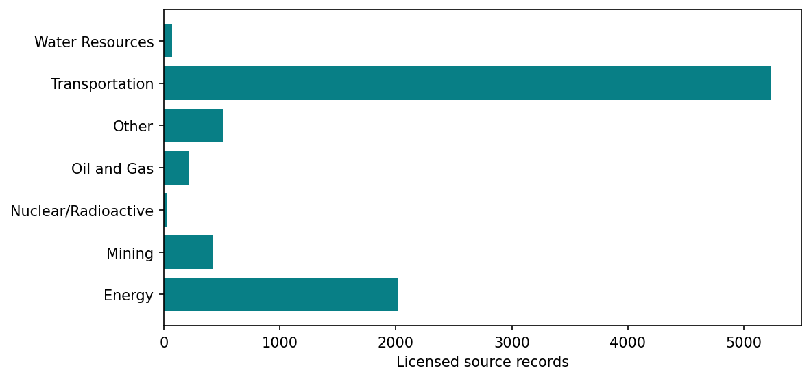

# IBAMA environmental licensing records

Read the saved licensing snapshot and its sector composition. Ordinary pipeline runs translate and visualise local records; live acquisition is a separate explicit command. Licensing records do not establish project completion or environmental impact.

[Variable and dataset codebook](../../docs/codebook.md) · [Methods](../../docs/methods.md) · [All reports](../README.md#read-the-reports)

Refresh processing and this report with `brazil-project report ibama_data_extraction --config project.toml`. Add `--from-saved` to refresh existing verified artifacts only. Code is collapsed; tables and figures below are saved execution results.

## Processing code and pipeline

Execution order: `ibama`. The [cli.py → dispatch()](../../code/brazil_project/cli.py#L23) dispatcher calls these functions; [cli.py → expand()](../../code/brazil_project/cli.py#L58) resolves dependencies. The cells below read their saved outputs and present the results.

| Pipeline stage | Active processing source | Inputs | Saved outputs used by the process/report |
| --- | --- | --- | --- |
| `ibama` | [projects.py → run()](../../code/brazil_project/infrastructure/projects.py#L47) | Configured snapshot or completed local acquisition; source=ibama | `ibama/licensed_projects.parquet; sector_counts.parquet; local HTML map` |

Paths without an `outputs/` prefix in this table are relative to `data/intermediate/`. Municipality runs use `data/intermediate/municipality_<code>/` and publish scoped report copies under `outputs/reports/`; national-only workflows reject municipality scope. See the [complete pipeline source guide](../../docs/pipeline-source.md) for dependencies, acquisition and the report publisher.

Live acquisition is separate: `brazil-project run acquire-ibama --config project.toml` invokes [infrastructure.py → run()](../../code/brazil_project/acquisition/infrastructure.py#L94). The historical extraction steps below describe provenance; ordinary report refresh does not call the API.

## How to read this analysis

The original provider workflow combines point, line and polygon layers: `tb_empreendimento_repr_p`, `tb_empreendimento_repr_l` and `tb_empreendimento_repr_a`. The acquisition adapter handles pagination separately. Counts below describe source records, not a verified count of unique developments. Untranslated sectors remain visible; no category is inferred.

## Inputs, coverage and processing status

This summary reads the current saved processing artifacts. Technical fingerprints are available in the collapsed provenance record.

Processing source: [projects.py → run()](../../code/brazil_project/infrastructure/projects.py#L47). Saved result: `data/intermediate/ibama/report.json`. Report display: [reporting.py → show_chunk()](../../code/brazil_project/reporting.py#L140).

<details>
<summary>Read saved processing summary</summary>

<!-- brazil:cell ibama_data_extraction_1 -->
```python
import matplotlib
matplotlib.use("Agg")  # Headless figures in the fresh report process.
#| label: ibama_data_extraction_1
from pathlib import Path
from brazil_project.io import Context
from brazil_project.reporting import show_chunk
show_chunk(ctx, 'Scripts_Data/IBAMA/IBAMA - Data Extraction.qmd', 1)
```

</details>

<!-- brazil:output ibama_data_extraction_1 begin -->
<table border="1" class="dataframe">
  <thead>
    <tr style="text-align: right;">
      <th>Measure</th>
      <th>Count</th>
    </tr>
  </thead>
  <tbody>
    <tr>
      <td>Licensed source records</td>
      <td>8494</td>
    </tr>
    <tr>
      <td>Untranslated sectors</td>
      <td>0</td>
    </tr>
  </tbody>
</table>

Input source: `copied_snapshot`; this refresh does not harvest live records.

<details>
<summary>Technical provenance and complete processing record</summary>

```json
{
  "records": 8494,
  "unknown_sectors": 0,
  "source": "copied_snapshot",
  "generated_at": "2026-10-26T14:27:07.137633+00:00"
}
```

</details>
<!-- brazil:output ibama_data_extraction_1 end -->

Processing source: [projects.py → run()](../../code/brazil_project/infrastructure/projects.py#L47). Saved result: `data/intermediate/ibama/report.json`. Report display: [reporting.py → show_chunk()](../../code/brazil_project/reporting.py#L140).

<details>
<summary>Trace original step: Unnamed 2</summary>

<!-- brazil:cell ibama_data_extraction_2 -->
```python
#| label: ibama_data_extraction_2
show_chunk(ctx, 'Scripts_Data/IBAMA/IBAMA - Data Extraction.qmd', 2)
```

</details>

<!-- brazil:output ibama_data_extraction_2 begin -->
<!-- Saved result already presented; original cell retained for traceability. -->
<!-- brazil:output ibama_data_extraction_2 end -->

## Joining

Saved result from the original comparison flow.

Processing source: [projects.py → counts()](../../code/brazil_project/infrastructure/projects.py#L29). Saved result: `data/intermediate/ibama/sector_counts.parquet`. Report display: [reporting.py → show_chunk()](../../code/brazil_project/reporting.py#L140).

<details>
<summary>Joining</summary>

<!-- brazil:cell ibama_data_extraction_3 -->
```python
#| label: ibama_data_extraction_3
show_chunk(ctx, 'Scripts_Data/IBAMA/IBAMA - Data Extraction.qmd', 3)
```

</details>

<!-- brazil:output ibama_data_extraction_3 begin -->
7 saved rows; showing up to ten. See the codebook for column definitions.

<table border="1" class="dataframe">
  <thead>
    <tr style="text-align: right;">
      <th>tp_sector_en</th>
      <th>Source records</th>
    </tr>
  </thead>
  <tbody>
    <tr>
      <td>Energy</td>
      <td>2013</td>
    </tr>
    <tr>
      <td>Mining</td>
      <td>420</td>
    </tr>
    <tr>
      <td>Nuclear/Radioactive</td>
      <td>25</td>
    </tr>
    <tr>
      <td>Oil and Gas</td>
      <td>219</td>
    </tr>
    <tr>
      <td>Other</td>
      <td>512</td>
    </tr>
    <tr>
      <td>Transportation</td>
      <td>5233</td>
    </tr>
    <tr>
      <td>Water Resources</td>
      <td>72</td>
    </tr>
  </tbody>
</table>
<!-- brazil:output ibama_data_extraction_3 end -->

## Sector composition

Source-record counts show the composition of the licensing snapshot. Open the local HTML map to investigate individual locations.

Processing source: [projects.py → run()](../../code/brazil_project/infrastructure/projects.py#L47). Saved result: `data/intermediate/ibama/report.json`. Report display: [reporting.py → show_chunk()](../../code/brazil_project/reporting.py#L140).

<details>
<summary>Draw sector counts and link interactive map</summary>

<!-- brazil:cell ibama_data_extraction_4 -->
```python
#| label: ibama_data_extraction_4
show_chunk(ctx, 'Scripts_Data/IBAMA/IBAMA - Data Extraction.qmd', 4)
```

</details>

<!-- brazil:output ibama_data_extraction_4 begin -->


Counts of licensed source records by translated sector, including untranslated values. This does not measure environmental impact or distinct developments.

Interactive map: `outputs/maps/ibama.html` (local HTML; GitHub cannot execute it).
<!-- brazil:output ibama_data_extraction_4 end -->

Processing source: [projects.py → run()](../../code/brazil_project/infrastructure/projects.py#L47). Saved result: `data/intermediate/ibama/report.json`. Report display: [reporting.py → show_chunk()](../../code/brazil_project/reporting.py#L140).

<details>
<summary>Trace original step: Save</summary>

<!-- brazil:cell ibama_data_extraction_5 -->
```python
#| label: ibama_data_extraction_5
show_chunk(ctx, 'Scripts_Data/IBAMA/IBAMA - Data Extraction.qmd', 5)
```

</details>

<!-- brazil:output ibama_data_extraction_5 begin -->
<!-- Saved result already presented; original cell retained for traceability. -->
<!-- brazil:output ibama_data_extraction_5 end -->

## Interpretation and limits

Outputs retain the original aggregation, missingness and exclusion rules. Available results do not establish national scientific validation. Read [verification and remaining limitations](../../docs/checks.md) before drawing research conclusions. Original codebooks and earlier report contents remain preserved in the project archive.
