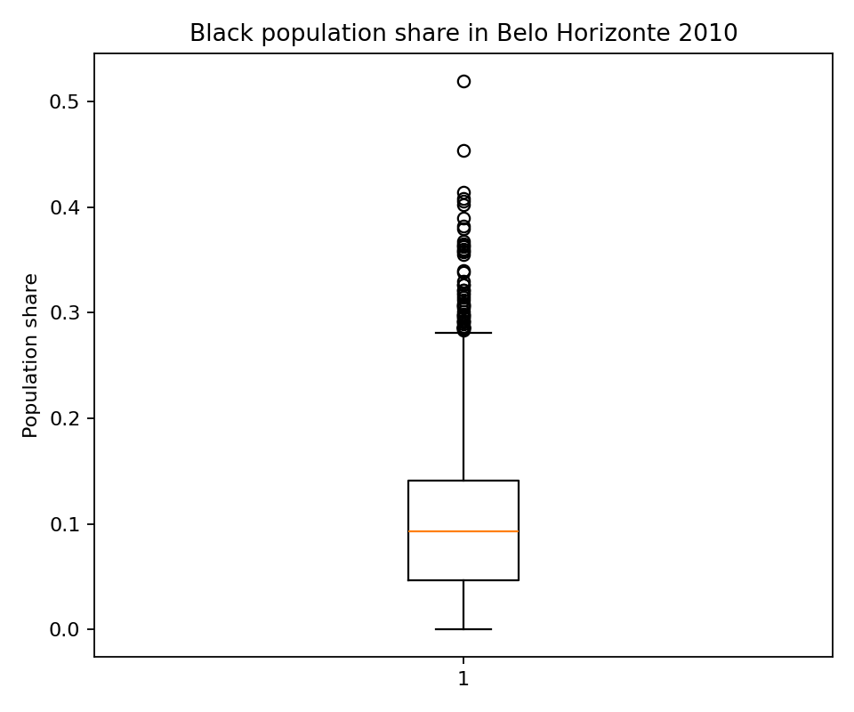
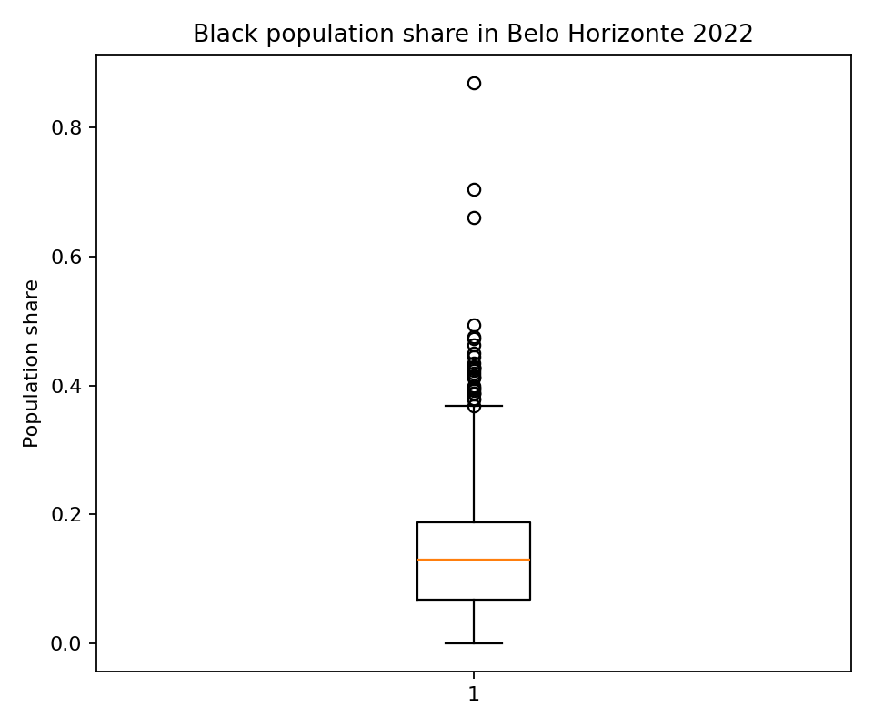

# Census exploration: original annual tracts

Explore Black population shares on the original 2010 and 2022 tract boundaries in six Minas Gerais municipalities. This is a geographic overview, separate from the harmonised temporal analysis.

[Variable and dataset codebook](../../docs/codebook.md) · [Methods](../../docs/methods.md) · [All reports](../README.md#read-the-reports)

Refresh processing and this report with `brazil-project report ibge_census_data_extraction --config project.toml`. Add `--from-saved` to refresh existing verified artifacts only. Code is collapsed; tables and figures below are saved execution results.

## How to read this analysis

Scope: Belo Horizonte, Vespasiano, São José da Lapa, Confins, Lagoa Santa and Santa Luzia. The ratio is the Black population count divided by each year’s total population. Original exploratory division is preserved; nonfinite values are omitted from visualisation, not silently corrected in saved analytical data. The Belo Horizonte boxplots weight each usable mapped geometry observation equally. Preserved repeated tract identifiers can contribute more than one observation; the original exploratory row weighting is retained. A changing distribution can reflect changing boundaries as well as population composition. The original Linha Verde shapefile is unavailable and is not replaced.

## Inputs, coverage and processing status

This summary reads the current saved processing artifacts. Technical fingerprints are available in the collapsed provenance record.

<details>
<summary>Read saved processing summary</summary>

<!-- brazil:cell ibge_census_data_extraction_1 -->
```python
import matplotlib
matplotlib.use("Agg")  # Headless figures in the fresh report process.
#| label: ibge_census_data_extraction_1
from pathlib import Path
from brazil_project.io import Context
from brazil_project.reporting import show_chunk
show_chunk(ctx, 'Scripts_Data/IBGE/IBGE Census - Data Extraction.qmd', 1)
```

</details>

<!-- brazil:output ibge_census_data_extraction_1 begin -->
<table border="1" class="dataframe">
  <thead>
    <tr style="text-align: right;">
      <th>Year</th>
      <th>Mapped tract pieces</th>
      <th>BH usable tract observations</th>
      <th>BH median Black share (%)</th>
    </tr>
  </thead>
  <tbody>
    <tr>
      <td>2010</td>
      <td>4380</td>
      <td>3,838.0000</td>
      <td>9.3293</td>
    </tr>
    <tr>
      <td>2022</td>
      <td>6255</td>
      <td>5,025.0000</td>
      <td>13.0307</td>
    </tr>
  </tbody>
</table>

Scope: Belo Horizonte, Vespasiano, São José da Lapa, Confins, Lagoa Santa, Santa Luzia. Overlay: missing original Linha Verde shapefile; not substituted.

<details>
<summary>Technical provenance and complete processing record</summary>

```json
{
  "scope": [
    "Belo Horizonte",
    "Vespasiano",
    "São José da Lapa",
    "Confins",
    "Lagoa Santa",
    "Santa Luzia"
  ],
  "annual": {
    "2010": {
      "map_tracts": 4380,
      "BH_summary": {
        "count": 3838.0,
        "mean": 0.0999245419310908,
        "std": 0.06755773466431246,
        "min": 0.0,
        "25%": 0.046556999343482515,
        "50%": 0.0932932161745721,
        "75%": 0.14093186567338092,
        "max": 0.52
      }
    },
    "2022": {
      "map_tracts": 6255,
      "BH_summary": {
        "count": 5025.0,
        "mean": 0.13449590373929912,
        "std": 0.08271013953960317,
        "min": 0.0,
        "25%": 0.068,
        "50%": 0.13030746705710103,
        "75%": 0.18814814814814815,
        "max": 0.8695652173913043
      }
    }
  },
  "metro_overlay": "missing original Linha Verde shapefile; not substituted",
  "generated_at": "2026-10-07T08:13:26.568455+00:00"
}
```

</details>
<!-- brazil:output ibge_census_data_extraction_1 end -->

<details>
<summary>Trace original step: Tracts Import</summary>

<!-- brazil:cell ibge_census_data_extraction_2 -->
```python
#| label: ibge_census_data_extraction_2
show_chunk(ctx, 'Scripts_Data/IBGE/IBGE Census - Data Extraction.qmd', 2)
```

</details>

<!-- brazil:output ibge_census_data_extraction_2 begin -->
<!-- Saved result already presented; original cell retained for traceability. -->
<!-- brazil:output ibge_census_data_extraction_2 end -->

<details>
<summary>Trace original step: Census Data Import</summary>

<!-- brazil:cell ibge_census_data_extraction_3 -->
```python
#| label: ibge_census_data_extraction_3
show_chunk(ctx, 'Scripts_Data/IBGE/IBGE Census - Data Extraction.qmd', 3)
```

</details>

<!-- brazil:output ibge_census_data_extraction_3 begin -->
<!-- Saved result already presented; original cell retained for traceability. -->
<!-- brazil:output ibge_census_data_extraction_3 end -->

<details>
<summary>Trace original step: Race Ratio Calculation</summary>

<!-- brazil:cell ibge_census_data_extraction_4 -->
```python
#| label: ibge_census_data_extraction_4
show_chunk(ctx, 'Scripts_Data/IBGE/IBGE Census - Data Extraction.qmd', 4)
```

</details>

<!-- brazil:output ibge_census_data_extraction_4 begin -->
<!-- Saved result already presented; original cell retained for traceability. -->
<!-- brazil:output ibge_census_data_extraction_4 end -->

<details>
<summary>Trace original step: Import Linha Verde</summary>

<!-- brazil:cell ibge_census_data_extraction_5 -->
```python
#| label: ibge_census_data_extraction_5
show_chunk(ctx, 'Scripts_Data/IBGE/IBGE Census - Data Extraction.qmd', 5)
```

</details>

<!-- brazil:output ibge_census_data_extraction_5 begin -->
<!-- Saved result already presented; original cell retained for traceability. -->
<!-- brazil:output ibge_census_data_extraction_5 end -->

## Tract distributions and map

Each boxplot summarises usable Belo Horizonte mapped tract observations on that year’s geography; observations are not deduplicated by tract ID. Do not interpret the median as the share of all city residents.

<details>
<summary>Display current annual boxplots</summary>

<!-- brazil:cell ibge_census_data_extraction_6 -->
```python
#| label: ibge_census_data_extraction_6
show_chunk(ctx, 'Scripts_Data/IBGE/IBGE Census - Data Extraction.qmd', 6)
```

</details>

<!-- brazil:output ibge_census_data_extraction_6 begin -->




Belo Horizonte tract-level distributions, using each year’s original geography; the vertical axis is a fraction (0.10 = 10%). Boxplots give equal weight to each usable tract, not each resident. These are not harmonised change estimates. Interactive map: `outputs/maps/black_ratio_2010_2022.html`.
<!-- brazil:output ibge_census_data_extraction_6 end -->

## Interpretation and limits

Outputs retain the original aggregation, missingness and exclusion rules. Available results do not establish national scientific validation. Read [verification and remaining limitations](../../docs/checks.md) before drawing research conclusions. Original codebooks and earlier report contents remain preserved in the project archive.
