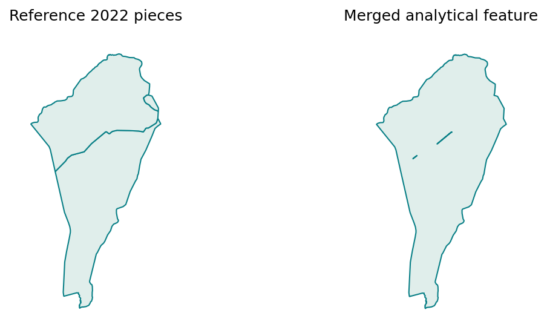

# Census tract harmonisation

Link 2010 and 2022 tracts into common comparison areas, preserving the research processing flow and original source geometry. The lookup assigns tracts to common_id; the analytical geometry merges complete 2022 pieces within each group.

[Variable and dataset codebook](../../docs/codebook.md) · [Methods](../../docs/methods.md) · [All reports](../README.md#read-the-reports)

Refresh processing and this report with `brazil-project report ibge_census_tract_harmonisation --config project.toml`. Add `--from-saved` to refresh existing verified artifacts only. Code is collapsed; tables and figures below are saved execution results.

## Processing code and pipeline

Execution order: `harmonisation`. The [cli.py → dispatch()](../../code/brazil_project/cli.py#L23) dispatcher calls these functions; [cli.py → expand()](../../code/brazil_project/cli.py#L58) resolves dependencies. The cells below read their saved outputs and present the results.

| Pipeline stage | Active processing source | Inputs | Saved outputs used by the process/report |
| --- | --- | --- | --- |
| `harmonisation` | [census.py → run()](../../code/brazil_project/harmonisation/census.py#L364) | Configured 2010/2022 tracts and original correspondence inputs | `harmonisation/current.json → bundles/<generation>/ lookups and merged geometry` |

Paths without an `outputs/` prefix in this table are relative to `data/intermediate/`. Municipality runs use `data/intermediate/municipality_<code>/` and publish scoped report copies under `outputs/reports/`; national-only workflows reject municipality scope. See the [complete pipeline source guide](../../docs/pipeline-source.md) for dependencies, acquisition and the report publisher.

Default imported-edge validation: [positive_baseline_edges()](../../code/brazil_project/harmonisation/census.py#L153). Explicit recomputation matcher: [largest_overlap()](../../code/brazil_project/harmonisation/census.py#L29). Connected grouping: [grouped_crosswalk()](../../code/brazil_project/harmonisation/census.py#L40). Merged geometry and measured area: [dissolved_common_geometry()](../../code/brazil_project/harmonisation/census.py#L236). Unmatched coverage: [coverage()](../../code/brazil_project/harmonisation/census.py#L260).

## How to read this analysis

Each tract selects its largest strictly positive polygon-area overlap in the other year. The two directional sets of links form a graph; connected components become comparison groups. Boundary-only contact is not an overlap match. Groups can be one-to-one, split, merge or many-to-many. A municipality selects complete groups, including contributing tracts beyond its boundary.

The routine national mode validates the original correspondence; it is not a fresh national recomputation. A versioned bundle keeps geometry and lookups together. Original tract pieces, including repeated tract IDs, remain reference data; identifiers are deduplicated for count aggregation.

**Research assumption:** footprint differences are assumed not to materially change the inhabited population compared. This has not been independently verified. Merging boundaries does not establish identical footprints in both years; diagnostics remain available without automatically rejecting groups. See the [approved policy](../../docs/harmonisation-policy.md).

## Inputs, coverage and processing status

This summary reads the current saved processing artifacts. Technical fingerprints are available in the collapsed provenance record.

Processing source: [census.py → run()](../../code/brazil_project/harmonisation/census.py#L364). Saved result: `data/intermediate/harmonisation/report.json`. Report display: [reporting.py → show_chunk()](../../code/brazil_project/reporting.py#L140).

<details>
<summary>Read saved processing summary</summary>

<!-- brazil:cell ibge_census_tract_harmonisation_1 -->
```python
import matplotlib
matplotlib.use("Agg")  # Headless figures in the fresh report process.
#| label: ibge_census_tract_harmonisation_1
from pathlib import Path
from brazil_project.io import Context
from brazil_project.reporting import show_chunk
show_chunk(ctx, 'Scripts_Data/IBGE/IBGE - Census tract harmonisation.qmd', 1)
```

</details>

<!-- brazil:output ibge_census_tract_harmonisation_1 begin -->
<table border="1" class="dataframe">
  <thead>
    <tr style="text-align: right;">
      <th>Measure</th>
      <th>Count</th>
    </tr>
  </thead>
  <tbody>
    <tr>
      <td>Comparison groups</td>
      <td>287178</td>
    </tr>
    <tr>
      <td>Merged 2022 features</td>
      <td>287178</td>
    </tr>
    <tr>
      <td>Reference 2022 pieces</td>
      <td>472778</td>
    </tr>
    <tr>
      <td>Repeated reference IDs</td>
      <td>4681</td>
    </tr>
  </tbody>
</table>

Coverage: known totals exclude unavailable values; missing values are not zero.

<table border="1" class="dataframe">
  <thead>
    <tr style="text-align: right;">
      <th>Year</th>
      <th>Measure</th>
      <th>Matched tract IDs</th>
      <th>Unmatched tract IDs</th>
      <th>Known unmatched total</th>
      <th>Unmatched missing values</th>
      <th>Matched missing values</th>
    </tr>
  </thead>
  <tbody>
    <tr>
      <td>2010</td>
      <td>population</td>
      <td>316558</td>
      <td>16</td>
      <td>87.0000</td>
      <td>12</td>
      <td>6448</td>
    </tr>
    <tr>
      <td>2010</td>
      <td>households</td>
      <td>316558</td>
      <td>16</td>
      <td>40.0000</td>
      <td>12</td>
      <td>7264</td>
    </tr>
    <tr>
      <td>2022</td>
      <td>population</td>
      <td>468073</td>
      <td>24</td>
      <td>281.0000</td>
      <td>0</td>
      <td>0</td>
    </tr>
    <tr>
      <td>2022</td>
      <td>households</td>
      <td>468073</td>
      <td>24</td>
      <td>80.0000</td>
      <td>21</td>
      <td>17988</td>
    </tr>
  </tbody>
</table>

Execution mode: `validated_original_correspondence`. Boundary differences are assumed not to materially change the inhabited population; not independently verified.

<details>
<summary>Technical provenance and complete processing record</summary>

```json
{
  "version": "8f67986ba3b1f50731be40dc11a183fdda6b8caecd893ed0d9ea5f83ddec1650",
  "source_version": "84700cdc61d0b76baf8512431fc55a7f3e9a8044b682a6fc51987b53ea1a49bd",
  "policy": "positive-area-common-geometry-v1",
  "mode": "validated_original_correspondence",
  "scope": "Brazil",
  "source_contract": {
    "policy": "positive-area-common-geometry-v1",
    "mode": "validated_original_correspondence",
    "inputs": {
      "tracts": "15ce7a4882dd3f8798223e3c1697fa3f32164793acac884da026c75b56549a3c",
      "baseline_lookup": "42d1354a5ed84047f4df28781aecd1970c0dd7e09c630c960c1a1139cb098c9b",
      "baseline_geometry": "ae961e48f488a18ae94cb3ece85162bab4f039daa9b87b3c029ac9e579edae57",
      "baseline_group_sizes": "17175bc7b75c44465cceecd87184fcbc413daedb5aaabb01cbd8efdc4bf721a1"
    },
    "crs": 5880,
    "precision_grid": 1e-06
  },
  "population_coverage": {
    "2010": {
      "matched_tract_ids": 316558,
      "unmatched_tract_ids": 16,
      "measures": {
        "population": {
          "status": "partial",
          "matched_known_total": 190755712.0,
          "unmatched_known_total": 87.0,
          "matched_missing_values": 6448,
          "unmatched_missing_values": 12,
          "unmatched_share_of_known_total": 4.560804990258776e-07
        },
        "households": {
          "status": "partial",
          "matched_known_total": 58862521.0,
          "unmatched_known_total": 40.0,
          "matched_missing_values": 7264,
          "unmatched_missing_values": 12,
          "unmatched_share_of_known_total": 6.795490940327928e-07
        }
      }
    },
    "2022": {
      "matched_tract_ids": 468073,
      "unmatched_tract_ids": 24,
      "measures": {
        "population": {
          "status": "complete",
          "matched_known_total": 203080475.0,
          "unmatched_known_total": 281.0,
          "matched_missing_values": 0,
          "unmatched_missing_values": 0,
          "unmatched_share_of_known_total": 1.3836860051870204e-06
        },
        "households": {
          "status": "partial",
          "matched_known_total": 72438873.0,
          "unmatched_known_total": 80.0,
          "matched_missing_values": 17988,
          "unmatched_missing_values": 21,
          "unmatched_share_of_known_total": 1.1043781927659832e-06
        }
      }
    }
  },
  "assumption": "Boundary differences are assumed not to materially change the inhabited population; not independently verified.",
  "generation": "b8b2c1c8082e4defa8e70bcdca4eb3bc",
  "tracts_2022": 472778,
  "groups": 287178,
  "duplicate_base_ids": 4681,
  "common_geometry_features": 287178,
  "rejected_edges": 0,
  "unmatched": {
    "2010": 16,
    "2022": 24
  },
  "footprint_difference_above_10pct": 131222,
  "generated_at": "2026-10-07T08:15:57.844141+00:00"
}
```

</details>
<!-- brazil:output ibge_census_tract_harmonisation_1 end -->

Processing source: [census.py → run()](../../code/brazil_project/harmonisation/census.py#L364). Saved result: `data/intermediate/harmonisation/report.json`. Report display: [reporting.py → show_chunk()](../../code/brazil_project/reporting.py#L140).

<details>
<summary>Trace original step: Data Import</summary>

<!-- brazil:cell ibge_census_tract_harmonisation_2 -->
```python
#| label: ibge_census_tract_harmonisation_2
show_chunk(ctx, 'Scripts_Data/IBGE/IBGE - Census tract harmonisation.qmd', 2)
```

</details>

<!-- brazil:output ibge_census_tract_harmonisation_2 begin -->
<!-- Saved result already presented; original cell retained for traceability. -->
<!-- brazil:output ibge_census_tract_harmonisation_2 end -->

## How comparison groups work

The illustration explains relationship types. A common_id identifies a connected group; dissolving its 2022 pieces removes internal display boundaries.

Processing source: [census.py → grouped_crosswalk()](../../code/brazil_project/harmonisation/census.py#L40). Method schematic only; the drawing does not process tract geometry. Report display: [reporting.py → harmonisation_diagram()](../../code/brazil_project/reporting.py#L102).

<details>
<summary>Draw common-area relationship schematic</summary>

<!-- brazil:cell reference_diagram -->
```python
from brazil_project.reporting import harmonisation_diagram
harmonisation_diagram(ctx)
```

</details>

<!-- brazil:output reference_diagram begin -->


Schematic only: no measured tract boundaries. Connected links form one common_id; complete 2022 pieces are merged for analysis. Largest positive overlap is selected in both directions. Yearly footprints may differ under the accepted research assumption.
<!-- brazil:output reference_diagram end -->

## Merged analytical geography

One row per common_id; inner tract boundaries are merged. Original pieces remain reference data. The preview identifies saved areas and their measured km². Dissolving preserves holes and gaps between source pieces; small holes can appear as short interior strokes in the illustration. These are not separately retained tract boundaries.

Processing source: [census.py → dissolved_common_geometry()](../../code/brazil_project/harmonisation/census.py#L236). Saved result: `data/intermediate/harmonisation/bundles/<generation>/common_geometry_2022.parquet`. Report display: [reporting.py → merged_example()](../../code/brazil_project/reporting.py#L198).

<details>
<summary>Read merged common-area geometry</summary>

<!-- brazil:cell ibge_census_tract_harmonisation_3 -->
```python
#| label: ibge_census_tract_harmonisation_3
show_chunk(ctx, 'Scripts_Data/IBGE/IBGE - Census tract harmonisation.qmd', 3)
```

</details>

<!-- brazil:output ibge_census_tract_harmonisation_3 begin -->
287,178 saved rows; showing up to ten. See the codebook for column definitions.

<table border="1" class="dataframe">
  <thead>
    <tr style="text-align: right;">
      <th>common_id</th>
      <th>n_2010</th>
      <th>n_2022</th>
      <th>relationship</th>
      <th>area_km2</th>
      <th>footprint_difference_fraction</th>
      <th>area_2010_km2</th>
      <th>area_2022_projected_km2</th>
    </tr>
  </thead>
  <tbody>
    <tr>
      <td>1</td>
      <td>1</td>
      <td>1</td>
      <td>1:1</td>
      <td>0.5400</td>
      <td>0.0714</td>
      <td>0.5344</td>
      <td>0.5451</td>
    </tr>
    <tr>
      <td>10</td>
      <td>1</td>
      <td>1</td>
      <td>1:1</td>
      <td>0.1834</td>
      <td>0.1571</td>
      <td>0.1942</td>
      <td>0.1852</td>
    </tr>
    <tr>
      <td>100</td>
      <td>1</td>
      <td>1</td>
      <td>1:1</td>
      <td>0.2170</td>
      <td>0.1373</td>
      <td>0.2103</td>
      <td>0.2197</td>
    </tr>
    <tr>
      <td>1000</td>
      <td>1</td>
      <td>1</td>
      <td>1:1</td>
      <td>0.0673</td>
      <td>0.1338</td>
      <td>0.0662</td>
      <td>0.0683</td>
    </tr>
    <tr>
      <td>10000</td>
      <td>1</td>
      <td>1</td>
      <td>1:1</td>
      <td>0.1195</td>
      <td>0.0231</td>
      <td>0.1182</td>
      <td>0.1201</td>
    </tr>
    <tr>
      <td>100000</td>
      <td>2</td>
      <td>3</td>
      <td>many_to_many</td>
      <td>91.0400</td>
      <td>0.0284</td>
      <td>93.0469</td>
      <td>91.9877</td>
    </tr>
    <tr>
      <td>100001</td>
      <td>1</td>
      <td>1</td>
      <td>1:1</td>
      <td>0.0568</td>
      <td>0.3737</td>
      <td>0.0591</td>
      <td>0.0573</td>
    </tr>
    <tr>
      <td>100002</td>
      <td>1</td>
      <td>1</td>
      <td>1:1</td>
      <td>0.0907</td>
      <td>0.4029</td>
      <td>0.0940</td>
      <td>0.0916</td>
    </tr>
    <tr>
      <td>100003</td>
      <td>1</td>
      <td>1</td>
      <td>1:1</td>
      <td>0.0850</td>
      <td>0.4181</td>
      <td>0.0991</td>
      <td>0.0859</td>
    </tr>
    <tr>
      <td>100004</td>
      <td>1</td>
      <td>1</td>
      <td>1:1</td>
      <td>0.1059</td>
      <td>0.2310</td>
      <td>0.1076</td>
      <td>0.1070</td>
    </tr>
  </tbody>
</table>

One row per common_id. area_km2 is the saved equal-area denominator; geometry belongs to the same versioned lookup bundle.



Actual common_id 100000: complete reference pieces at left, one merged analytical feature at right. Original pieces remain saved. This shows removal of internal boundaries, not equality of 2010 and 2022 footprints.
<!-- brazil:output ibge_census_tract_harmonisation_3 end -->

## Interpretation and limits

Outputs retain the original aggregation, missingness and exclusion rules. Available results do not establish national scientific validation. Read [verification and remaining limitations](../../docs/checks.md) before drawing research conclusions. Original codebooks and earlier report contents remain preserved in the project archive.
