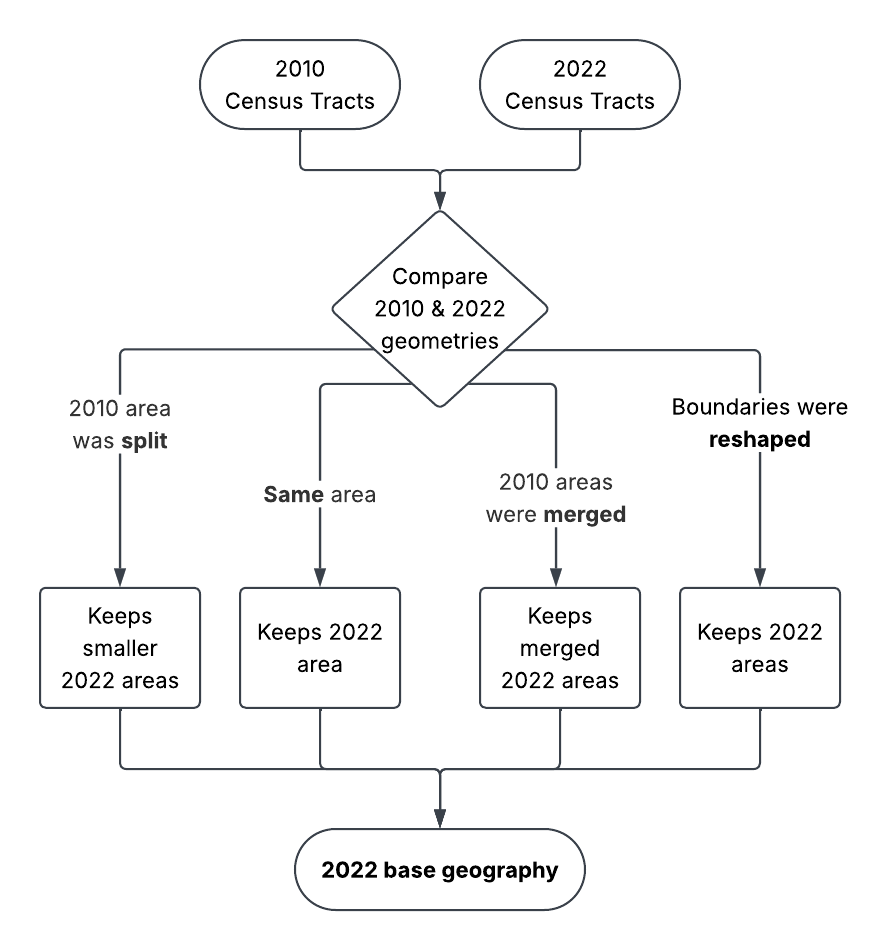

# IBGE Census - Census tract harmonisation

Executable research report. Refresh with `brazil-project report ibge_census_tract_harmonisation`. Code is collapsed below each explanation.

This code links 2010 and 2022 census tracts based on their largest spatial overlap in both directions, creating a correspondence table (crosswalk). It identifies whether areas stayed the same, were split, merged, or changed in a more complex way. The original tract pieces remain unchanged as reference geometry. The active analytical layer merges complete 2022 groups by `common_id`, and matching now excludes line/point-only contacts. See the [approved policy](../../docs/harmonisation-policy.md) for complete-group selection, unmatched coverage, and the boundary-change assumption.


<details>
<summary>Python code</summary>

<!-- brazil:cell ibge_census_tract_harmonisation_1 -->
```python
#| label: ibge_census_tract_harmonisation_1
from pathlib import Path
from brazil_project.io import Context
from brazil_project.reporting import show_chunk
show_chunk(ctx, 'Scripts_Data/IBGE/IBGE - Census tract harmonisation.qmd', 1)
```

</details>

<!-- brazil:output ibge_census_tract_harmonisation_1 begin -->
```text
{'version': '8f67986ba3b1f50731be40dc11a183fdda6b8caecd893ed0d9ea5f83ddec1650',
 'source_version': '84700cdc61d0b76baf8512431fc55a7f3e9a8044b682a6fc51987b53ea1a49bd',
 'policy': 'positive-area-common-geometry-v1',
 'mode': 'validated_original_correspondence',
 'scope': 'Brazil',
 'source_contract': {'policy': 'positive-area-common-geometry-v1',
  'mode': 'validated_original_correspondence',
  'inputs': {'tracts': '15ce7a4882dd3f8798223e3c1697fa3f32164793acac884da026c75b56549a3c',
   'baseline_lookup': '42d1354a5ed84047f4df28781aecd1970c0dd7e09c630c960c1a1139cb098c9b',
   'baseline_geometry': 'ae961e48f488a18ae94cb3ece85162bab4f039daa9b87b3c029ac9e579edae57',
   'baseline_group_sizes': '17175bc7b75c44465cceecd87184fcbc413daedb5aaabb01cbd8efdc4bf721a1'},
  'crs': 5880,
  'precision_grid': 1e-06},
 'population_coverage': {'2010': {'matched_tract_ids': 316558,
   'unmatched_tract_ids': 16,
   'measures': {'population': {'status': 'partial',
     'matched_known_total': 190755712.0,
     'unmatched_known_total': 87.0,
     'matched_missing_values': 6448,
     'unmatched_missing_values': 12,
     'unmatched_share_of_known_total': 4.560804990258776e-07},
    'households': {'status': 'partial',
     'matched_known_total': 58862521.0,
     'unmatched_known_total': 40.0,
     'matched_missing_values': 7264,
     'unmatched_missing_values': 12,
     'unmatched_share_of_known_total': 6.795490940327928e-07}}},
  '2022': {'matched_tract_ids': 468073,
   'unmatched_tract_ids': 24,
   'measures': {'population': {'status': 'complete',
     'matched_known_total': 203080475.0,
     'unmatched_known_total': 281.0,
     'matched_missing_values': 0,
     'unmatched_missing_values': 0,
     'unmatched_share_of_known_total': 1.3836860051870204e-06},
    'households': {'status': 'partial',
     'matched_known_total': 72438873.0,
     'unmatched_known_total': 80.0,
     'matched_missing_values': 17988,
     'unmatched_missing_values': 21,
     'unmatched_share_of_known_total': 1.1043781927659832e-06}}}},
 'assumption': 'Boundary differences are assumed not to materially change the inhabited population; not independently verified.',
 'generation': '1483b749a1d549b2921143f05004033e',
 'tracts_2022': 472778,
 'groups': 287178,
 'duplicate_base_ids': 4681,
 'common_geometry_features': 287178,
 'rejected_edges': 0,
 'unmatched': {'2010': 16, '2022': 24},
 'footprint_difference_above_10pct': 131222,
 'generated_at': '2026-10-07T07:04:38.358590+00:00'}
```
<!-- brazil:output ibge_census_tract_harmonisation_1 end -->


<details>
<summary>Python code</summary>

<!-- brazil:cell ibge_census_tract_harmonisation_2 -->
```python
#| label: ibge_census_tract_harmonisation_2
show_chunk(ctx, 'Scripts_Data/IBGE/IBGE - Census tract harmonisation.qmd', 2)
```

</details>

<!-- brazil:output ibge_census_tract_harmonisation_2 begin -->
```text
{'version': '8f67986ba3b1f50731be40dc11a183fdda6b8caecd893ed0d9ea5f83ddec1650',
 'source_version': '84700cdc61d0b76baf8512431fc55a7f3e9a8044b682a6fc51987b53ea1a49bd',
 'policy': 'positive-area-common-geometry-v1',
 'mode': 'validated_original_correspondence',
 'scope': 'Brazil',
 'source_contract': {'policy': 'positive-area-common-geometry-v1',
  'mode': 'validated_original_correspondence',
  'inputs': {'tracts': '15ce7a4882dd3f8798223e3c1697fa3f32164793acac884da026c75b56549a3c',
   'baseline_lookup': '42d1354a5ed84047f4df28781aecd1970c0dd7e09c630c960c1a1139cb098c9b',
   'baseline_geometry': 'ae961e48f488a18ae94cb3ece85162bab4f039daa9b87b3c029ac9e579edae57',
   'baseline_group_sizes': '17175bc7b75c44465cceecd87184fcbc413daedb5aaabb01cbd8efdc4bf721a1'},
  'crs': 5880,
  'precision_grid': 1e-06},
 'population_coverage': {'2010': {'matched_tract_ids': 316558,
   'unmatched_tract_ids': 16,
   'measures': {'population': {'status': 'partial',
     'matched_known_total': 190755712.0,
     'unmatched_known_total': 87.0,
     'matched_missing_values': 6448,
     'unmatched_missing_values': 12,
     'unmatched_share_of_known_total': 4.560804990258776e-07},
    'households': {'status': 'partial',
     'matched_known_total': 58862521.0,
     'unmatched_known_total': 40.0,
     'matched_missing_values': 7264,
     'unmatched_missing_values': 12,
     'unmatched_share_of_known_total': 6.795490940327928e-07}}},
  '2022': {'matched_tract_ids': 468073,
   'unmatched_tract_ids': 24,
   'measures': {'population': {'status': 'complete',
     'matched_known_total': 203080475.0,
     'unmatched_known_total': 281.0,
     'matched_missing_values': 0,
     'unmatched_missing_values': 0,
     'unmatched_share_of_known_total': 1.3836860051870204e-06},
    'households': {'status': 'partial',
     'matched_known_total': 72438873.0,
     'unmatched_known_total': 80.0,
     'matched_missing_values': 17988,
     'unmatched_missing_values': 21,
     'unmatched_share_of_known_total': 1.1043781927659832e-06}}}},
 'assumption': 'Boundary differences are assumed not to materially change the inhabited population; not independently verified.',
 'generation': '1483b749a1d549b2921143f05004033e',
 'tracts_2022': 472778,
 'groups': 287178,
 'duplicate_base_ids': 4681,
 'common_geometry_features': 287178,
 'rejected_edges': 0,
 'unmatched': {'2010': 16, '2022': 24},
 'footprint_difference_above_10pct': 131222,
 'generated_at': '2026-10-07T07:04:38.358590+00:00'}
```
<!-- brazil:output ibge_census_tract_harmonisation_2 end -->

<details>
<summary>Python code</summary>

<!-- brazil:cell reference_diagram -->
```python
report_image("data/archive/original_outputs/Scripts_Data/IBGE/images/Harmonizing 2010 and 2022 Census Tracts.png")
```

</details>

<!-- brazil:output reference_diagram begin -->

<!-- brazil:output reference_diagram end -->

Original census tract harmonization flow chart.


<details>
<summary>Python code</summary>

<!-- brazil:cell ibge_census_tract_harmonisation_3 -->
```python
#| label: ibge_census_tract_harmonisation_3
show_chunk(ctx, 'Scripts_Data/IBGE/IBGE - Census tract harmonisation.qmd', 3)
```

</details>

<!-- brazil:output ibge_census_tract_harmonisation_3 begin -->

<table border="1" class="dataframe">
  <thead>
    <tr style="text-align: right;">
      <th></th>
      <th>common_id</th>
      <th>n_2010</th>
      <th>n_2022</th>
      <th>relationship</th>
      <th>area_km2</th>
      <th>footprint_difference_fraction</th>
      <th>area_2010_km2</th>
      <th>area_2022_projected_km2</th>
    </tr>
  </thead>
  <tbody>
    <tr>
      <th>0</th>
      <td>1</td>
      <td>1</td>
      <td>1</td>
      <td>1:1</td>
      <td>0.539979</td>
      <td>0.071359</td>
      <td>0.534356</td>
      <td>0.545054</td>
    </tr>
    <tr>
      <th>1</th>
      <td>10</td>
      <td>1</td>
      <td>1</td>
      <td>1:1</td>
      <td>0.183445</td>
      <td>0.157143</td>
      <td>0.194150</td>
      <td>0.185165</td>
    </tr>
    <tr>
      <th>2</th>
      <td>100</td>
      <td>1</td>
      <td>1</td>
      <td>1:1</td>
      <td>0.217012</td>
      <td>0.137256</td>
      <td>0.210305</td>
      <td>0.219653</td>
    </tr>
    <tr>
      <th>3</th>
      <td>1000</td>
      <td>1</td>
      <td>1</td>
      <td>1:1</td>
      <td>0.067295</td>
      <td>0.133822</td>
      <td>0.066169</td>
      <td>0.068263</td>
    </tr>
    <tr>
      <th>4</th>
      <td>10000</td>
      <td>1</td>
      <td>1</td>
      <td>1:1</td>
      <td>0.119492</td>
      <td>0.023133</td>
      <td>0.118183</td>
      <td>0.120067</td>
    </tr>
    <tr>
      <th>5</th>
      <td>100000</td>
      <td>2</td>
      <td>3</td>
      <td>many_to_many</td>
      <td>91.040011</td>
      <td>0.028448</td>
      <td>93.046892</td>
      <td>91.987685</td>
    </tr>
    <tr>
      <th>6</th>
      <td>100001</td>
      <td>1</td>
      <td>1</td>
      <td>1:1</td>
      <td>0.056755</td>
      <td>0.373679</td>
      <td>0.059133</td>
      <td>0.057344</td>
    </tr>
    <tr>
      <th>7</th>
      <td>100002</td>
      <td>1</td>
      <td>1</td>
      <td>1:1</td>
      <td>0.090660</td>
      <td>0.402873</td>
      <td>0.094015</td>
      <td>0.091602</td>
    </tr>
    <tr>
      <th>8</th>
      <td>100003</td>
      <td>1</td>
      <td>1</td>
      <td>1:1</td>
      <td>0.085019</td>
      <td>0.418140</td>
      <td>0.099104</td>
      <td>0.085902</td>
    </tr>
    <tr>
      <th>9</th>
      <td>100004</td>
      <td>1</td>
      <td>1</td>
      <td>1:1</td>
      <td>0.105918</td>
      <td>0.230998</td>
      <td>0.107598</td>
      <td>0.107016</td>
    </tr>
    <tr>
      <th>10</th>
      <td>100005</td>
      <td>1</td>
      <td>1</td>
      <td>1:1</td>
      <td>0.087685</td>
      <td>0.299505</td>
      <td>0.085229</td>
      <td>0.088597</td>
    </tr>
    <tr>
      <th>11</th>
      <td>100006</td>
      <td>1</td>
      <td>1</td>
      <td>1:1</td>
      <td>0.079447</td>
      <td>0.401304</td>
      <td>0.078223</td>
      <td>0.080273</td>
    </tr>
    <tr>
      <th>12</th>
      <td>100007</td>
      <td>1</td>
      <td>1</td>
      <td>1:1</td>
      <td>0.051121</td>
      <td>0.469180</td>
      <td>0.050756</td>
      <td>0.051652</td>
    </tr>
    <tr>
      <th>13</th>
      <td>100008</td>
      <td>1</td>
      <td>1</td>
      <td>1:1</td>
      <td>0.448989</td>
      <td>0.172298</td>
      <td>0.488978</td>
      <td>0.453659</td>
    </tr>
    <tr>
      <th>14</th>
      <td>100009</td>
      <td>1</td>
      <td>1</td>
      <td>1:1</td>
      <td>0.098064</td>
      <td>0.338957</td>
      <td>0.098907</td>
      <td>0.099082</td>
    </tr>
    <tr>
      <th>15</th>
      <td>10001</td>
      <td>1</td>
      <td>1</td>
      <td>1:1</td>
      <td>0.071374</td>
      <td>0.101103</td>
      <td>0.076234</td>
      <td>0.071717</td>
    </tr>
    <tr>
      <th>16</th>
      <td>100010</td>
      <td>1</td>
      <td>1</td>
      <td>1:1</td>
      <td>0.156026</td>
      <td>0.250150</td>
      <td>0.156728</td>
      <td>0.157645</td>
    </tr>
    <tr>
      <th>17</th>
      <td>100011</td>
      <td>1</td>
      <td>1</td>
      <td>1:1</td>
      <td>0.045247</td>
      <td>0.364494</td>
      <td>0.046667</td>
      <td>0.045716</td>
    </tr>
    <tr>
      <th>18</th>
      <td>100012</td>
      <td>1</td>
      <td>3</td>
      <td>2010_to_2022_split</td>
      <td>2.000736</td>
      <td>0.178445</td>
      <td>1.830004</td>
      <td>2.021359</td>
    </tr>
    <tr>
      <th>19</th>
      <td>100013</td>
      <td>1</td>
      <td>1</td>
      <td>1:1</td>
      <td>0.165580</td>
      <td>0.214994</td>
      <td>0.167169</td>
      <td>0.167286</td>
    </tr>
  </tbody>
</table>


```text
{'artifact_rows': 287178,
 'path': 'data/intermediate/harmonisation/bundles/1483b749a1d549b2921143f05004033e/common_geometry_2022.parquet'}
```
<!-- brazil:output ibge_census_tract_harmonisation_3 end -->

**Historical note about reference tract pieces; active analytical geometry is merged by `common_id`.**

Be aware that the base geometry layer has not been unioned by common ID. 2010 tracts that were split share a common ID but still follow the 2022 tract boundaries.
