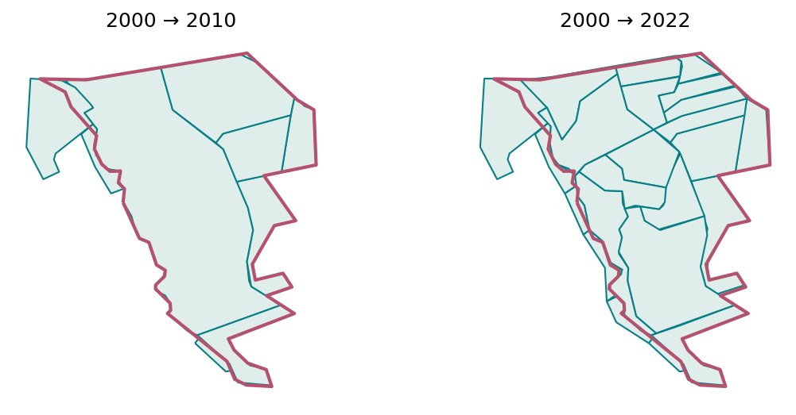
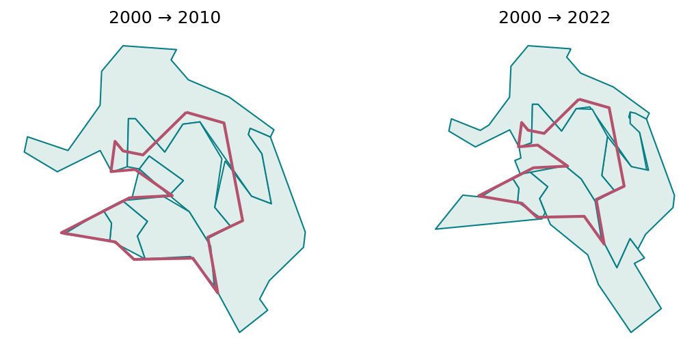
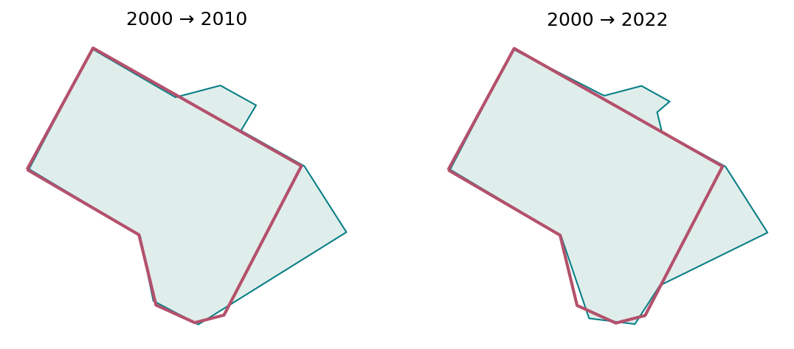
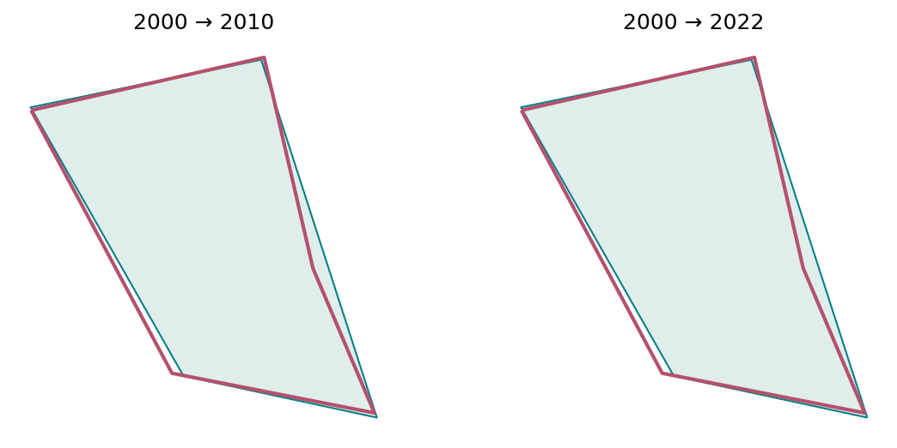

# Census boundary overview: 2000, 2010 and 2022

Explore changes from 2000 urban tracts to newer boundaries in Belo Horizonte. This exploratory method differs from the 2010–2022 common-area harmonisation.

[Variable and dataset codebook](../../docs/codebook.md) · [Methods](../../docs/methods.md) · [All reports](../README.md#read-the-reports)

Refresh processing and this report with `brazil-project report ibge_dataset_overview --config project.toml`. Add `--from-saved` to refresh existing verified artifacts only. Code is collapsed; tables and figures below are saved execution results.

## Processing code and pipeline

Execution order: `overview`. The [cli.py → dispatch()](../../code/brazil_project/cli.py#L23) dispatcher calls these functions; [cli.py → expand()](../../code/brazil_project/cli.py#L58) resolves dependencies. The cells below read their saved outputs and present the results.

| Pipeline stage | Active processing source | Inputs | Saved outputs used by the process/report |
| --- | --- | --- | --- |
| `overview` | [overview.py → run()](../../code/brazil_project/harmonisation/overview.py#L9) | Configured tract GeoPackage; default municipality Belo Horizonte | `overview/intersections_2000_<year>.gpkg; change_summary_2000_<year>.parquet` |

Paths without an `outputs/` prefix in this table are relative to `data/intermediate/`. Municipality runs use `data/intermediate/municipality_<code>/` and publish scoped report copies under `outputs/reports/`; national-only workflows reject municipality scope. See the [complete pipeline source guide](../../docs/pipeline-source.md) for dependencies, acquisition and the report publisher.

The Python adapter invokes [overview.R](../../code/scripts/r/overview.R) and [spherical_intersections.R](../../code/scripts/r/spherical_intersections.R) for the retained sf/S2 calculations.

## How to read this analysis

A newer tract contributes when the original spherical overlap fraction exceeds 5%. A single qualifying match above 95% is classified as stable; multiple qualifying matches are split, and a remaining single match is reshaped. No qualifying match is unmatched. R sf/S2 retains the original geographic topology and area semantics. Example figures show actual saved inputs; labels describe the original examples and classifications may differ between comparison years.

## Inputs, coverage and processing status

This summary reads the current saved processing artifacts. Technical fingerprints are available in the collapsed provenance record.

Processing source: [overview.py → run()](../../code/brazil_project/harmonisation/overview.py#L9). Saved result: `data/intermediate/overview/report.json`. Report display: [reporting.py → show_chunk()](../../code/brazil_project/reporting.py#L140).

<details>
<summary>Read saved processing summary</summary>

<!-- brazil:cell ibge_dataset_overview_1 -->
```python
import matplotlib
matplotlib.use("Agg")  # Headless figures in the fresh report process.
#| label: ibge_dataset_overview_1
from pathlib import Path
from brazil_project.io import Context
from brazil_project.reporting import show_chunk
show_chunk(ctx, 'Scripts_Data/IBGE/IBGE - Dataset Overview.qmd', 1)
```

</details>

<!-- brazil:output ibge_dataset_overview_1 begin -->
<table border="1" class="dataframe">
  <thead>
    <tr style="text-align: right;">
      <th>Comparison</th>
      <th>Classification</th>
      <th>2000 tracts</th>
    </tr>
  </thead>
  <tbody>
    <tr>
      <td>2000 → 2010</td>
      <td>split</td>
      <td>1323</td>
    </tr>
    <tr>
      <td>2000 → 2010</td>
      <td>stable</td>
      <td>1017</td>
    </tr>
    <tr>
      <td>2000 → 2010</td>
      <td>reshaped</td>
      <td>222</td>
    </tr>
    <tr>
      <td>2000 → 2010</td>
      <td>unmatched</td>
      <td>2</td>
    </tr>
    <tr>
      <td>2000 → 2022</td>
      <td>split</td>
      <td>1897</td>
    </tr>
    <tr>
      <td>2000 → 2022</td>
      <td>stable</td>
      <td>491</td>
    </tr>
    <tr>
      <td>2000 → 2022</td>
      <td>reshaped</td>
      <td>164</td>
    </tr>
    <tr>
      <td>2000 → 2022</td>
      <td>unmatched</td>
      <td>11</td>
    </tr>
  </tbody>
</table>

Municipality: `3106200`; geometry calculations use R sf/S2.

<details>
<summary>Technical provenance and complete processing record</summary>

```json
{
  "municipality": "3106200",
  "adapter": "R sf/S2",
  "classification_counts": {
    "2010": {
      "split": 1323,
      "stable": 1017,
      "reshaped": 222,
      "unmatched": 2
    },
    "2022": {
      "split": 1897,
      "stable": 491,
      "reshaped": 164,
      "unmatched": 11
    }
  },
  "reason": "preserve original geographic intersection and area semantics",
  "generated_at": "2026-10-07T08:13:22.961550+00:00"
}
```

</details>
<!-- brazil:output ibge_dataset_overview_1 end -->

Processing source: [overview.py → run()](../../code/brazil_project/harmonisation/overview.py#L9). Saved result: `data/intermediate/overview/report.json`. Report display: [reporting.py → show_chunk()](../../code/brazil_project/reporting.py#L140).

<details>
<summary>Trace original step: Tracts Import</summary>

<!-- brazil:cell ibge_dataset_overview_2 -->
```python
#| label: ibge_dataset_overview_2
show_chunk(ctx, 'Scripts_Data/IBGE/IBGE - Dataset Overview.qmd', 2)
```

</details>

<!-- brazil:output ibge_dataset_overview_2 begin -->
<!-- Saved result already presented; original cell retained for traceability. -->
<!-- brazil:output ibge_dataset_overview_2 end -->

Processing source: [overview.py → run()](../../code/brazil_project/harmonisation/overview.py#L9). Saved result: `data/intermediate/overview/report.json`. Report display: [reporting.py → show_chunk()](../../code/brazil_project/reporting.py#L140).

<details>
<summary>Trace original step: Census Data Import</summary>

<!-- brazil:cell ibge_dataset_overview_3 -->
```python
#| label: ibge_dataset_overview_3
show_chunk(ctx, 'Scripts_Data/IBGE/IBGE - Dataset Overview.qmd', 3)
```

</details>

<!-- brazil:output ibge_dataset_overview_3 begin -->
<!-- Saved result already presented; original cell retained for traceability. -->
<!-- brazil:output ibge_dataset_overview_3 end -->

Processing source: [overview.py → run()](../../code/brazil_project/harmonisation/overview.py#L9). Saved result: `data/intermediate/overview/report.json`. Report display: [reporting.py → show_chunk()](../../code/brazil_project/reporting.py#L140).

<details>
<summary>Trace original step: Compute Intersections</summary>

<!-- brazil:cell ibge_dataset_overview_4 -->
```python
#| label: ibge_dataset_overview_4
show_chunk(ctx, 'Scripts_Data/IBGE/IBGE - Dataset Overview.qmd', 4)
```

</details>

<!-- brazil:output ibge_dataset_overview_4 begin -->
<!-- Saved result already presented; original cell retained for traceability. -->
<!-- brazil:output ibge_dataset_overview_4 end -->

Processing source: [overview.py → run()](../../code/brazil_project/harmonisation/overview.py#L9). Saved result: `data/intermediate/overview/report.json`. Report display: [reporting.py → show_chunk()](../../code/brazil_project/reporting.py#L140).

<details>
<summary>Trace original step: Load Saved Computations</summary>

<!-- brazil:cell ibge_dataset_overview_5 -->
```python
#| label: ibge_dataset_overview_5
show_chunk(ctx, 'Scripts_Data/IBGE/IBGE - Dataset Overview.qmd', 5)
```

</details>

<!-- brazil:output ibge_dataset_overview_5 begin -->
<!-- Saved result already presented; original cell retained for traceability. -->
<!-- brazil:output ibge_dataset_overview_5 end -->

## Tract Change Summary 2000 2010

Saved result from the original comparison flow.

Processing source: [overview.py → run()](../../code/brazil_project/harmonisation/overview.py#L9). Saved result: `data/intermediate/overview/change_summary_2000_2010.parquet`. Report display: [reporting.py → show_chunk()](../../code/brazil_project/reporting.py#L140).

<details>
<summary>Tract Change Summary 2000 2010</summary>

<!-- brazil:cell ibge_dataset_overview_6 -->
```python
#| label: ibge_dataset_overview_6
show_chunk(ctx, 'Scripts_Data/IBGE/IBGE - Dataset Overview.qmd', 6)
```

</details>

<!-- brazil:output ibge_dataset_overview_6 begin -->
2,564 saved rows; showing up to ten. See the codebook for column definitions.

<table border="1" class="dataframe">
  <thead>
    <tr style="text-align: right;">
      <th>code_tract_2000</th>
      <th>n</th>
      <th>over5pct</th>
      <th>minimum</th>
      <th>maximum</th>
      <th>total</th>
      <th>change_type</th>
    </tr>
  </thead>
  <tbody>
    <tr>
      <td>310620005620001</td>
      <td>9</td>
      <td>3</td>
      <td>0.0008</td>
      <td>0.9820</td>
      <td>2.1029</td>
      <td>split</td>
    </tr>
    <tr>
      <td>310620005620002</td>
      <td>6</td>
      <td>2</td>
      <td>0.0020</td>
      <td>0.9896</td>
      <td>1.9867</td>
      <td>split</td>
    </tr>
    <tr>
      <td>310620005620003</td>
      <td>7</td>
      <td>1</td>
      <td>0.0006</td>
      <td>0.9727</td>
      <td>0.9915</td>
      <td>stable</td>
    </tr>
    <tr>
      <td>310620005620004</td>
      <td>5</td>
      <td>1</td>
      <td>0.0017</td>
      <td>0.9961</td>
      <td>1.0064</td>
      <td>stable</td>
    </tr>
    <tr>
      <td>310620005620005</td>
      <td>8</td>
      <td>1</td>
      <td>0.0000</td>
      <td>0.9875</td>
      <td>1.0129</td>
      <td>stable</td>
    </tr>
    <tr>
      <td>310620005620006</td>
      <td>6</td>
      <td>1</td>
      <td>0.0005</td>
      <td>0.9945</td>
      <td>1.0214</td>
      <td>stable</td>
    </tr>
    <tr>
      <td>310620005620007</td>
      <td>3</td>
      <td>1</td>
      <td>0.0048</td>
      <td>0.9897</td>
      <td>1.0003</td>
      <td>stable</td>
    </tr>
    <tr>
      <td>310620005620008</td>
      <td>3</td>
      <td>1</td>
      <td>0.0003</td>
      <td>0.9529</td>
      <td>0.9608</td>
      <td>stable</td>
    </tr>
    <tr>
      <td>310620005620009</td>
      <td>4</td>
      <td>2</td>
      <td>0.0073</td>
      <td>0.9985</td>
      <td>1.9536</td>
      <td>split</td>
    </tr>
    <tr>
      <td>310620005620010</td>
      <td>8</td>
      <td>3</td>
      <td>0.0003</td>
      <td>1.0000</td>
      <td>3.0002</td>
      <td>split</td>
    </tr>
  </tbody>
</table>
<!-- brazil:output ibge_dataset_overview_6 end -->

Processing source: [overview.py → run()](../../code/brazil_project/harmonisation/overview.py#L9). Saved result: `data/intermediate/overview/report.json`. Report display: [reporting.py → show_chunk()](../../code/brazil_project/reporting.py#L140).

<details>
<summary>Trace original step: Unnamed 7</summary>

<!-- brazil:cell ibge_dataset_overview_7 -->
```python
#| label: ibge_dataset_overview_7
show_chunk(ctx, 'Scripts_Data/IBGE/IBGE - Dataset Overview.qmd', 7)
```

</details>

<!-- brazil:output ibge_dataset_overview_7 begin -->
<!-- Saved result already presented; original cell retained for traceability. -->
<!-- brazil:output ibge_dataset_overview_7 end -->

## Example 1 Split

The two panels compare the same 2000 tract with each newer year. Rose outlines mark the old tract; teal outlines mark eligible newer tracts.

Processing source: [overview.py → run()](../../code/brazil_project/harmonisation/overview.py#L9). Saved result: `data/intermediate/overview/report.json`. Report display: [reporting.py → overview_example()](../../code/brazil_project/reporting.py#L115).

<details>
<summary>Draw real tract-boundary example</summary>

<!-- brazil:cell ibge_dataset_overview_8 -->
```python
#| label: ibge_dataset_overview_8
show_chunk(ctx, 'Scripts_Data/IBGE/IBGE - Dataset Overview.qmd', 8)
```

</details>

<!-- brazil:output ibge_dataset_overview_8 begin -->


Real 2000 tract 310620025610001 (rose outline) and newer tracts (teal), selected by the original >5% overlap rule. No basemap; complete newer outlines may extend outside the old tract. This exploratory classification differs from the 2010–2022 harmonisation method.
<!-- brazil:output ibge_dataset_overview_8 end -->

## Example 2 Split

The two panels compare the same 2000 tract with each newer year. Rose outlines mark the old tract; teal outlines mark eligible newer tracts.

Processing source: [overview.py → run()](../../code/brazil_project/harmonisation/overview.py#L9). Saved result: `data/intermediate/overview/report.json`. Report display: [reporting.py → overview_example()](../../code/brazil_project/reporting.py#L115).

<details>
<summary>Draw real tract-boundary example</summary>

<!-- brazil:cell ibge_dataset_overview_9 -->
```python
#| label: ibge_dataset_overview_9
show_chunk(ctx, 'Scripts_Data/IBGE/IBGE - Dataset Overview.qmd', 9)
```

</details>

<!-- brazil:output ibge_dataset_overview_9 begin -->


Real 2000 tract 310620005650306 (rose outline) and newer tracts (teal), selected by the original >5% overlap rule. No basemap; complete newer outlines may extend outside the old tract. This exploratory classification differs from the 2010–2022 harmonisation method.
<!-- brazil:output ibge_dataset_overview_9 end -->

## Example 3 Reshape

The two panels compare the same 2000 tract with each newer year. Rose outlines mark the old tract; teal outlines mark eligible newer tracts.

Processing source: [overview.py → run()](../../code/brazil_project/harmonisation/overview.py#L9). Saved result: `data/intermediate/overview/report.json`. Report display: [reporting.py → overview_example()](../../code/brazil_project/reporting.py#L115).

<details>
<summary>Draw real tract-boundary example</summary>

<!-- brazil:cell ibge_dataset_overview_10 -->
```python
#| label: ibge_dataset_overview_10
show_chunk(ctx, 'Scripts_Data/IBGE/IBGE - Dataset Overview.qmd', 10)
```

</details>

<!-- brazil:output ibge_dataset_overview_10 begin -->


Real 2000 tract 310620005620021 (rose outline) and newer tracts (teal), selected by the original >5% overlap rule. No basemap; complete newer outlines may extend outside the old tract. This exploratory classification differs from the 2010–2022 harmonisation method.
<!-- brazil:output ibge_dataset_overview_10 end -->

## Example 3 Stable

The two panels compare the same 2000 tract with each newer year. Rose outlines mark the old tract; teal outlines mark eligible newer tracts.

Processing source: [overview.py → run()](../../code/brazil_project/harmonisation/overview.py#L9). Saved result: `data/intermediate/overview/report.json`. Report display: [reporting.py → overview_example()](../../code/brazil_project/reporting.py#L115).

<details>
<summary>Draw real tract-boundary example</summary>

<!-- brazil:cell ibge_dataset_overview_11 -->
```python
#| label: ibge_dataset_overview_11
show_chunk(ctx, 'Scripts_Data/IBGE/IBGE - Dataset Overview.qmd', 11)
```

</details>

<!-- brazil:output ibge_dataset_overview_11 begin -->


Real 2000 tract 310620005620008 (rose outline) and newer tracts (teal), selected by the original >5% overlap rule. No basemap; complete newer outlines may extend outside the old tract. This exploratory classification differs from the 2010–2022 harmonisation method.
<!-- brazil:output ibge_dataset_overview_11 end -->

Processing source: [overview.py → run()](../../code/brazil_project/harmonisation/overview.py#L9). Saved result: `data/intermediate/overview/report.json`. Report display: [reporting.py → show_chunk()](../../code/brazil_project/reporting.py#L140).

<details>
<summary>Trace original step: Race Ratio Calculation</summary>

<!-- brazil:cell ibge_dataset_overview_12 -->
```python
#| label: ibge_dataset_overview_12
show_chunk(ctx, 'Scripts_Data/IBGE/IBGE - Dataset Overview.qmd', 12)
```

</details>

<!-- brazil:output ibge_dataset_overview_12 begin -->
<!-- Saved result already presented; original cell retained for traceability. -->
<!-- brazil:output ibge_dataset_overview_12 end -->

Processing source: [overview.py → run()](../../code/brazil_project/harmonisation/overview.py#L9). Saved result: `data/intermediate/overview/report.json`. Report display: [reporting.py → show_chunk()](../../code/brazil_project/reporting.py#L140).

<details>
<summary>Trace original step: Import Linha Verde</summary>

<!-- brazil:cell ibge_dataset_overview_13 -->
```python
#| label: ibge_dataset_overview_13
show_chunk(ctx, 'Scripts_Data/IBGE/IBGE - Dataset Overview.qmd', 13)
```

</details>

<!-- brazil:output ibge_dataset_overview_13 begin -->
<!-- Saved result already presented; original cell retained for traceability. -->
<!-- brazil:output ibge_dataset_overview_13 end -->

Processing source: [overview.py → run()](../../code/brazil_project/harmonisation/overview.py#L9). Saved result: `data/intermediate/overview/report.json`. Report display: [reporting.py → show_chunk()](../../code/brazil_project/reporting.py#L140).

<details>
<summary>Trace original step: Visualization Black Ratio</summary>

<!-- brazil:cell ibge_dataset_overview_14 -->
```python
#| label: ibge_dataset_overview_14
show_chunk(ctx, 'Scripts_Data/IBGE/IBGE - Dataset Overview.qmd', 14)
```

</details>

<!-- brazil:output ibge_dataset_overview_14 begin -->
_No displayed output._
<!-- brazil:output ibge_dataset_overview_14 end -->

## Interpretation and limits

Outputs retain the original aggregation, missingness and exclusion rules. Available results do not establish national scientific validation. Read [verification and remaining limitations](../../docs/checks.md) before drawing research conclusions. Original codebooks and earlier report contents remain preserved in the project archive.
