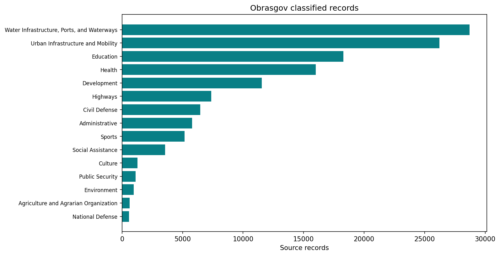
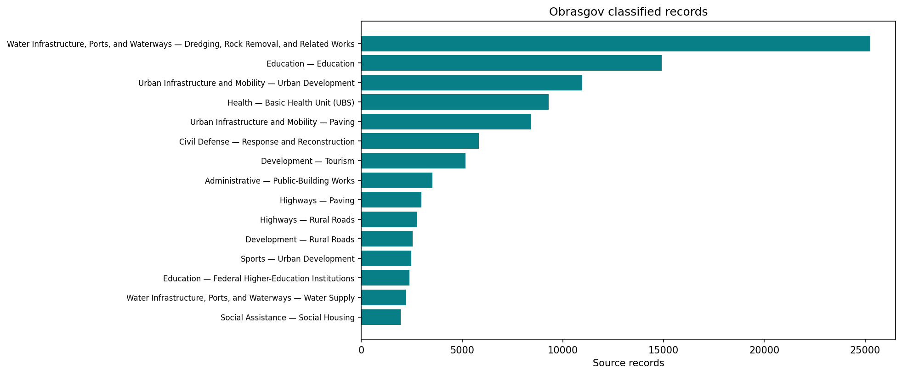

# Obrasgov preprocessing and location checks

Follow saved snapshot translation, location screening, the reported primary-state check and approved exclusions. Source records and original coordinates remain preserved; map eligibility is written to a separate derivative.

[Variable and dataset codebook](../../docs/codebook.md) · [Methods](../../docs/methods.md) · [All reports](../README.md#read-the-reports)

Refresh processing and this report with `brazil-project report obrasgov_preprocessing --config project.toml`. Add `--from-saved` to refresh existing verified artifacts only. Code is collapsed; tables and figures below are saved execution results.

## Processing code and pipeline

Execution order: `obrasgov-snapshot` → `obrasgov-location-qa` → `obrasgov-location-plot` → `obrasgov-primary-state-check` → `obrasgov-primary-state-filter`. The [cli.py → dispatch()](../../code/brazil_project/cli.py#L23) dispatcher calls these functions; [cli.py → expand()](../../code/brazil_project/cli.py#L58) resolves dependencies. The cells below read their saved outputs and present the results.

| Pipeline stage | Active processing source | Inputs | Saved outputs used by the process/report |
| --- | --- | --- | --- |
| `obrasgov-snapshot` | [projects.py → run()](../../code/brazil_project/infrastructure/projects.py#L47) | Configured snapshot or completed local acquisition; source=obrasgov | `obrasgov/projects.parquet; projects_clean.parquet; translated category counts` |
| `obrasgov-location-qa` | [location_qa.py → run()](../../code/brazil_project/infrastructure/location_qa.py#L218) | Preserved source snapshot from location_qa.source and pinned reference boundaries | `obrasgov-location-qa/component_audit.parquet; map, quarantine and review tables` |
| `obrasgov-location-plot` | [plot_location_qa.py → run()](../../code/scripts/plot_location_qa.py#L35) | Component audit and pinned municipal reference | `outputs/figures/obrasgov-location-qa/location-screening.png` |
| `obrasgov-primary-state-check` | [check_obras_primary_state.py → run()](../../code/scripts/check_obras_primary_state.py#L54) | Complete component geometry, uf_principal and IBGE state territory | `outputs/tables/obrasgov-primary-state/summary.json and component-level checks` |
| `obrasgov-primary-state-filter` | [filter_obras_primary_state.py → run()](../../code/scripts/filter_obras_primary_state.py#L103) | Completed QA and primary-state diagnostics | `obrasgov-primary-state-filter/map_components.parquet; exclusion audit and comparison figure` |

Paths without an `outputs/` prefix in this table are relative to `data/intermediate/`. Municipality runs use `data/intermediate/municipality_<code>/` and publish scoped report copies under `outputs/reports/`; national-only workflows reject municipality scope. See the [complete pipeline source guide](../../docs/pipeline-source.md) for dependencies, acquisition and the report publisher.

Original geometry cleaning: [clean_obrasgov()](../../code/brazil_project/infrastructure/projects.py#L17). Component decomposition: [decompose()](../../code/brazil_project/infrastructure/location_qa.py#L38); screening decisions: [audit()](../../code/brazil_project/infrastructure/location_qa.py#L112); exact primary-state predicates: [check_states()](../../code/scripts/check_obras_primary_state.py#L16).

Approved exclusion rule: [apply_filter()](../../code/scripts/filter_obras_primary_state.py#L24).

## How to read this analysis

**Two distinct paths:** the faithful original cleaning step removes empty or world-range-invalid geometries and repairs retained geometry. The later location-quality workflow starts from the preserved source snapshot, decomposes its geometries and assigns component-level status. Their counts are not interchangeable.

A component is a single point, line or polygon part. A source row or project can have several components, some retained and some excluded. All Obrasgov polygons are excluded from map display at researcher request; the underlying records remain available. Eligible locations are not independently verified coordinates.

## Inputs, coverage and processing status

This summary reads the current saved processing artifacts. Technical fingerprints are available in the collapsed provenance record.

Processing source: [projects.py → run()](../../code/brazil_project/infrastructure/projects.py#L47). Saved result: `data/intermediate/obrasgov/report.json`. Report display: [reporting.py → show_chunk()](../../code/brazil_project/reporting.py#L140).

<details>
<summary>Read saved processing summary</summary>

<!-- brazil:cell obrasgov_preprocessing_1 -->
```python
import matplotlib
matplotlib.use("Agg")  # Headless figures in the fresh report process.
#| label: obrasgov_preprocessing_1
from pathlib import Path
from brazil_project.io import Context
from brazil_project.reporting import show_chunk
show_chunk(ctx, 'Scripts_Data/Obrasgov/Obrasgov - Preprocessing.qmd', 1)
```

</details>

<!-- brazil:output obrasgov_preprocessing_1 begin -->
<table border="1" class="dataframe">
  <thead>
    <tr style="text-align: right;">
      <th>Cleaning step</th>
      <th>Count</th>
    </tr>
  </thead>
  <tbody>
    <tr>
      <td>Input snapshot records</td>
      <td>134929</td>
    </tr>
    <tr>
      <td>Retained records</td>
      <td>133417</td>
    </tr>
    <tr>
      <td>Excluded from this derivative</td>
      <td>1512</td>
    </tr>
    <tr>
      <td>Archived retained-record count</td>
      <td>133417</td>
    </tr>
  </tbody>
</table>

Archived row-count agreement: **yes**. This checks counts only, not record identity or coordinate accuracy. Source: `copied_snapshot`.

<details>
<summary>Technical provenance and complete processing record</summary>

```json
{
  "records": 134929,
  "cleaned_records": 133417,
  "removed": 1512,
  "baseline_cleaned_records": 133417,
  "count_matches_baseline": true,
  "source": "copied_snapshot",
  "generated_at": "2026-10-26T14:29:25.709140+00:00"
}
```

</details>
<!-- brazil:output obrasgov_preprocessing_1 end -->

Processing source: [projects.py → run()](../../code/brazil_project/infrastructure/projects.py#L47). Saved result: `data/intermediate/obrasgov/report.json`. Report display: [reporting.py → show_chunk()](../../code/brazil_project/reporting.py#L140).

<details>
<summary>Trace original step: Import</summary>

<!-- brazil:cell obrasgov_preprocessing_2 -->
```python
#| label: obrasgov_preprocessing_2
show_chunk(ctx, 'Scripts_Data/Obrasgov/Obrasgov - Preprocessing.qmd', 2)
```

</details>

<!-- brazil:output obrasgov_preprocessing_2 begin -->
<!-- Saved result already presented; original cell retained for traceability. -->
<!-- brazil:output obrasgov_preprocessing_2 end -->

Processing source: [projects.py → run()](../../code/brazil_project/infrastructure/projects.py#L47). Saved result: `data/intermediate/obrasgov/report.json`. Report display: [reporting.py → show_chunk()](../../code/brazil_project/reporting.py#L140).

<details>
<summary>Trace original step: Add Translated Cols</summary>

<!-- brazil:cell obrasgov_preprocessing_3 -->
```python
#| label: obrasgov_preprocessing_3
show_chunk(ctx, 'Scripts_Data/Obrasgov/Obrasgov - Preprocessing.qmd', 3)
```

</details>

<!-- brazil:output obrasgov_preprocessing_3 begin -->
<!-- Saved result already presented; original cell retained for traceability. -->
<!-- brazil:output obrasgov_preprocessing_3 end -->

## Category table

Largest saved categories only. Untranslated values are excluded from classified counts; the denominator is all classified rows before the top-15 display limit.

Processing source: [projects.py → counts()](../../code/brazil_project/infrastructure/projects.py#L29). Saved result: `data/intermediate/obrasgov/type_subtype_counts.parquet`. Report display: [reporting.py → show_chunk()](../../code/brazil_project/reporting.py#L140).

<details>
<summary>Read saved category frequencies</summary>

<!-- brazil:cell obrasgov_preprocessing_4 -->
```python
#| label: obrasgov_preprocessing_4
show_chunk(ctx, 'Scripts_Data/Obrasgov/Obrasgov - Preprocessing.qmd', 4)
```

</details>

<!-- brazil:output obrasgov_preprocessing_4 begin -->
15 saved rows; showing up to ten. See the codebook for column definitions.

<table border="1" class="dataframe">
  <thead>
    <tr style="text-align: right;">
      <th>type_en</th>
      <th>subtype_en</th>
      <th>Source records</th>
      <th>Share of classified records (fraction)</th>
    </tr>
  </thead>
  <tbody>
    <tr>
      <td>Water Infrastructure, Ports, and Waterways</td>
      <td>Dredging, Rock Removal, and Related Works</td>
      <td>25250</td>
      <td>0.1874</td>
    </tr>
    <tr>
      <td>Education</td>
      <td>Education</td>
      <td>14896</td>
      <td>0.1106</td>
    </tr>
    <tr>
      <td>Urban Infrastructure and Mobility</td>
      <td>Urban Development</td>
      <td>10957</td>
      <td>0.0813</td>
    </tr>
    <tr>
      <td>Health</td>
      <td>Basic Health Unit (UBS)</td>
      <td>9297</td>
      <td>0.0690</td>
    </tr>
    <tr>
      <td>Urban Infrastructure and Mobility</td>
      <td>Paving</td>
      <td>8407</td>
      <td>0.0624</td>
    </tr>
    <tr>
      <td>Civil Defense</td>
      <td>Response and Reconstruction</td>
      <td>5822</td>
      <td>0.0432</td>
    </tr>
    <tr>
      <td>Development</td>
      <td>Tourism</td>
      <td>5171</td>
      <td>0.0384</td>
    </tr>
    <tr>
      <td>Administrative</td>
      <td>Public-Building Works</td>
      <td>3534</td>
      <td>0.0262</td>
    </tr>
    <tr>
      <td>Highways</td>
      <td>Paving</td>
      <td>2978</td>
      <td>0.0221</td>
    </tr>
    <tr>
      <td>Highways</td>
      <td>Rural Roads</td>
      <td>2781</td>
      <td>0.0206</td>
    </tr>
  </tbody>
</table>
<!-- brazil:output obrasgov_preprocessing_4 end -->

## Project categories

Figures count source rows by translated type and subtype. Repeated project IDs can appear more than once; category shares are fractions of all classified rows, not shares of investment.

Processing source: [projects.py → counts()](../../code/brazil_project/infrastructure/projects.py#L29). Saved result: `data/intermediate/obrasgov/type_subtype_counts.parquet`. Report display: [reporting.py → show_chunk()](../../code/brazil_project/reporting.py#L140).

<details>
<summary>Generate category figures from saved counts</summary>

<!-- brazil:cell obrasgov_preprocessing_5 -->
```python
#| label: obrasgov_preprocessing_5
show_chunk(ctx, 'Scripts_Data/Obrasgov/Obrasgov - Preprocessing.qmd', 5)
```

</details>

<!-- brazil:output obrasgov_preprocessing_5 begin -->


Largest 15 saved categories; counts describe source rows, which can repeat project IDs. Missing translations are excluded from classified counts. Full classified records determine the saved share denominator, before truncation to 15 categories.



Largest 15 saved categories; counts describe source rows, which can repeat project IDs. Missing translations are excluded from classified counts. Full classified records determine the saved share denominator, before truncation to 15 categories.
<!-- brazil:output obrasgov_preprocessing_5 end -->

Processing source: [projects.py → run()](../../code/brazil_project/infrastructure/projects.py#L47). Saved result: `data/intermediate/obrasgov/report.json`. Report display: [reporting.py → show_chunk()](../../code/brazil_project/reporting.py#L140).

<details>
<summary>Trace original step: Unnamed 6</summary>

<!-- brazil:cell obrasgov_preprocessing_6 -->
```python
#| label: obrasgov_preprocessing_6
show_chunk(ctx, 'Scripts_Data/Obrasgov/Obrasgov - Preprocessing.qmd', 6)
```

</details>

<!-- brazil:output obrasgov_preprocessing_6 begin -->
<!-- Saved result already presented; original cell retained for traceability. -->
<!-- brazil:output obrasgov_preprocessing_6 end -->

## Location screening

Checks use IBGE municipal boundaries and generalized Natural Earth coast/land references. Invalid coordinates and suspicious offshore locations are quarantined; coastal, border, marine and administrative uncertainty can require review. Small islands and reference resolution limit conclusions. No reprojection or coordinate replacement is inferred. The plot shows points only, not all geometry components.

Processing source: [location_qa.py → audit()](../../code/brazil_project/infrastructure/location_qa.py#L112). QA audit and [plot_location_qa.py → run()](../../code/scripts/plot_location_qa.py#L35) produce the summary and screening figure. Report display: [reporting.py → summary()](../../code/brazil_project/reporting.py#L33).

<details>
<summary>Summarise screening and display its current figure</summary>

<!-- brazil:cell location_qa -->
```python
from brazil_project.reporting import summary
summary(report_json("obrasgov-location-qa"), "obrasgov-location-qa")
report_image("outputs/figures/obrasgov-location-qa/location-screening.png")
```

</details>

<!-- brazil:output location_qa begin -->
<table border="1" class="dataframe">
  <thead>
    <tr style="text-align: right;">
      <th>Measure</th>
      <th>Count</th>
    </tr>
  </thead>
  <tbody>
    <tr>
      <td>Original source records</td>
      <td>134929</td>
    </tr>
    <tr>
      <td>Geometry components</td>
      <td>230356</td>
    </tr>
    <tr>
      <td>Eligible point/line components before state check</td>
      <td>226309</td>
    </tr>
    <tr>
      <td>Quarantined components</td>
      <td>2037</td>
    </tr>
    <tr>
      <td>Offshore components quarantined</td>
      <td>428</td>
    </tr>
  </tbody>
</table>

<table border="1" class="dataframe">
  <thead>
    <tr style="text-align: right;">
      <th>Location status</th>
      <th>Components</th>
    </tr>
  </thead>
  <tbody>
    <tr>
      <td>eligible unverified</td>
      <td>224103</td>
    </tr>
    <tr>
      <td>administrative or coordinate review</td>
      <td>2063</td>
    </tr>
    <tr>
      <td>polygon display excluded</td>
      <td>2010</td>
    </tr>
    <tr>
      <td>quarantined invalid location</td>
      <td>1523</td>
    </tr>
    <tr>
      <td>quarantined offshore</td>
      <td>428</td>
    </tr>
    <tr>
      <td>quarantined outside brazil</td>
      <td>86</td>
    </tr>
    <tr>
      <td>coastal review</td>
      <td>75</td>
    </tr>
    <tr>
      <td>border review</td>
      <td>62</td>
    </tr>
    <tr>
      <td>possible marine review</td>
      <td>6</td>
    </tr>
  </tbody>
</table>

Eligibility is a screening decision, not verified geocoding. Coordinates corrected: **0**.

<details>
<summary>Technical provenance and complete processing record</summary>

```json
{
  "status": "completed",
  "contract": {
    "policy_version": "1.0",
    "source_sha256": "091c27860f78eee1e6abe989dbbef65a8b7412f87d82616d74c30ca6774f17cc",
    "references": {
      "municipalities": {
        "path": "BR_Municipios_2022.zip",
        "url": "https://geoftp.ibge.gov.br/organizacao_do_territorio/malhas_territoriais/malhas_municipais/municipio_2022/Brasil/BR/BR_Municipios_2022.zip",
        "description": "IBGE municipal mesh 2022",
        "sha256": "9c904fa1feb978a89042bfecd7758e571266f285d6122a4ff02ffe37bffb76a2",
        "bytes": 203627589,
        "acquired_at": "2026-10-06T11:52:29.156527+00:00"
      },
      "land": {
        "path": "ne_10m_land.zip",
        "url": "https://naturalearth.s3.amazonaws.com/5.1.1/10m_physical/ne_10m_land.zip",
        "description": "Natural Earth land 1:10m, 5.1.1",
        "sha256": "e547d749445eaa0964aba76738090ec88f5e63c4585122170f98c67a7ea922dc",
        "bytes": 3269070,
        "acquired_at": "2026-10-06T11:52:31.427667+00:00"
      },
      "coastline": {
        "path": "ne_10m_coastline.zip",
        "url": "https://naturalearth.s3.amazonaws.com/5.1.1/10m_physical/ne_10m_coastline.zip",
        "description": "Natural Earth ocean coastline 1:10m, release 5.1.1",
        "sha256": "bfa04cdbcbef07ef90dfca1dabb48062eca29900a113df0f389303e255484017",
        "bytes": 3069451,
        "acquired_at": "2026-10-06T11:54:44.640947+00:00"
      }
    },
    "parameters": {
      "coast_tolerance_m": 5000,
      "border_tolerance_m": 1000,
      "sample_spacing_m": 1000,
      "max_line_samples": 250
    },
    "code_sha256": "f8c0d12ef77c89f81122516b92c005fcf250c01ab7b5a555e65cf95340093915"
  },
  "source_records": 134929,
  "duplicate_project_id_rows": 4968,
  "components": 230356,
  "map_components": 226309,
  "quarantined_components": 2037,
  "component_status_counts": {
    "eligible_unverified": 224103,
    "administrative_or_coordinate_review": 2063,
    "polygon_display_excluded": 2010,
    "quarantined_invalid_location": 1523,
    "quarantined_offshore": 428,
    "quarantined_outside_brazil": 86,
    "coastal_review": 75,
    "border_review": 62,
    "possible_marine_review": 6
  },
  "quarantined_source_rows": 1826,
  "quarantined_project_ids": 1801,
  "offshore_project_ids": 292,
  "far_offshore_project_ids": 236,
  "unique_project_budget_diagnostic": {
    "distinct_project_ids": 129961,
    "consistent_amount_project_ids": 129961,
    "conflicting_amount_project_ids": 0,
    "all_missing_amount_project_ids": 0,
    "consistent_project_amount_brl": 1017235379491.0999,
    "source_row_sum_is_not_unique_project_budget": true
  },
  "offshore_components": 509,
  "far_offshore_components": 428,
  "investment_by_source_row_coverage": {
    "all_components_eligible": {
      "source_rows": 131459,
      "known_investment_brl": 1095191124427.0099,
      "missing_investment_rows": 0
    },
    "mixed_components": {
      "source_rows": 227,
      "known_investment_brl": 2187023643.69,
      "missing_investment_rows": 0
    },
    "no_eligible_location": {
      "source_rows": 3243,
      "known_investment_brl": 17839949930.53,
      "missing_investment_rows": 0
    }
  },
  "source_unchanged": true,
  "coordinates_corrected": 0,
  "municipality_code_check_available": false,
  "limitations": [
    "Generalized coastline and land mask; small unmapped islands can be flagged.",
    "Marine descriptions indicate review, not verified marine validity.",
    "Line paths are sampled; all source vertices are checked.",
    "Retained locations are eligible, not independently validated.",
    "Source rows include duplicate project IDs; row investment totals are not unique-project budgets."
  ],
  "output_fingerprints": {
    "source_audit": "451555ec861c6065f53640bd70ac44793a731562fc7ff331ff15a0ece2c436aa",
    "component_audit": "a37ced6f2fa55ceb6758914181c34359abae256288d12d897b50c3b7fadb8b05",
    "map_components": "894b73d13808206f4571754d41efe57b5820ba838459dbc966454c1fb47d38d6",
    "quarantined_components": "d34beb533c55ecc97fed473e9e9e4c807431c32d88ea61a2342a8e8d924bbab2",
    "review_table": "d6646ca021901c08c91523d25142b7a44069512650f66800b648b83719621c8b"
  },
  "generated_at": "2026-10-26T14:31:25.904671+00:00"
}
```

</details>


<!-- brazil:output location_qa end -->

## Does geometry intersect its reported primary state?

The complete component is checked against its declared primary-state territory: covered, partly intersecting, entirely outside or unassessable. The check itself does not filter. A lead state may describe a multi-state project, and administrative territory is not an offshore licensing boundary.

Processing source: [check_obras_primary_state.py → run()](../../code/scripts/check_obras_primary_state.py#L54). Reads `outputs/tables/obrasgov-primary-state/summary.json`; this diagnostic does not filter. Report display: [reporting.py → summary()](../../code/brazil_project/reporting.py#L33).

<details>
<summary>Read primary-state diagnostics</summary>

<!-- brazil:cell primary_state_check -->
```python
summary(report_file("outputs/tables/obrasgov-primary-state/summary.json"), "primary-state")
```

</details>

<!-- brazil:output primary_state_check begin -->
<table border="1" class="dataframe">
  <thead>
    <tr style="text-align: right;">
      <th>Relation to reported primary state</th>
      <th>Components</th>
    </tr>
  </thead>
  <tbody>
    <tr>
      <td>fully inside</td>
      <td>226006</td>
    </tr>
    <tr>
      <td>entirely outside</td>
      <td>2346</td>
    </tr>
    <tr>
      <td>not assessable geometry</td>
      <td>1561</td>
    </tr>
    <tr>
      <td>partly inside or boundary contact</td>
      <td>440</td>
    </tr>
    <tr>
      <td>unknown or missing primary state</td>
      <td>3</td>
    </tr>
  </tbody>
</table>

Of entirely outside components, 1,678 intersect another state and 668 intersect no mapped state territory. Multi-state projects and coastal boundaries need interpretation.

<details>
<summary>Technical provenance and complete processing record</summary>

```json
{
  "status": "completed",
  "mode": "diagnostic_only_no_filtering",
  "reference": "IBGE municipalities 2022 dissolved by SIGLA_UF; original resolution",
  "predicate": "covers for fully_inside; intersects for partly_inside_or_boundary_contact; no buffer or coordinate correction",
  "inputs": {
    "data/intermediate/obrasgov-location-qa/component_audit.parquet": "a37ced6f2fa55ceb6758914181c34359abae256288d12d897b50c3b7fadb8b05",
    "data/reference/location-qa/BR_Municipios_2022.zip": "9c904fa1feb978a89042bfecd7758e571266f285d6122a4ff02ffe37bffb76a2",
    "data/processed/obrasgov/projects_st.gpkg": "091c27860f78eee1e6abe989dbbef65a8b7412f87d82616d74c30ca6774f17cc"
  },
  "script_sha256": "e747480b47dc9661227c55481f845bbc4353f7e63c505f703a3a30a9d3b444c4",
  "source_rows": 134929,
  "components": 230356,
  "component_counts": {
    "fully_inside": 226006,
    "entirely_outside": 2346,
    "not_assessable_geometry": 1561,
    "partly_inside_or_boundary_contact": 440,
    "unknown_or_missing_primary_state": 3
  },
  "affected_source_rows": {
    "entirely_outside": 784,
    "fully_inside": 132924,
    "not_assessable_geometry": 1558,
    "partly_inside_or_boundary_contact": 112,
    "unknown_or_missing_primary_state": 3
  },
  "affected_distinct_project_ids": {
    "entirely_outside": 697,
    "fully_inside": 128048,
    "not_assessable_geometry": 1508,
    "partly_inside_or_boundary_contact": 79,
    "unknown_or_missing_primary_state": 3
  },
  "counts_by_state": {
    "": {
      "entirely_outside": 0,
      "fully_inside": 0,
      "not_assessable_geometry": 6,
      "partly_inside_or_boundary_contact": 0,
      "unknown_or_missing_primary_state": 3
    },
    "AC": {
      "entirely_outside": 6,
      "fully_inside": 1831,
      "not_assessable_geometry": 8,
      "partly_inside_or_boundary_contact": 1,
      "unknown_or_missing_primary_state": 0
    },
    "AL": {
      "entirely_outside": 99,
      "fully_inside": 3230,
      "not_assessable_geometry": 25,
      "partly_inside_or_boundary_contact": 8,
      "unknown_or_missing_primary_state": 0
    },
    "AM": {
      "entirely_outside": 24,
      "fully_inside": 4952,
      "not_assessable_geometry": 22,
      "partly_inside_or_boundary_contact": 32,
      "unknown_or_missing_primary_state": 0
    },
    "AP": {
      "entirely_outside": 16,
      "fully_inside": 2189,
      "not_assessable_geometry": 7,
      "partly_inside_or_boundary_contact": 0,
      "unknown_or_missing_primary_state": 0
    },
    "BA": {
      "entirely_outside": 280,
      "fully_inside": 18053,
      "not_assessable_geometry": 132,
      "partly_inside_or_boundary_contact": 4,
      "unknown_or_missing_primary_state": 0
    },
    "CE": {
      "entirely_outside": 28,
      "fully_inside": 9938,
      "not_assessable_geometry": 80,
      "partly_inside_or_boundary_contact": 34,
      "unknown_or_missing_primary_state": 0
    },
    "DF": {
      "entirely_outside": 330,
      "fully_inside": 1324,
      "not_assessable_geometry": 13,
      "partly_inside_or_boundary_contact": 21,
      "unknown_or_missing_primary_state": 0
    },
    "ES": {
      "entirely_outside": 12,
      "fully_inside": 2812,
      "not_assessable_geometry": 43,
      "partly_inside_or_boundary_contact": 2,
      "unknown_or_missing_primary_state": 0
    },
    "GO": {
      "entirely_outside": 28,
      "fully_inside": 4965,
      "not_assessable_geometry": 39,
      "partly_inside_or_boundary_contact": 2,
      "unknown_or_missing_primary_state": 0
    },
    "MA": {
      "entirely_outside": 293,
      "fully_inside": 18699,
      "not_assessable_geometry": 80,
      "partly_inside_or_boundary_contact": 6,
      "unknown_or_missing_primary_state": 0
    },
    "MG": {
      "entirely_outside": 84,
      "fully_inside": 22551,
      "not_assessable_geometry": 114,
      "partly_inside_or_boundary_contact": 3,
      "unknown_or_missing_primary_state": 0
    },
    "MS": {
      "entirely_outside": 12,
      "fully_inside": 3168,
      "not_assessable_geometry": 33,
      "partly_inside_or_boundary_contact": 1,
      "unknown_or_missing_primary_state": 0
    },
    "MT": {
      "entirely_outside": 43,
      "fully_inside": 4996,
      "not_assessable_geometry": 23,
      "partly_inside_or_boundary_contact": 6,
      "unknown_or_missing_primary_state": 0
    },
    "PA": {
      "entirely_outside": 50,
      "fully_inside": 21038,
      "not_assessable_geometry": 56,
      "partly_inside_or_boundary_contact": 15,
      "unknown_or_missing_primary_state": 0
    },
    "PB": {
      "entirely_outside": 24,
      "fully_inside": 6390,
      "not_assessable_geometry": 40,
      "partly_inside_or_boundary_contact": 6,
      "unknown_or_missing_primary_state": 0
    },
    "PE": {
      "entirely_outside": 363,
      "fully_inside": 13917,
      "not_assessable_geometry": 57,
      "partly_inside_or_boundary_contact": 204,
      "unknown_or_missing_primary_state": 0
    },
    "PI": {
      "entirely_outside": 237,
      "fully_inside": 13083,
      "not_assessable_geometry": 140,
      "partly_inside_or_boundary_contact": 35,
      "unknown_or_missing_primary_state": 0
    },
    "PR": {
      "entirely_outside": 21,
      "fully_inside": 7270,
      "not_assessable_geometry": 76,
      "partly_inside_or_boundary_contact": 11,
      "unknown_or_missing_primary_state": 0
    },
    "RJ": {
      "entirely_outside": 59,
      "fully_inside": 5771,
      "not_assessable_geometry": 39,
      "partly_inside_or_boundary_contact": 20,
      "unknown_or_missing_primary_state": 0
    },
    "RN": {
      "entirely_outside": 31,
      "fully_inside": 5001,
      "not_assessable_geometry": 24,
      "partly_inside_or_boundary_contact": 7,
      "unknown_or_missing_primary_state": 0
    },
    "RO": {
      "entirely_outside": 38,
      "fully_inside": 2535,
      "not_assessable_geometry": 23,
      "partly_inside_or_boundary_contact": 1,
      "unknown_or_missing_primary_state": 0
    },
    "RR": {
      "entirely_outside": 9,
      "fully_inside": 1625,
      "not_assessable_geometry": 42,
      "partly_inside_or_boundary_contact": 0,
      "unknown_or_missing_primary_state": 0
    },
    "RS": {
      "entirely_outside": 74,
      "fully_inside": 13079,
      "not_assessable_geometry": 154,
      "partly_inside_or_boundary_contact": 5,
      "unknown_or_missing_primary_state": 0
    },
    "SC": {
      "entirely_outside": 43,
      "fully_inside": 6678,
      "not_assessable_geometry": 30,
      "partly_inside_or_boundary_contact": 1,
      "unknown_or_missing_primary_state": 0
    },
    "SE": {
      "entirely_outside": 13,
      "fully_inside": 2554,
      "not_assessable_geometry": 25,
      "partly_inside_or_boundary_contact": 10,
      "unknown_or_missing_primary_state": 0
    },
    "SP": {
      "entirely_outside": 52,
      "fully_inside": 23803,
      "not_assessable_geometry": 212,
      "partly_inside_or_boundary_contact": 1,
      "unknown_or_missing_primary_state": 0
    },
    "TO": {
      "entirely_outside": 77,
      "fully_inside": 4554,
      "not_assessable_geometry": 18,
      "partly_inside_or_boundary_contact": 4,
      "unknown_or_missing_primary_state": 0
    }
  },
  "counts_by_geometry": {
    "LineString": {
      "entirely_outside": 329,
      "fully_inside": 23477,
      "not_assessable_geometry": 0,
      "partly_inside_or_boundary_contact": 375,
      "unknown_or_missing_primary_state": 0
    },
    "MultiPoint": {
      "entirely_outside": 0,
      "fully_inside": 0,
      "not_assessable_geometry": 1509,
      "partly_inside_or_boundary_contact": 0,
      "unknown_or_missing_primary_state": 0
    },
    "Point": {
      "entirely_outside": 2010,
      "fully_inside": 200640,
      "not_assessable_geometry": 3,
      "partly_inside_or_boundary_contact": 0,
      "unknown_or_missing_primary_state": 3
    },
    "Polygon": {
      "entirely_outside": 7,
      "fully_inside": 1889,
      "not_assessable_geometry": 49,
      "partly_inside_or_boundary_contact": 65,
      "unknown_or_missing_primary_state": 0
    }
  },
  "entirely_outside_intersecting_other_states": 1678,
  "entirely_outside_intersecting_no_state": 668,
  "figure": {
    "path": "outputs/figures/obrasgov-location-qa/primary-state-check.png",
    "sha256": "a0c9d2335732140b56d10cc4959f0f803ffa807fe77a61869b3037356eab4f66"
  },
  "output_sha256": {
    "components.csv": "1d26c299819b06d142c6f36544c3b56c558e075379b801aadee5c89313d45571",
    "by-state.csv": "0014477a1d7f9b1d9c3973fb633837ee7fa7cdff25940734fffdf191e4a83d6e",
    "by-geometry.csv": "076c078cc01d1367042619f2e0a689ae9b4d7e6628be120394be4de6e5e5a487"
  },
  "limitations": [
    "Primary state may describe a lead state in a multi-state project.",
    "IBGE 2022 administrative territory is not an offshore licensing boundary.",
    "Exact boundary differences can produce partial or outside results.",
    "Source rows/project IDs may have multiple components and occur in multiple categories."
  ]
}
```

</details>
<!-- brazil:output primary_state_check end -->

## Approved map exclusions

Components entirely outside the reported primary state are excluded from the separate map derivative. Partly intersecting components retain the baseline policy. Some outside components were already quarantined, so total outside components exceed newly excluded eligible map components. Other valid components from the same project remain. This pipeline does not publish the website.

Processing source: [filter_obras_primary_state.py → run()](../../code/scripts/filter_obras_primary_state.py#L103). Reads `data/intermediate/obrasgov-primary-state-filter/report.json`; filtering affects a separate derivative. Report display: [reporting.py → table()](../../code/brazil_project/reporting.py#L13).

<details>
<summary>Read exclusion counts</summary>

<!-- brazil:cell obrasgov_state_filter_summary -->
```python
import pandas as pd
from brazil_project.reporting import table
state_result = report_json("obrasgov-primary-state-filter")
table(pd.DataFrame({"Result": ["Components entirely outside primary state", "Map components before state exclusions", "Map components after state exclusions"], "Count": [state_result["excluded_components"], state_result["map_components_before"], state_result["map_components_after"]]}))
```

</details>

<!-- brazil:output obrasgov_state_filter_summary begin -->
<table border="1" class="dataframe">
  <thead>
    <tr style="text-align: right;">
      <th>Result</th>
      <th>Count</th>
    </tr>
  </thead>
  <tbody>
    <tr>
      <td>Components entirely outside primary state</td>
      <td>2346</td>
    </tr>
    <tr>
      <td>Map components before state exclusions</td>
      <td>226309</td>
    </tr>
    <tr>
      <td>Map components after state exclusions</td>
      <td>224495</td>
    </tr>
  </tbody>
</table>
<!-- brazil:output obrasgov_state_filter_summary end -->

## Before and after exclusions

Original eligible points before and after the state filter. Lines, polygons and already quarantined points are omitted. Coordinates are unchanged.

Processing source: [filter_obras_primary_state.py → run()](../../code/scripts/filter_obras_primary_state.py#L103). Reads its current `outputs/figures/obrasgov-location-qa/primary-state-filter.png`; this cell displays rather than generates the processing figure. Report display: [report_engine.py → execute_cells()](../../code/brazil_project/report_engine.py#L123) supplies `report_image()`.

<details>
<summary>Display current exclusion-comparison figure</summary>

<!-- brazil:cell state_filter_figure -->
```python
report_image("outputs/figures/obrasgov-location-qa/primary-state-filter.png")
```

</details>

<!-- brazil:output state_filter_figure begin -->

<!-- brazil:output state_filter_figure end -->

## Interpretation and limits

Outputs retain the original aggregation, missingness and exclusion rules. Available results do not establish national scientific validation. Read [verification and remaining limitations](../../docs/checks.md) before drawing research conclusions. Original codebooks and earlier report contents remain preserved in the project archive.
