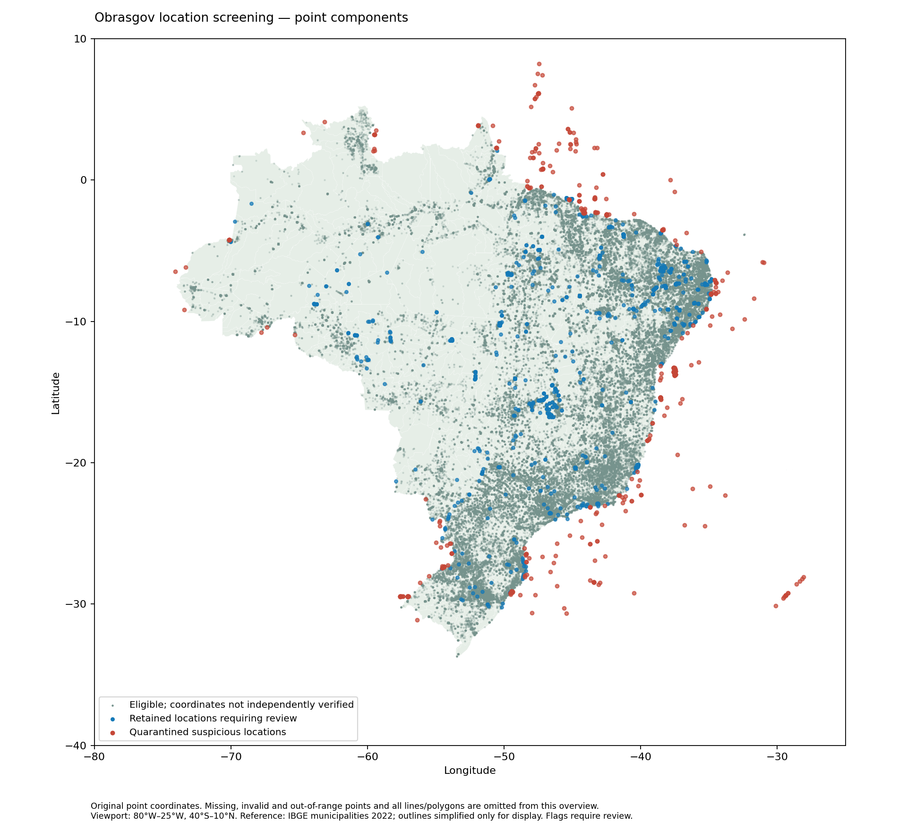

# Obrasgov Preprocessing

Executable research report. Refresh with `brazil-project report obrasgov_preprocessing`. Code is collapsed below each explanation.

This report follows the original import, translation and cleaning flow using saved Python processing artifacts. Rendering does not download or modify source datasets. The later location QA and approved primary-state exclusions are documented separately below.

## Processing flow


<details>
<summary>Python code</summary>

<!-- brazil:cell obrasgov_preprocessing_1 -->
```python
#| label: obrasgov_preprocessing_1
from pathlib import Path
from brazil_project.io import Context
from brazil_project.reporting import show_chunk
show_chunk(ctx, 'Scripts_Data/Obrasgov/Obrasgov - Preprocessing.qmd', 1)
```

</details>

<!-- brazil:output obrasgov_preprocessing_1 begin -->
```text
{'records': 134929,
 'cleaned_records': 133417,
 'removed': 1512,
 'baseline_cleaned_records': 133417,
 'count_matches_baseline': True,
 'source': 'copied_snapshot',
 'generated_at': '2026-10-07T07:10:12.235992+00:00'}
```
<!-- brazil:output obrasgov_preprocessing_1 end -->


<details>
<summary>Python code</summary>

<!-- brazil:cell obrasgov_preprocessing_2 -->
```python
#| label: obrasgov_preprocessing_2
show_chunk(ctx, 'Scripts_Data/Obrasgov/Obrasgov - Preprocessing.qmd', 2)
```

</details>

<!-- brazil:output obrasgov_preprocessing_2 begin -->
```text
{'records': 134929,
 'cleaned_records': 133417,
 'removed': 1512,
 'baseline_cleaned_records': 133417,
 'count_matches_baseline': True,
 'source': 'copied_snapshot',
 'generated_at': '2026-10-07T07:10:12.235992+00:00'}
```
<!-- brazil:output obrasgov_preprocessing_2 end -->


<details>
<summary>Python code</summary>

<!-- brazil:cell obrasgov_preprocessing_3 -->
```python
#| label: obrasgov_preprocessing_3
show_chunk(ctx, 'Scripts_Data/Obrasgov/Obrasgov - Preprocessing.qmd', 3)
```

</details>

<!-- brazil:output obrasgov_preprocessing_3 begin -->
```text
{'records': 134929,
 'cleaned_records': 133417,
 'removed': 1512,
 'baseline_cleaned_records': 133417,
 'count_matches_baseline': True,
 'source': 'copied_snapshot',
 'generated_at': '2026-10-07T07:10:12.235992+00:00'}
```
<!-- brazil:output obrasgov_preprocessing_3 end -->


<details>
<summary>Python code</summary>

<!-- brazil:cell obrasgov_preprocessing_4 -->
```python
#| label: obrasgov_preprocessing_4
show_chunk(ctx, 'Scripts_Data/Obrasgov/Obrasgov - Preprocessing.qmd', 4)
```

</details>

<!-- brazil:output obrasgov_preprocessing_4 begin -->

<table border="1" class="dataframe">
  <thead>
    <tr style="text-align: right;">
      <th></th>
      <th>type_en</th>
      <th>subtype_en</th>
      <th>projects</th>
      <th>share</th>
    </tr>
  </thead>
  <tbody>
    <tr>
      <th>0</th>
      <td>Water Infrastructure, Ports, and Waterways</td>
      <td>Dredging, Rock Removal, and Related Works</td>
      <td>25250</td>
      <td>0.187413</td>
    </tr>
    <tr>
      <th>1</th>
      <td>Education</td>
      <td>Education</td>
      <td>14896</td>
      <td>0.110563</td>
    </tr>
    <tr>
      <th>2</th>
      <td>Urban Infrastructure and Mobility</td>
      <td>Urban Development</td>
      <td>10957</td>
      <td>0.081326</td>
    </tr>
    <tr>
      <th>3</th>
      <td>Health</td>
      <td>Basic Health Unit (UBS)</td>
      <td>9297</td>
      <td>0.069005</td>
    </tr>
    <tr>
      <th>4</th>
      <td>Urban Infrastructure and Mobility</td>
      <td>Paving</td>
      <td>8407</td>
      <td>0.062399</td>
    </tr>
    <tr>
      <th>5</th>
      <td>Civil Defense</td>
      <td>Response and Reconstruction</td>
      <td>5822</td>
      <td>0.043213</td>
    </tr>
    <tr>
      <th>6</th>
      <td>Development</td>
      <td>Tourism</td>
      <td>5171</td>
      <td>0.038381</td>
    </tr>
    <tr>
      <th>7</th>
      <td>Administrative</td>
      <td>Public-Building Works</td>
      <td>3534</td>
      <td>0.026230</td>
    </tr>
    <tr>
      <th>8</th>
      <td>Highways</td>
      <td>Paving</td>
      <td>2978</td>
      <td>0.022104</td>
    </tr>
    <tr>
      <th>9</th>
      <td>Highways</td>
      <td>Rural Roads</td>
      <td>2781</td>
      <td>0.020641</td>
    </tr>
    <tr>
      <th>10</th>
      <td>Development</td>
      <td>Rural Roads</td>
      <td>2554</td>
      <td>0.018957</td>
    </tr>
    <tr>
      <th>11</th>
      <td>Sports</td>
      <td>Urban Development</td>
      <td>2483</td>
      <td>0.018430</td>
    </tr>
    <tr>
      <th>12</th>
      <td>Education</td>
      <td>Federal Higher-Education Institutions</td>
      <td>2374</td>
      <td>0.017621</td>
    </tr>
    <tr>
      <th>13</th>
      <td>Water Infrastructure, Ports, and Waterways</td>
      <td>Water Supply</td>
      <td>2198</td>
      <td>0.016314</td>
    </tr>
    <tr>
      <th>14</th>
      <td>Social Assistance</td>
      <td>Social Housing</td>
      <td>1956</td>
      <td>0.014518</td>
    </tr>
  </tbody>
</table>


```text
{'artifact_rows': 15,
 'path': 'data/intermediate/obrasgov/type_subtype_counts.parquet'}
```
<!-- brazil:output obrasgov_preprocessing_4 end -->


<details>
<summary>Python code</summary>

<!-- brazil:cell obrasgov_preprocessing_5 -->
```python
#| label: obrasgov_preprocessing_5
show_chunk(ctx, 'Scripts_Data/Obrasgov/Obrasgov - Preprocessing.qmd', 5)
```

</details>

<!-- brazil:output obrasgov_preprocessing_5 begin -->

<table border="1" class="dataframe">
  <thead>
    <tr style="text-align: right;">
      <th></th>
      <th>type_en</th>
      <th>subtype_en</th>
      <th>projects</th>
      <th>share</th>
    </tr>
  </thead>
  <tbody>
    <tr>
      <th>0</th>
      <td>Water Infrastructure, Ports, and Waterways</td>
      <td>Dredging, Rock Removal, and Related Works</td>
      <td>25250</td>
      <td>0.187413</td>
    </tr>
    <tr>
      <th>1</th>
      <td>Education</td>
      <td>Education</td>
      <td>14896</td>
      <td>0.110563</td>
    </tr>
    <tr>
      <th>2</th>
      <td>Urban Infrastructure and Mobility</td>
      <td>Urban Development</td>
      <td>10957</td>
      <td>0.081326</td>
    </tr>
    <tr>
      <th>3</th>
      <td>Health</td>
      <td>Basic Health Unit (UBS)</td>
      <td>9297</td>
      <td>0.069005</td>
    </tr>
    <tr>
      <th>4</th>
      <td>Urban Infrastructure and Mobility</td>
      <td>Paving</td>
      <td>8407</td>
      <td>0.062399</td>
    </tr>
    <tr>
      <th>5</th>
      <td>Civil Defense</td>
      <td>Response and Reconstruction</td>
      <td>5822</td>
      <td>0.043213</td>
    </tr>
    <tr>
      <th>6</th>
      <td>Development</td>
      <td>Tourism</td>
      <td>5171</td>
      <td>0.038381</td>
    </tr>
    <tr>
      <th>7</th>
      <td>Administrative</td>
      <td>Public-Building Works</td>
      <td>3534</td>
      <td>0.026230</td>
    </tr>
    <tr>
      <th>8</th>
      <td>Highways</td>
      <td>Paving</td>
      <td>2978</td>
      <td>0.022104</td>
    </tr>
    <tr>
      <th>9</th>
      <td>Highways</td>
      <td>Rural Roads</td>
      <td>2781</td>
      <td>0.020641</td>
    </tr>
    <tr>
      <th>10</th>
      <td>Development</td>
      <td>Rural Roads</td>
      <td>2554</td>
      <td>0.018957</td>
    </tr>
    <tr>
      <th>11</th>
      <td>Sports</td>
      <td>Urban Development</td>
      <td>2483</td>
      <td>0.018430</td>
    </tr>
    <tr>
      <th>12</th>
      <td>Education</td>
      <td>Federal Higher-Education Institutions</td>
      <td>2374</td>
      <td>0.017621</td>
    </tr>
    <tr>
      <th>13</th>
      <td>Water Infrastructure, Ports, and Waterways</td>
      <td>Water Supply</td>
      <td>2198</td>
      <td>0.016314</td>
    </tr>
    <tr>
      <th>14</th>
      <td>Social Assistance</td>
      <td>Social Housing</td>
      <td>1956</td>
      <td>0.014518</td>
    </tr>
  </tbody>
</table>


```text
{'artifact_rows': 15,
 'path': 'data/intermediate/obrasgov/type_subtype_counts.parquet'}
```
<!-- brazil:output obrasgov_preprocessing_5 end -->


<details>
<summary>Python code</summary>

<!-- brazil:cell obrasgov_preprocessing_6 -->
```python
#| label: obrasgov_preprocessing_6
show_chunk(ctx, 'Scripts_Data/Obrasgov/Obrasgov - Preprocessing.qmd', 6)
```

</details>

<!-- brazil:output obrasgov_preprocessing_6 begin -->
```text
{'records': 134929,
 'cleaned_records': 133417,
 'removed': 1512,
 'baseline_cleaned_records': 133417,
 'count_matches_baseline': True,
 'source': 'copied_snapshot',
 'generated_at': '2026-10-07T07:10:12.235992+00:00'}
```
<!-- brazil:output obrasgov_preprocessing_6 end -->

## Location preprocessing and primary-state exclusions

The faithful snapshot translation above is separate from the later spatial quality checks. Original records remain preserved. The approved state filter excludes components entirely outside their reported primary state, keeps partial/boundary intersections under the baseline policy, and saves a complete exclusion audit. See the [processing and verification record](../../docs/obrasgov-primary-state-filter.md).


<details>
<summary>Python code</summary>

<!-- brazil:cell location_qa -->
```python
display(report_json("obrasgov-location-qa"))
report_image("outputs/figures/obrasgov-location-qa/location-screening.png")
```

</details>

<!-- brazil:output location_qa begin -->
```text
{'status': 'completed',
 'contract': {'policy_version': '1.0',
  'source_sha256': '091c27860f78eee1e6abe989dbbef65a8b7412f87d82616d74c30ca6774f17cc',
  'references': {'municipalities': {'path': 'BR_Municipios_2022.zip',
    'url': 'https://geoftp.ibge.gov.br/organizacao_do_territorio/malhas_territoriais/malhas_municipais/municipio_2022/Brasil/BR/BR_Municipios_2022.zip',
    'description': 'IBGE municipal mesh 2022',
    'sha256': '9c904fa1feb978a89042bfecd7758e571266f285d6122a4ff02ffe37bffb76a2',
    'bytes': 203627589,
    'acquired_at': '2026-10-06T11:52:29.156527+00:00'},
   'land': {'path': 'ne_10m_land.zip',
    'url': 'https://naturalearth.s3.amazonaws.com/5.1.1/10m_physical/ne_10m_land.zip',
    'description': 'Natural Earth land 1:10m, 5.1.1',
    'sha256': 'e547d749445eaa0964aba76738090ec88f5e63c4585122170f98c67a7ea922dc',
    'bytes': 3269070,
    'acquired_at': '2026-10-06T11:52:31.427667+00:00'},
   'coastline': {'path': 'ne_10m_coastline.zip',
    'url': 'https://naturalearth.s3.amazonaws.com/5.1.1/10m_physical/ne_10m_coastline.zip',
    'description': 'Natural Earth ocean coastline 1:10m, release 5.1.1',
    'sha256': 'bfa04cdbcbef07ef90dfca1dabb48062eca29900a113df0f389303e255484017',
    'bytes': 3069451,
    'acquired_at': '2026-10-06T11:54:44.640947+00:00'}},
  'parameters': {'coast_tolerance_m': 5000,
   'border_tolerance_m': 1000,
   'sample_spacing_m': 1000,
   'max_line_samples': 250},
  'code_sha256': 'f8c0d12ef77c89f81122516b92c005fcf250c01ab7b5a555e65cf95340093915'},
 'source_records': 134929,
 'duplicate_project_id_rows': 4968,
 'components': 230356,
 'map_components': 226309,
 'quarantined_components': 2037,
 'component_status_counts': {'eligible_unverified': 224103,
  'administrative_or_coordinate_review': 2063,
  'polygon_display_excluded': 2010,
  'quarantined_invalid_location': 1523,
  'quarantined_offshore': 428,
  'quarantined_outside_brazil': 86,
  'coastal_review': 75,
  'border_review': 62,
  'possible_marine_review': 6},
 'quarantined_source_rows': 1826,
 'quarantined_project_ids': 1801,
 'offshore_project_ids': 292,
 'far_offshore_project_ids': 236,
 'unique_project_budget_diagnostic': {'distinct_project_ids': 129961,
  'consistent_amount_project_ids': 129961,
  'conflicting_amount_project_ids': 0,
  'all_missing_amount_project_ids': 0,
  'consistent_project_amount_brl': 1017235379491.0999,
  'source_row_sum_is_not_unique_project_budget': True},
 'offshore_components': 509,
 'far_offshore_components': 428,
 'investment_by_source_row_coverage': {'all_components_eligible': {'source_rows': 131459,
   'known_investment_brl': 1095191124427.0099,
   'missing_investment_rows': 0},
  'mixed_components': {'source_rows': 227,
   'known_investment_brl': 2187023643.69,
   'missing_investment_rows': 0},
  'no_eligible_location': {'source_rows': 3243,
   'known_investment_brl': 17839949930.53,
   'missing_investment_rows': 0}},
 'source_unchanged': True,
 'coordinates_corrected': 0,
 'municipality_code_check_available': False,
 'limitations': ['Generalized coastline and land mask; small unmapped islands can be flagged.',
  'Marine descriptions indicate review, not verified marine validity.',
  'Line paths are sampled; all source vertices are checked.',
  'Retained locations are eligible, not independently validated.',
  'Source rows include duplicate project IDs; row investment totals are not unique-project budgets.'],
 'output_fingerprints': {'source_audit': '451555ec861c6065f53640bd70ac44793a731562fc7ff331ff15a0ece2c436aa',
  'component_audit': 'a37ced6f2fa55ceb6758914181c34359abae256288d12d897b50c3b7fadb8b05',
  'map_components': '894b73d13808206f4571754d41efe57b5820ba838459dbc966454c1fb47d38d6',
  'quarantined_components': 'd34beb533c55ecc97fed473e9e9e4c807431c32d88ea61a2342a8e8d924bbab2',
  'review_table': 'd6646ca021901c08c91523d25142b7a44069512650f66800b648b83719621c8b'},
 'generated_at': '2026-10-07T07:12:19.720580+00:00'}
```


<!-- brazil:output location_qa end -->

<details>
<summary>Python code</summary>

<!-- brazil:cell primary_state_check -->
```python
display(report_file("outputs/tables/obrasgov-primary-state/summary.json"))
```

</details>

<!-- brazil:output primary_state_check begin -->
```text
{'status': 'completed',
 'mode': 'diagnostic_only_no_filtering',
 'reference': 'IBGE municipalities 2022 dissolved by SIGLA_UF; original resolution',
 'predicate': 'covers for fully_inside; intersects for partly_inside_or_boundary_contact; no buffer or coordinate correction',
 'inputs': {'data/intermediate/obrasgov-location-qa/component_audit.parquet': 'a37ced6f2fa55ceb6758914181c34359abae256288d12d897b50c3b7fadb8b05',
  'data/reference/location-qa/BR_Municipios_2022.zip': '9c904fa1feb978a89042bfecd7758e571266f285d6122a4ff02ffe37bffb76a2',
  'data/processed/obrasgov/projects_st.gpkg': '091c27860f78eee1e6abe989dbbef65a8b7412f87d82616d74c30ca6774f17cc'},
 'script_sha256': 'e747480b47dc9661227c55481f845bbc4353f7e63c505f703a3a30a9d3b444c4',
 'source_rows': 134929,
 'components': 230356,
 'component_counts': {'fully_inside': 226006,
  'entirely_outside': 2346,
  'not_assessable_geometry': 1561,
  'partly_inside_or_boundary_contact': 440,
  'unknown_or_missing_primary_state': 3},
 'affected_source_rows': {'entirely_outside': 784,
  'fully_inside': 132924,
  'not_assessable_geometry': 1558,
  'partly_inside_or_boundary_contact': 112,
  'unknown_or_missing_primary_state': 3},
 'affected_distinct_project_ids': {'entirely_outside': 697,
  'fully_inside': 128048,
  'not_assessable_geometry': 1508,
  'partly_inside_or_boundary_contact': 79,
  'unknown_or_missing_primary_state': 3},
 'counts_by_state': {'': {'entirely_outside': 0,
   'fully_inside': 0,
   'not_assessable_geometry': 6,
   'partly_inside_or_boundary_contact': 0,
   'unknown_or_missing_primary_state': 3},
  'AC': {'entirely_outside': 6,
   'fully_inside': 1831,
   'not_assessable_geometry': 8,
   'partly_inside_or_boundary_contact': 1,
   'unknown_or_missing_primary_state': 0},
  'AL': {'entirely_outside': 99,
   'fully_inside': 3230,
   'not_assessable_geometry': 25,
   'partly_inside_or_boundary_contact': 8,
   'unknown_or_missing_primary_state': 0},
  'AM': {'entirely_outside': 24,
   'fully_inside': 4952,
   'not_assessable_geometry': 22,
   'partly_inside_or_boundary_contact': 32,
   'unknown_or_missing_primary_state': 0},
  'AP': {'entirely_outside': 16,
   'fully_inside': 2189,
   'not_assessable_geometry': 7,
   'partly_inside_or_boundary_contact': 0,
   'unknown_or_missing_primary_state': 0},
  'BA': {'entirely_outside': 280,
   'fully_inside': 18053,
   'not_assessable_geometry': 132,
   'partly_inside_or_boundary_contact': 4,
   'unknown_or_missing_primary_state': 0},
  'CE': {'entirely_outside': 28,
   'fully_inside': 9938,
   'not_assessable_geometry': 80,
   'partly_inside_or_boundary_contact': 34,
   'unknown_or_missing_primary_state': 0},
  'DF': {'entirely_outside': 330,
   'fully_inside': 1324,
   'not_assessable_geometry': 13,
   'partly_inside_or_boundary_contact': 21,
   'unknown_or_missing_primary_state': 0},
  'ES': {'entirely_outside': 12,
   'fully_inside': 2812,
   'not_assessable_geometry': 43,
   'partly_inside_or_boundary_contact': 2,
   'unknown_or_missing_primary_state': 0},
  'GO': {'entirely_outside': 28,
   'fully_inside': 4965,
   'not_assessable_geometry': 39,
   'partly_inside_or_boundary_contact': 2,
   'unknown_or_missing_primary_state': 0},
  'MA': {'entirely_outside': 293,
   'fully_inside': 18699,
   'not_assessable_geometry': 80,
   'partly_inside_or_boundary_contact': 6,
   'unknown_or_missing_primary_state': 0},
  'MG': {'entirely_outside': 84,
   'fully_inside': 22551,
   'not_assessable_geometry': 114,
   'partly_inside_or_boundary_contact': 3,
   'unknown_or_missing_primary_state': 0},
  'MS': {'entirely_outside': 12,
   'fully_inside': 3168,
   'not_assessable_geometry': 33,
   'partly_inside_or_boundary_contact': 1,
   'unknown_or_missing_primary_state': 0},
  'MT': {'entirely_outside': 43,
   'fully_inside': 4996,
   'not_assessable_geometry': 23,
   'partly_inside_or_boundary_contact': 6,
   'unknown_or_missing_primary_state': 0},
  'PA': {'entirely_outside': 50,
   'fully_inside': 21038,
   'not_assessable_geometry': 56,
   'partly_inside_or_boundary_contact': 15,
   'unknown_or_missing_primary_state': 0},
  'PB': {'entirely_outside': 24,
   'fully_inside': 6390,
   'not_assessable_geometry': 40,
   'partly_inside_or_boundary_contact': 6,
   'unknown_or_missing_primary_state': 0},
  'PE': {'entirely_outside': 363,
   'fully_inside': 13917,
   'not_assessable_geometry': 57,
   'partly_inside_or_boundary_contact': 204,
   'unknown_or_missing_primary_state': 0},
  'PI': {'entirely_outside': 237,
   'fully_inside': 13083,
   'not_assessable_geometry': 140,
   'partly_inside_or_boundary_contact': 35,
   'unknown_or_missing_primary_state': 0},
  'PR': {'entirely_outside': 21,
   'fully_inside': 7270,
   'not_assessable_geometry': 76,
   'partly_inside_or_boundary_contact': 11,
   'unknown_or_missing_primary_state': 0},
  'RJ': {'entirely_outside': 59,
   'fully_inside': 5771,
   'not_assessable_geometry': 39,
   'partly_inside_or_boundary_contact': 20,
   'unknown_or_missing_primary_state': 0},
  'RN': {'entirely_outside': 31,
   'fully_inside': 5001,
   'not_assessable_geometry': 24,
   'partly_inside_or_boundary_contact': 7,
   'unknown_or_missing_primary_state': 0},
  'RO': {'entirely_outside': 38,
   'fully_inside': 2535,
   'not_assessable_geometry': 23,
   'partly_inside_or_boundary_contact': 1,
   'unknown_or_missing_primary_state': 0},
  'RR': {'entirely_outside': 9,
   'fully_inside': 1625,
   'not_assessable_geometry': 42,
   'partly_inside_or_boundary_contact': 0,
   'unknown_or_missing_primary_state': 0},
  'RS': {'entirely_outside': 74,
   'fully_inside': 13079,
   'not_assessable_geometry': 154,
   'partly_inside_or_boundary_contact': 5,
   'unknown_or_missing_primary_state': 0},
  'SC': {'entirely_outside': 43,
   'fully_inside': 6678,
   'not_assessable_geometry': 30,
   'partly_inside_or_boundary_contact': 1,
   'unknown_or_missing_primary_state': 0},
  'SE': {'entirely_outside': 13,
   'fully_inside': 2554,
   'not_assessable_geometry': 25,
   'partly_inside_or_boundary_contact': 10,
   'unknown_or_missing_primary_state': 0},
  'SP': {'entirely_outside': 52,
   'fully_inside': 23803,
   'not_assessable_geometry': 212,
   'partly_inside_or_boundary_contact': 1,
   'unknown_or_missing_primary_state': 0},
  'TO': {'entirely_outside': 77,
   'fully_inside': 4554,
   'not_assessable_geometry': 18,
   'partly_inside_or_boundary_contact': 4,
   'unknown_or_missing_primary_state': 0}},
 'counts_by_geometry': {'LineString': {'entirely_outside': 329,
   'fully_inside': 23477,
   'not_assessable_geometry': 0,
   'partly_inside_or_boundary_contact': 375,
   'unknown_or_missing_primary_state': 0},
  'MultiPoint': {'entirely_outside': 0,
   'fully_inside': 0,
   'not_assessable_geometry': 1509,
   'partly_inside_or_boundary_contact': 0,
   'unknown_or_missing_primary_state': 0},
  'Point': {'entirely_outside': 2010,
   'fully_inside': 200640,
   'not_assessable_geometry': 3,
   'partly_inside_or_boundary_contact': 0,
   'unknown_or_missing_primary_state': 3},
  'Polygon': {'entirely_outside': 7,
   'fully_inside': 1889,
   'not_assessable_geometry': 49,
   'partly_inside_or_boundary_contact': 65,
   'unknown_or_missing_primary_state': 0}},
 'entirely_outside_intersecting_other_states': 1678,
 'entirely_outside_intersecting_no_state': 668,
 'figure': {'path': 'outputs/figures/obrasgov-location-qa/primary-state-check.png',
  'sha256': 'a0c9d2335732140b56d10cc4959f0f803ffa807fe77a61869b3037356eab4f66'},
 'output_sha256': {'components.csv': '1d26c299819b06d142c6f36544c3b56c558e075379b801aadee5c89313d45571',
  'by-state.csv': '0014477a1d7f9b1d9c3973fb633837ee7fa7cdff25940734fffdf191e4a83d6e',
  'by-geometry.csv': '076c078cc01d1367042619f2e0a689ae9b4d7e6628be120394be4de6e5e5a487'},
 'limitations': ['Primary state may describe a lead state in a multi-state project.',
  'IBGE 2022 administrative territory is not an offshore licensing boundary.',
  'Exact boundary differences can produce partial or outside results.',
  'Source rows/project IDs may have multiple components and occur in multiple categories.']}
```
<!-- brazil:output primary_state_check end -->

<details>
<summary>Python code</summary>

<!-- brazil:cell obrasgov_state_filter_summary -->
```python
#| label: obrasgov_state_filter_summary
import json
import pandas as pd
from IPython.display import display
state_report = ctx.require(ctx.artifact("obrasgov-primary-state-filter", "report.json"))
if state_report.exists():
    state_result = json.loads(state_report.read_text())
    display(pd.DataFrame([
        {"Result": "Components excluded by primary state", "Count": state_result["excluded_components"]},
        {"Result": "Map components before state exclusions", "Count": state_result["map_components_before"]},
        {"Result": "Map components after state exclusions", "Count": state_result["map_components_after"]},
    ]))
else:
    display({"status": "State filter not yet generated", "command": ".venv/bin/python code/scripts/filter_obras_primary_state.py"})
```

</details>

<!-- brazil:output obrasgov_state_filter_summary begin -->

<table border="1" class="dataframe">
  <thead>
    <tr style="text-align: right;">
      <th></th>
      <th>Result</th>
      <th>Count</th>
    </tr>
  </thead>
  <tbody>
    <tr>
      <th>0</th>
      <td>Components excluded by primary state</td>
      <td>2346</td>
    </tr>
    <tr>
      <th>1</th>
      <td>Map components before state exclusions</td>
      <td>226309</td>
    </tr>
    <tr>
      <th>2</th>
      <td>Map components after state exclusions</td>
      <td>224495</td>
    </tr>
  </tbody>
</table>

<!-- brazil:output obrasgov_state_filter_summary end -->

<details>
<summary>Python code</summary>

<!-- brazil:cell state_filter_figure -->
```python
report_image("outputs/figures/obrasgov-location-qa/primary-state-filter.png")
```

</details>

<!-- brazil:output state_filter_figure begin -->

<!-- brazil:output state_filter_figure end -->

Original eligible Obrasgov points before and after approved primary-state exclusions.


Point-only illustration; lines, polygons and already quarantined locations are omitted. Source coordinates are unchanged.
